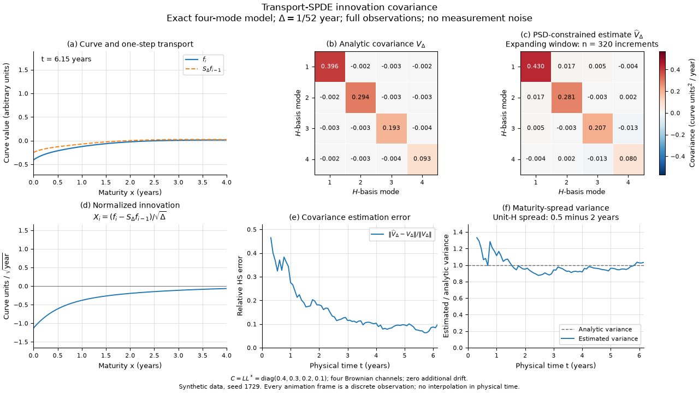
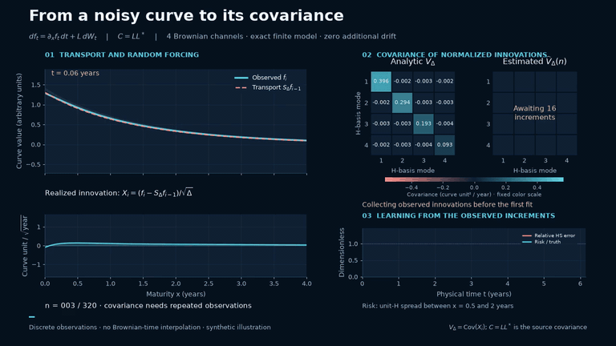

# Transport-SPDE covariance laboratory

[](https://github.com/xrough/spde-covariance/actions/workflows/verify.yml)
[](LICENSE)

A Python research toolkit for transport-SPDE covariance. Its **four-dimensional toy laboratory**
develops identification, estimation and forecast evaluation;
a fixed infinite-rank benchmark separates forcing truncation, curve projection,
time resolution and partial-observation error. Established estimators are used;
no new estimator or infinite-dimensional statistical guarantee is claimed.

Start with the **[current findings notebook](notebooks/current_findings.ipynb)**:
a worked identification example, saved figures, numerical results and the remaining research questions.

The longer-term application is futures-curve risk and prediction. Three questions guide the studies:

| Question | Toy foundation | Fixed-model continuation |
| --- | --- | --- |
| **1. Identification** | Which covariance entries and exposure risks do partial observations reveal? | Observation geometry as spatial resolution increases |
| **2. Current-risk estimation** | How do sampling error, changing covariance and maturity-pair coverage interact? | Kernel/risk estimation with representation diagnostics |
| **3. Forecast evaluation** | How do estimates score on strictly subsequent observations? | Completed-kernel forecasts under declared source paths |

The [roadmap](docs/research-roadmap.md) distinguishes numerical evidence from future research.

## See the toy model



One seeded four-mode transport trajectory, its normalized innovations and estimated covariance
against analytical truth, using clean coefficients, four Brownian sources and zero additional drift.

<details>
<summary>Show the animated Matplotlib figure</summary>



[Full-resolution MP4](assets/transport-spde.mp4) ·
[Rendering instructions](docs/visualizations.md)

</details>

## Quick start

Use Python 3.13 and [uv](https://docs.astral.sh/uv/). No market data or GPU is needed.

```sh
git clone https://github.com/xrough/spde-covariance.git
cd spde-covariance
uv sync --locked --extra reference
uv run python examples/transport_pipeline.py
uv run pytest
```

A small executable example:

```python
import numpy as np
import spde_covariance as spde

model = spde.ExponentialTransport()
times = np.arange(513) / 52
source_C = np.diag([0.4, 0.3, 0.2, 0.1])
simulation = spde.simulate_transport(model, times, source_C, seed=1729)
innovations = spde.extract_innovations(simulation.trajectory, model)
fit = spde.fit_innovation_covariance(
    innovations,
    covariance_assumption="common",
    regularization=1e-3,
    trace_cap=2.0,
    numerical_error_budget=1e-5,
)
print(fit.covariance)  # normalized innovation covariance V_delta
```

The [full example](examples/transport_pipeline.py) checks analytical truth; the [notebook](notebooks/transport_covariance.ipynb) explores partial observations.

## What is estimated

For clean curve coefficients and a known transport matrix, the innovation is

```math
\xi_i=\frac{a_i-M_{\Delta_i}a_{i-1}-d_i}{\sqrt{\Delta_i}}.
```

The supplied $d_i$ is the integrated, transported drift. With constant source covariance, the finite model gives

```math
C=LL^\top,\qquad
V_\Delta=\mathrm{Cov}(\xi_i)
=\frac{1}{\Delta}\int_0^\Delta M_r C M_r^\top dr.
```

**The fitted target is $V_\Delta$, not $C$ or $L$.** The simulator accepts $C$; a loading $L$ is nonunique.
The default exact exponential model has four Gaussian Brownian channels and no explicit spatial mollifier.
After transport adjustment, its covariance-fitting core is a generic problem
with partial linear observations.

The fitter receives $y_i=O_i\xi_i+\varepsilon_i$, known maps and fresh noise
covariances. It fits corrected outer products with PSD/trace-constrained ridge
and reports observation geometry and numerical convergence diagnostics.
For dense point fragments, [canonical completion](docs/canonical-completion.md)
adds an explicit structural rule for unseen kernel entries alongside ridge.
It does not turn missing pairs into identified data. The [coherent strategy](docs/coherent-completion.md)
fits compatible PSD fragments before completion; the [runnable example](examples/coherent_pipeline.py)
also checks distance to a declared finite constant-source SPDE class. Historical
raw and separately PSD-projected completion remain available.
The [Gaussian completion model](docs/statistical-completion.md) fits observed likelihood with known noise and keeps conditional predictions separate from confidence ranges over alternative completions.
The [methods](docs/methods.md) retain the SPDE setup, metric, approximations, objective and certificates.

## What the numerical evidence says

The [Stage 1 report](experiments/results/stage1/report.md) uses 20 paired synthetic replications; relative Hilbert–Schmidt errors are means ± MCSE:

| Information setting | Constrained ridge error | Numerical Gram rank |
| --- | ---: | ---: |
| Full noiseless coefficients | 0.1201 ± 0.0097 | 10/10 |
| Dense point/delivery observations | 0.3133 ± 0.0411 | 10/10 |
| Rotating sparse subsets | 0.8068 ± 0.1228 | 10/10 |
| Missing coordinate pairs | 0.1666 ± 0.0095 | 6/10 |

Full rank can coexist with weak information; modest error at one truth does not
identify missing directions. The full-data empirical baseline scores 0.1189 ±
0.0098, so ridge does not win every comparison. MCSE measures simulation precision;
optimization certificates bound numerical error to the constrained optimizer.

## Current studies

- [Statistical completion](docs/statistical-completion-findings.md): likelihood fitting, observed-data selection, conditional predictions and identification-inclusive uncertainty; [report](experiments/results/statistical-completion/report.md) and [example](examples/statistical_completion.py).
- Finite [RQ2](docs/research-question-2.md) and [RQ3](docs/research-question-3.md):
  estimation under changing coverage and 20-replication past-only forecast evaluation.
- [Fixed infinite-rank transport](docs/infinite-transport.md) and [evidence](experiments/results/infinite-transport/report.md):
  forcing, curve projection and time-discretization errors remain distinct.
- [Partial observations](docs/partial-observations.md): shared data across dimensions; more coordinates do not remove weak information.
- [Canonical completion](docs/canonical-completion.md), [paper controls](experiments/results/canonical-reference/report.md)
  and [SPDE fragments](experiments/results/canonical-spde/report.md): structural completion and risk ambiguity.
- [Coherent fitting](docs/coherent-completion.md), [ablations](experiments/results/completion-ablation/report.md)
  and [joint refinement](experiments/results/completion-refinement/report.md): PSD coherence,
  shrinkage, floors, forcing support and overlap amplification are tested separately.
- [Completion forecasts](experiments/results/completion-forecast/report.md): three frozen forecast rules
  on future weekly innovations; [findings and limits](docs/completion-continuation-findings.md).
- [Identification-aware hedging](docs/hedging-findings.md): projected and true-point controls, added observations and [20-replication evidence](experiments/results/identified-hedging/report.md).
- [Futures-price interface](docs/futures-data.md): contract-level CSV, availability checks, no-roll changes and P&L units; [offline example](examples/futures_pipeline.py).

The [research protocol](docs/completion-research.md) and [source-class note](docs/source-classes.md)
distinguish output dimension from forcing support. No finite-class diagnostic
excludes every infinite-dimensional SPDE; numerical grid stability is not a continuum guarantee.

Current experiments assume known observation maps/noise and correct drift. Gaussian sampling bands have a narrow declared scope;
sparse/noisy level reconstruction, stochastic volatility and empirical futures forecasting are not validated outcomes.
The spline backend is a projected approximation, with separate boundary and
quadrature diagnostics; dense computation targets moderate dimensions.

## Find details and reproduce

[API](docs/api.md) · [Workflow](docs/workflow.md) · [Methods](docs/methods.md) · [Verification](docs/verification.md) ·
[CV evidence](docs/portfolio.md) · [Contributing](CONTRIBUTING.md)

Reproduce the smoke studies:

```sh
uv run spde-covariance benchmark-partial experiments/configs/completion-research-smoke.toml --output experiments/runs/research-smoke
uv run spde-covariance benchmark-rq3 experiments/configs/completion-forecast-smoke.toml --output experiments/runs/forecast-smoke
```

Protocols and the [roadmap](docs/research-roadmap.md) link evidence and next questions; runs retain source/configuration manifests and measurements.
Code, tests and analytical controls are licensed under [MIT](LICENSE).
