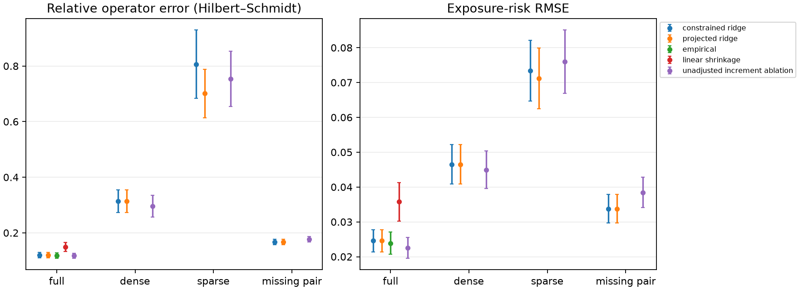
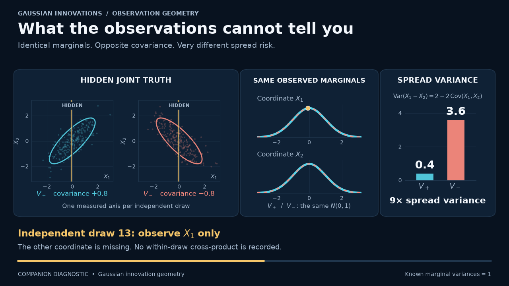

# Transport-SPDE covariance estimation

[](https://github.com/xrough/spde-covariance/actions/workflows/verify.yml)
[](LICENSE)

A Python research toolkit for estimating the covariance of transport-adjusted
curve innovations from complete or partial linear observations. It implements
PSD-constrained estimation, observation diagnostics, analytical controls and
reproducible synthetic benchmarks.

The central question is: **which covariance information can be recovered from
the observed curve shocks, and how much error comes from sampling, observation
geometry and numerical approximation?**

The current output is the finite-interval innovation covariance **V_delta**.
The instantaneous diffusion covariance **C** is supplied to simulation, and the
Brownian loading **L** is a compatible factor of C. Neither C nor L is fitted by
the current estimation workflow. Futures-curve calibration and prediction are
subsequent applications.

## Quick start

Python 3.13 and [uv](https://docs.astral.sh/uv/) are required for the locked
research environment. No market data or GPU is needed.

```sh
git clone https://github.com/xrough/spde-covariance.git
cd spde-covariance
uv sync --locked --extra reference
uv run python examples/transport_pipeline.py
uv run pytest
```

```python
import numpy as np
from spde_covariance import (
    ExponentialTransport,
    extract_innovations,
    fit_innovation_covariance,
    simulate_transport,
)

model = ExponentialTransport()
source_covariance_C = np.diag([0.4, 0.3, 0.2, 0.1])
simulation = simulate_transport(
    model, np.arange(1025) / 52, source_covariance_C, seed=1729
)
innovations = extract_innovations(simulation.trajectory, model)
fit = fit_innovation_covariance(
    innovations,
    covariance_assumption="common",
    regularization=1e-3,
    trace_cap=2.0,
    numerical_error_budget=1e-5,
)
print(fit.covariance)  # estimate of V_delta in the declared orthonormal basis
print(fit.estimate.covariance_error_bound)  # numerical error to the optimizer
```

The [example](examples/transport_pipeline.py) checks the result against an
independently calculated analytical covariance. For this seed and 1,024 weekly
innovations, relative Hilbert–Schmidt error is **0.0582**; the numerical
covariance-error certificate is **2.31e-8**. These are different error measures.
The [notebook](notebooks/transport_covariance.ipynb) adds kernel comparisons and
partial-observation diagnostics.

## Model, data and estimation target

### Curve dynamics and Brownian forcing

Time t and remaining maturity x are measured in years. The reference model is

```math
df_t(x)=\bigl(\partial_x f_t(x)+\beta_t(x)\bigr)dt
+\sum_{k=1}^{m}\ell_k(x)dB_t^k,
\qquad (S_r f)(x)=f(x+r).
```

The Brownian motions are independent. The default analytical control uses four
sources and a four-dimensional, shift-invariant span of exponentials with rates
0.6, 1, 2 and 4 per year. Its forcing is spatially correlated through the
loading functions. No specific spatial mollifier is imposed.

Write the curve and loading functions in a declared orthonormal basis:

```math
f_t(x)=\sum_{j=1}^{J}a_{t,j}\phi_j(x),
\qquad \ell_k(x)=\sum_{j=1}^{J}\phi_j(x)L_{jk}.
```

The coefficient model is

```math
da_t=(Aa_t+b_t)dt+LdB_t,
\qquad M_r=e^{Ar},
\qquad C=LL^{\top}.
```

Here C is a J-by-J instantaneous source covariance in this basis. The simulator
accepts C. A loading L is nonunique: multiplying it on the right by an orthogonal
matrix preserves C. The reference example uses a full-rank C; estimation does
not impose a fixed factor rank.

### Transport adjustment

For clean coefficient trajectories observed at dates t_i, extraction computes

```math
\Delta_i=t_i-t_{i-1},
\qquad
\xi_i=\frac{a_{t_i}-M_{\Delta_i}a_{t_{i-1}}-d_i}{\sqrt{\Delta_i}}.
```

The supplied d_i is the integrated mild drift contribution. Omitting it makes an
explicit zero-drift assumption. With constant deterministic C on an interval,
exact transport gives

```math
\xi_i=\frac{1}{\sqrt{\Delta_i}}
\int_{t_{i-1}}^{t_i}M_{t_i-s}L\,dB_s,
\qquad
V_i=\mathrm{Cov}(\xi_i)
=\frac{1}{\Delta_i}\int_0^{\Delta_i}M_rCM_r^{\top}\,dr.
```

Normalized innovations have units of curve units per square root year; their
covariances have units of curve units squared per year.

Thus an innovation is a transported, accumulated random shock. Its covariance
V_i generally differs from C at a finite sampling interval. The high-level fit
requires equal intervals and an explicit common or local covariance assumption.
A local fit approximates a common covariance within its selected window.
Irregular extraction retains interval-specific targets; the common-target
workflow rejects pooling unequal intervals. Recovering C from V is a separate
inverse problem.

| Quantity | Interpretation | Role in the current workflow |
| --- | --- | --- |
| `L` | Brownian loading | Nonunique model factor; not estimated |
| `C = L L.T` | Instantaneous diffusion covariance | Simulation input and bridge reference |
| `xi_i` | Normalized transport-adjusted innovation | Extracted from a clean trajectory |
| `V_delta` | Covariance of the innovations at interval delta | Primary estimation target |
| `O_i V_delta O_i.T` | Covariance visible through observation map O_i | Observed target, after noise correction |
| `v.T V_delta v` | Variance of a chosen linear exposure | Scalar risk target |

### Partial observations and noise

Fitting receives observed innovations and their known linear maps:

```math
y_i=O_i\xi_i+\varepsilon_i,
\qquad
\mathrm{Cov}(\varepsilon_i)=N_i,
\qquad
Z_i=y_i y_i^{\top}-N_i.
```

The noise is fresh, centered and independent of the innovations, with known
covariance. Under a common target, the expectation of Z_i is
O_i V_delta O_i.T. Z_i is retained even when it has negative eigenvalues.
Latent covariance truth is stored separately and never supplied to fitting.

Observation maps can change with date. Their rows represent point evaluations,
uniform delivery averages or explicitly supplied linear functionals. Initial
trajectory inputs are clean coefficients; reconstructing innovations from
sparse, noisy price levels is outside this workflow.

## Estimation and diagnostics

The covariance estimate minimizes a Frobenius loss with positive ridge penalty:

```math
F(B)=\frac{1}{2}\sum_i w_i
\left\|Z_i-O_iBO_i^{\top}\right\|_{\mathrm{F}}^2
+\frac{\lambda}{2}\left\|B\right\|_{\mathrm{F}}^2,
\qquad B\succeq0,\quad \mathrm{tr}(B)\le R.
```

Weights are normalized; the defaults use a uniform trailing window. The ridge
strength and trace cap are explicit. Accelerated projected gradient solves the
constrained problem. CVXPY/SCS provides an optional independent reference for
small cases. A fit that fails its requested numerical budget raises an explicit
convergence error with diagnostics.

A unique regularized solution does not imply that all covariance entries are
identified by the observations. The toolkit reports the spectrum and numerical
rank of the lifted observation Gram matrix, weak directions, and target
nullspace residuals. Direct scalar risk estimation is available when its target
passes the range check. Rank thresholds and their sensitivity are reported.

Outputs retain basis and target information, PSD/trace feasibility, convergence,
an objective-gap bound and its implied distance to the constrained optimizer.
These floating-point numerical certificates do **not** bound statistical error
against the unknown covariance.

See the [methods](docs/methods.md) for the observation operator and certificate
details, and the [API guide](docs/api.md) for inputs and returned diagnostics.

## Numerical representations

Both backends use the weighted Sobolev metric

```math
\langle f,g\rangle_H
=f(0)g(0)+\int_0^{\infty}e^{x/\tau}f'(x)g'(x)\,dx,
\qquad \tau=1\ \mathrm{year}.
```

The exponential model has exact transport and analytical innovation covariance
within its finite span. Its shift matrix is generally not diagonal after
orthonormalization. It supplies an independent simulation and integration
control.

The spline model uses cubic splines on a padded domain with a constant tail,
orthonormalized in the same metric. Its projected shift is an approximation;
repeated projected shifts need not form an exact semigroup. The stress suite
reports projection, omitted-tail, padding, conditioning and time-step errors
separately. Dense computation is intended for moderate dimensions: spline
validation uses J=4/8/16, with J=24 as a performance case.

## Numerical evidence

The [technical report](experiments/results/stage1/report.md) contains 20 paired
replications with 256 training, 128 validation and 128 evaluation intervals per
trajectory, sampled weekly. Tuning uses observed validation data; latent truth
is reserved for evaluation. Ridge candidates are scaled by the observation Gram
norm. Comparisons use shared truths, paired seeds, common evaluation grids and
exposures, with nested dense/sparse observation subsets.

| Observation setting | Constrained ridge relative HS error, mean ± MCSE | Gram rank |
| --- | ---: | ---: |
| Full coefficients, identity map | 0.1201 ± 0.0097 | 10/10 |
| Dense point/delivery observations | 0.3133 ± 0.0411 | 10/10 |
| Rotating sparse subsets | 0.8068 ± 0.1228 | 10/10 |
| Missing coordinate pairs | 0.1666 ± 0.0095 | 6/10 |

HS means Hilbert–Schmidt/Frobenius error in orthonormal H coordinates, divided by
the norm of truth. MCSE is Monte Carlo standard error, not a confidence interval.
The full case is an identifiable recovery control. The sparse case has full
numerical rank but large error, illustrating weak information. In the missing-pair
case, some cross-covariances and the declared spread risk remain unidentified;
modest error for this particular truth does not establish general recovery.



The complete-data empirical baseline has relative HS error 0.1189 ± 0.0098, so
ridge does not outperform every baseline. Partial-data comparisons include
unconstrained ridge followed by PSD/trace projection and identifiable direct
risk estimates. Ordinary, unadjusted increments use the same trajectory
information as a transport ablation; they are not another valid V estimator
under the stated model. The weekly ablation has similar error here.

All 80 selected/refitted covariance fits and 80 transport-ablation fits meet the
1e-4 numerical budget. Four independent CVXPY/SCS checks have maximum matrix
discrepancy 2.46e-9. The report separately records observed-covariance, off-grid
kernel and exposure-risk errors, resolved/weak-direction errors, runtime and
peak traced allocations.

The analytical bridge also separates finite-interval effects from numerical
integration:

| Interval in years | Absolute HS difference between V and C | Analytical/quadrature discrepancy |
| ---: | ---: | ---: |
| 1/12 | 0.056785 | 1.14e-15 |
| 1/52 | 0.016060 | 1.11e-15 |
| 1/252 | 0.003498 | 6.93e-16 |

These are measurements for the declared constant-C analytical model. The
[manifest](experiments/results/stage1/manifest.json) records the actual source
revision, environment and solver settings. Performance measurements are local
single-run diagnostics, not hardware-independent speed claims.

## Scientific figures and animations

The figures below are ordinary Matplotlib outputs from seeded numerical models.
The transport figure is a single-path illustration, separate from the Monte
Carlo benchmark above. It shows a curve and its transport prediction, extracted
innovations, analytical/estimated covariance matrices, and running error/risk
measurements. It uses four Brownian sources, zero additional drift, weekly
steps and full clean coefficient observations.


[Transport animation, MP4](assets/transport-spde.mp4) ·
[GIF version](assets/transport-spde-preview.gif)

The companion Gaussian example shows why separate marginal measurements cannot
identify a contemporaneous cross-covariance. Correlations +0.8 and -0.8 give the
same unit-normal marginals but spread variances 0.4 and 3.6. Joint clouds are
labelled latent; the animation explicitly marks the later change to paired
observations. This is an observation-geometry illustration, not an SPDE path.



[Observation animation, MP4](assets/observability.mp4) ·
[GIF version](assets/observability-preview.gif)

[Rendering instructions and metadata](docs/visualizations.md) document seeds,
model settings and ffmpeg requirements. No external footage or image generation
is used.

## Reproduce and inspect

```sh
# Small paired benchmark, including independent convex references and stress checks
uv run spde-covariance benchmark experiments/configs/stage1-smoke.toml --output experiments/runs/stage1-smoke
# Full study; use a new directory for each run
uv run spde-covariance benchmark experiments/configs/stage1.toml --output experiments/runs/stage1
uv run python scripts/check_notebook.py
uv run ruff check .
uv run ruff format --check .
# Optional interactive notebook
uv sync --locked --extra reference --extra notebooks
uv run --no-sync jupyter lab notebooks/transport_covariance.ipynb
```

The `reference` extra installs CVXPY/SCS. Core estimation uses NumPy/SciPy;
Matplotlib produces the figures. CI verifies Linux and macOS, the end-to-end
example, notebook execution, seeded experiments and installation outside the
checkout. Full Monte Carlo studies and video encoding run separately.

## Assumptions, limits and next steps

The implemented experiments assume deterministic observation designs, centered
Gaussian innovations, correct zero/supplied integrated drift and known fresh
innovation-noise covariance. The common/local covariance assumption is declared
by the user; the software does not establish local stationarity.

PSD constraints enforce covariance feasibility. Numerical reliability under the
stated assumptions does not establish outlier robustness, model-misspecification
robustness or identification from insufficient observations. Spline and boundary
approximations have separate error diagnostics. Confidence intervals are not
implemented.

Subsequent work includes recovering innovations from noisy sparse price levels,
studying recovery of C from V under explicit assumptions, and testing
futures-curve calibration and prediction with empirical data. Jumps and adaptive
observation designs require further observation modeling.

## Repository guide

| Location | Contents |
| --- | --- |
| `src/spde_covariance/` | Spaces, transport, extraction, observations, estimation and diagnostics |
| `experiments/` | Configurations and selected reproducible benchmark evidence |
| `examples/` | End-to-end workflow and Matplotlib renderers |
| `tests/` | Analytical, numerical, interface and reproducibility checks |
| `docs/` | [Methods](docs/methods.md), [API](docs/api.md), [workflow](docs/workflow.md), [verification](docs/verification.md) and [CV evidence](docs/portfolio.md) |

See [contributing](CONTRIBUTING.md). Licensed under [MIT](LICENSE).
