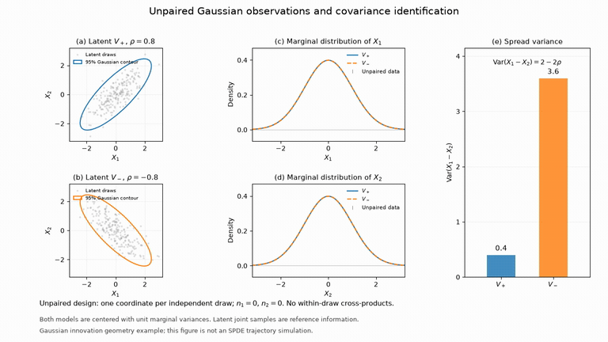

# Transport-SPDE covariance

[](https://github.com/xrough/spde-covariance/actions/workflows/verify.yml)
[](LICENSE)

A Python toolkit for estimating covariance from transport-SPDE innovations.
It combines positive-semidefinite optimization, observation diagnostics and
reproducible synthetic benchmarks for quantitative research and risk modeling.

```text
Curve trajectory → transport adjustment → observed innovations → covariance estimate → risk diagnostics
```

## What is estimated?

**The estimator returns the innovation covariance \(V_\Delta\).** The diffusion
loading \(L\) and instantaneous diffusion covariance \(C=LL^\top\) are simulation
inputs and reference quantities in the current workflow.

In the exact reference model, orthonormal curve coordinates satisfy

$$
da_t=Aa_t\,dt+b_t\,dt+L\,dB_t,
\qquad M_r=e^{Ar},\qquad C=LL^\top.
$$

Transport adjustment extracts one random innovation per interval:

$$
\xi_i=\frac{a_{t_i}-M_\Delta a_{t_{i-1}}-d_i}{\sqrt\Delta},
\qquad
V_\Delta=\operatorname{Cov}(\xi_i)
=\frac1\Delta\int_0^\Delta M_r C M_r^\top\,dr.
$$

Here \(d_i\) is the supplied integrated mild drift, or zero under an explicit
zero-drift assumption. The integral formula assumes constant deterministic
diffusion covariance on the interval. It is exact for the exponential model;
the spline backend uses its declared projected recursion.

| Symbol | Meaning | Current workflow |
| --- | --- | --- |
| \(a_t\) | Coefficients representing the curve at time \(t\) | Clean trajectory input or simulated state |
| \(L\) | Loading that turns Brownian forcing into curve shocks | Generates the model; not fitted |
| \(C=LL^\top\) | Instantaneous diffusion covariance | Supplied to simulation; used in bridge diagnostics |
| \(\xi_i\) | Normalized, transport-adjusted random innovation | Extracted from a clean trajectory |
| \(V_\Delta\) | Covariance of \(\xi_i\) at sampling interval \(\Delta\) | **Estimated output** |

The main analytical benchmark uses four independent Brownian sources and a
full-rank four-dimensional source covariance. The resulting curve forcing is
spatially correlated. A specific spatial mollifier is not implemented. The
framework allows other PSD source covariances and spline dimensions.

For partial observations, fitting receives
\(y_i=O_i\xi_i+\varepsilon_i\), the known maps \(O_i\), and the known fresh
innovation-noise covariances. It does not receive latent covariance truth.
Recovering \(C\) from \(V_\Delta\) is an additional inverse problem; recovering
\(L\) also requires a factorization convention, since \(LQ\) gives the same
covariance for orthogonal \(Q\).

## Run the workflow

Python 3.13 and [uv](https://docs.astral.sh/uv/) are required for the locked
development environment. No market data or GPU is needed.

```sh
git clone https://github.com/xrough/spde-covariance.git
cd spde-covariance
uv sync --locked --extra reference
uv run python examples/transport_pipeline.py
uv run pytest
```

```python
import numpy as np
from spde_covariance import (
    ExponentialTransport,
    simulate_transport,
    extract_innovations,
    fit_innovation_covariance,
)

model = ExponentialTransport()  # exact shift-invariant, four-dimensional control
source_covariance_C = np.diag([0.4, 0.3, 0.2, 0.1])
simulation = simulate_transport(
    model,
    np.arange(1025) / 52,
    source_covariance_C,
    seed=1729,
)
innovations = extract_innovations(simulation.trajectory, model)
fit = fit_innovation_covariance(
    innovations,
    covariance_assumption="common",
    regularization=1e-3,
    trace_cap=2,
    numerical_error_budget=1e-5,
)
print(fit.covariance)  # estimated V_delta; this is not a loading matrix L
print(fit.estimate.covariance_error_bound)
```

The [runnable example](examples/transport_pipeline.py) compares the estimate to
an independently calculated analytic covariance. The
[illustrative notebook](notebooks/transport_covariance.ipynb) adds kernel plots
and partial-observation diagnostics. To open it interactively:

```sh
uv sync --locked --extra reference --extra notebooks
uv run --no-sync jupyter lab notebooks/transport_covariance.ipynb
```

## Watch the workflow

The animations use seeded synthetic data and actual discrete simulation steps.
They illustrate the model and its observation limits; they do not show market
calibration or predictive performance.

[](assets/transport-spde.mp4)

[Watch the transport-SPDE video](assets/transport-spde.mp4): follow the curve,
its transport prediction and the running estimate of \(V_\Delta\) in the exact
four-dimensional model.

[](assets/observability.mp4)

[Watch the observation-diagnostics companion](assets/observability.mp4): two
Gaussian innovation models have identical separately observed marginals but
different spread risks. The latent joint distributions are explicitly marked.
See [rendering instructions](docs/visualizations.md) to reproduce both videos.

## Representative results

The checked-in [technical report](experiments/results/stage1/report.md) uses
20 paired replications, observed-data validation for tuning, and a held-out
evaluation block. Each trajectory has 512 weekly intervals. Errors below
concern the four-dimensional analytic model, with 128/256-date candidate windows.

| Observation setting | Relative operator error, mean ± MCSE | Covariance Gram rank |
| --- | ---: | ---: |
| Full coefficients, O=I | 12.0% ± 1.0% | 10/10 |
| Dense point/delivery observations | 31.3% ± 4.1% | 10/10 |
| Rotating sparse subsets | 80.7% ± 12.3% | 10/10 |
| Missing coordinate pairs | 16.7% ± 1.0% | 6/10 |

Operator error is Hilbert–Schmidt error relative to truth in orthonormal H
coordinates. MCSE is Monte Carlo standard error. Comparisons between estimators
use the same observations within each setting; the full case is a recovery control.
Full numerical rank can coexist with weakly observed directions and large error.
Rank deficiency leaves selected cross-covariances unidentified even when error
on this particular synthetic truth is modest.


All 160 selected/refitted constrained fits met a `1e-4` numerical covariance-error
budget. The largest matrix discrepancy against four independent CVXPY/SCS
reference fits was `2.5e-9`. Baselines sometimes achieve smaller statistical
error; the report includes paired differences and separate observed-covariance,
off-grid kernel and exposure-risk metrics. The weekly transport ablation has
similar error in this experiment; deterministic cancellation and time-step
diagnostics independently validate the transport adjustment.

The [manifest](experiments/results/stage1/manifest.json) records source hashes,
environment, seeds and solver settings. Timing measurements are specific to
that environment. The implementation uses dense matrices for moderate dimensions;
validation covers spline sizes 4/8/16 and a size-24 performance case.

## What is supported

- Clean coefficient trajectories with explicit basis identity, timestamps,
  curve units and integrated mild drift; normalized transport adjustment.
- Exact exponential transport and explicitly approximate projected spline
  recursion in a weighted Sobolev curve space.
- Point evaluations, delivery averages, changing observation grids and known
  fresh innovation observation noise.
- Full PSD, trace-capped ridge estimation, observed-data tuning, complete-data
  empirical/shrinkage baselines, and identifiable direct risk estimates.
- Gram spectra, target nullspace residuals, threshold sensitivity, feasibility,
  convergence failures and objective-gap/covariance-error certificates.

The main estimand is finite-interval normalized innovation covariance **V**.
Instantaneous diffusion covariance **C**, observed covariance **O V Oᵀ** and
exposure risk **vᵀ V v** are distinct targets. The
[methods note](docs/methods.md) gives the equations, assumptions and certificates;
the [API guide](docs/api.md) describes the interfaces.

## Reproduce and verify

```sh
# Small paired benchmark, including convex references and stress checks
uv run spde-covariance benchmark experiments/configs/stage1-smoke.toml --output experiments/runs/stage1-smoke
# Full paired study; save a new run alongside the checked-in evidence
uv run spde-covariance benchmark experiments/configs/stage1.toml --output experiments/runs/stage1
uv run python scripts/check_notebook.py
uv run ruff check .
uv run ruff format --check .
```

The `reference` extra installs CVXPY/SCS for small independent convex checks.
Core estimation uses NumPy/SciPy. CI checks Linux and macOS, reference agreement,
the end-to-end example, notebook code, seeded benchmarks and clean installation.
Output directories must be new to preserve previous runs.

## Assumptions and limits

Stage 1 assumes deterministic observation designs, centered Gaussian innovations,
correct zero/supplied drift and known fresh innovation-noise covariance. The
high-level estimator requires equal time intervals and an explicit common or
local covariance assumption. Irregular extraction retains interval-specific
targets and reports bridge diagnostics. Recovering innovations from sparse,
noisy price levels requires further observation modeling.

“Robust” refers to numerical and software reliability under these assumptions.
Spline transport, padding and projection errors are measured separately. A
solver certificate concerns optimization error; statistical recovery also
depends on sampling and observation geometry.

Futures-curve calibration, prediction, real market data, jumps, adaptive designs,
outlier resistance and confidence intervals are subsequent stages.

## Project layout

Code is in `src/spde_covariance/`; configurations and selected evidence are in
`experiments/`; numerical checks are in `tests/`. See
[contributing](CONTRIBUTING.md), the [workflow guide](docs/workflow.md), and the
[CV presentation](docs/portfolio.md).
The [verification record](docs/verification.md) documents the software checks.

Licensed under [MIT](LICENSE).
