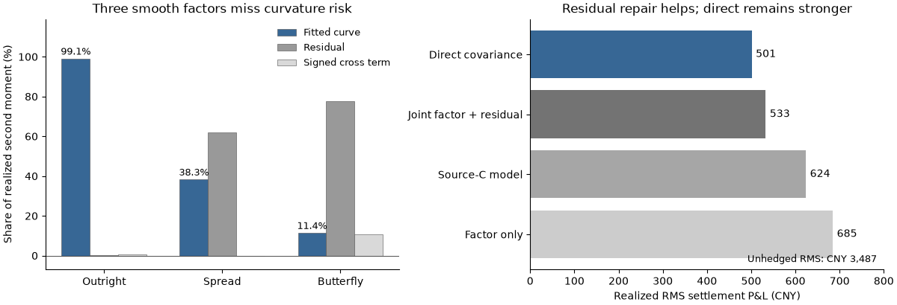

# Futures-curve covariance and risk laboratory

[](https://github.com/xrough/spde-covariance/actions/workflows/verify.yml)
[](LICENSE)

A Python financial research pipeline for asking **when a transport-SPDE curve
representation helps estimate futures risk, and when it removes risk that
matters for spreads and hedges**. It combines numerical controls with an
empirical SHFE copper settlement study. Established methods are implemented;
no new estimator, physical market-forcing identification or trading alpha is claimed.

**Workflow:** actual-contract data → curve reconstruction → transport-adjusted
innovations → covariance/risk forecasts → diagnostics → constrained hedges.

## Research roadmap

| Question | Numerical foundation | Empirical investigation |
| --- | --- | --- |
| **RQ1 · Identification** | Observation geometry, missing pairs and completion ambiguity | Data coverage, curve representation and residual risk |
| **RQ2 · Estimation** | PSD/ridge fitting, source integration and spatial error | Matched mechanism comparisons, joint residual risk and diffusion clocks |
| **RQ3 · Evaluation** | Past-only synthetic forecasts and risk decisions | Paired forecast scores, calibration and bounded hedging |

**Latest study:** [pipeline mechanisms on 2016–2025 copper](notebooks/08_copper_mechanism_attribution.ipynb).
The [project overview](notebooks/00_project_findings.ipynb)
connects the earlier numerical controls and empirical results in one executed notebook.
The [short findings report](docs/project-findings.md) gives the same research
story with evidence links. The eight focused notebooks below retain detailed
audits and sensitivities; they execute from public aggregates, without exchange files.

| Notebook | Investigation |
| --- | --- |
| [01 · Data and risk targets](notebooks/01_data_and_risk_targets.ipynb) | Contract identity, units, maturity convention, quality and effective history |
| [02 · Representation and identification](notebooks/02_representation_and_identification.ipynb) | Dimension, smoothing, conditioning and fitted/residual/cross risk |
| [03 · Performance attribution](notebooks/03_performance_attribution.ipynb) | Matched windows, transport ablation, maturity masking and short samples |
| [04 · Forecast scores and model risk](notebooks/04_forecast_scores_and_model_risk.ipynb) | QLIKE/quadratic loss, block uncertainty, calibration and influence |
| [05 · Joint residual risk and clocks](notebooks/05_joint_residual_risk_and_clocks.ipynb) | PSD factor/residual second moments, cross-covariances and diffusion time |
| [06 · Hedging decisions](notebooks/06_hedging_decisions.ipynb) | Past-only minimum-risk hedges, realized risk and position instability |
| [07 · Short-history risk transfer](notebooks/07_short_history_risk_transfer.ipynb) | Masked contract histories; learned maturity factors versus transport with shared residual risk |
| [08 · Pipeline mechanism diagnostics](notebooks/08_copper_mechanism_attribution.ipynb) | 2016–2025 copper: matched reconstruction, source-estimation and residual-correction comparisons; 2026 held out |

The [research protocol](docs/empirical-research-protocol.md) states assumptions,
chronology and evaluation rules. The [suite findings](docs/empirical-research-findings.md)
and [generated report](experiments/results/shfe-research/report.md) connect conclusions to evidence.
The [short-history protocol](docs/short_history.md) tests risk transfer to currently
quoted contracts with restricted own histories; it preserves the earlier evidence.
The [mechanism protocol](docs/mechanism-attribution.md) extends the diagnostic
sample to 2016–2025 and separates six source/residual policies under matched
information. The [generated results](experiments/results/copper-mechanisms/report.md)
and executed notebook retain numerical certificates and annual sensitivities.

## Current evidence

The main finding is that **observation coverage and curve representation determine
which risks can be recovered; a converged PSD fit alone is insufficient**.

| Evidence | Finding | Scope |
| --- | --- | --- |
| Synthetic identification | Different full covariances can have identical observed fragment laws; more native samples do not identify missing spread risk. | Completion requires an explicit structural assumption. |
| SHFE copper representation | Three smooth factors account for 99.1% of outright second moment, but 38.3% of spread and 11.4% of butterfly second moment. | Sample decomposition retains residual and signed cross terms. |
| Subsequent hedge outcomes | RMS P&L: direct CNY 501, joint factor/residual 533, source-C 624, factor-only 685. | Same 484 origins; bounded settlement-risk exercise, excluding costs. |
| Masked short-history transfer | At zero own history, learned-factor spread forecasts are 19.26× realized second moment, versus 1.22× transport and 1.08× maturity pooling. | A distinct 97-origin exploratory study; learned factors do not improve the tested policy and simple pooling remains competitive. |
| Ten-year mechanism study | Smooth reconstruction loses most spread risk; source-C/direct-innovation differences are small. Full residual repair raises zero-history spread calibration from 0.11× to 1.08×. | 437 origins; raw pooling retains lower point-estimate hedge RMS. These are policy diagnostics, not identified physical forcing. |



The earlier empirical sample contains 969 sessions and 11,628 official copper settlements
from 2022–2025. The new mechanism study uses 2,430 sessions and 29,160 observations
from 2016–2025, with 2016 as initial history. Joint residual modeling repairs much of the factor-only weakness,
but direct covariance remains a strong baseline. Matched transport ablations
establish no forecasting advantage. In the [frozen first benchmark](notebooks/shfe_empirical.ipynb),
spread rankings reverse between primary QLIKE and secondary quadratic loss.
The [overview notebook](notebooks/00_project_findings.ipynb) reports paired uncertainty;
RMS bars above are point summaries. Numerical controls and market evidence remain distinct.
The [short-history results](experiments/results/short-history/report.md) diagnose
an excessive learned-factor diagonal correction; removing it instead underpredicts
spread risk. This is a model-risk finding, not a universal SPDE advantage.

**Research boundary:** 2024–2025 has informed model development. New analyses on
these years are exploratory even when issuance is past-only. A revised policy
needs an uninspected confirmation period. No execution, transaction-cost,
market-capacity or profitability backtest is implemented.
The 2026 archive remains unparsed and unscored. Raw volume/OI counts are preserved;
normalization uses explicit workbook declarations, with missing conventions
reported as unavailable. This does not change the study's positive-liquidity rule.

## Run the software

Python 3.13, NumPy, SciPy and Matplotlib; `uv.lock` fixes the environment.
This public repository is the development home for code, notebooks, issues and
aggregate results. Keep unpublished drafts and raw data outside committed content.

```sh
git clone https://github.com/xrough/spde-covariance.git
cd spde-covariance
uv sync --locked --extra reference --extra empirical
uv run python examples/empirical_research_pipeline.py  # synthetic, no exchange data
uv run python scripts/check_notebook.py notebooks/00_project_findings.ipynb
uv run pytest
```

The notebooks read checksummed aggregate results without a Jupyter installation.
For interactive use: `uv sync --locked --extra notebooks --extra empirical --extra reference`.
To reproduce the historical analysis, follow the
[local-data commands](docs/empirical-research-protocol.md#reproduction-and-data-boundary).
Raw quotes, reconstructed daily curves and individual P&Ls are Git-ignored.
MIT covers project code, not exchange data.

## Mathematical targets

In a finite transport representation with known propagation matrix,

```math
\xi_i=\frac{a_i-M_{\Delta_i}a_{i-1}-d_i}{\sqrt{\Delta_i}},\qquad
C=LL^\top,\qquad
V_\Delta=\frac1\Delta\int_0^\Delta M_s C M_s^\top ds.
```

The clean-innovation API estimates $V_\Delta$; a loading $L$ is nonunique.
The original empirical fitter estimates an effective finite $C$ through
interval-specific maps. The joint factor/residual model directly estimates
an empirical innovation second moment. These targets remain distinct.
Portfolio evaluation targets the conditional second moment of same-contract
settlement P&L; interpreting it as variance requires a negligible conditional mean.

## Numerical foundations and next phase

The [synthetic completion notebook](notebooks/current_findings.ipynb) covers
partial identification, canonical completion and Gaussian uncertainty. The
[transport example](notebooks/transport_covariance.ipynb) validates the
SPDE-to-innovation connection. A [fixed infinite-rank model](docs/infinite-transport.md)
separates noise truncation, curve projection and time discretization.

<details>
<summary>Matplotlib transport illustration from the four-mode numerical control</summary>


[Full-resolution MP4](assets/transport-spde.mp4) · [Rendering instructions](docs/visualizations.md)

</details>

[Stage 1](experiments/results/stage1/report.md) · [RQ2](docs/research-question-2.md) ·
[RQ3](docs/research-question-3.md) · [Partial observations](docs/partial-observations.md) ·
[Canonical completion](docs/canonical-completion.md) · [Coherent completion](docs/coherent-completion.md) ·
[Statistical completion](docs/statistical-completion-findings.md) · [Hedging controls](docs/hedging-findings.md)

Next gates are an uninspected empirical confirmation period, defensible
point-in-time security metadata and delivery maps, and execution-aware risk
evaluation. Infinite-dimensional identification and statistical guarantees
remain separate research tasks; nonlinear dynamics are not a prerequisite.
See the [longer research roadmap](docs/research-roadmap.md).

[Methods](docs/methods.md) · [API](docs/api.md) · [Verification](docs/verification.md) ·
[Portfolio evidence](docs/portfolio.md) · [Contributing](CONTRIBUTING.md)
