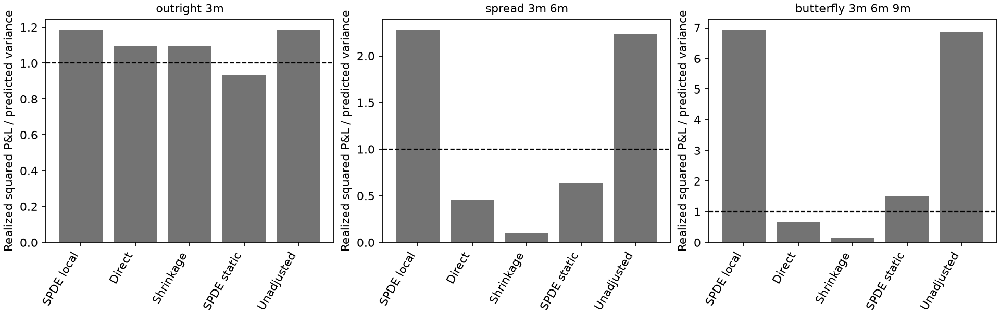

# Futures-curve covariance and risk laboratory

[](https://github.com/xrough/spde-covariance/actions/workflows/verify.yml)
[](LICENSE)

A Python financial research pipeline for asking **when a transport-SPDE curve
representation helps estimate futures risk, and when it removes risk that
matters for spreads and hedges**. It combines numerical controls with an
empirical SHFE copper settlement study. Established methods are implemented;
no new estimator, physical market-forcing identification or trading alpha is claimed.

**Workflow:** actual-contract data → curve reconstruction → transport-adjusted
innovations → covariance/risk forecasts → diagnostics → constrained hedges.

## Research roadmap

| Question | Numerical foundation | Empirical investigation |
| --- | --- | --- |
| **RQ1 · Identification** | Observation geometry, missing pairs and completion ambiguity | Data coverage, curve representation and residual risk |
| **RQ2 · Estimation** | PSD/ridge fitting, source integration and spatial error | Matched mechanism comparisons, joint residual risk and diffusion clocks |
| **RQ3 · Evaluation** | Past-only synthetic forecasts and risk decisions | Paired forecast scores, calibration and bounded hedging |

Start with the [executive empirical notebook](notebooks/shfe_empirical.ipynb).
The focused notebooks below are implemented and execute from public aggregate
evidence; exchange files remain local.

| Notebook | Investigation |
| --- | --- |
| [01 · Data and risk targets](notebooks/01_data_and_risk_targets.ipynb) | Contract identity, units, maturity convention, quality and effective history |
| [02 · Representation and identification](notebooks/02_representation_and_identification.ipynb) | Dimension, smoothing, conditioning and fitted/residual/cross risk |
| [03 · Performance attribution](notebooks/03_performance_attribution.ipynb) | Matched windows, transport ablation, maturity masking and short samples |
| [04 · Forecast scores and model risk](notebooks/04_forecast_scores_and_model_risk.ipynb) | QLIKE/quadratic loss, block uncertainty, calibration and influence |
| [05 · Joint residual risk and clocks](notebooks/05_joint_residual_risk_and_clocks.ipynb) | PSD factor/residual second moments, cross-covariances and diffusion time |
| [06 · Hedging decisions](notebooks/06_hedging_decisions.ipynb) | Past-only minimum-risk hedges, realized risk and position instability |

The [research protocol](docs/empirical-research-protocol.md) states assumptions,
chronology and evaluation rules. The [suite findings](docs/empirical-research-findings.md)
and [generated report](experiments/results/shfe-research/report.md) connect conclusions to evidence.

## Current evidence

The frozen first study uses official copper settlements from 2022–2025:
969 sessions, 11,628 contract observations and 484 evaluation origins.
The three-mode local source model materially underpredicts spread and butterfly
risk under the primary QLIKE criterion. Its spread forecast performs favorably
under secondary quadratic loss; score choice matters. Adjusted and unadjusted
coefficient forecasts are close, so an SPDE transport advantage is not established.



A good fit to large price levels does not ensure accurate spread risk. The
[representation analysis](notebooks/02_representation_and_identification.ipynb)
retains reconstruction-residual changes and their signed cross term.
The new suite tests specific explanations and revised risk models while
preserving the original benchmark, including unfavorable results.
Joint residual modeling improves on factor-only curvature risk, while direct
covariance gives lower realized hedge RMS: CNY 501 versus 533 for joint and 685
for factor-only. These are development-sample settlement risks, excluding costs.

**Research boundary:** 2024–2025 has informed model development. New analyses on
these years are exploratory even when issuance is past-only. A revised policy
needs an uninspected confirmation period. No execution, transaction-cost,
market-capacity or profitability backtest is implemented.

## Run the software

Python 3.13, NumPy, SciPy and Matplotlib; `uv.lock` fixes the environment.
This implementation is under review in [PR #11](https://github.com/xrough/spde-covariance/pull/11);
check out its branch until the changes reach the default branch.

```sh
git clone https://github.com/xrough/spde-covariance.git
cd spde-covariance
git switch codex/shfe-research-suite
uv sync --locked --extra reference --extra empirical
uv run python examples/empirical_research_pipeline.py  # synthetic, no exchange data
uv run python scripts/check_notebook.py notebooks/04_forecast_scores_and_model_risk.ipynb
uv run pytest
```

The notebooks read checksummed aggregate results without a Jupyter installation.
For interactive use: `uv sync --locked --extra notebooks --extra empirical --extra reference`.
To reproduce the historical analysis, follow the
[local-data commands](docs/empirical-research-protocol.md#reproduction-and-data-boundary).
Raw quotes, reconstructed daily curves and individual P&Ls are Git-ignored.
MIT covers project code, not exchange data.

## Mathematical targets

In a finite transport representation with known propagation matrix,

```math
\xi_i=\frac{a_i-M_{\Delta_i}a_{i-1}-d_i}{\sqrt{\Delta_i}},\qquad
C=LL^\top,\qquad
V_\Delta=\frac1\Delta\int_0^\Delta M_s C M_s^\top ds.
```

The clean-innovation API estimates $V_\Delta$; a loading $L$ is nonunique.
The original empirical fitter estimates an effective finite $C$ through
interval-specific maps. The joint factor/residual model directly estimates
an empirical innovation second moment. These targets remain distinct.
Portfolio evaluation targets the conditional second moment of same-contract
settlement P&L; interpreting it as variance requires a negligible conditional mean.

## Numerical foundations and next phase

The [numerical findings notebook](notebooks/current_findings.ipynb) covers the
finite toy model, partial identification and canonical completion. The
[transport example](notebooks/transport_covariance.ipynb) validates the
SPDE-to-innovation connection. A [fixed infinite-rank model](docs/infinite-transport.md)
separates noise truncation, curve projection and time discretization.

<details>
<summary>Matplotlib transport illustration from the four-mode numerical control</summary>


[Full-resolution MP4](assets/transport-spde.mp4) · [Rendering instructions](docs/visualizations.md)

</details>

[Stage 1](experiments/results/stage1/report.md) · [RQ2](docs/research-question-2.md) ·
[RQ3](docs/research-question-3.md) · [Partial observations](docs/partial-observations.md) ·
[Canonical completion](docs/canonical-completion.md) · [Coherent completion](docs/coherent-completion.md) ·
[Statistical completion](docs/statistical-completion-findings.md) · [Hedging controls](docs/hedging-findings.md)

Next gates are an uninspected empirical confirmation period, defensible
point-in-time security metadata and delivery maps, and execution-aware risk
evaluation. Infinite-dimensional identification and statistical guarantees
remain separate research tasks; nonlinear dynamics are not a prerequisite.
See the [longer research roadmap](docs/research-roadmap.md).

[Methods](docs/methods.md) · [API](docs/api.md) · [Verification](docs/verification.md) ·
[Portfolio evidence](docs/portfolio.md) · [Contributing](CONTRIBUTING.md)
