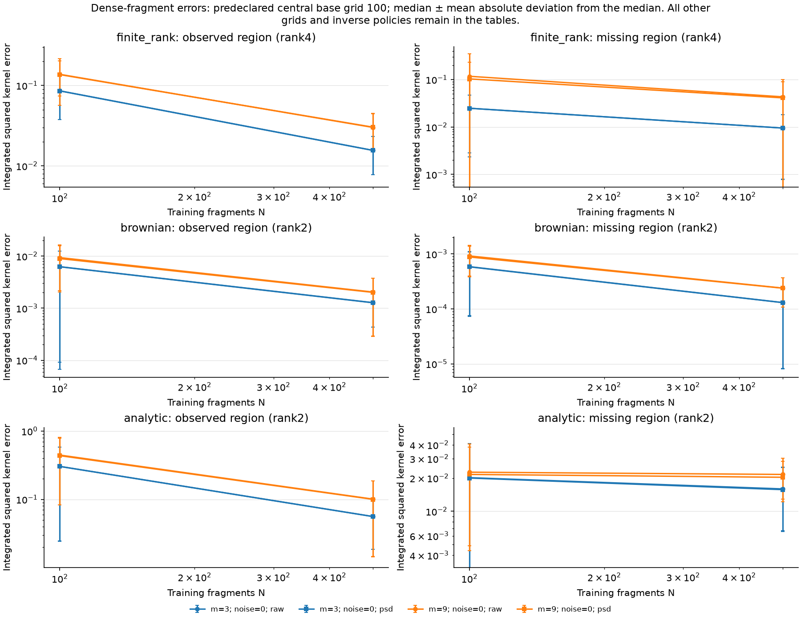
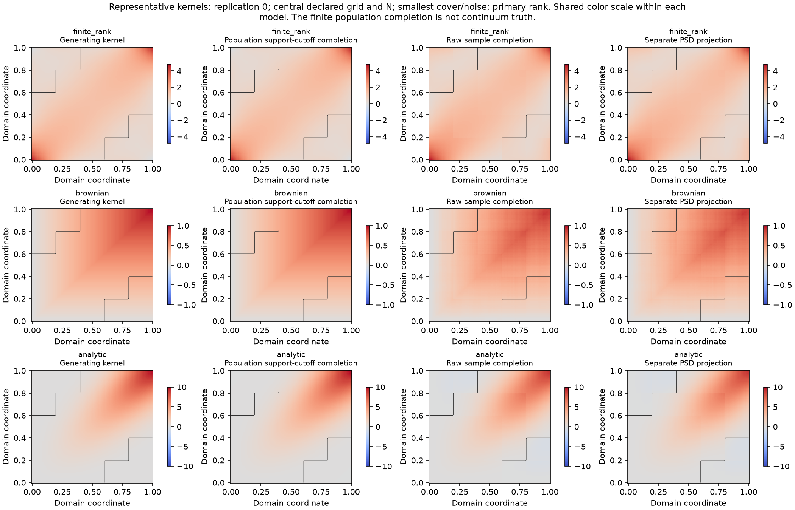
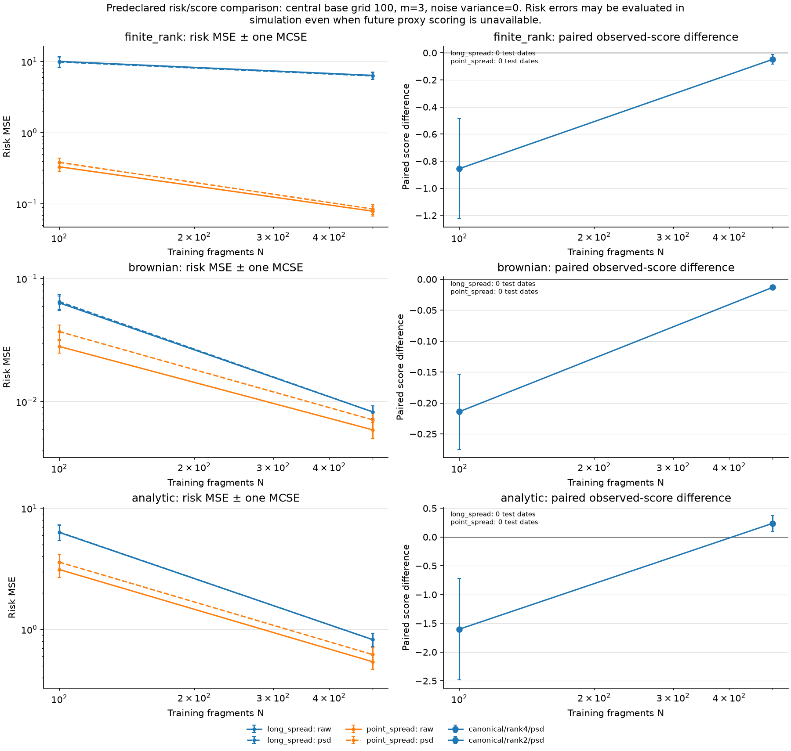

# Dense-fragment covariance kernels

This study extends the existing observation workflow: parent Gaussian measurements are generated before grid/fragment/method views; fitting uses corrected observed products. The [protocol](https://github.com/xrough/spde-covariance/blob/main/docs/canonical-completion.md) distinguishes H-coordinate ridge covariance from covariance kernels and their weighted L2 operators.

Profile: reference; seed: 20261026; independent replications: 100. Training N=(100, 500); base grids=(100,); covers=(3, 9); noise variances=(0.0,).

Assumptions: centered Gaussian curves, common covariance across independent fragments, balanced randomized fragment assignment, dense point measurements, and known fresh independent measurement-noise variance. This is not extraction from sparse/noisy curve levels or a market-prediction experiment. Smaller training counts share prefixes; grids share parent curves. Replication MCSE never counts dates, grids, ranks or covers as independent experiments.

The reference profile uses equal 1/Q grid weights on [0,1]. SPDE kernels use physical trapezoidal weights on [0,3] maturity years and a fixed normalized-innovation interval; their kernel values have curve-unit squared per year. Kernel L2 norms include the declared maturity quadrature. They are not H-coordinate operator norms. Continuous delivery risk and its discretized grid approximation remain separately labeled.

## Numerical acceptance and scope

| Check | Value |
| --- | --- |
| passed | True |
| psd_outputs_feasible | True |
| ridge_certificates_within_budget | True |
| raw_indefiniteness_is_allowed | True |
| primary_manual_policy_present_per_model | True |
| controlled_population_recovery | True |

Available recorded fits: 2430; unavailable fits: 2370; raw indefinite fits: 1215.

Raw truncated completion may be indefinite. The separate PSD projection changes the estimator and may alter observed entries; it is not called an exact canonical completion. Only ridge retains the existing optimization-distance certificate. Integration agreement, support thresholds and source-tail checks are numerical diagnostics, not a completion-error certificate.



## Every configured method and resolution

Entries use median ± mean absolute deviation from the median. The paper states mean absolute deviation without specifying its center; this report uses the median explicitly, and the archive also retains deviation from the mean and median absolute deviation. Regional values are ISE in the reference profile and L2 norms in the SPDE profile; complete ISE is always squared. These descriptive uncertainty summaries are not confidence intervals. Unavailable fits are labeled rather than silently assigned zero error.

| Model | Noise | Grid | m | N | Method/policy/variant | Available/unavailable reps | Observed ISE | Missing ISE | Complete ISE | Error to population completion (L2) |
| --- | --- | --- | --- | --- | --- | --- | --- | --- | --- | --- |
| finite_rank | 0 | 100 | 3 | 100 | canonical/fve95/raw | 0/100 | unavailable | unavailable | unavailable | unavailable |
| finite_rank | 0 | 100 | 3 | 100 | canonical/fve95/psd | 0/100 | unavailable | unavailable | unavailable | unavailable |
| finite_rank | 0 | 100 | 3 | 100 | canonical/rank4/raw | 100/0 | 0.0857249 ± 0.0482515 | 0.0248515 ± 0.0225179 | 0.117679 ± 0.0602537 | 0.343039 ± 0.0823145 |
| finite_rank | 0 | 100 | 3 | 100 | canonical/rank4/psd | 100/0 | 0.0855903 ± 0.047946 | 0.0248087 ± 0.0219563 | 0.11645 ± 0.0593597 | 0.341245 ± 0.0815945 |
| finite_rank | 0 | 100 | 3 | 500 | canonical/fve95/raw | 0/100 | unavailable | unavailable | unavailable | unavailable |
| finite_rank | 0 | 100 | 3 | 500 | canonical/fve95/psd | 0/100 | unavailable | unavailable | unavailable | unavailable |
| finite_rank | 0 | 100 | 3 | 500 | canonical/rank4/raw | 100/0 | 0.0155911 ± 0.00777131 | 0.00948993 ± 0.0087127 | 0.028295 ± 0.0130805 | 0.168204 ± 0.0368046 |
| finite_rank | 0 | 100 | 3 | 500 | canonical/rank4/psd | 100/0 | 0.0155769 ± 0.00775665 | 0.00949498 ± 0.0086994 | 0.0282676 ± 0.0130477 | 0.168123 ± 0.0367555 |
| finite_rank | 0 | 100 | 9 | 100 | canonical/fve95/raw | 0/100 | unavailable | unavailable | unavailable | unavailable |
| finite_rank | 0 | 100 | 9 | 100 | canonical/fve95/psd | 0/100 | unavailable | unavailable | unavailable | unavailable |
| finite_rank | 0 | 100 | 9 | 100 | canonical/rank4/raw | 100/0 | 0.137612 ± 0.0639997 | 0.117272 ± 0.233805 | 0.276227 ± 0.267687 | 0.525571 ± 0.169973 |
| finite_rank | 0 | 100 | 9 | 100 | canonical/rank4/psd | 100/0 | 0.136404 ± 0.0797771 | 0.103323 ± 0.128745 | 0.249168 ± 0.183356 | 0.499166 ± 0.136833 |
| finite_rank | 0 | 100 | 9 | 500 | canonical/fve95/raw | 0/100 | unavailable | unavailable | unavailable | unavailable |
| finite_rank | 0 | 100 | 9 | 500 | canonical/fve95/psd | 0/100 | unavailable | unavailable | unavailable | unavailable |
| finite_rank | 0 | 100 | 9 | 500 | canonical/rank4/raw | 100/0 | 0.0300617 ± 0.0141557 | 0.0432591 ± 0.0566809 | 0.0820772 ± 0.0616091 | 0.286474 ± 0.0855283 |
| finite_rank | 0 | 100 | 9 | 500 | canonical/rank4/psd | 100/0 | 0.0303085 ± 0.0147739 | 0.0411108 ± 0.0485027 | 0.0808962 ± 0.0542919 | 0.284412 ± 0.0799763 |
| brownian | 0 | 100 | 3 | 100 | canonical/fve95/raw | 0/100 | unavailable | unavailable | unavailable | unavailable |
| brownian | 0 | 100 | 3 | 100 | canonical/fve95/psd | 0/100 | unavailable | unavailable | unavailable | unavailable |
| brownian | 0 | 100 | 3 | 100 | canonical/rank2/raw | 100/0 | 0.00626434 ± 0.00619691 | 0.000587424 ± 0.000514014 | 0.007059 ± 0.0064099 | 0.0840178 ± 0.030725 |
| brownian | 0 | 100 | 3 | 100 | canonical/rank2/psd | 100/0 | 0.0062363 ± 0.0061451 | 0.000583101 ± 0.00050711 | 0.00703481 ± 0.00635546 | 0.0838735 ± 0.0306934 |
| brownian | 0 | 100 | 3 | 500 | canonical/fve95/raw | 15/85 | 0.00149939 ± 0.000627745 | 0.000136581 ± 0.000115323 | 0.00160863 ± 0.000636883 | 0.0401077 ± 0.00872511 |
| brownian | 0 | 100 | 3 | 500 | canonical/fve95/psd | 15/85 | 0.00149927 ± 0.000627651 | 0.000136508 ± 0.00011472 | 0.00160485 ± 0.000637377 | 0.0400606 ± 0.00873712 |
| brownian | 0 | 100 | 3 | 500 | canonical/rank2/raw | 100/0 | 0.00127719 ± 0.000842491 | 0.000130492 ± 0.000122319 | 0.00148097 ± 0.000903807 | 0.0384815 ± 0.0110594 |
| brownian | 0 | 100 | 3 | 500 | canonical/rank2/psd | 100/0 | 0.00127025 ± 0.000839653 | 0.000130145 ± 0.000121997 | 0.00148016 ± 0.000900949 | 0.038471 ± 0.0110388 |
| brownian | 0 | 100 | 9 | 100 | canonical/fve95/raw | 0/100 | unavailable | unavailable | unavailable | unavailable |
| brownian | 0 | 100 | 9 | 100 | canonical/fve95/psd | 0/100 | unavailable | unavailable | unavailable | unavailable |
| brownian | 0 | 100 | 9 | 100 | canonical/rank2/raw | 100/0 | 0.00936097 ± 0.00718542 | 0.000921538 ± 0.000526803 | 0.0104298 ± 0.00746471 | 0.102125 ± 0.0314376 |
| brownian | 0 | 100 | 9 | 100 | canonical/rank2/psd | 100/0 | 0.00895596 ± 0.00692313 | 0.000880754 ± 0.000495602 | 0.00980834 ± 0.00716029 | 0.0990352 ± 0.0310553 |
| brownian | 0 | 100 | 9 | 500 | canonical/fve95/raw | 0/100 | unavailable | unavailable | unavailable | unavailable |
| brownian | 0 | 100 | 9 | 500 | canonical/fve95/psd | 0/100 | unavailable | unavailable | unavailable | unavailable |
| brownian | 0 | 100 | 9 | 500 | canonical/rank2/raw | 100/0 | 0.00204226 ± 0.00175096 | 0.000239623 ± 0.000132246 | 0.0023185 ± 0.00183318 | 0.0481489 ± 0.0159522 |
| brownian | 0 | 100 | 9 | 500 | canonical/rank2/psd | 100/0 | 0.00201031 ± 0.00172338 | 0.000238272 ± 0.000131459 | 0.00226423 ± 0.00180549 | 0.0475811 ± 0.0158893 |
| analytic | 0 | 100 | 3 | 100 | canonical/fve95/raw | 0/100 | unavailable | unavailable | unavailable | unavailable |
| analytic | 0 | 100 | 3 | 100 | canonical/fve95/psd | 0/100 | unavailable | unavailable | unavailable | unavailable |
| analytic | 0 | 100 | 3 | 100 | canonical/rank2/raw | 100/0 | 0.303864 ± 0.279561 | 0.0201661 ± 0.020907 | 0.351489 ± 0.284044 | 0.592854 ± 0.207967 |
| analytic | 0 | 100 | 3 | 100 | canonical/rank2/psd | 100/0 | 0.303513 ± 0.278722 | 0.020009 ± 0.0205397 | 0.349915 ± 0.283111 | 0.591525 ± 0.207831 |
| analytic | 0 | 100 | 3 | 500 | canonical/fve95/raw | 0/100 | unavailable | unavailable | unavailable | unavailable |
| analytic | 0 | 100 | 3 | 500 | canonical/fve95/psd | 0/100 | unavailable | unavailable | unavailable | unavailable |
| analytic | 0 | 100 | 3 | 500 | canonical/rank2/raw | 100/0 | 0.0560242 ± 0.0376089 | 0.0159504 ± 0.00926949 | 0.0765953 ± 0.0395218 | 0.27674 ± 0.0648958 |
| analytic | 0 | 100 | 3 | 500 | canonical/rank2/psd | 100/0 | 0.0560342 ± 0.0375892 | 0.0157099 ± 0.0091331 | 0.0764889 ± 0.0394918 | 0.276547 ± 0.0649491 |
| analytic | 0 | 100 | 9 | 100 | canonical/fve95/raw | 0/100 | unavailable | unavailable | unavailable | unavailable |
| analytic | 0 | 100 | 9 | 100 | canonical/fve95/psd | 0/100 | unavailable | unavailable | unavailable | unavailable |
| analytic | 0 | 100 | 9 | 100 | canonical/rank2/raw | 100/0 | 0.445436 ± 0.36222 | 0.0226111 ± 0.0181909 | 0.488087 ± 0.362373 | 0.698562 ± 0.221331 |
| analytic | 0 | 100 | 9 | 100 | canonical/rank2/psd | 100/0 | 0.436242 ± 0.353476 | 0.0215774 ± 0.0167209 | 0.474441 ± 0.352975 | 0.688797 ± 0.21877 |
| analytic | 0 | 100 | 9 | 500 | canonical/fve95/raw | 0/100 | unavailable | unavailable | unavailable | unavailable |
| analytic | 0 | 100 | 9 | 500 | canonical/fve95/psd | 0/100 | unavailable | unavailable | unavailable | unavailable |
| analytic | 0 | 100 | 9 | 500 | canonical/rank2/raw | 100/0 | 0.100886 ± 0.0863146 | 0.0215716 ± 0.00864311 | 0.11888 ± 0.0866286 | 0.344794 ± 0.103156 |
| analytic | 0 | 100 | 9 | 500 | canonical/rank2/psd | 100/0 | 0.100072 ± 0.0857396 | 0.0203297 ± 0.00811957 | 0.115964 ± 0.0860986 | 0.340526 ± 0.103429 |

## Population structure and representative kernels



The population support-cutoff completion is a finite-grid reference. Its discrepancy from the generating kernel is structural/truncation/discretization discrepancy, separate from sample error against that completion. A canonical completion is an identifiable completion rule; without uniqueness it need not equal the generating covariance. Population inverse failure or sensitivity must remain visible.

| Model | m | Grid | Rank | Population missing ISE | Observed preservation |
| --- | --- | --- | --- | --- | --- |
| finite_rank | 3 | 41 | 4 | 3.79627e-28 | 0 |
| finite_rank | 9 | 41 | 4 | 3.28282e-30 | 0 |
| brownian | 3 | 41 | 2 | 2.03863e-05 | 0 |
| brownian | 9 | 41 | 2 | 3.28284e-05 | 0 |
| analytic | 3 | 41 | 2 | 0.0165863 | 0 |
| analytic | 9 | 41 | 2 | 0.0150639 | 0 |

### Noncanonical identification control

```json
{
  "rho_values": [
    -1,
    0,
    1
  ],
  "observed_difference_max": 2.220446049250313e-16,
  "endpoint_spread_variances": [
    4.0,
    2.0,
    0.0
  ],
  "canonical_completion_error": 2.220446049250313e-16,
  "risk_range": {
    "lower": 0.0,
    "upper": 4.0,
    "canonical": 2.0,
    "identified": false,
    "lower_witness_min_eigenvalue": -1.0301000415094793e-14,
    "upper_witness_min_eigenvalue": -1.2845184582013447e-14
  },
  "scope": "known three-factor population family; unrestricted completion nonuniqueness"
}
```

### Truncation identification control

```json
{
  "rank1_min_eigenvalue": -0.41421356237309503,
  "rank2_min_eigenvalue": -1.1102230246251565e-16,
  "rank1_missing_value": 0.0,
  "rank2_missing_value": 1.0
}
```

### Forcing/grid/overlap/support sensitivity

Comparisons below use common physical evaluation targets and the predeclared finest forcing/grid, support cutoff 1e-12 as numerical reference. Agreement is not proof of continuum convergence; disagreement is not a sampling effect.

| Model | Overlap | Base/actual grid | Forcing M | Support cutoff | Available | Relative reference difference | Unstable flag |
| --- | --- | --- | --- | --- | --- | --- | --- |

### Inverse availability and PSD-projection changes

Rank counts below count separator solves, not independent paths. Unavailable inverses remain unavailable; they are not replaced by another rank.

| Policy | Selected separator rank | Solves |
| --- | --- | --- |
| fve95 | 2 | 15 |
| fve95 | 3 | 60 |
| fve95 | 4 | 1 |
| rank2 | 2 | 4000 |
| rank4 | 4 | 2000 |

| Unavailable reason | Fits |
| --- | --- |
| FVE is undefined for an indefinite separator | 1185 |

| Projection diagnostic | Maximum over recorded projections |
| --- | --- |
| weighted_hs_change | 1.40113 |
| observed_weighted_hs_change | 0.99455 |
| observed_maximum_change | 18.9506 |
| weighted_trace_change | 1.52958 |
| kernel_diagonal_sum_change | 152.958 |

| Separator diagnostic | Maximum finite value | Undefined/unrecorded solves |
| --- | --- | --- |
| retained_condition_number | 29937.3 | 1185 |
| inverse_norm | 48227.9 | 1185 |
| inverse_perturbation_multiplier | 2.52829e+10 | 1185 |

### Recorded wall-clock times

These are minimum/maximum cell mean wall times across configured sources, noise levels, covers and training counts. They describe this recorded environment, not hardware-independent speed. The CSV retains each cell and replication.

| Method | Policy | Variant | Grid | Cells | Min mean seconds | Max mean seconds |
| --- | --- | --- | --- | --- | --- | --- |
| canonical | fve95 | psd | 100 | 1 | 0.00501961 | 0.00501961 |
| canonical | fve95 | raw | 100 | 1 | 0.00338051 | 0.00338051 |
| canonical | rank2 | psd | 100 | 8 | 0.00486332 | 0.0111016 |
| canonical | rank2 | raw | 100 | 8 | 0.00343965 | 0.00956334 |
| canonical | rank4 | psd | 100 | 4 | 0.00465475 | 0.00962708 |
| canonical | rank4 | raw | 100 | 4 | 0.00336985 | 0.00828086 |

## Exposure risks and held-out scores



Risk error is evaluated against the generating grid kernel in simulation. Future risk scores require the complete exposure support in one actual fragment. Unavailable scoring is not filled using latent truth. Continuous delivery integrals have no exact proxy from finite point measurements. Raw completion ranks preserve the same observed partial covariance, so ordinary held-out observed scores cannot tune those ranks. Ridge alone uses observed validation and remains frozen for test evaluation.

To keep this report readable, the following risk and paired-score tables use the predeclared primary rank (4 for the finite-rank control, 2 otherwise), both raw and PSD variants, and ridge wherever configured, across every grid/cover/noise/N condition. This display rule does not inspect outcomes. All inverse ranks and FVE remain in the covariance table above and the complete [risk archive](risks.csv.gz), [risk summary](risk_summary.csv.gz), and [paired-score archive](paired.csv.gz).

| Model | Noise | Grid | m | N | Method/policy/variant | Exposure | Available test dates | Risk MSE | Future risk score |
| --- | --- | --- | --- | --- | --- | --- | --- | --- | --- |
| finite_rank | 0 | 100 | 3 | 100 | canonical/rank4/raw | point_spread | 0 | 0.142086 ± 0.28589 | unavailable |
| finite_rank | 0 | 100 | 3 | 100 | canonical/rank4/raw | long_spread | 0 | 5.76379 ± 7.76904 | unavailable |
| finite_rank | 0 | 100 | 3 | 100 | canonical/rank4/psd | point_spread | 0 | 0.132828 ± 0.33694 | unavailable |
| finite_rank | 0 | 100 | 3 | 100 | canonical/rank4/psd | long_spread | 0 | 5.64477 ± 7.63611 | unavailable |
| finite_rank | 0 | 100 | 3 | 500 | canonical/rank4/raw | point_spread | 0 | 0.0329861 ± 0.0687689 | unavailable |
| finite_rank | 0 | 100 | 3 | 500 | canonical/rank4/raw | long_spread | 0 | 4.8581 ± 4.8298 | unavailable |
| finite_rank | 0 | 100 | 3 | 500 | canonical/rank4/psd | point_spread | 0 | 0.0341886 ± 0.0757323 | unavailable |
| finite_rank | 0 | 100 | 3 | 500 | canonical/rank4/psd | long_spread | 0 | 4.82016 ± 4.75247 | unavailable |
| finite_rank | 0 | 100 | 9 | 100 | canonical/rank4/raw | point_spread | 0 | 0.250583 ± 0.584057 | unavailable |
| finite_rank | 0 | 100 | 9 | 100 | canonical/rank4/raw | long_spread | 0 | 26.205 ± 130.336 | unavailable |
| finite_rank | 0 | 100 | 9 | 100 | canonical/rank4/psd | point_spread | 0 | 0.282337 ± 1.17024 | unavailable |
| finite_rank | 0 | 100 | 9 | 100 | canonical/rank4/psd | long_spread | 0 | 19.3539 ± 64.9158 | unavailable |
| finite_rank | 0 | 100 | 9 | 500 | canonical/rank4/raw | point_spread | 0 | 0.110727 ± 0.145474 | unavailable |
| finite_rank | 0 | 100 | 9 | 500 | canonical/rank4/raw | long_spread | 0 | 14.8615 ± 29.3243 | unavailable |
| finite_rank | 0 | 100 | 9 | 500 | canonical/rank4/psd | point_spread | 0 | 0.115695 ± 0.187296 | unavailable |
| finite_rank | 0 | 100 | 9 | 500 | canonical/rank4/psd | long_spread | 0 | 13.9978 ± 18.0805 | unavailable |
| brownian | 0 | 100 | 3 | 100 | canonical/rank2/raw | point_spread | 0 | 0.01407 ± 0.0227999 | unavailable |
| brownian | 0 | 100 | 3 | 100 | canonical/rank2/raw | long_spread | 0 | 0.0318656 ± 0.0523958 | unavailable |
| brownian | 0 | 100 | 3 | 100 | canonical/rank2/psd | point_spread | 0 | 0.0180611 ± 0.0305883 | unavailable |
| brownian | 0 | 100 | 3 | 100 | canonical/rank2/psd | long_spread | 0 | 0.0329862 ± 0.0538705 | unavailable |
| brownian | 0 | 100 | 3 | 500 | canonical/rank2/raw | point_spread | 0 | 0.00305625 ± 0.00502722 | unavailable |
| brownian | 0 | 100 | 3 | 500 | canonical/rank2/raw | long_spread | 0 | 0.00501991 ± 0.00678481 | unavailable |
| brownian | 0 | 100 | 3 | 500 | canonical/rank2/psd | point_spread | 0 | 0.00307077 ± 0.00610489 | unavailable |
| brownian | 0 | 100 | 3 | 500 | canonical/rank2/psd | long_spread | 0 | 0.00501662 ± 0.00678763 | unavailable |
| brownian | 0 | 100 | 9 | 100 | canonical/rank2/raw | point_spread | 0 | 0.00759837 ± 0.0266325 | unavailable |
| brownian | 0 | 100 | 9 | 100 | canonical/rank2/raw | long_spread | 0 | 0.100298 ± 0.141189 | unavailable |
| brownian | 0 | 100 | 9 | 100 | canonical/rank2/psd | point_spread | 0 | 0.0118459 ± 0.0402982 | unavailable |
| brownian | 0 | 100 | 9 | 100 | canonical/rank2/psd | long_spread | 0 | 0.117436 ± 0.249546 | unavailable |
| brownian | 0 | 100 | 9 | 500 | canonical/rank2/raw | point_spread | 0 | 0.00320199 ± 0.00508246 | unavailable |
| brownian | 0 | 100 | 9 | 500 | canonical/rank2/raw | long_spread | 0 | 0.0188283 ± 0.0276589 | unavailable |
| brownian | 0 | 100 | 9 | 500 | canonical/rank2/psd | point_spread | 0 | 0.0051264 ± 0.00683583 | unavailable |
| brownian | 0 | 100 | 9 | 500 | canonical/rank2/psd | long_spread | 0 | 0.023534 ± 0.0387061 | unavailable |
| analytic | 0 | 100 | 3 | 100 | canonical/rank2/raw | point_spread | 0 | 1.24726 ± 2.67939 | unavailable |
| analytic | 0 | 100 | 3 | 100 | canonical/rank2/raw | long_spread | 0 | 3.32245 ± 5.43544 | unavailable |
| analytic | 0 | 100 | 3 | 100 | canonical/rank2/psd | point_spread | 0 | 1.24539 ± 3.13761 | unavailable |
| analytic | 0 | 100 | 3 | 100 | canonical/rank2/psd | long_spread | 0 | 3.33529 ± 5.4568 | unavailable |
| analytic | 0 | 100 | 3 | 500 | canonical/rank2/raw | point_spread | 0 | 0.253027 ± 0.465467 | unavailable |
| analytic | 0 | 100 | 3 | 500 | canonical/rank2/raw | long_spread | 0 | 0.580652 ± 0.620381 | unavailable |
| analytic | 0 | 100 | 3 | 500 | canonical/rank2/psd | point_spread | 0 | 0.276697 ± 0.54042 | unavailable |
| analytic | 0 | 100 | 3 | 500 | canonical/rank2/psd | long_spread | 0 | 0.572824 ± 0.619248 | unavailable |
| analytic | 0 | 100 | 9 | 100 | canonical/rank2/raw | point_spread | 0 | 1.0299 ± 1.69423 | unavailable |
| analytic | 0 | 100 | 9 | 100 | canonical/rank2/raw | long_spread | 0 | 7.71495 ± 12.847 | unavailable |
| analytic | 0 | 100 | 9 | 100 | canonical/rank2/psd | point_spread | 0 | 1.05371 ± 2.10997 | unavailable |
| analytic | 0 | 100 | 9 | 100 | canonical/rank2/psd | long_spread | 0 | 7.44093 ± 15.4166 | unavailable |
| analytic | 0 | 100 | 9 | 500 | canonical/rank2/raw | point_spread | 0 | 0.243195 ± 0.575507 | unavailable |
| analytic | 0 | 100 | 9 | 500 | canonical/rank2/raw | long_spread | 0 | 1.55066 ± 2.77728 | unavailable |
| analytic | 0 | 100 | 9 | 500 | canonical/rank2/psd | point_spread | 0 | 0.347358 ± 0.64917 | unavailable |
| analytic | 0 | 100 | 9 | 500 | canonical/rank2/psd | long_spread | 0 | 1.52773 ± 3.19915 | unavailable |

Paired score differences compare each method with the primary-rank raw completion on the same observations. Scores can be negative because a common measurement-only constant is omitted. Raw values across grids, covers or noise settings have different scales; they are not a cross-design ranking.

| Model | Noise | Grid | m | N | Method/policy/variant | Paired reps | Score difference mean ± MCSE |
| --- | --- | --- | --- | --- | --- | --- | --- |
| finite_rank | 0 | 100 | 3 | 100 | canonical/rank4/psd | 100 | -0.855021 ± 0.370574 |
| finite_rank | 0 | 100 | 3 | 100 | canonical/rank4/raw | 100 | 0 ± 0 |
| finite_rank | 0 | 100 | 3 | 500 | canonical/rank4/psd | 100 | -0.0485529 ± 0.0364797 |
| finite_rank | 0 | 100 | 3 | 500 | canonical/rank4/raw | 100 | 0 ± 0 |
| finite_rank | 0 | 100 | 9 | 100 | canonical/rank4/psd | 100 | 32.2089 ± 13.9499 |
| finite_rank | 0 | 100 | 9 | 100 | canonical/rank4/raw | 100 | 0 ± 0 |
| finite_rank | 0 | 100 | 9 | 500 | canonical/rank4/psd | 100 | 1.44916 ± 0.542497 |
| finite_rank | 0 | 100 | 9 | 500 | canonical/rank4/raw | 100 | 0 ± 0 |
| brownian | 0 | 100 | 3 | 100 | canonical/rank2/psd | 100 | -0.214113 ± 0.0608825 |
| brownian | 0 | 100 | 3 | 100 | canonical/rank2/raw | 100 | 0 ± 0 |
| brownian | 0 | 100 | 3 | 500 | canonical/rank2/psd | 100 | -0.0131764 ± 0.00401223 |
| brownian | 0 | 100 | 3 | 500 | canonical/rank2/raw | 100 | 0 ± 0 |
| brownian | 0 | 100 | 9 | 100 | canonical/rank2/psd | 100 | -0.688449 ± 0.174178 |
| brownian | 0 | 100 | 9 | 100 | canonical/rank2/raw | 100 | 0 ± 0 |
| brownian | 0 | 100 | 9 | 500 | canonical/rank2/psd | 100 | -0.0395874 ± 0.0121456 |
| brownian | 0 | 100 | 9 | 500 | canonical/rank2/raw | 100 | 0 ± 0 |
| analytic | 0 | 100 | 3 | 100 | canonical/rank2/psd | 100 | -1.60146 ± 0.879812 |
| analytic | 0 | 100 | 3 | 100 | canonical/rank2/raw | 100 | 0 ± 0 |
| analytic | 0 | 100 | 3 | 500 | canonical/rank2/psd | 100 | 0.237772 ± 0.138414 |
| analytic | 0 | 100 | 3 | 500 | canonical/rank2/raw | 100 | 0 ± 0 |
| analytic | 0 | 100 | 9 | 100 | canonical/rank2/psd | 100 | -16.5098 ± 3.53844 |
| analytic | 0 | 100 | 9 | 100 | canonical/rank2/raw | 100 | 0 ± 0 |
| analytic | 0 | 100 | 9 | 500 | canonical/rank2/psd | 100 | 0.680202 ± 0.408803 |
| analytic | 0 | 100 | 9 | 500 | canonical/rank2/raw | 100 | 0 ± 0 |

## Artifacts and provenance

This evidence bundle retains the complete accepted run. CSV files and measurement/audit JSON files are compressed with gzip; artifact links point to those archives. Use `gzip -dc FILE.gz > FILE` to read an uncompressed copy. [Bundle checksums](artifact_sha256.json) record original and published bytes. The unchanged [manifest](manifest.json) retains the originating clean revision and source hashes.

The unchanged [manifest](manifest.json) and [configuration](config.json) identify the source revision, environment, methods and quadrature convention. Full numerical arrays and diagnostics accompany the report:

- [Results](results.json.gz), [population controls and sensitivity](population.json.gz), [grid geometry](geometry.json.gz).
- [Completion and projection audits](completion_audit.json.gz), [representative kernels](representative_kernels.json.gz).
- [Every fit](estimates.csv.gz), [risk evaluations](risks.csv.gz), [summary](summary.csv.gz), [paired differences](paired.csv.gz).
- [Ridge candidates](ridge_candidates.json.gz) and [frozen validation selections](ridge_selection.json.gz).

The author-code reference is restricted to explicit-rank recurrence parity. Corrected FVE uses the consistently scaled overlap trace; the legacy R normalization is retained only as a documented reference discrepancy. No statistical superiority or general recovery theorem is inferred from this finite study.
