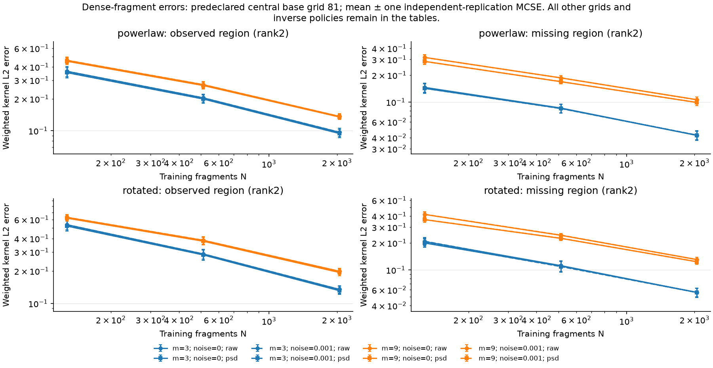
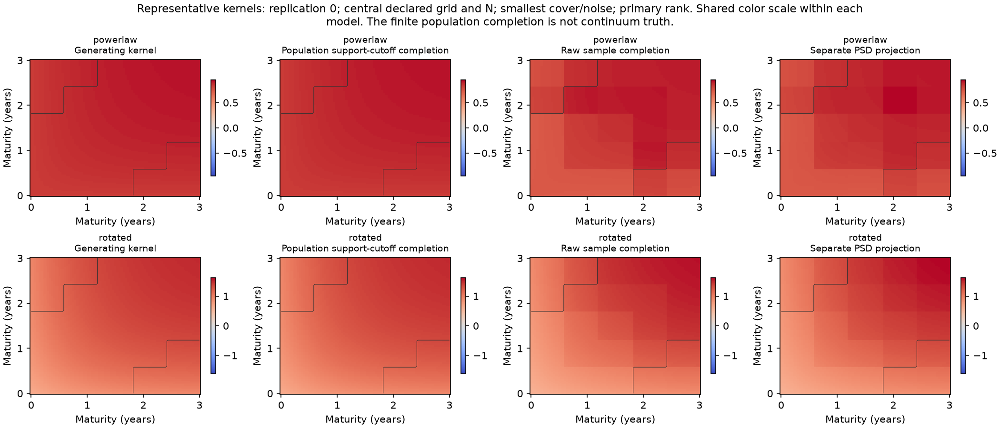
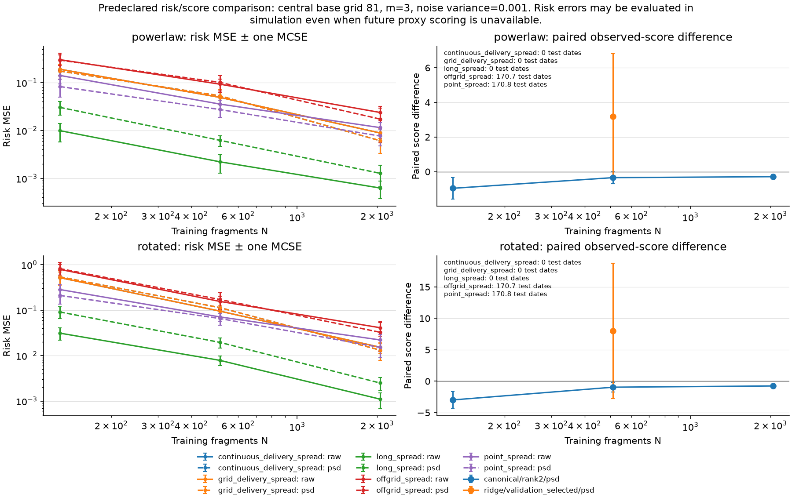

# Dense-fragment covariance kernels

This study extends the existing observation workflow: parent Gaussian measurements are generated before grid/fragment/method views; fitting uses corrected observed products. The [protocol](https://github.com/xrough/spde-covariance/blob/main/docs/canonical-completion.md) distinguishes H-coordinate ridge covariance from covariance kernels and their weighted L2 operators.

Profile: spde; seed: 20261026; independent replications: 20. Training N=(128, 512, 2048); base grids=(41, 81, 161); covers=(3, 9); noise variances=(0.0, 0.001).

Assumptions: centered Gaussian curves, common covariance across independent fragments, balanced randomized fragment assignment, dense point measurements, and known fresh independent measurement-noise variance. This is not extraction from sparse/noisy curve levels or a market-prediction experiment. Smaller training counts share prefixes; grids share parent curves. Replication MCSE never counts dates, grids, ranks or covers as independent experiments.

The reference profile uses equal 1/Q grid weights on [0,1]. SPDE kernels use physical trapezoidal weights on [0,3] maturity years and a fixed normalized-innovation interval; their kernel values have curve-unit squared per year. Kernel L2 norms include the declared maturity quadrature. They are not H-coordinate operator norms. Continuous delivery risk and its discretized grid approximation remain separately labeled.

## Numerical acceptance and scope

| Check | Value |
| --- | --- |
| passed | True |
| psd_outputs_feasible | True |
| ridge_certificates_within_budget | True |
| raw_indefiniteness_is_allowed | True |
| primary_manual_policy_present_per_model | True |
| controlled_population_recovery | True |

Available recorded fits: 11680; unavailable fits: 2880; raw indefinite fits: 5760.

Raw truncated completion may be indefinite. The separate PSD projection changes the estimator and may alter observed entries; it is not called an exact canonical completion. Only ridge retains the existing optimization-distance certificate. Integration agreement, support thresholds and source-tail checks are numerical diagnostics, not a completion-error certificate.



## Every configured method and resolution

Entries use mean ± independent-replication MCSE. The paper states mean absolute deviation without specifying its center; this report uses the median explicitly, and the archive also retains deviation from the mean and median absolute deviation. Regional values are ISE in the reference profile and L2 norms in the SPDE profile; complete ISE is always squared. These descriptive uncertainty summaries are not confidence intervals. Unavailable fits are labeled rather than silently assigned zero error.

| Model | Noise | Grid | m | N | Method/policy/variant | Available/unavailable reps | Observed L2 | Missing L2 | Complete ISE | Error to population completion (L2) |
| --- | --- | --- | --- | --- | --- | --- | --- | --- | --- | --- |
| powerlaw | 0 | 41 | 3 | 128 | canonical/fve95/raw | 0/20 | unavailable | unavailable | unavailable | unavailable |
| powerlaw | 0 | 41 | 3 | 128 | canonical/fve95/psd | 0/20 | unavailable | unavailable | unavailable | unavailable |
| powerlaw | 0 | 41 | 3 | 128 | canonical/rank1/raw | 20/0 | 0.363759 ± 0.0400332 | 0.15519 ± 0.0183919 | 0.193282 ± 0.0415759 | 0.397987 ± 0.042851 |
| powerlaw | 0 | 41 | 3 | 128 | canonical/rank1/psd | 20/0 | 0.354363 ± 0.0397382 | 0.148385 ± 0.0181534 | 0.183856 ± 0.0402473 | 0.386971 ± 0.0423702 |
| powerlaw | 0 | 41 | 3 | 128 | canonical/rank2/raw | 20/0 | 0.363759 ± 0.0400332 | 0.142975 ± 0.0162813 | 0.188249 ± 0.0407478 | 0.392996 ± 0.0421796 |
| powerlaw | 0 | 41 | 3 | 128 | canonical/rank2/psd | 20/0 | 0.353849 ± 0.0396013 | 0.139697 ± 0.0169716 | 0.179994 ± 0.0396293 | 0.383123 ± 0.0418081 |
| powerlaw | 0 | 41 | 3 | 128 | canonical/rank4/raw | 20/0 | 0.363759 ± 0.0400332 | 0.176583 ± 0.0287228 | 0.209627 ± 0.0427231 | 0.415361 ± 0.0441905 |
| powerlaw | 0 | 41 | 3 | 128 | canonical/rank4/psd | 20/0 | 0.357131 ± 0.0395394 | 0.166281 ± 0.0270223 | 0.19877 ± 0.0412748 | 0.403309 ± 0.0435961 |
| powerlaw | 0 | 41 | 3 | 128 | canonical/rank8/raw | 20/0 | 0.363759 ± 0.0400332 | 0.218582 ± 0.0427957 | 0.245347 ± 0.0599201 | 0.441091 ± 0.0517008 |
| powerlaw | 0 | 41 | 3 | 128 | canonical/rank8/psd | 20/0 | 0.359928 ± 0.0407025 | 0.198436 ± 0.0394262 | 0.229936 ± 0.0569541 | 0.425639 ± 0.050663 |
| powerlaw | 0 | 41 | 3 | 512 | canonical/fve95/raw | 0/20 | unavailable | unavailable | unavailable | unavailable |
| powerlaw | 0 | 41 | 3 | 512 | canonical/fve95/psd | 0/20 | unavailable | unavailable | unavailable | unavailable |
| powerlaw | 0 | 41 | 3 | 512 | canonical/rank1/raw | 20/0 | 0.204541 ± 0.0173001 | 0.0915732 ± 0.0104266 | 0.0579748 ± 0.0095814 | 0.225612 ± 0.0192953 |
| powerlaw | 0 | 41 | 3 | 512 | canonical/rank1/psd | 20/0 | 0.200461 ± 0.0174352 | 0.0895484 ± 0.00974039 | 0.0557818 ± 0.00945007 | 0.220805 ± 0.0192313 |
| powerlaw | 0 | 41 | 3 | 512 | canonical/rank2/raw | 20/0 | 0.204541 ± 0.0173001 | 0.0838437 ± 0.00934564 | 0.0562129 ± 0.00953607 | 0.221783 ± 0.019229 |
| powerlaw | 0 | 41 | 3 | 512 | canonical/rank2/psd | 20/0 | 0.199842 ± 0.0174537 | 0.0831639 ± 0.00928495 | 0.0542791 ± 0.00948158 | 0.217246 ± 0.0193081 |
| powerlaw | 0 | 41 | 3 | 512 | canonical/rank4/raw | 20/0 | 0.204541 ± 0.0173001 | 0.0904166 ± 0.00968619 | 0.0574814 ± 0.00952094 | 0.224841 ± 0.0190956 |
| powerlaw | 0 | 41 | 3 | 512 | canonical/rank4/psd | 20/0 | 0.200768 ± 0.017365 | 0.0885598 ± 0.00961047 | 0.055635 ± 0.00944755 | 0.220686 ± 0.019102 |
| powerlaw | 0 | 41 | 3 | 512 | canonical/rank8/raw | 20/0 | 0.204541 ± 0.0173001 | 0.0932605 ± 0.0109288 | 0.0584905 ± 0.00952698 | 0.227051 ± 0.0191099 |
| powerlaw | 0 | 41 | 3 | 512 | canonical/rank8/psd | 20/0 | 0.200596 ± 0.017476 | 0.0910454 ± 0.0105378 | 0.0564407 ± 0.0095042 | 0.22223 ± 0.0192691 |
| powerlaw | 0 | 41 | 3 | 2048 | canonical/fve95/raw | 0/20 | unavailable | unavailable | unavailable | unavailable |
| powerlaw | 0 | 41 | 3 | 2048 | canonical/fve95/psd | 0/20 | unavailable | unavailable | unavailable | unavailable |
| powerlaw | 0 | 41 | 3 | 2048 | canonical/rank1/raw | 20/0 | 0.0967124 ± 0.00868237 | 0.0450069 ± 0.0060853 | 0.0135148 ± 0.0026822 | 0.107219 ± 0.010308 |
| powerlaw | 0 | 41 | 3 | 2048 | canonical/rank1/psd | 20/0 | 0.0946475 ± 0.00847823 | 0.0444199 ± 0.00610839 | 0.0130059 ± 0.00259438 | 0.105094 ± 0.0101598 |
| powerlaw | 0 | 41 | 3 | 2048 | canonical/rank2/raw | 20/0 | 0.0967124 ± 0.00868237 | 0.041476 ± 0.00451815 | 0.0128937 ± 0.00242819 | 0.105649 ± 0.00954769 |
| powerlaw | 0 | 41 | 3 | 2048 | canonical/rank2/psd | 20/0 | 0.0943643 ± 0.0083123 | 0.0415414 ± 0.00496979 | 0.0124124 ± 0.00235375 | 0.103585 ± 0.00941065 |
| powerlaw | 0 | 41 | 3 | 2048 | canonical/rank4/raw | 20/0 | 0.0967124 ± 0.00868237 | 0.0420434 ± 0.00494848 | 0.0130185 ± 0.00250252 | 0.105838 ± 0.00977866 |
| powerlaw | 0 | 41 | 3 | 2048 | canonical/rank4/psd | 20/0 | 0.0946119 ± 0.00837242 | 0.0419983 ± 0.0053115 | 0.0125832 ± 0.002436 | 0.103979 ± 0.00965587 |
| powerlaw | 0 | 41 | 3 | 2048 | canonical/rank8/raw | 20/0 | 0.0967124 ± 0.00868237 | 0.0423531 ± 0.00530995 | 0.0131151 ± 0.00251547 | 0.106133 ± 0.00986994 |
| powerlaw | 0 | 41 | 3 | 2048 | canonical/rank8/psd | 20/0 | 0.0946815 ± 0.00839078 | 0.0424252 ± 0.00559946 | 0.0126979 ± 0.0024495 | 0.104372 ± 0.00974551 |
| powerlaw | 0 | 41 | 9 | 128 | canonical/fve95/raw | 0/20 | unavailable | unavailable | unavailable | unavailable |
| powerlaw | 0 | 41 | 9 | 128 | canonical/fve95/psd | 0/20 | unavailable | unavailable | unavailable | unavailable |
| powerlaw | 0 | 41 | 9 | 128 | canonical/rank1/raw | 20/0 | 0.456797 ± 0.0325408 | 0.225151 ± 0.0173038 | 0.285165 ± 0.0385314 | 0.511287 ± 0.0353553 |
| powerlaw | 0 | 41 | 9 | 128 | canonical/rank1/psd | 20/0 | 0.439128 ± 0.03296 | 0.21737 ± 0.0164338 | 0.265856 ± 0.0371152 | 0.492044 ± 0.0353542 |
| powerlaw | 0 | 41 | 9 | 128 | canonical/rank2/raw | 20/0 | 0.456797 ± 0.0325408 | 0.304741 ± 0.0215279 | 0.330455 ± 0.0412606 | 0.553112 ± 0.0359256 |
| powerlaw | 0 | 41 | 9 | 128 | canonical/rank2/psd | 20/0 | 0.448247 ± 0.0324009 | 0.274705 ± 0.0197607 | 0.303754 ± 0.0388589 | 0.52926 ± 0.035271 |
| powerlaw | 0 | 41 | 9 | 128 | canonical/rank4/raw | 20/0 | 0.456797 ± 0.0325408 | 2.71199 ± 1.27401 | 38.4225 ± 24.7648 | 2.87905 ± 1.25936 |
| powerlaw | 0 | 41 | 9 | 128 | canonical/rank4/psd | 20/0 | 1.56406 ± 0.615011 | 1.4604 ± 0.632539 | 19.3676 ± 12.367 | 2.14884 ± 0.88109 |
| powerlaw | 0 | 41 | 9 | 128 | canonical/rank8/raw | 20/0 | 0.456797 ± 0.0325408 | 155.221 ± 98.1595 | 207164 ± 183933 | 155.246 ± 98.1575 |
| powerlaw | 0 | 41 | 9 | 128 | canonical/rank8/psd | 20/0 | 77.5707 ± 49.07 | 77.7368 ± 49.0801 | 103578 ± 91961.5 | 109.822 ± 69.4024 |
| powerlaw | 0 | 41 | 9 | 512 | canonical/fve95/raw | 0/20 | unavailable | unavailable | unavailable | unavailable |
| powerlaw | 0 | 41 | 9 | 512 | canonical/fve95/psd | 0/20 | unavailable | unavailable | unavailable | unavailable |
| powerlaw | 0 | 41 | 9 | 512 | canonical/rank1/raw | 20/0 | 0.268303 ± 0.0195222 | 0.139492 ± 0.0116129 | 0.101248 ± 0.0145042 | 0.303821 ± 0.0216931 |
| powerlaw | 0 | 41 | 9 | 512 | canonical/rank1/psd | 20/0 | 0.258718 ± 0.0194178 | 0.13509 ± 0.0114696 | 0.0948479 ± 0.0139729 | 0.293458 ± 0.0214356 |
| powerlaw | 0 | 41 | 9 | 512 | canonical/rank2/raw | 20/0 | 0.268303 ± 0.0195222 | 0.179151 ± 0.0106809 | 0.11349 ± 0.0140708 | 0.324981 ± 0.0203619 |
| powerlaw | 0 | 41 | 9 | 512 | canonical/rank2/psd | 20/0 | 0.263556 ± 0.0189888 | 0.162373 ± 0.00951908 | 0.104399 ± 0.013495 | 0.311079 ± 0.0200387 |
| powerlaw | 0 | 41 | 9 | 512 | canonical/rank4/raw | 20/0 | 0.268303 ± 0.0195222 | 0.301109 ± 0.0561384 | 0.229774 ± 0.0782744 | 0.420648 ± 0.0527301 |
| powerlaw | 0 | 41 | 9 | 512 | canonical/rank4/psd | 20/0 | 0.298924 ± 0.0279326 | 0.222191 ± 0.0281232 | 0.168576 ± 0.0415021 | 0.375206 ± 0.038249 |
| powerlaw | 0 | 41 | 9 | 512 | canonical/rank8/raw | 20/0 | 0.268303 ± 0.0195222 | 9.69569 ± 3.83957 | 374.189 ± 272.046 | 9.7349 ± 3.83489 |
| powerlaw | 0 | 41 | 9 | 512 | canonical/rank8/psd | 20/0 | 4.83864 ± 1.89656 | 4.95376 ± 1.93507 | 187.439 ± 136.147 | 6.92834 ± 2.70902 |
| powerlaw | 0 | 41 | 9 | 2048 | canonical/fve95/raw | 0/20 | unavailable | unavailable | unavailable | unavailable |
| powerlaw | 0 | 41 | 9 | 2048 | canonical/fve95/psd | 0/20 | unavailable | unavailable | unavailable | unavailable |
| powerlaw | 0 | 41 | 9 | 2048 | canonical/rank1/raw | 20/0 | 0.135343 ± 0.00779945 | 0.0714195 ± 0.00485439 | 0.025022 ± 0.00281454 | 0.153417 ± 0.00884111 |
| powerlaw | 0 | 41 | 9 | 2048 | canonical/rank1/psd | 20/0 | 0.130055 ± 0.0077504 | 0.0705014 ± 0.00484215 | 0.0234716 ± 0.00273156 | 0.148279 ± 0.00884058 |
| powerlaw | 0 | 41 | 9 | 2048 | canonical/rank2/raw | 20/0 | 0.135343 ± 0.00779945 | 0.101865 ± 0.007899 | 0.0310354 ± 0.00295428 | 0.171725 ± 0.00901998 |
| powerlaw | 0 | 41 | 9 | 2048 | canonical/rank2/psd | 20/0 | 0.133446 ± 0.00739279 | 0.0948047 ± 0.00714234 | 0.0288034 ± 0.00284516 | 0.165134 ± 0.00898526 |
| powerlaw | 0 | 41 | 9 | 2048 | canonical/rank4/raw | 20/0 | 0.135343 ± 0.00779945 | 0.124539 ± 0.0115323 | 0.0375103 ± 0.00430941 | 0.187377 ± 0.0112394 |
| powerlaw | 0 | 41 | 9 | 2048 | canonical/rank4/psd | 20/0 | 0.139184 ± 0.00758909 | 0.101665 ± 0.00837479 | 0.0321348 ± 0.00356471 | 0.173746 ± 0.0101233 |
| powerlaw | 0 | 41 | 9 | 2048 | canonical/rank8/raw | 20/0 | 0.135343 ± 0.00779945 | 41.5357 ± 28.9754 | 17677.1 ± 16335.4 | 41.552 ± 28.9742 |
| powerlaw | 0 | 41 | 9 | 2048 | canonical/rank8/psd | 20/0 | 20.7418 ± 14.4839 | 20.8561 ± 14.487 | 8838.69 ± 8167.57 | 29.4171 ± 20.4853 |
| powerlaw | 0 | 81 | 3 | 128 | canonical/fve95/raw | 0/20 | unavailable | unavailable | unavailable | unavailable |
| powerlaw | 0 | 81 | 3 | 128 | canonical/fve95/psd | 0/20 | unavailable | unavailable | unavailable | unavailable |
| powerlaw | 0 | 81 | 3 | 128 | canonical/rank1/raw | 20/0 | 0.363887 ± 0.0400307 | 0.158836 ± 0.0187997 | 0.194804 ± 0.0418482 | 0.399649 ± 0.0429714 |
| powerlaw | 0 | 81 | 3 | 128 | canonical/rank1/psd | 20/0 | 0.354522 ± 0.0397537 | 0.15164 ± 0.0185634 | 0.185255 ± 0.0405114 | 0.388509 ± 0.0424979 |
| powerlaw | 0 | 81 | 3 | 128 | canonical/rank2/raw | 20/0 | 0.363887 ± 0.0400307 | 0.146041 ± 0.0166612 | 0.189462 ± 0.0409717 | 0.394397 ± 0.0422484 |
| powerlaw | 0 | 81 | 3 | 128 | canonical/rank2/psd | 20/0 | 0.353942 ± 0.0396071 | 0.142612 ± 0.0173893 | 0.181164 ± 0.0398582 | 0.384481 ± 0.0418885 |
| powerlaw | 0 | 81 | 3 | 128 | canonical/rank4/raw | 20/0 | 0.363887 ± 0.0400307 | 0.183814 ± 0.0312079 | 0.215153 ± 0.0441748 | 0.420117 ± 0.0451048 |
| powerlaw | 0 | 81 | 3 | 128 | canonical/rank4/psd | 20/0 | 0.35757 ± 0.0395234 | 0.1728 ± 0.0292406 | 0.203641 ± 0.0424422 | 0.407705 ± 0.0443773 |
| powerlaw | 0 | 81 | 3 | 128 | canonical/rank8/raw | 20/0 | 0.363887 ± 0.0400307 | 0.221844 ± 0.0422449 | 0.245983 ± 0.0569534 | 0.44412 ± 0.0506486 |
| powerlaw | 0 | 81 | 3 | 128 | canonical/rank8/psd | 20/0 | 0.360336 ± 0.0403377 | 0.202144 ± 0.0394011 | 0.231116 ± 0.0544713 | 0.429059 ± 0.0497493 |
| powerlaw | 0 | 81 | 3 | 512 | canonical/fve95/raw | 0/20 | unavailable | unavailable | unavailable | unavailable |
| powerlaw | 0 | 81 | 3 | 512 | canonical/fve95/psd | 0/20 | unavailable | unavailable | unavailable | unavailable |
| powerlaw | 0 | 81 | 3 | 512 | canonical/rank1/raw | 20/0 | 0.204449 ± 0.0172182 | 0.0937016 ± 0.0106526 | 0.0583682 ± 0.00961016 | 0.226439 ± 0.0193223 |
| powerlaw | 0 | 81 | 3 | 512 | canonical/rank1/psd | 20/0 | 0.200357 ± 0.0173655 | 0.0915055 ± 0.00994952 | 0.0561266 ± 0.00947234 | 0.221548 ± 0.019253 |
| powerlaw | 0 | 81 | 3 | 512 | canonical/rank2/raw | 20/0 | 0.204449 ± 0.0172182 | 0.0857994 ± 0.009522 | 0.0565164 ± 0.00953752 | 0.222492 ± 0.019213 |
| powerlaw | 0 | 81 | 3 | 512 | canonical/rank2/psd | 20/0 | 0.199711 ± 0.0173749 | 0.0850755 ± 0.00946302 | 0.0545596 ± 0.00948158 | 0.21792 ± 0.0192906 |
| powerlaw | 0 | 81 | 3 | 512 | canonical/rank4/raw | 20/0 | 0.204449 ± 0.0172182 | 0.0927417 ± 0.00991395 | 0.0579006 ± 0.00951502 | 0.225834 ± 0.0190563 |
| powerlaw | 0 | 81 | 3 | 512 | canonical/rank4/psd | 20/0 | 0.200665 ± 0.0172826 | 0.0908312 ± 0.0098444 | 0.056033 ± 0.00944015 | 0.221651 ± 0.0190621 |
| powerlaw | 0 | 81 | 3 | 512 | canonical/rank8/raw | 20/0 | 0.204449 ± 0.0172182 | 0.096461 ± 0.0111435 | 0.0590962 ± 0.00948821 | 0.228516 ± 0.0190246 |
| powerlaw | 0 | 81 | 3 | 512 | canonical/rank8/psd | 20/0 | 0.20049 ± 0.0173869 | 0.094412 ± 0.0107576 | 0.0570526 ± 0.00945594 | 0.223783 ± 0.0191583 |
| powerlaw | 0 | 81 | 3 | 512 | ridge/validation_selected/psd | 20/0 | 0.233273 ± 0.0192225 | 0.124574 ± 0.0151046 | 0.0812906 ± 0.0128308 | 0.26571 ± 0.023719 |
| powerlaw | 0 | 81 | 3 | 2048 | canonical/fve95/raw | 0/20 | unavailable | unavailable | unavailable | unavailable |
| powerlaw | 0 | 81 | 3 | 2048 | canonical/fve95/psd | 0/20 | unavailable | unavailable | unavailable | unavailable |
| powerlaw | 0 | 81 | 3 | 2048 | canonical/rank1/raw | 20/0 | 0.0967251 ± 0.00872475 | 0.0460382 ± 0.00622934 | 0.0136589 ± 0.00272764 | 0.107678 ± 0.0104234 |
| powerlaw | 0 | 81 | 3 | 2048 | canonical/rank1/psd | 20/0 | 0.0946266 ± 0.0085157 | 0.0454057 ± 0.00625879 | 0.013138 ± 0.00263735 | 0.105511 ± 0.0102738 |
| powerlaw | 0 | 81 | 3 | 2048 | canonical/rank2/raw | 20/0 | 0.0967251 ± 0.00872475 | 0.0424089 ± 0.0046501 | 0.0130114 ± 0.00246152 | 0.106057 ± 0.00963386 |
| powerlaw | 0 | 81 | 3 | 2048 | canonical/rank2/psd | 20/0 | 0.0943326 ± 0.00834666 | 0.04247 ± 0.00511531 | 0.0125232 ± 0.00238669 | 0.103964 ± 0.00949965 |
| powerlaw | 0 | 81 | 3 | 2048 | canonical/rank4/raw | 20/0 | 0.0967251 ± 0.00872475 | 0.0430292 ± 0.00509376 | 0.0131466 ± 0.00253999 | 0.10627 ± 0.00987653 |
| powerlaw | 0 | 81 | 3 | 2048 | canonical/rank4/psd | 20/0 | 0.0945872 ± 0.00840855 | 0.0429764 ± 0.00546807 | 0.0127052 ± 0.00247299 | 0.104388 ± 0.00975596 |
| powerlaw | 0 | 81 | 3 | 2048 | canonical/rank8/raw | 20/0 | 0.0967251 ± 0.00872475 | 0.0435638 ± 0.00547061 | 0.0132685 ± 0.00255676 | 0.106671 ± 0.00997307 |
| powerlaw | 0 | 81 | 3 | 2048 | canonical/rank8/psd | 20/0 | 0.0946702 ± 0.0084287 | 0.04363 ± 0.0057694 | 0.0128483 ± 0.00249098 | 0.104901 ± 0.00985199 |
| powerlaw | 0 | 81 | 9 | 128 | canonical/fve95/raw | 0/20 | unavailable | unavailable | unavailable | unavailable |
| powerlaw | 0 | 81 | 9 | 128 | canonical/fve95/psd | 0/20 | unavailable | unavailable | unavailable | unavailable |
| powerlaw | 0 | 81 | 9 | 128 | canonical/rank1/raw | 20/0 | 0.46134 ± 0.0326638 | 0.234038 ± 0.0183588 | 0.294284 ± 0.039354 | 0.519447 ± 0.0358791 |
| powerlaw | 0 | 81 | 9 | 128 | canonical/rank1/psd | 20/0 | 0.443817 ± 0.0331462 | 0.225349 ± 0.0174126 | 0.274391 ± 0.0379062 | 0.499911 ± 0.0358949 |
| powerlaw | 0 | 81 | 9 | 128 | canonical/rank2/raw | 20/0 | 0.46134 ± 0.0326638 | 0.316613 ± 0.0226766 | 0.34312 ± 0.042464 | 0.563664 ± 0.036565 |
| powerlaw | 0 | 81 | 9 | 128 | canonical/rank2/psd | 20/0 | 0.453162 ± 0.0325418 | 0.285763 ± 0.0208033 | 0.315359 ± 0.0399305 | 0.539363 ± 0.0358701 |
| powerlaw | 0 | 81 | 9 | 128 | canonical/rank4/raw | 20/0 | 0.46134 ± 0.0326638 | 2.82815 ± 1.33087 | 41.8847 ± 27.6078 | 2.99519 ± 1.31617 |
| powerlaw | 0 | 81 | 9 | 128 | canonical/rank4/psd | 20/0 | 1.62117 ± 0.642746 | 1.52309 ± 0.661478 | 21.1108 ± 13.776 | 2.23323 ± 0.921198 |
| powerlaw | 0 | 81 | 9 | 128 | canonical/rank8/raw | 20/0 | 0.46134 ± 0.0326638 | 146.117 ± 84.9366 | 158421 ± 131324 | 146.141 ± 84.9345 |
| powerlaw | 0 | 81 | 9 | 128 | canonical/rank8/psd | 20/0 | 73.0145 ± 42.4591 | 73.1851 ± 42.468 | 79207 ± 65658 | 103.382 ± 60.0523 |
| powerlaw | 0 | 81 | 9 | 512 | canonical/fve95/raw | 0/20 | unavailable | unavailable | unavailable | unavailable |
| powerlaw | 0 | 81 | 9 | 512 | canonical/fve95/psd | 0/20 | unavailable | unavailable | unavailable | unavailable |
| powerlaw | 0 | 81 | 9 | 512 | canonical/rank1/raw | 20/0 | 0.272244 ± 0.0195655 | 0.146371 ± 0.0122173 | 0.105651 ± 0.0150867 | 0.310539 ± 0.0220237 |
| powerlaw | 0 | 81 | 9 | 512 | canonical/rank1/psd | 20/0 | 0.26264 ± 0.0194833 | 0.141465 ± 0.0119914 | 0.0989367 ± 0.0145047 | 0.299923 ± 0.0217437 |
| powerlaw | 0 | 81 | 9 | 512 | canonical/rank2/raw | 20/0 | 0.272244 ± 0.0195655 | 0.186651 ± 0.0109773 | 0.118518 ± 0.0144289 | 0.332562 ± 0.0204176 |
| powerlaw | 0 | 81 | 9 | 512 | canonical/rank2/psd | 20/0 | 0.267572 ± 0.018976 | 0.169301 ± 0.00986778 | 0.108949 ± 0.0138711 | 0.318192 ± 0.0201348 |
| powerlaw | 0 | 81 | 9 | 512 | canonical/rank4/raw | 20/0 | 0.272244 ± 0.0195655 | 0.326508 ± 0.06655 | 0.272147 ± 0.108597 | 0.444666 ± 0.0625843 |
| powerlaw | 0 | 81 | 9 | 512 | canonical/rank4/psd | 20/0 | 0.310027 ± 0.0319742 | 0.238267 ± 0.0329078 | 0.192888 ± 0.0563036 | 0.393879 ± 0.0445728 |
| powerlaw | 0 | 81 | 9 | 512 | canonical/rank8/raw | 20/0 | 0.272244 ± 0.0195655 | 9.78878 ± 4.28781 | 445.222 ± 374.569 | 9.82632 ± 4.28379 |
| powerlaw | 0 | 81 | 9 | 512 | canonical/rank8/psd | 20/0 | 4.87565 ± 2.11901 | 5.00904 ± 2.16188 | 222.977 ± 187.417 | 6.99386 ± 3.02675 |
| powerlaw | 0 | 81 | 9 | 512 | ridge/validation_selected/psd | 20/0 | 0.257882 ± 0.0246921 | 0.139289 ± 0.0166478 | 0.102755 ± 0.0171832 | 0.293967 ± 0.0293241 |
| powerlaw | 0 | 81 | 9 | 2048 | canonical/fve95/raw | 0/20 | unavailable | unavailable | unavailable | unavailable |
| powerlaw | 0 | 81 | 9 | 2048 | canonical/fve95/psd | 0/20 | unavailable | unavailable | unavailable | unavailable |
| powerlaw | 0 | 81 | 9 | 2048 | canonical/rank1/raw | 20/0 | 0.136678 ± 0.00791865 | 0.07438 ± 0.00512123 | 0.0259029 ± 0.00294957 | 0.156005 ± 0.00907698 |
| powerlaw | 0 | 81 | 9 | 2048 | canonical/rank1/psd | 20/0 | 0.131375 ± 0.00787776 | 0.0733557 ± 0.00509975 | 0.0243138 ± 0.00286242 | 0.150822 ± 0.00908044 |
| powerlaw | 0 | 81 | 9 | 2048 | canonical/rank2/raw | 20/0 | 0.136678 ± 0.00791865 | 0.106349 ± 0.00840619 | 0.0325249 ± 0.00311796 | 0.175693 ± 0.00933872 |
| powerlaw | 0 | 81 | 9 | 2048 | canonical/rank2/psd | 20/0 | 0.134977 ± 0.00748245 | 0.0991246 ± 0.00760755 | 0.0302077 ± 0.00300052 | 0.16901 ± 0.00930055 |
| powerlaw | 0 | 81 | 9 | 2048 | canonical/rank4/raw | 20/0 | 0.136678 ± 0.00791865 | 0.129934 ± 0.0119231 | 0.0394561 ± 0.00454247 | 0.192043 ± 0.0116433 |
| powerlaw | 0 | 81 | 9 | 2048 | canonical/rank4/psd | 20/0 | 0.141057 ± 0.0077851 | 0.105583 ± 0.00846057 | 0.0335563 ± 0.00371457 | 0.177499 ± 0.010388 |
| powerlaw | 0 | 81 | 9 | 2048 | canonical/rank8/raw | 20/0 | 0.136678 ± 0.00791865 | 38.4619 ± 27.3092 | 15649.4 ± 14613.4 | 38.479 ± 27.3079 |
| powerlaw | 0 | 81 | 9 | 2048 | canonical/rank8/psd | 20/0 | 19.2096 ± 13.6509 | 19.3155 ± 13.6537 | 7824.77 ± 7306.56 | 27.2443 ± 19.3071 |
| powerlaw | 0 | 161 | 3 | 128 | canonical/fve95/raw | 0/20 | unavailable | unavailable | unavailable | unavailable |
| powerlaw | 0 | 161 | 3 | 128 | canonical/fve95/psd | 0/20 | unavailable | unavailable | unavailable | unavailable |
| powerlaw | 0 | 161 | 3 | 128 | canonical/rank1/raw | 20/0 | 0.363902 ± 0.0400249 | 0.160627 ± 0.0189993 | 0.195522 ± 0.041976 | 0.400432 ± 0.0430278 |
| powerlaw | 0 | 161 | 3 | 128 | canonical/rank1/psd | 20/0 | 0.354558 ± 0.039758 | 0.153239 ± 0.0187657 | 0.185918 ± 0.0406369 | 0.389235 ± 0.042559 |
| powerlaw | 0 | 161 | 3 | 128 | canonical/rank2/raw | 20/0 | 0.363902 ± 0.0400249 | 0.147566 ± 0.0168514 | 0.190034 ± 0.0410744 | 0.395061 ± 0.0422774 |
| powerlaw | 0 | 161 | 3 | 128 | canonical/rank2/psd | 20/0 | 0.353947 ± 0.039606 | 0.144059 ± 0.0175983 | 0.18172 ± 0.0399651 | 0.38513 ± 0.0419242 |
| powerlaw | 0 | 161 | 3 | 128 | canonical/rank4/raw | 20/0 | 0.363902 ± 0.0400249 | 0.187754 ± 0.0326494 | 0.218368 ± 0.0451541 | 0.422745 ± 0.0456847 |
| powerlaw | 0 | 161 | 3 | 128 | canonical/rank4/psd | 20/0 | 0.357788 ± 0.0395121 | 0.176328 ± 0.0305255 | 0.206471 ± 0.0432347 | 0.410132 ± 0.0448762 |
| powerlaw | 0 | 161 | 3 | 128 | canonical/rank8/raw | 20/0 | 0.363902 ± 0.0400249 | 0.222763 ± 0.0426391 | 0.24703 ± 0.0562444 | 0.445341 ± 0.0506282 |
| powerlaw | 0 | 161 | 3 | 128 | canonical/rank8/psd | 20/0 | 0.360349 ± 0.0401946 | 0.203454 ± 0.0399176 | 0.232217 ± 0.0538166 | 0.430399 ± 0.0497225 |
| powerlaw | 0 | 161 | 3 | 512 | canonical/fve95/raw | 0/20 | unavailable | unavailable | unavailable | unavailable |
| powerlaw | 0 | 161 | 3 | 512 | canonical/fve95/psd | 0/20 | unavailable | unavailable | unavailable | unavailable |
| powerlaw | 0 | 161 | 3 | 512 | canonical/rank1/raw | 20/0 | 0.204376 ± 0.0171773 | 0.0947512 ± 0.0107625 | 0.0585544 ± 0.00962471 | 0.226827 ± 0.0193363 |
| powerlaw | 0 | 161 | 3 | 512 | canonical/rank1/psd | 20/0 | 0.200281 ± 0.0173312 | 0.092469 ± 0.0100516 | 0.0562898 ± 0.00948379 | 0.221897 ± 0.0192646 |
| powerlaw | 0 | 161 | 3 | 512 | canonical/rank2/raw | 20/0 | 0.204376 ± 0.0171773 | 0.0867804 ± 0.00960884 | 0.0566609 ± 0.00953806 | 0.222831 ± 0.0192046 |
| powerlaw | 0 | 161 | 3 | 512 | canonical/rank2/psd | 20/0 | 0.199623 ± 0.0173359 | 0.0860309 ± 0.00955051 | 0.0546936 ± 0.00948152 | 0.218243 ± 0.0192815 |
| powerlaw | 0 | 161 | 3 | 512 | canonical/rank4/raw | 20/0 | 0.204376 ± 0.0171773 | 0.093937 ± 0.0100275 | 0.0581105 ± 0.00951113 | 0.226333 ± 0.0190344 |
| powerlaw | 0 | 161 | 3 | 512 | canonical/rank4/psd | 20/0 | 0.200591 ± 0.0172416 | 0.0919939 ± 0.00996124 | 0.056233 ± 0.00943564 | 0.222137 ± 0.0190401 |
| powerlaw | 0 | 161 | 3 | 512 | canonical/rank8/raw | 20/0 | 0.204376 ± 0.0171773 | 0.0984954 ± 0.0112404 | 0.0594778 ± 0.00945732 | 0.229478 ± 0.0189427 |
| powerlaw | 0 | 161 | 3 | 512 | canonical/rank8/psd | 20/0 | 0.200421 ± 0.0173394 | 0.0963827 ± 0.0108728 | 0.0574166 ± 0.00942391 | 0.224727 ± 0.0190769 |
| powerlaw | 0 | 161 | 3 | 2048 | canonical/fve95/raw | 0/20 | unavailable | unavailable | unavailable | unavailable |
| powerlaw | 0 | 161 | 3 | 2048 | canonical/fve95/psd | 0/20 | unavailable | unavailable | unavailable | unavailable |
| powerlaw | 0 | 161 | 3 | 2048 | canonical/rank1/raw | 20/0 | 0.0967182 ± 0.00874446 | 0.046546 ± 0.00629865 | 0.0137276 ± 0.00274954 | 0.107894 ± 0.010479 |
| powerlaw | 0 | 161 | 3 | 2048 | canonical/rank1/psd | 20/0 | 0.0946033 ± 0.00853275 | 0.0458909 ± 0.00633175 | 0.0132008 ± 0.00265804 | 0.105707 ± 0.0103287 |
| powerlaw | 0 | 161 | 3 | 2048 | canonical/rank2/raw | 20/0 | 0.0967182 ± 0.00874446 | 0.0428719 ± 0.00471464 | 0.0130676 ± 0.00247753 | 0.10625 ± 0.00967526 |
| powerlaw | 0 | 161 | 3 | 2048 | canonical/rank2/psd | 20/0 | 0.0943043 ± 0.00836231 | 0.0429296 ± 0.00518675 | 0.012576 ± 0.00240254 | 0.104144 ± 0.00954251 |
| powerlaw | 0 | 161 | 3 | 2048 | canonical/rank4/raw | 20/0 | 0.0967182 ± 0.00874446 | 0.0435208 ± 0.0051647 | 0.0132081 ± 0.00255812 | 0.106475 ± 0.00992376 |
| powerlaw | 0 | 161 | 3 | 2048 | canonical/rank4/psd | 20/0 | 0.0945623 ± 0.00842506 | 0.0434626 ± 0.00554485 | 0.0127638 ± 0.0024909 | 0.104583 ± 0.00980435 |
| powerlaw | 0 | 161 | 3 | 2048 | canonical/rank8/raw | 20/0 | 0.0967182 ± 0.00874446 | 0.0441178 ± 0.00554483 | 0.0133378 ± 0.00257608 | 0.106908 ± 0.0100223 |
| powerlaw | 0 | 161 | 3 | 2048 | canonical/rank8/psd | 20/0 | 0.0946495 ± 0.00844571 | 0.0441816 ± 0.00584935 | 0.0129159 ± 0.00251027 | 0.105132 ± 0.00990271 |
| powerlaw | 0 | 161 | 9 | 128 | canonical/fve95/raw | 0/20 | unavailable | unavailable | unavailable | unavailable |
| powerlaw | 0 | 161 | 9 | 128 | canonical/fve95/psd | 0/20 | unavailable | unavailable | unavailable | unavailable |
| powerlaw | 0 | 161 | 9 | 128 | canonical/rank1/raw | 20/0 | 0.463694 ± 0.0328198 | 0.239324 ± 0.018985 | 0.299602 ± 0.0399958 | 0.524001 ± 0.0362922 |
| powerlaw | 0 | 161 | 9 | 128 | canonical/rank1/psd | 20/0 | 0.446257 ± 0.0333293 | 0.230155 ± 0.0180068 | 0.279383 ± 0.0385132 | 0.504319 ± 0.0363069 |
| powerlaw | 0 | 161 | 9 | 128 | canonical/rank2/raw | 20/0 | 0.463694 ± 0.0328198 | 0.322722 ± 0.0231764 | 0.349833 ± 0.0431914 | 0.569123 ± 0.0369431 |
| powerlaw | 0 | 161 | 9 | 128 | canonical/rank2/psd | 20/0 | 0.455629 ± 0.0326907 | 0.291683 ± 0.0213441 | 0.321638 ± 0.0405952 | 0.54469 ± 0.0362379 |
| powerlaw | 0 | 161 | 9 | 128 | canonical/rank4/raw | 20/0 | 0.463694 ± 0.0328198 | 2.8903 ± 1.35902 | 43.6812 ± 29.1848 | 3.05658 ± 1.34435 |
| powerlaw | 0 | 161 | 9 | 128 | canonical/rank4/psd | 20/0 | 1.65073 ± 0.656677 | 1.55706 ± 0.675596 | 22.0148 ± 14.5587 | 2.27783 ± 0.94106 |
| powerlaw | 0 | 161 | 9 | 128 | canonical/rank8/raw | 20/0 | 0.463694 ± 0.0328198 | 144.089 ± 81.0358 | 145531 ± 117051 | 144.112 ± 81.0338 |
| powerlaw | 0 | 161 | 9 | 128 | canonical/rank8/psd | 20/0 | 71.9961 ± 40.5085 | 72.1738 ± 40.5177 | 72762.3 ± 58521.2 | 101.947 ± 57.2939 |
| powerlaw | 0 | 161 | 9 | 512 | canonical/fve95/raw | 0/20 | unavailable | unavailable | unavailable | unavailable |
| powerlaw | 0 | 161 | 9 | 512 | canonical/fve95/psd | 0/20 | unavailable | unavailable | unavailable | unavailable |
| powerlaw | 0 | 161 | 9 | 512 | canonical/rank1/raw | 20/0 | 0.274096 ± 0.0196193 | 0.1501 ± 0.0125703 | 0.107974 ± 0.0154361 | 0.313952 ± 0.0222529 |
| powerlaw | 0 | 161 | 9 | 512 | canonical/rank1/psd | 20/0 | 0.2645 ± 0.0195421 | 0.144896 ± 0.0123031 | 0.101087 ± 0.0148224 | 0.303199 ± 0.0219535 |
| powerlaw | 0 | 161 | 9 | 512 | canonical/rank2/raw | 20/0 | 0.274096 ± 0.0196193 | 0.190303 ± 0.0111272 | 0.12101 ± 0.014685 | 0.336146 ± 0.0205401 |
| powerlaw | 0 | 161 | 9 | 512 | canonical/rank2/psd | 20/0 | 0.269399 ± 0.0190095 | 0.172874 ± 0.0101271 | 0.111276 ± 0.0141311 | 0.32166 ± 0.0202747 |
| powerlaw | 0 | 161 | 9 | 512 | canonical/rank4/raw | 20/0 | 0.274096 ± 0.0196193 | 0.338931 ± 0.0724232 | 0.296973 ± 0.127658 | 0.456589 ± 0.0682487 |
| powerlaw | 0 | 161 | 9 | 512 | canonical/rank4/psd | 20/0 | 0.31555 ± 0.0344073 | 0.24624 ± 0.0356898 | 0.206901 ± 0.0657357 | 0.403195 ± 0.0483053 |
| powerlaw | 0 | 161 | 9 | 512 | canonical/rank8/raw | 20/0 | 0.274096 ± 0.0196193 | 10.2479 ± 4.64653 | 515.315 ± 443.396 | 10.2844 ± 4.64274 |
| powerlaw | 0 | 161 | 9 | 512 | canonical/rank8/psd | 20/0 | 5.10198 ± 2.2978 | 5.2404 ± 2.34208 | 258.031 ± 221.837 | 7.31744 ± 3.28062 |
| powerlaw | 0 | 161 | 9 | 2048 | canonical/fve95/raw | 0/20 | unavailable | unavailable | unavailable | unavailable |
| powerlaw | 0 | 161 | 9 | 2048 | canonical/fve95/psd | 0/20 | unavailable | unavailable | unavailable | unavailable |
| powerlaw | 0 | 161 | 9 | 2048 | canonical/rank1/raw | 20/0 | 0.137428 ± 0.00800165 | 0.076069 ± 0.00528686 | 0.0264204 ± 0.00303581 | 0.157485 ± 0.00923065 |
| powerlaw | 0 | 161 | 9 | 2048 | canonical/rank1/psd | 20/0 | 0.13211 ± 0.00796244 | 0.0749846 ± 0.00526241 | 0.0248065 ± 0.00294487 | 0.152271 ± 0.00923402 |
| powerlaw | 0 | 161 | 9 | 2048 | canonical/rank2/raw | 20/0 | 0.137428 ± 0.00800165 | 0.108776 ± 0.00864104 | 0.0333538 ± 0.00321769 | 0.177848 ± 0.0095255 |
| powerlaw | 0 | 161 | 9 | 2048 | canonical/rank2/psd | 20/0 | 0.135787 ± 0.00755146 | 0.10151 ± 0.00785095 | 0.030997 ± 0.00309691 | 0.171131 ± 0.00949045 |
| powerlaw | 0 | 161 | 9 | 2048 | canonical/rank4/raw | 20/0 | 0.137428 ± 0.00800165 | 0.133303 ± 0.0122386 | 0.0407184 ± 0.00469762 | 0.195012 ± 0.0118958 |
| powerlaw | 0 | 161 | 9 | 2048 | canonical/rank4/psd | 20/0 | 0.142178 ± 0.0078579 | 0.10815 ± 0.00863302 | 0.0345003 ± 0.00382239 | 0.179944 ± 0.0105645 |
| powerlaw | 0 | 161 | 9 | 2048 | canonical/rank8/raw | 20/0 | 0.137428 ± 0.00800165 | 38.2246 ± 27.1614 | 15478.3 ± 14480.2 | 38.2412 ± 27.1602 |
| powerlaw | 0 | 161 | 9 | 2048 | canonical/rank8/psd | 20/0 | 19.0886 ± 13.5771 | 19.1984 ± 13.5798 | 7739.2 ± 7239.91 | 27.0762 ± 19.2026 |
| powerlaw | 0.001 | 41 | 3 | 128 | canonical/fve95/raw | 0/20 | unavailable | unavailable | unavailable | unavailable |
| powerlaw | 0.001 | 41 | 3 | 128 | canonical/fve95/psd | 0/20 | unavailable | unavailable | unavailable | unavailable |
| powerlaw | 0.001 | 41 | 3 | 128 | canonical/rank1/raw | 20/0 | 0.364211 ± 0.0402188 | 0.155469 ± 0.0183739 | 0.193969 ± 0.0417865 | 0.398498 ± 0.0430226 |
| powerlaw | 0.001 | 41 | 3 | 128 | canonical/rank1/psd | 20/0 | 0.354872 ± 0.0399325 | 0.148621 ± 0.0180778 | 0.184529 ± 0.0404341 | 0.387498 ± 0.0425345 |
| powerlaw | 0.001 | 41 | 3 | 128 | canonical/rank2/raw | 20/0 | 0.364211 ± 0.0402188 | 0.145709 ± 0.0160912 | 0.189534 ± 0.0409394 | 0.394486 ± 0.0422493 |
| powerlaw | 0.001 | 41 | 3 | 128 | canonical/rank2/psd | 20/0 | 0.354466 ± 0.0398166 | 0.141781 ± 0.0166895 | 0.181162 ± 0.0397905 | 0.384544 ± 0.041857 |
| powerlaw | 0.001 | 41 | 3 | 128 | canonical/rank4/raw | 20/0 | 0.364211 ± 0.0402188 | 0.163981 ± 0.0178806 | 0.196348 ± 0.0401602 | 0.405763 ± 0.0408495 |
| powerlaw | 0.001 | 41 | 3 | 128 | canonical/rank4/psd | 20/0 | 0.357337 ± 0.0396188 | 0.157756 ± 0.0181004 | 0.188625 ± 0.0394146 | 0.39635 ± 0.0407378 |
| powerlaw | 0.001 | 41 | 3 | 128 | canonical/rank8/raw | 20/0 | 0.364211 ± 0.0402188 | 0.355708 ± 0.0518057 | 0.340904 ± 0.0656389 | 0.539324 ± 0.0513164 |
| powerlaw | 0.001 | 41 | 3 | 128 | canonical/rank8/psd | 20/0 | 0.380731 ± 0.0382054 | 0.317473 ± 0.0463637 | 0.314321 ± 0.058658 | 0.519063 ± 0.04861 |
| powerlaw | 0.001 | 41 | 3 | 512 | canonical/fve95/raw | 0/20 | unavailable | unavailable | unavailable | unavailable |
| powerlaw | 0.001 | 41 | 3 | 512 | canonical/fve95/psd | 0/20 | unavailable | unavailable | unavailable | unavailable |
| powerlaw | 0.001 | 41 | 3 | 512 | canonical/rank1/raw | 20/0 | 0.204589 ± 0.0173566 | 0.0917931 ± 0.0104053 | 0.0580635 ± 0.00959678 | 0.225738 ± 0.0193391 |
| powerlaw | 0.001 | 41 | 3 | 512 | canonical/rank1/psd | 20/0 | 0.200552 ± 0.0174789 | 0.0897978 ± 0.00971794 | 0.0558837 ± 0.00946119 | 0.220976 ± 0.0192673 |
| powerlaw | 0.001 | 41 | 3 | 512 | canonical/rank2/raw | 20/0 | 0.204589 ± 0.0173566 | 0.0838512 ± 0.00919169 | 0.0562167 ± 0.00948835 | 0.221964 ± 0.0191236 |
| powerlaw | 0.001 | 41 | 3 | 512 | canonical/rank2/psd | 20/0 | 0.199998 ± 0.0174439 | 0.0832848 ± 0.00917651 | 0.054317 ± 0.00942671 | 0.217559 ± 0.0191738 |
| powerlaw | 0.001 | 41 | 3 | 512 | canonical/rank4/raw | 20/0 | 0.204589 ± 0.0173566 | 0.0940501 ± 0.00918845 | 0.05803 ± 0.00931054 | 0.226965 ± 0.0185199 |
| powerlaw | 0.001 | 41 | 3 | 512 | canonical/rank4/psd | 20/0 | 0.201347 ± 0.0172641 | 0.0909557 ± 0.00918221 | 0.0560783 ± 0.00926224 | 0.222522 ± 0.0185843 |
| powerlaw | 0.001 | 41 | 3 | 512 | canonical/rank8/raw | 20/0 | 0.204589 ± 0.0173566 | 0.162075 ± 0.0148875 | 0.0780599 ± 0.00963058 | 0.268998 ± 0.0173211 |
| powerlaw | 0.001 | 41 | 3 | 512 | canonical/rank8/psd | 20/0 | 0.207437 ± 0.0165182 | 0.146147 ± 0.0143622 | 0.0734922 ± 0.00968636 | 0.259703 ± 0.0178393 |
| powerlaw | 0.001 | 41 | 3 | 2048 | canonical/fve95/raw | 0/20 | unavailable | unavailable | unavailable | unavailable |
| powerlaw | 0.001 | 41 | 3 | 2048 | canonical/fve95/psd | 0/20 | unavailable | unavailable | unavailable | unavailable |
| powerlaw | 0.001 | 41 | 3 | 2048 | canonical/rank1/raw | 20/0 | 0.0971021 ± 0.00865722 | 0.0452016 ± 0.00606398 | 0.0135947 ± 0.00268359 | 0.107653 ± 0.0102739 |
| powerlaw | 0.001 | 41 | 3 | 2048 | canonical/rank1/psd | 20/0 | 0.0950116 ± 0.00845674 | 0.0446321 ± 0.00608993 | 0.0130827 ± 0.00259784 | 0.10551 ± 0.0101316 |
| powerlaw | 0.001 | 41 | 3 | 2048 | canonical/rank2/raw | 20/0 | 0.0971021 ± 0.00865722 | 0.0420773 ± 0.00450672 | 0.0130092 ± 0.00243061 | 0.106255 ± 0.0095122 |
| powerlaw | 0.001 | 41 | 3 | 2048 | canonical/rank2/psd | 20/0 | 0.0947724 ± 0.00829689 | 0.0420622 ± 0.00495405 | 0.0125253 ± 0.00235793 | 0.104175 ± 0.00938323 |
| powerlaw | 0.001 | 41 | 3 | 2048 | canonical/rank4/raw | 20/0 | 0.0971021 ± 0.00865722 | 0.0431582 ± 0.00538878 | 0.0132672 ± 0.00255674 | 0.106998 ± 0.00978352 |
| powerlaw | 0.001 | 41 | 3 | 2048 | canonical/rank4/psd | 20/0 | 0.0951292 ± 0.00837937 | 0.0430078 ± 0.00565652 | 0.0128412 ± 0.00250002 | 0.10515 ± 0.00969173 |
| powerlaw | 0.001 | 41 | 3 | 2048 | canonical/rank8/raw | 20/0 | 0.0971021 ± 0.00865722 | 0.0621644 ± 0.00681339 | 0.0155993 ± 0.00268402 | 0.117584 ± 0.00966128 |
| powerlaw | 0.001 | 41 | 3 | 2048 | canonical/rank8/psd | 20/0 | 0.0965552 ± 0.00841449 | 0.0590342 ± 0.0068207 | 0.0150371 ± 0.00264391 | 0.115137 ± 0.00968133 |
| powerlaw | 0.001 | 41 | 9 | 128 | canonical/fve95/raw | 0/20 | unavailable | unavailable | unavailable | unavailable |
| powerlaw | 0.001 | 41 | 9 | 128 | canonical/fve95/psd | 0/20 | unavailable | unavailable | unavailable | unavailable |
| powerlaw | 0.001 | 41 | 9 | 128 | canonical/rank1/raw | 20/0 | 0.458139 ± 0.032613 | 0.225285 ± 0.0174097 | 0.286612 ± 0.0386497 | 0.512586 ± 0.0354422 |
| powerlaw | 0.001 | 41 | 9 | 128 | canonical/rank1/psd | 20/0 | 0.440322 ± 0.0330321 | 0.217334 ± 0.0165354 | 0.267044 ± 0.0372131 | 0.493142 ± 0.0354329 |
| powerlaw | 0.001 | 41 | 9 | 128 | canonical/rank2/raw | 20/0 | 0.458139 ± 0.032613 | 0.305116 ± 0.0215114 | 0.331988 ± 0.0413599 | 0.554319 ± 0.0360685 |
| powerlaw | 0.001 | 41 | 9 | 128 | canonical/rank2/psd | 20/0 | 0.449349 ± 0.0324935 | 0.274643 ± 0.0197403 | 0.304807 ± 0.0388614 | 0.530178 ± 0.035332 |
| powerlaw | 0.001 | 41 | 9 | 128 | canonical/rank4/raw | 20/0 | 0.458139 ± 0.032613 | 1.86546 ± 0.987082 | 22.2224 ± 19.4498 | 2.04748 ± 0.974144 |
| powerlaw | 0.001 | 41 | 9 | 128 | canonical/rank4/psd | 20/0 | 1.15592 ± 0.477164 | 1.04023 ± 0.487124 | 11.2527 ± 9.70353 | 1.56414 ± 0.680797 |
| powerlaw | 0.001 | 41 | 9 | 128 | canonical/rank8/raw | 20/0 | 0.458139 ± 0.032613 | 4.3441 ± 2.14313 | 106.368 ± 90.1957 | 4.45992 ± 2.13341 |
| powerlaw | 0.001 | 41 | 9 | 128 | canonical/rank8/psd | 20/0 | 2.3101 ± 1.05606 | 2.27144 ± 1.0692 | 53.4066 ± 45.0591 | 3.24582 ± 1.50213 |
| powerlaw | 0.001 | 41 | 9 | 512 | canonical/fve95/raw | 0/20 | unavailable | unavailable | unavailable | unavailable |
| powerlaw | 0.001 | 41 | 9 | 512 | canonical/fve95/psd | 0/20 | unavailable | unavailable | unavailable | unavailable |
| powerlaw | 0.001 | 41 | 9 | 512 | canonical/rank1/raw | 20/0 | 0.269265 ± 0.0196672 | 0.139857 ± 0.0116699 | 0.102 ± 0.0146114 | 0.304851 ± 0.0218436 |
| powerlaw | 0.001 | 41 | 9 | 512 | canonical/rank1/psd | 20/0 | 0.259636 ± 0.0195562 | 0.135461 ± 0.0115126 | 0.0955452 ± 0.0140647 | 0.294451 ± 0.0215744 |
| powerlaw | 0.001 | 41 | 9 | 512 | canonical/rank2/raw | 20/0 | 0.269265 ± 0.0196672 | 0.179773 ± 0.010916 | 0.114435 ± 0.0143508 | 0.326019 ± 0.0207062 |
| powerlaw | 0.001 | 41 | 9 | 512 | canonical/rank2/psd | 20/0 | 0.26446 ± 0.0191879 | 0.163135 ± 0.00973291 | 0.105348 ± 0.0137319 | 0.312224 ± 0.0203436 |
| powerlaw | 0.001 | 41 | 9 | 512 | canonical/rank4/raw | 20/0 | 0.269265 ± 0.0196672 | 0.302996 ± 0.0521701 | 0.223372 ± 0.0697164 | 0.421752 ± 0.0489346 |
| powerlaw | 0.001 | 41 | 9 | 512 | canonical/rank4/psd | 20/0 | 0.298207 ± 0.0264534 | 0.22558 ± 0.0268543 | 0.166812 ± 0.037727 | 0.377024 ± 0.0360297 |
| powerlaw | 0.001 | 41 | 9 | 512 | canonical/rank8/raw | 20/0 | 0.269265 ± 0.0196672 | 0.902997 ± 0.259929 | 2.17895 ± 1.31659 | 0.986304 ± 0.251956 |
| powerlaw | 0.001 | 41 | 9 | 512 | canonical/rank8/psd | 20/0 | 0.544649 ± 0.119293 | 0.531129 ± 0.131115 | 1.17576 ± 0.666725 | 0.76663 ± 0.175924 |
| powerlaw | 0.001 | 41 | 9 | 2048 | canonical/fve95/raw | 0/20 | unavailable | unavailable | unavailable | unavailable |
| powerlaw | 0.001 | 41 | 9 | 2048 | canonical/fve95/psd | 0/20 | unavailable | unavailable | unavailable | unavailable |
| powerlaw | 0.001 | 41 | 9 | 2048 | canonical/rank1/raw | 20/0 | 0.135466 ± 0.00777453 | 0.0713658 ± 0.00483563 | 0.0250369 ± 0.00281085 | 0.153498 ± 0.00881152 |
| powerlaw | 0.001 | 41 | 9 | 2048 | canonical/rank1/psd | 20/0 | 0.130157 ± 0.00771948 | 0.070442 ± 0.00481654 | 0.0234758 ± 0.00272568 | 0.148333 ± 0.00880486 |
| powerlaw | 0.001 | 41 | 9 | 2048 | canonical/rank2/raw | 20/0 | 0.135466 ± 0.00777453 | 0.101362 ± 0.00782096 | 0.030936 ± 0.002938 | 0.171482 ± 0.00897307 |
| powerlaw | 0.001 | 41 | 9 | 2048 | canonical/rank2/psd | 20/0 | 0.133482 ± 0.00737107 | 0.0943629 ± 0.00708104 | 0.0287067 ± 0.00283541 | 0.164879 ± 0.00894925 |
| powerlaw | 0.001 | 41 | 9 | 2048 | canonical/rank4/raw | 20/0 | 0.135466 ± 0.00777453 | 0.118508 ± 0.0113804 | 0.0360045 ± 0.00487214 | 0.18242 ± 0.0119809 |
| powerlaw | 0.001 | 41 | 9 | 2048 | canonical/rank4/psd | 20/0 | 0.138284 ± 0.00831348 | 0.0962168 ± 0.0070537 | 0.0306386 ± 0.00373245 | 0.169125 ± 0.01035 |
| powerlaw | 0.001 | 41 | 9 | 2048 | canonical/rank8/raw | 20/0 | 0.135466 ± 0.00777453 | 0.373213 ± 0.15016 | 0.5872 ± 0.505599 | 0.417792 ± 0.147372 |
| powerlaw | 0.001 | 41 | 9 | 2048 | canonical/rank8/psd | 20/0 | 0.241742 ± 0.0714965 | 0.220292 ± 0.0734179 | 0.306505 ± 0.251091 | 0.329134 ± 0.102129 |
| powerlaw | 0.001 | 81 | 3 | 128 | canonical/fve95/raw | 0/20 | unavailable | unavailable | unavailable | unavailable |
| powerlaw | 0.001 | 81 | 3 | 128 | canonical/fve95/psd | 0/20 | unavailable | unavailable | unavailable | unavailable |
| powerlaw | 0.001 | 81 | 3 | 128 | canonical/rank1/raw | 20/0 | 0.364051 ± 0.0401188 | 0.159138 ± 0.0188417 | 0.195184 ± 0.0419926 | 0.399883 ± 0.0430894 |
| powerlaw | 0.001 | 81 | 3 | 128 | canonical/rank1/psd | 20/0 | 0.35465 ± 0.0398629 | 0.151902 ± 0.0185642 | 0.18559 ± 0.0406517 | 0.38868 ± 0.0426232 |
| powerlaw | 0.001 | 81 | 3 | 128 | canonical/rank2/raw | 20/0 | 0.364051 ± 0.0401188 | 0.145247 ± 0.0169218 | 0.189651 ± 0.0411435 | 0.394322 ± 0.0424022 |
| powerlaw | 0.001 | 81 | 3 | 128 | canonical/rank2/psd | 20/0 | 0.354016 ± 0.0397463 | 0.142428 ± 0.0175333 | 0.18147 ± 0.0400383 | 0.384559 ± 0.0420427 |
| powerlaw | 0.001 | 81 | 3 | 128 | canonical/rank4/raw | 20/0 | 0.364051 ± 0.0401188 | 0.153194 ± 0.0173409 | 0.192296 ± 0.0405318 | 0.399364 ± 0.0415516 |
| powerlaw | 0.001 | 81 | 3 | 128 | canonical/rank4/psd | 20/0 | 0.355491 ± 0.0396817 | 0.148922 ± 0.018122 | 0.184709 ± 0.0396257 | 0.390242 ± 0.0413082 |
| powerlaw | 0.001 | 81 | 3 | 128 | canonical/rank8/raw | 20/0 | 0.364051 ± 0.0401188 | 0.220627 ± 0.0255701 | 0.224213 ± 0.0422505 | 0.440388 ± 0.0399156 |
| powerlaw | 0.001 | 81 | 3 | 128 | canonical/rank8/psd | 20/0 | 0.361373 ± 0.039244 | 0.207995 ± 0.024946 | 0.214938 ± 0.0411775 | 0.430141 ± 0.0396808 |
| powerlaw | 0.001 | 81 | 3 | 512 | canonical/fve95/raw | 0/20 | unavailable | unavailable | unavailable | unavailable |
| powerlaw | 0.001 | 81 | 3 | 512 | canonical/fve95/psd | 0/20 | unavailable | unavailable | unavailable | unavailable |
| powerlaw | 0.001 | 81 | 3 | 512 | canonical/rank1/raw | 20/0 | 0.204585 ± 0.0173044 | 0.0938161 ± 0.0106802 | 0.058513 ± 0.00967071 | 0.226608 ± 0.0194146 |
| powerlaw | 0.001 | 81 | 3 | 512 | canonical/rank1/psd | 20/0 | 0.200484 ± 0.0174474 | 0.0916167 ± 0.00998102 | 0.0562641 ± 0.00953151 | 0.221707 ± 0.0193443 |
| powerlaw | 0.001 | 81 | 3 | 512 | canonical/rank2/raw | 20/0 | 0.204585 ± 0.0173044 | 0.0852226 ± 0.00934884 | 0.0564678 ± 0.0095315 | 0.222426 ± 0.0191864 |
| powerlaw | 0.001 | 81 | 3 | 512 | canonical/rank2/psd | 20/0 | 0.199846 ± 0.0174123 | 0.0846639 ± 0.009356 | 0.0545303 ± 0.00947255 | 0.217929 ± 0.0192452 |
| powerlaw | 0.001 | 81 | 3 | 512 | canonical/rank4/raw | 20/0 | 0.204585 ± 0.0173044 | 0.0868342 ± 0.00899647 | 0.0566222 ± 0.00933688 | 0.223242 ± 0.0188978 |
| powerlaw | 0.001 | 81 | 3 | 512 | canonical/rank4/psd | 20/0 | 0.200264 ± 0.0173198 | 0.0861226 ± 0.00916506 | 0.0548184 ± 0.0092725 | 0.219103 ± 0.0189352 |
| powerlaw | 0.001 | 81 | 3 | 512 | canonical/rank8/raw | 20/0 | 0.204585 ± 0.0173044 | 0.110384 ± 0.0105417 | 0.0618403 ± 0.00962222 | 0.234732 ± 0.0188366 |
| powerlaw | 0.001 | 81 | 3 | 512 | canonical/rank8/psd | 20/0 | 0.202103 ± 0.0172252 | 0.105841 ± 0.0105255 | 0.0597905 ± 0.00958848 | 0.230177 ± 0.0189308 |
| powerlaw | 0.001 | 81 | 3 | 512 | ridge/validation_selected/psd | 20/0 | 0.233183 ± 0.0192712 | 0.124546 ± 0.0151121 | 0.0812812 ± 0.0128363 | 0.265614 ± 0.0237649 |
| powerlaw | 0.001 | 81 | 3 | 2048 | canonical/fve95/raw | 0/20 | unavailable | unavailable | unavailable | unavailable |
| powerlaw | 0.001 | 81 | 3 | 2048 | canonical/fve95/psd | 0/20 | unavailable | unavailable | unavailable | unavailable |
| powerlaw | 0.001 | 81 | 3 | 2048 | canonical/rank1/raw | 20/0 | 0.0969726 ± 0.0087032 | 0.0461994 ± 0.00621442 | 0.013711 ± 0.00273608 | 0.107967 ± 0.0103974 |
| powerlaw | 0.001 | 81 | 3 | 2048 | canonical/rank1/psd | 20/0 | 0.0948687 ± 0.00849635 | 0.0455795 ± 0.00624326 | 0.0131897 ± 0.00264653 | 0.105799 ± 0.0102504 |
| powerlaw | 0.001 | 81 | 3 | 2048 | canonical/rank2/raw | 20/0 | 0.0969726 ± 0.0087032 | 0.0426176 ± 0.00467242 | 0.0130739 ± 0.00247785 | 0.106367 ± 0.00962468 |
| powerlaw | 0.001 | 81 | 3 | 2048 | canonical/rank2/psd | 20/0 | 0.0945988 ± 0.00833442 | 0.042662 ± 0.00512815 | 0.0125884 ± 0.00240448 | 0.104282 ± 0.00949695 |
| powerlaw | 0.001 | 81 | 3 | 2048 | canonical/rank4/raw | 20/0 | 0.0969726 ± 0.0087032 | 0.0435559 ± 0.0054387 | 0.013302 ± 0.00260307 | 0.10688 ± 0.00994389 |
| powerlaw | 0.001 | 81 | 3 | 2048 | canonical/rank4/psd | 20/0 | 0.0950147 ± 0.00842685 | 0.0434038 ± 0.005737 | 0.0128863 ± 0.0025446 | 0.105089 ± 0.00984796 |
| powerlaw | 0.001 | 81 | 3 | 2048 | canonical/rank8/raw | 20/0 | 0.0969726 ± 0.0087032 | 0.0519188 ± 0.00667813 | 0.0143858 ± 0.00282494 | 0.111595 ± 0.0100851 |
| powerlaw | 0.001 | 81 | 3 | 2048 | canonical/rank8/psd | 20/0 | 0.095716 ± 0.00850327 | 0.0505026 ± 0.00673222 | 0.013947 ± 0.00278509 | 0.109663 ± 0.0100558 |
| powerlaw | 0.001 | 81 | 9 | 128 | canonical/fve95/raw | 0/20 | unavailable | unavailable | unavailable | unavailable |
| powerlaw | 0.001 | 81 | 9 | 128 | canonical/fve95/psd | 0/20 | unavailable | unavailable | unavailable | unavailable |
| powerlaw | 0.001 | 81 | 9 | 128 | canonical/rank1/raw | 20/0 | 0.462761 ± 0.0327302 | 0.234797 ± 0.0183854 | 0.296054 ± 0.0394743 | 0.521069 ± 0.0359394 |
| powerlaw | 0.001 | 81 | 9 | 128 | canonical/rank1/psd | 20/0 | 0.445174 ± 0.0332032 | 0.225936 ± 0.0174476 | 0.275957 ± 0.0380101 | 0.501404 ± 0.035947 |
| powerlaw | 0.001 | 81 | 9 | 128 | canonical/rank2/raw | 20/0 | 0.462761 ± 0.0327302 | 0.31575 ± 0.022548 | 0.34386 ± 0.0424169 | 0.564279 ± 0.0365979 |
| powerlaw | 0.001 | 81 | 9 | 128 | canonical/rank2/psd | 20/0 | 0.454294 ± 0.0326189 | 0.285062 ± 0.0207238 | 0.31602 ± 0.0398999 | 0.539945 ± 0.0358938 |
| powerlaw | 0.001 | 81 | 9 | 128 | canonical/rank4/raw | 20/0 | 0.462761 ± 0.0327302 | 2.19439 ± 1.36011 | 40.1978 ± 37.7645 | 2.38257 ± 1.34793 |
| powerlaw | 0.001 | 81 | 9 | 128 | canonical/rank4/psd | 20/0 | 1.32624 ± 0.66476 | 1.20882 ± 0.673629 | 20.2381 ± 18.8583 | 1.80434 ± 0.945418 |
| powerlaw | 0.001 | 81 | 9 | 128 | canonical/rank8/raw | 20/0 | 0.462761 ± 0.0327302 | 3.78289 ± 2.12008 | 99.945 ± 91.7198 | 3.91282 ± 2.11056 |
| powerlaw | 0.001 | 81 | 9 | 128 | canonical/rank8/psd | 20/0 | 2.05079 ± 1.04624 | 2.00085 ± 1.0552 | 50.1624 ± 45.8103 | 2.87202 ± 1.48526 |
| powerlaw | 0.001 | 81 | 9 | 512 | canonical/fve95/raw | 0/20 | unavailable | unavailable | unavailable | unavailable |
| powerlaw | 0.001 | 81 | 9 | 512 | canonical/fve95/psd | 0/20 | unavailable | unavailable | unavailable | unavailable |
| powerlaw | 0.001 | 81 | 9 | 512 | canonical/rank1/raw | 20/0 | 0.272842 ± 0.019641 | 0.146754 ± 0.0122135 | 0.106143 ± 0.0151224 | 0.311236 ± 0.0220948 |
| powerlaw | 0.001 | 81 | 9 | 512 | canonical/rank1/psd | 20/0 | 0.263225 ± 0.0195581 | 0.141825 ± 0.0119672 | 0.0993909 ± 0.0145266 | 0.300595 ± 0.0218049 |
| powerlaw | 0.001 | 81 | 9 | 512 | canonical/rank2/raw | 20/0 | 0.272842 ± 0.019641 | 0.186869 ± 0.0110621 | 0.119017 ± 0.014514 | 0.33317 ± 0.0205393 |
| powerlaw | 0.001 | 81 | 9 | 512 | canonical/rank2/psd | 20/0 | 0.26813 ± 0.0190652 | 0.169727 ± 0.0100069 | 0.10951 ± 0.0139387 | 0.318937 ± 0.0202475 |
| powerlaw | 0.001 | 81 | 9 | 512 | canonical/rank4/raw | 20/0 | 0.272842 ± 0.019641 | 0.275129 ± 0.0378584 | 0.1847 ± 0.0417982 | 0.399473 ± 0.0363623 |
| powerlaw | 0.001 | 81 | 9 | 512 | canonical/rank4/psd | 20/0 | 0.29163 ± 0.0223655 | 0.211409 ± 0.0199251 | 0.146789 ± 0.0246502 | 0.362905 ± 0.0281807 |
| powerlaw | 0.001 | 81 | 9 | 512 | canonical/rank8/raw | 20/0 | 0.272842 ± 0.019641 | 0.594024 ± 0.145389 | 0.836258 ± 0.456059 | 0.690015 ± 0.137676 |
| powerlaw | 0.001 | 81 | 9 | 512 | canonical/rank8/psd | 20/0 | 0.408404 ± 0.0636708 | 0.374466 ± 0.0746247 | 0.489852 ± 0.230874 | 0.56051 ± 0.096158 |
| powerlaw | 0.001 | 81 | 9 | 512 | ridge/validation_selected/psd | 20/0 | 0.257822 ± 0.024642 | 0.139221 ± 0.0166153 | 0.102637 ± 0.0171321 | 0.293882 ± 0.0292635 |
| powerlaw | 0.001 | 81 | 9 | 2048 | canonical/fve95/raw | 0/20 | unavailable | unavailable | unavailable | unavailable |
| powerlaw | 0.001 | 81 | 9 | 2048 | canonical/fve95/psd | 0/20 | unavailable | unavailable | unavailable | unavailable |
| powerlaw | 0.001 | 81 | 9 | 2048 | canonical/rank1/raw | 20/0 | 0.136847 ± 0.00791159 | 0.0743972 ± 0.00510936 | 0.0259472 ± 0.00295329 | 0.156161 ± 0.00906404 |
| powerlaw | 0.001 | 81 | 9 | 2048 | canonical/rank1/psd | 20/0 | 0.131528 ± 0.00786636 | 0.0733632 ± 0.00507821 | 0.0243474 ± 0.00286456 | 0.150954 ± 0.00906151 |
| powerlaw | 0.001 | 81 | 9 | 2048 | canonical/rank2/raw | 20/0 | 0.136847 ± 0.00791159 | 0.106017 ± 0.00835502 | 0.0324823 ± 0.00311081 | 0.175598 ± 0.00931253 |
| powerlaw | 0.001 | 81 | 9 | 2048 | canonical/rank2/psd | 20/0 | 0.135085 ± 0.00748007 | 0.0988486 ± 0.0075698 | 0.030171 ± 0.00299686 | 0.168921 ± 0.00928152 |
| powerlaw | 0.001 | 81 | 9 | 2048 | canonical/rank4/raw | 20/0 | 0.136847 ± 0.00791159 | 0.120857 ± 0.0101724 | 0.0364888 ± 0.00410883 | 0.184894 ± 0.0110097 |
| powerlaw | 0.001 | 81 | 9 | 2048 | canonical/rank4/psd | 20/0 | 0.139125 ± 0.00793905 | 0.0997677 ± 0.00706564 | 0.0314553 ± 0.00342497 | 0.172019 ± 0.00990687 |
| powerlaw | 0.001 | 81 | 9 | 2048 | canonical/rank8/raw | 20/0 | 0.136847 ± 0.00791159 | 0.271313 ± 0.0809998 | 0.218185 ± 0.153323 | 0.319922 ± 0.0780806 |
| powerlaw | 0.001 | 81 | 9 | 2048 | canonical/rank8/psd | 20/0 | 0.196587 ± 0.0370934 | 0.165968 ± 0.0387265 | 0.120829 ± 0.075892 | 0.258467 ± 0.0533233 |
| powerlaw | 0.001 | 161 | 3 | 128 | canonical/fve95/raw | 0/20 | unavailable | unavailable | unavailable | unavailable |
| powerlaw | 0.001 | 161 | 3 | 128 | canonical/fve95/psd | 0/20 | unavailable | unavailable | unavailable | unavailable |
| powerlaw | 0.001 | 161 | 3 | 128 | canonical/rank1/raw | 20/0 | 0.363981 ± 0.0399744 | 0.160883 ± 0.0189625 | 0.195559 ± 0.0419526 | 0.400576 ± 0.0429793 |
| powerlaw | 0.001 | 161 | 3 | 128 | canonical/rank1/psd | 20/0 | 0.354594 ± 0.0397256 | 0.153431 ± 0.0186946 | 0.185902 ± 0.0406098 | 0.389303 ± 0.0425168 |
| powerlaw | 0.001 | 161 | 3 | 128 | canonical/rank2/raw | 20/0 | 0.363981 ± 0.0399744 | 0.146079 ± 0.0170226 | 0.189688 ± 0.0410356 | 0.394601 ± 0.0422886 |
| powerlaw | 0.001 | 161 | 3 | 128 | canonical/rank2/psd | 20/0 | 0.353626 ± 0.0396478 | 0.143597 ± 0.0176893 | 0.181484 ± 0.0399398 | 0.38478 ± 0.0419446 |
| powerlaw | 0.001 | 161 | 3 | 128 | canonical/rank4/raw | 20/0 | 0.363981 ± 0.0399744 | 0.148701 ± 0.0168477 | 0.190348 ± 0.0403505 | 0.396668 ± 0.0416772 |
| powerlaw | 0.001 | 161 | 3 | 128 | canonical/rank4/psd | 20/0 | 0.354893 ± 0.0396128 | 0.145252 ± 0.0176934 | 0.18281 ± 0.0394935 | 0.387439 ± 0.041486 |
| powerlaw | 0.001 | 161 | 3 | 128 | canonical/rank8/raw | 20/0 | 0.363981 ± 0.0399744 | 0.189927 ± 0.0177591 | 0.204908 ± 0.0390215 | 0.420381 ± 0.0385174 |
| powerlaw | 0.001 | 161 | 3 | 128 | canonical/rank8/psd | 20/0 | 0.358821 ± 0.0392583 | 0.181295 ± 0.0178548 | 0.19696 ± 0.0382878 | 0.410917 ± 0.0384623 |
| powerlaw | 0.001 | 161 | 3 | 512 | canonical/fve95/raw | 0/20 | unavailable | unavailable | unavailable | unavailable |
| powerlaw | 0.001 | 161 | 3 | 512 | canonical/fve95/psd | 0/20 | unavailable | unavailable | unavailable | unavailable |
| powerlaw | 0.001 | 161 | 3 | 512 | canonical/rank1/raw | 20/0 | 0.204658 ± 0.0171594 | 0.0949492 ± 0.0107564 | 0.058693 ± 0.00964347 | 0.227158 ± 0.0193202 |
| powerlaw | 0.001 | 161 | 3 | 512 | canonical/rank1/psd | 20/0 | 0.200556 ± 0.0173094 | 0.0926635 ± 0.0100479 | 0.0564202 ± 0.00950259 | 0.22222 ± 0.0192471 |
| powerlaw | 0.001 | 161 | 3 | 512 | canonical/rank2/raw | 20/0 | 0.204658 ± 0.0171594 | 0.0865387 ± 0.00956324 | 0.0567059 ± 0.00953392 | 0.223015 ± 0.0191536 |
| powerlaw | 0.001 | 161 | 3 | 512 | canonical/rank2/psd | 20/0 | 0.199915 ± 0.0172902 | 0.0858411 ± 0.00955937 | 0.0547511 ± 0.00948033 | 0.218467 ± 0.0192261 |
| powerlaw | 0.001 | 161 | 3 | 512 | canonical/rank4/raw | 20/0 | 0.204658 ± 0.0171594 | 0.0866211 ± 0.0097093 | 0.0567737 ± 0.00947561 | 0.223439 ± 0.0189857 |
| powerlaw | 0.001 | 161 | 3 | 512 | canonical/rank4/psd | 20/0 | 0.20031 ± 0.0172157 | 0.0858373 ± 0.00978092 | 0.0549409 ± 0.00942303 | 0.219224 ± 0.0190316 |
| powerlaw | 0.001 | 161 | 3 | 512 | canonical/rank8/raw | 20/0 | 0.204658 ± 0.0171594 | 0.101343 ± 0.011791 | 0.0603914 ± 0.00946278 | 0.231927 ± 0.0186397 |
| powerlaw | 0.001 | 161 | 3 | 512 | canonical/rank8/psd | 20/0 | 0.20171 ± 0.017096 | 0.0987442 ± 0.0114865 | 0.0584975 ± 0.00941182 | 0.227751 ± 0.018676 |
| powerlaw | 0.001 | 161 | 3 | 2048 | canonical/fve95/raw | 0/20 | unavailable | unavailable | unavailable | unavailable |
| powerlaw | 0.001 | 161 | 3 | 2048 | canonical/fve95/psd | 0/20 | unavailable | unavailable | unavailable | unavailable |
| powerlaw | 0.001 | 161 | 3 | 2048 | canonical/rank1/raw | 20/0 | 0.0968815 ± 0.00872353 | 0.0466255 ± 0.00629378 | 0.0137585 ± 0.00275382 | 0.10807 ± 0.0104612 |
| powerlaw | 0.001 | 161 | 3 | 2048 | canonical/rank1/psd | 20/0 | 0.0947597 ± 0.00851293 | 0.0459842 ± 0.00632592 | 0.0132312 ± 0.0026625 | 0.105881 ± 0.010312 |
| powerlaw | 0.001 | 161 | 3 | 2048 | canonical/rank2/raw | 20/0 | 0.0968815 ± 0.00872353 | 0.043087 ± 0.00473809 | 0.013115 ± 0.00248502 | 0.106488 ± 0.00966657 |
| powerlaw | 0.001 | 161 | 3 | 2048 | canonical/rank2/psd | 20/0 | 0.094479 ± 0.00834422 | 0.0431353 ± 0.00520313 | 0.0126242 ± 0.00241042 | 0.104386 ± 0.00953638 |
| powerlaw | 0.001 | 161 | 3 | 2048 | canonical/rank4/raw | 20/0 | 0.0968815 ± 0.00872353 | 0.0444929 ± 0.00546161 | 0.0133783 ± 0.0026332 | 0.107146 ± 0.00999497 |
| powerlaw | 0.001 | 161 | 3 | 2048 | canonical/rank4/psd | 20/0 | 0.0947372 ± 0.00843243 | 0.0444475 ± 0.0057815 | 0.0129368 ± 0.00257263 | 0.105257 ± 0.0098887 |
| powerlaw | 0.001 | 161 | 3 | 2048 | canonical/rank8/raw | 20/0 | 0.0968815 ± 0.00872353 | 0.0483489 ± 0.00648635 | 0.0139689 ± 0.00272288 | 0.109617 ± 0.0101391 |
| powerlaw | 0.001 | 161 | 3 | 2048 | canonical/rank8/psd | 20/0 | 0.0951534 ± 0.00847401 | 0.0480298 ± 0.006625 | 0.0135593 ± 0.00266975 | 0.107881 ± 0.0100551 |
| powerlaw | 0.001 | 161 | 9 | 128 | canonical/fve95/raw | 0/20 | unavailable | unavailable | unavailable | unavailable |
| powerlaw | 0.001 | 161 | 9 | 128 | canonical/fve95/psd | 0/20 | unavailable | unavailable | unavailable | unavailable |
| powerlaw | 0.001 | 161 | 9 | 128 | canonical/rank1/raw | 20/0 | 0.464644 ± 0.0328577 | 0.240087 ± 0.0189365 | 0.300862 ± 0.0401079 | 0.525191 ± 0.0363003 |
| powerlaw | 0.001 | 161 | 9 | 128 | canonical/rank1/psd | 20/0 | 0.447218 ± 0.0333496 | 0.230869 ± 0.017949 | 0.280558 ± 0.0386022 | 0.505501 ± 0.0362929 |
| powerlaw | 0.001 | 161 | 9 | 128 | canonical/rank2/raw | 20/0 | 0.464644 ± 0.0328577 | 0.321606 ± 0.02289 | 0.349793 ± 0.0431812 | 0.5691 ± 0.0369343 |
| powerlaw | 0.001 | 161 | 9 | 128 | canonical/rank2/psd | 20/0 | 0.456266 ± 0.0327434 | 0.290993 ± 0.0211934 | 0.32176 ± 0.0406539 | 0.544792 ± 0.0362462 |
| powerlaw | 0.001 | 161 | 9 | 128 | canonical/rank4/raw | 20/0 | 0.464644 ± 0.0328577 | 1.89931 ± 1.08764 | 26.3202 ± 24.103 | 2.08976 ± 1.07491 |
| powerlaw | 0.001 | 161 | 9 | 128 | canonical/rank4/psd | 20/0 | 1.18066 ± 0.527782 | 1.06462 ± 0.537022 | 13.2993 ± 12.0274 | 1.59898 ± 0.751931 |
| powerlaw | 0.001 | 161 | 9 | 128 | canonical/rank8/raw | 20/0 | 0.464644 ± 0.0328577 | 3.05855 ± 1.74942 | 67.7403 ± 63.6693 | 3.20445 ± 1.7392 |
| powerlaw | 0.001 | 161 | 9 | 128 | canonical/rank8/psd | 20/0 | 1.70705 ± 0.860792 | 1.63065 ± 0.869582 | 34.0186 ± 31.7839 | 2.36942 ± 1.22269 |
| powerlaw | 0.001 | 161 | 9 | 512 | canonical/fve95/raw | 0/20 | unavailable | unavailable | unavailable | unavailable |
| powerlaw | 0.001 | 161 | 9 | 512 | canonical/fve95/psd | 0/20 | unavailable | unavailable | unavailable | unavailable |
| powerlaw | 0.001 | 161 | 9 | 512 | canonical/rank1/raw | 20/0 | 0.274629 ± 0.019666 | 0.15031 ± 0.012549 | 0.108354 ± 0.0154598 | 0.314516 ± 0.0222829 |
| powerlaw | 0.001 | 161 | 9 | 512 | canonical/rank1/psd | 20/0 | 0.265021 ± 0.019594 | 0.145094 ± 0.0122711 | 0.101444 ± 0.0148419 | 0.303749 ± 0.0219823 |
| powerlaw | 0.001 | 161 | 9 | 512 | canonical/rank2/raw | 20/0 | 0.274629 ± 0.019666 | 0.190492 ± 0.0111124 | 0.121403 ± 0.0147353 | 0.336678 ± 0.0205846 |
| powerlaw | 0.001 | 161 | 9 | 512 | canonical/rank2/psd | 20/0 | 0.269887 ± 0.019074 | 0.173244 ± 0.0101491 | 0.111722 ± 0.0141822 | 0.322289 ± 0.0203291 |
| powerlaw | 0.001 | 161 | 9 | 512 | canonical/rank4/raw | 20/0 | 0.274629 ± 0.019666 | 0.274303 ± 0.0303855 | 0.175554 ± 0.0283177 | 0.398062 ± 0.0300006 |
| powerlaw | 0.001 | 161 | 9 | 512 | canonical/rank4/psd | 20/0 | 0.290319 ± 0.0203946 | 0.215186 ± 0.0178461 | 0.144544 ± 0.019623 | 0.364193 ± 0.0250349 |
| powerlaw | 0.001 | 161 | 9 | 512 | canonical/rank8/raw | 20/0 | 0.274629 ± 0.019666 | 0.498078 ± 0.0901428 | 0.485239 ± 0.182911 | 0.596914 ± 0.0823767 |
| powerlaw | 0.001 | 161 | 9 | 512 | canonical/rank8/psd | 20/0 | 0.367713 ± 0.0381451 | 0.320852 ± 0.0438012 | 0.302257 ± 0.0919935 | 0.492441 ± 0.0560824 |
| powerlaw | 0.001 | 161 | 9 | 2048 | canonical/fve95/raw | 0/20 | unavailable | unavailable | unavailable | unavailable |
| powerlaw | 0.001 | 161 | 9 | 2048 | canonical/fve95/psd | 0/20 | unavailable | unavailable | unavailable | unavailable |
| powerlaw | 0.001 | 161 | 9 | 2048 | canonical/rank1/raw | 20/0 | 0.137453 ± 0.00797513 | 0.0760719 ± 0.00525109 | 0.0264126 ± 0.00301919 | 0.157505 ± 0.00919018 |
| powerlaw | 0.001 | 161 | 9 | 2048 | canonical/rank1/psd | 20/0 | 0.132113 ± 0.00793518 | 0.0749909 ± 0.00522733 | 0.0247931 ± 0.00292812 | 0.152274 ± 0.00919333 |
| powerlaw | 0.001 | 161 | 9 | 2048 | canonical/rank2/raw | 20/0 | 0.137453 ± 0.00797513 | 0.108232 ± 0.00853645 | 0.0332005 ± 0.00319701 | 0.177464 ± 0.00947881 |
| powerlaw | 0.001 | 161 | 9 | 2048 | canonical/rank2/psd | 20/0 | 0.135709 ± 0.00753552 | 0.101122 ± 0.0077929 | 0.0308753 ± 0.00308003 | 0.170813 ± 0.00945443 |
| powerlaw | 0.001 | 161 | 9 | 2048 | canonical/rank4/raw | 20/0 | 0.137453 ± 0.00797513 | 0.124757 ± 0.0106078 | 0.037804 ± 0.00434059 | 0.188055 ± 0.0113305 |
| powerlaw | 0.001 | 161 | 9 | 2048 | canonical/rank4/psd | 20/0 | 0.140459 ± 0.00806736 | 0.102158 ± 0.00687867 | 0.0323006 ± 0.00343398 | 0.174443 ± 0.0099215 |
| powerlaw | 0.001 | 161 | 9 | 2048 | canonical/rank8/raw | 20/0 | 0.137453 ± 0.00797513 | 0.235953 ± 0.05555 | 0.134406 ± 0.0746381 | 0.286295 ± 0.0525364 |
| powerlaw | 0.001 | 161 | 9 | 2048 | canonical/rank8/psd | 20/0 | 0.180696 ± 0.0241022 | 0.151362 ± 0.0261933 | 0.0796345 ± 0.0366648 | 0.236697 ± 0.0352504 |
| rotated | 0 | 41 | 3 | 128 | canonical/fve95/raw | 0/20 | unavailable | unavailable | unavailable | unavailable |
| rotated | 0 | 41 | 3 | 128 | canonical/fve95/psd | 0/20 | unavailable | unavailable | unavailable | unavailable |
| rotated | 0 | 41 | 3 | 128 | canonical/rank1/raw | 20/0 | 0.536993 ± 0.0553323 | 0.210072 ± 0.0210128 | 0.399053 ± 0.0779382 | 0.579536 ± 0.05767 |
| rotated | 0 | 41 | 3 | 128 | canonical/rank1/psd | 20/0 | 0.522887 ± 0.0546044 | 0.198281 ± 0.020162 | 0.377101 ± 0.0748121 | 0.56278 ± 0.0563728 |
| rotated | 0 | 41 | 3 | 128 | canonical/rank2/raw | 20/0 | 0.536993 ± 0.0553323 | 0.202469 ± 0.0205111 | 0.39552 ± 0.0772006 | 0.577202 ± 0.0572888 |
| rotated | 0 | 41 | 3 | 128 | canonical/rank2/psd | 20/0 | 0.522395 ± 0.0545825 | 0.195411 ± 0.0207685 | 0.375884 ± 0.0743842 | 0.562027 ± 0.0561995 |
| rotated | 0 | 41 | 3 | 128 | canonical/rank4/raw | 20/0 | 0.536993 ± 0.0553323 | 0.216155 ± 0.0230903 | 0.403386 ± 0.0776184 | 0.583872 ± 0.0573447 |
| rotated | 0 | 41 | 3 | 128 | canonical/rank4/psd | 20/0 | 0.525011 ± 0.0544328 | 0.204406 ± 0.0222776 | 0.383144 ± 0.0744155 | 0.568934 ± 0.0559407 |
| rotated | 0 | 41 | 3 | 128 | canonical/rank8/raw | 20/0 | 0.536993 ± 0.0553323 | 0.256845 ± 0.0365019 | 0.437818 ± 0.0869347 | 0.606974 ± 0.060437 |
| rotated | 0 | 41 | 3 | 128 | canonical/rank8/psd | 20/0 | 0.529122 ± 0.0546009 | 0.238921 ± 0.0338013 | 0.415406 ± 0.0830972 | 0.591155 ± 0.0589115 |
| rotated | 0 | 41 | 3 | 512 | canonical/fve95/raw | 0/20 | unavailable | unavailable | unavailable | unavailable |
| rotated | 0 | 41 | 3 | 512 | canonical/fve95/psd | 0/20 | unavailable | unavailable | unavailable | unavailable |
| rotated | 0 | 41 | 3 | 512 | canonical/rank1/raw | 20/0 | 0.288163 ± 0.0308597 | 0.113782 ± 0.0154038 | 0.118587 ± 0.0248055 | 0.31123 ± 0.0338125 |
| rotated | 0 | 41 | 3 | 512 | canonical/rank1/psd | 20/0 | 0.282816 ± 0.0308974 | 0.110896 ± 0.0146654 | 0.114508 ± 0.02443 | 0.305083 ± 0.0335861 |
| rotated | 0 | 41 | 3 | 512 | canonical/rank2/raw | 20/0 | 0.288163 ± 0.0308597 | 0.109166 ± 0.0148558 | 0.117243 ± 0.0247176 | 0.309316 ± 0.033691 |
| rotated | 0 | 41 | 3 | 512 | canonical/rank2/psd | 20/0 | 0.282618 ± 0.0308965 | 0.10782 ± 0.0145239 | 0.113643 ± 0.0244014 | 0.303757 ± 0.0335409 |
| rotated | 0 | 41 | 3 | 512 | canonical/rank4/raw | 20/0 | 0.288163 ± 0.0308597 | 0.113013 ± 0.0150036 | 0.118181 ± 0.0247493 | 0.311157 ± 0.0335311 |
| rotated | 0 | 41 | 3 | 512 | canonical/rank4/psd | 20/0 | 0.283116 ± 0.0307887 | 0.11122 ± 0.0147945 | 0.114694 ± 0.0244366 | 0.305884 ± 0.0333474 |
| rotated | 0 | 41 | 3 | 512 | canonical/rank8/raw | 20/0 | 0.288163 ± 0.0308597 | 0.127496 ± 0.0158093 | 0.122136 ± 0.0248667 | 0.317495 ± 0.0335082 |
| rotated | 0 | 41 | 3 | 512 | canonical/rank8/psd | 20/0 | 0.284402 ± 0.0308404 | 0.122415 ± 0.0154446 | 0.118474 ± 0.0246108 | 0.311914 ± 0.0333902 |
| rotated | 0 | 41 | 3 | 2048 | canonical/fve95/raw | 0/20 | unavailable | unavailable | unavailable | unavailable |
| rotated | 0 | 41 | 3 | 2048 | canonical/fve95/psd | 0/20 | unavailable | unavailable | unavailable | unavailable |
| rotated | 0 | 41 | 3 | 2048 | canonical/rank1/raw | 20/0 | 0.135124 ± 0.0110354 | 0.0593983 ± 0.00717918 | 0.0250796 ± 0.00439115 | 0.148353 ± 0.0127135 |
| rotated | 0 | 41 | 3 | 2048 | canonical/rank1/psd | 20/0 | 0.132596 ± 0.0107759 | 0.0582049 ± 0.0073159 | 0.0241928 ± 0.00424427 | 0.145698 ± 0.0124921 |
| rotated | 0 | 41 | 3 | 2048 | canonical/rank2/raw | 20/0 | 0.135124 ± 0.0110354 | 0.0548084 ± 0.00593033 | 0.0242444 ± 0.00423648 | 0.146274 ± 0.0122437 |
| rotated | 0 | 41 | 3 | 2048 | canonical/rank2/psd | 20/0 | 0.131816 ± 0.0106713 | 0.0548035 ± 0.00649984 | 0.0233452 ± 0.00409005 | 0.143484 ± 0.012047 |
| rotated | 0 | 41 | 3 | 2048 | canonical/rank4/raw | 20/0 | 0.135124 ± 0.0110354 | 0.0551614 ± 0.00660513 | 0.0244439 ± 0.00433062 | 0.146635 ± 0.012444 |
| rotated | 0 | 41 | 3 | 2048 | canonical/rank4/psd | 20/0 | 0.13201 ± 0.010751 | 0.0550174 ± 0.00700849 | 0.023583 ± 0.00420561 | 0.143909 ± 0.0122974 |
| rotated | 0 | 41 | 3 | 2048 | canonical/rank8/raw | 20/0 | 0.135124 ± 0.0110354 | 0.0551393 ± 0.00660867 | 0.0244424 ± 0.00431479 | 0.146715 ± 0.0123906 |
| rotated | 0 | 41 | 3 | 2048 | canonical/rank8/psd | 20/0 | 0.132139 ± 0.0107374 | 0.0550301 ± 0.00702776 | 0.0236179 ± 0.00419115 | 0.144126 ± 0.0122378 |
| rotated | 0 | 41 | 9 | 128 | canonical/fve95/raw | 0/20 | unavailable | unavailable | unavailable | unavailable |
| rotated | 0 | 41 | 9 | 128 | canonical/fve95/psd | 0/20 | unavailable | unavailable | unavailable | unavailable |
| rotated | 0 | 41 | 9 | 128 | canonical/rank1/raw | 20/0 | 0.621335 ± 0.037495 | 0.279972 ± 0.0191993 | 0.498157 ± 0.0539655 | 0.683579 ± 0.0403124 |
| rotated | 0 | 41 | 9 | 128 | canonical/rank1/psd | 20/0 | 0.597702 ± 0.0373731 | 0.271155 ± 0.0185919 | 0.463878 ± 0.0519796 | 0.658373 ± 0.0400151 |
| rotated | 0 | 41 | 9 | 128 | canonical/rank2/raw | 20/0 | 0.621335 ± 0.037495 | 0.396173 ± 0.026545 | 0.58311 ± 0.063467 | 0.740203 ± 0.043048 |
| rotated | 0 | 41 | 9 | 128 | canonical/rank2/psd | 20/0 | 0.61031 ± 0.0374035 | 0.347581 ± 0.0249666 | 0.531716 ± 0.0596738 | 0.705965 ± 0.0418831 |
| rotated | 0 | 41 | 9 | 128 | canonical/rank4/raw | 20/0 | 0.621335 ± 0.037495 | 5.98705 ± 3.0553 | 213.62 ± 177.094 | 6.15103 ± 3.04168 |
| rotated | 0 | 41 | 9 | 128 | canonical/rank4/psd | 20/0 | 3.19228 ± 1.50778 | 3.1403 ± 1.52305 | 107.32 ± 88.6042 | 4.48855 ± 2.14198 |
| rotated | 0 | 41 | 9 | 128 | canonical/rank8/raw | 20/0 | 0.621335 ± 0.037495 | 549.129 ± 225.995 | 1.27195e+06 ± 851119 | 549.138 ± 225.994 |
| rotated | 0 | 41 | 9 | 128 | canonical/rank8/psd | 20/0 | 274.445 ± 112.976 | 274.735 ± 113.01 | 635962 ± 425555 | 388.329 ± 159.796 |
| rotated | 0 | 41 | 9 | 512 | canonical/fve95/raw | 0/20 | unavailable | unavailable | unavailable | unavailable |
| rotated | 0 | 41 | 9 | 512 | canonical/fve95/psd | 0/20 | unavailable | unavailable | unavailable | unavailable |
| rotated | 0 | 41 | 9 | 512 | canonical/rank1/raw | 20/0 | 0.380221 ± 0.0313777 | 0.181574 ± 0.0141922 | 0.200071 ± 0.0334673 | 0.423218 ± 0.0332118 |
| rotated | 0 | 41 | 9 | 512 | canonical/rank1/psd | 20/0 | 0.36729 ± 0.0315154 | 0.177518 ± 0.0147899 | 0.189442 ± 0.0331462 | 0.409991 ± 0.0335204 |
| rotated | 0 | 41 | 9 | 512 | canonical/rank2/raw | 20/0 | 0.380221 ± 0.0313777 | 0.234543 ± 0.0112279 | 0.220681 ± 0.0323116 | 0.449929 ± 0.0309873 |
| rotated | 0 | 41 | 9 | 512 | canonical/rank2/psd | 20/0 | 0.373345 ± 0.0308674 | 0.216267 ± 0.0116595 | 0.206844 ± 0.0319073 | 0.433961 ± 0.0312221 |
| rotated | 0 | 41 | 9 | 512 | canonical/rank4/raw | 20/0 | 0.380221 ± 0.0313777 | 0.477278 ± 0.138386 | 0.754933 ± 0.427809 | 0.655586 ± 0.130815 |
| rotated | 0 | 41 | 9 | 512 | canonical/rank4/psd | 20/0 | 0.45327 ± 0.0604033 | 0.337937 ± 0.077661 | 0.503571 ± 0.241597 | 0.572962 ± 0.0960496 |
| rotated | 0 | 41 | 9 | 512 | canonical/rank8/raw | 20/0 | 0.380221 ± 0.0313777 | 16.8525 ± 9.16952 | 1881.69 ± 1638.87 | 16.9279 ± 9.16267 |
| rotated | 0 | 41 | 9 | 512 | canonical/rank8/psd | 20/0 | 8.47473 ± 4.56738 | 8.53689 ± 4.58939 | 941.246 ± 819.342 | 12.0359 ± 6.47417 |
| rotated | 0 | 41 | 9 | 2048 | canonical/fve95/raw | 0/20 | unavailable | unavailable | unavailable | unavailable |
| rotated | 0 | 41 | 9 | 2048 | canonical/fve95/psd | 0/20 | unavailable | unavailable | unavailable | unavailable |
| rotated | 0 | 41 | 9 | 2048 | canonical/rank1/raw | 20/0 | 0.196465 ± 0.0137249 | 0.0969544 ± 0.00602753 | 0.0522679 ± 0.00712646 | 0.219654 ± 0.0145456 |
| rotated | 0 | 41 | 9 | 2048 | canonical/rank1/psd | 20/0 | 0.188971 ± 0.0136336 | 0.0960902 ± 0.00629754 | 0.0492287 ± 0.00692685 | 0.212645 ± 0.0145293 |
| rotated | 0 | 41 | 9 | 2048 | canonical/rank2/raw | 20/0 | 0.196465 ± 0.0137249 | 0.125116 ± 0.00829932 | 0.0591402 ± 0.00728194 | 0.234499 ± 0.0147801 |
| rotated | 0 | 41 | 9 | 2048 | canonical/rank2/psd | 20/0 | 0.191642 ± 0.013534 | 0.118168 ± 0.00786744 | 0.0553464 ± 0.00702604 | 0.226388 ± 0.0146807 |
| rotated | 0 | 41 | 9 | 2048 | canonical/rank4/raw | 20/0 | 0.196465 ± 0.0137249 | 0.210759 ± 0.0386146 | 0.114928 ± 0.029678 | 0.303724 ± 0.0345495 |
| rotated | 0 | 41 | 9 | 2048 | canonical/rank4/psd | 20/0 | 0.217802 ± 0.0175888 | 0.161809 ± 0.0209959 | 0.0878734 ± 0.017143 | 0.274584 ± 0.0256259 |
| rotated | 0 | 41 | 9 | 2048 | canonical/rank8/raw | 20/0 | 0.196465 ± 0.0137249 | 12.2609 ± 8.37741 | 1483.81 ± 1414.84 | 12.3087 ± 8.37385 |
| rotated | 0 | 41 | 9 | 2048 | canonical/rank8/psd | 20/0 | 6.16301 ± 4.1822 | 6.21761 ± 4.18831 | 742.264 ± 707.586 | 8.75824 ± 5.91856 |
| rotated | 0 | 81 | 3 | 128 | canonical/fve95/raw | 0/20 | unavailable | unavailable | unavailable | unavailable |
| rotated | 0 | 81 | 3 | 128 | canonical/fve95/psd | 0/20 | unavailable | unavailable | unavailable | unavailable |
| rotated | 0 | 81 | 3 | 128 | canonical/rank1/raw | 20/0 | 0.537125 ± 0.0553806 | 0.215523 ± 0.021559 | 0.402058 ± 0.0784881 | 0.581812 ± 0.0578348 |
| rotated | 0 | 81 | 3 | 128 | canonical/rank1/psd | 20/0 | 0.523065 ± 0.0546794 | 0.203046 ± 0.0206704 | 0.37975 ± 0.0753362 | 0.564842 ± 0.0565234 |
| rotated | 0 | 81 | 3 | 128 | canonical/rank2/raw | 20/0 | 0.537125 ± 0.0553806 | 0.207448 ± 0.0209821 | 0.398176 ± 0.0776629 | 0.579347 ± 0.0573689 |
| rotated | 0 | 81 | 3 | 128 | canonical/rank2/psd | 20/0 | 0.522491 ± 0.0546373 | 0.200035 ± 0.0212866 | 0.37834 ± 0.0748529 | 0.564057 ± 0.0562793 |
| rotated | 0 | 81 | 3 | 128 | canonical/rank4/raw | 20/0 | 0.537125 ± 0.0553806 | 0.220785 ± 0.0231519 | 0.405707 ± 0.0778974 | 0.585913 ± 0.0573136 |
| rotated | 0 | 81 | 3 | 128 | canonical/rank4/psd | 20/0 | 0.525086 ± 0.0544704 | 0.208792 ± 0.022404 | 0.385219 ± 0.0746607 | 0.570852 ± 0.0558887 |
| rotated | 0 | 81 | 3 | 128 | canonical/rank8/raw | 20/0 | 0.537125 ± 0.0553806 | 0.256457 ± 0.0347837 | 0.435535 ± 0.0856909 | 0.606 ± 0.059956 |
| rotated | 0 | 81 | 3 | 128 | canonical/rank8/psd | 20/0 | 0.528423 ± 0.0545786 | 0.240034 ± 0.0323471 | 0.413325 ± 0.0816973 | 0.590449 ± 0.0583526 |
| rotated | 0 | 81 | 3 | 512 | canonical/fve95/raw | 0/20 | unavailable | unavailable | unavailable | unavailable |
| rotated | 0 | 81 | 3 | 512 | canonical/fve95/psd | 0/20 | unavailable | unavailable | unavailable | unavailable |
| rotated | 0 | 81 | 3 | 512 | canonical/rank1/raw | 20/0 | 0.287978 ± 0.0307163 | 0.116666 ± 0.0157869 | 0.119204 ± 0.0248104 | 0.31219 ± 0.0338269 |
| rotated | 0 | 81 | 3 | 512 | canonical/rank1/psd | 20/0 | 0.282638 ± 0.0307623 | 0.113528 ± 0.0150324 | 0.115046 ± 0.0244222 | 0.305953 ± 0.0335911 |
| rotated | 0 | 81 | 3 | 512 | canonical/rank2/raw | 20/0 | 0.287978 ± 0.0307163 | 0.111853 ± 0.0151877 | 0.117751 ± 0.024685 | 0.310175 ± 0.0336722 |
| rotated | 0 | 81 | 3 | 512 | canonical/rank2/psd | 20/0 | 0.282405 ± 0.0307559 | 0.110405 ± 0.0148601 | 0.11411 ± 0.0243637 | 0.304576 ± 0.0335165 |
| rotated | 0 | 81 | 3 | 512 | canonical/rank4/raw | 20/0 | 0.287978 ± 0.0307163 | 0.11564 ± 0.0153538 | 0.118709 ± 0.024715 | 0.312068 ± 0.0334998 |
| rotated | 0 | 81 | 3 | 512 | canonical/rank4/psd | 20/0 | 0.282895 ± 0.0306447 | 0.113778 ± 0.0151561 | 0.115182 ± 0.0243987 | 0.306753 ± 0.0333129 |
| rotated | 0 | 81 | 3 | 512 | canonical/rank8/raw | 20/0 | 0.287978 ± 0.0307163 | 0.12937 ± 0.0162369 | 0.122603 ± 0.0248387 | 0.318386 ± 0.0334299 |
| rotated | 0 | 81 | 3 | 512 | canonical/rank8/psd | 20/0 | 0.284105 ± 0.0306837 | 0.124572 ± 0.0158761 | 0.118911 ± 0.0245837 | 0.312771 ± 0.0333129 |
| rotated | 0 | 81 | 3 | 512 | ridge/validation_selected/psd | 20/0 | 0.273876 ± 0.02211 | 0.136753 ± 0.0160068 | 0.107866 ± 0.0176782 | 0.308237 ± 0.0260124 |
| rotated | 0 | 81 | 3 | 2048 | canonical/fve95/raw | 0/20 | unavailable | unavailable | unavailable | unavailable |
| rotated | 0 | 81 | 3 | 2048 | canonical/fve95/psd | 0/20 | unavailable | unavailable | unavailable | unavailable |
| rotated | 0 | 81 | 3 | 2048 | canonical/rank1/raw | 20/0 | 0.135062 ± 0.0110435 | 0.0609193 ± 0.00736506 | 0.0253009 ± 0.00444053 | 0.148937 ± 0.0128117 |
| rotated | 0 | 81 | 3 | 2048 | canonical/rank1/psd | 20/0 | 0.13251 ± 0.0107799 | 0.0596464 ± 0.00750675 | 0.0243953 ± 0.00429134 | 0.146236 ± 0.0125871 |
| rotated | 0 | 81 | 3 | 2048 | canonical/rank2/raw | 20/0 | 0.135062 ± 0.0110435 | 0.0561155 ± 0.00609884 | 0.0244148 ± 0.00427531 | 0.146745 ± 0.0123131 |
| rotated | 0 | 81 | 3 | 2048 | canonical/rank2/psd | 20/0 | 0.131689 ± 0.0106725 | 0.0560903 ± 0.00668315 | 0.0235008 ± 0.00412853 | 0.143914 ± 0.0121173 |
| rotated | 0 | 81 | 3 | 2048 | canonical/rank4/raw | 20/0 | 0.135062 ± 0.0110435 | 0.056528 ± 0.00680431 | 0.0246342 ± 0.00437523 | 0.147148 ± 0.0125269 |
| rotated | 0 | 81 | 3 | 2048 | canonical/rank4/psd | 20/0 | 0.131892 ± 0.010757 | 0.0563731 ± 0.00720632 | 0.0237588 ± 0.0042505 | 0.144377 ± 0.0123846 |
| rotated | 0 | 81 | 3 | 2048 | canonical/rank8/raw | 20/0 | 0.135062 ± 0.0110435 | 0.0562582 ± 0.00679004 | 0.0246001 ± 0.00435691 | 0.147136 ± 0.0124625 |
| rotated | 0 | 81 | 3 | 2048 | canonical/rank8/psd | 20/0 | 0.132003 ± 0.0107455 | 0.0561801 ± 0.00720372 | 0.0237609 ± 0.00423346 | 0.144498 ± 0.0123148 |
| rotated | 0 | 81 | 9 | 128 | canonical/fve95/raw | 0/20 | unavailable | unavailable | unavailable | unavailable |
| rotated | 0 | 81 | 9 | 128 | canonical/fve95/psd | 0/20 | unavailable | unavailable | unavailable | unavailable |
| rotated | 0 | 81 | 9 | 128 | canonical/rank1/raw | 20/0 | 0.628618 ± 0.0375462 | 0.292291 ± 0.0201196 | 0.515071 ± 0.0554908 | 0.695413 ± 0.0406992 |
| rotated | 0 | 81 | 9 | 128 | canonical/rank1/psd | 20/0 | 0.605006 ± 0.037455 | 0.282169 ± 0.0193424 | 0.479414 ± 0.0533134 | 0.669684 ± 0.0403525 |
| rotated | 0 | 81 | 9 | 128 | canonical/rank2/raw | 20/0 | 0.628618 ± 0.0375462 | 0.41677 ± 0.0273944 | 0.609901 ± 0.0651309 | 0.757723 ± 0.043382 |
| rotated | 0 | 81 | 9 | 128 | canonical/rank2/psd | 20/0 | 0.618509 ± 0.0374052 | 0.364604 ± 0.0256831 | 0.554606 ± 0.0610345 | 0.721713 ± 0.0421378 |
| rotated | 0 | 81 | 9 | 128 | canonical/rank4/raw | 20/0 | 0.628618 ± 0.0375462 | 6.39724 ± 3.19593 | 235.412 ± 192.375 | 6.55397 ± 3.18267 |
| rotated | 0 | 81 | 9 | 128 | canonical/rank4/psd | 20/0 | 3.38506 ± 1.57777 | 3.35094 ± 1.5941 | 118.267 ± 96.2558 | 4.77327 ± 2.24174 |
| rotated | 0 | 81 | 9 | 128 | canonical/rank8/raw | 20/0 | 0.628618 ± 0.0375462 | 544.707 ± 249.2 | 1.47662e+06 ± 1.10491e+06 | 544.716 ± 249.199 |
| rotated | 0 | 81 | 9 | 128 | canonical/rank8/psd | 20/0 | 272.216 ± 124.582 | 272.541 ± 124.611 | 738302 ± 552454 | 385.202 ± 176.206 |
| rotated | 0 | 81 | 9 | 512 | canonical/fve95/raw | 0/20 | unavailable | unavailable | unavailable | unavailable |
| rotated | 0 | 81 | 9 | 512 | canonical/fve95/psd | 0/20 | unavailable | unavailable | unavailable | unavailable |
| rotated | 0 | 81 | 9 | 512 | canonical/rank1/raw | 20/0 | 0.385185 ± 0.0311441 | 0.190418 ± 0.0148531 | 0.207247 ± 0.0336602 | 0.431669 ± 0.0331736 |
| rotated | 0 | 81 | 9 | 512 | canonical/rank1/psd | 20/0 | 0.372164 ± 0.031282 | 0.185785 ± 0.0154353 | 0.196142 ± 0.0333313 | 0.418118 ± 0.0334971 |
| rotated | 0 | 81 | 9 | 512 | canonical/rank2/raw | 20/0 | 0.385185 ± 0.0311441 | 0.243965 ± 0.0116183 | 0.22888 ± 0.032381 | 0.459197 ± 0.0307942 |
| rotated | 0 | 81 | 9 | 512 | canonical/rank2/psd | 20/0 | 0.378283 ± 0.0306039 | 0.225434 ± 0.0121775 | 0.214531 ± 0.0319911 | 0.442943 ± 0.0310627 |
| rotated | 0 | 81 | 9 | 512 | canonical/rank4/raw | 20/0 | 0.385185 ± 0.0311441 | 0.519139 ± 0.157143 | 0.905485 ± 0.533766 | 0.69647 ± 0.148752 |
| rotated | 0 | 81 | 9 | 512 | canonical/rank4/psd | 20/0 | 0.471984 ± 0.0674974 | 0.362977 ± 0.0880478 | 0.588379 ± 0.299241 | 0.603796 ± 0.108533 |
| rotated | 0 | 81 | 9 | 512 | canonical/rank8/raw | 20/0 | 0.385185 ± 0.0311441 | 19.0233 ± 9.26049 | 1991.43 ± 1460.79 | 19.0979 ± 9.25288 |
| rotated | 0 | 81 | 9 | 512 | canonical/rank8/psd | 20/0 | 9.55409 ± 4.60632 | 9.62753 ± 4.63991 | 996.162 ± 730.342 | 13.5699 ± 6.53742 |
| rotated | 0 | 81 | 9 | 512 | ridge/validation_selected/psd | 20/0 | 0.296128 ± 0.0312511 | 0.134265 ± 0.0162816 | 0.129312 ± 0.0257956 | 0.326903 ± 0.034371 |
| rotated | 0 | 81 | 9 | 2048 | canonical/fve95/raw | 0/20 | unavailable | unavailable | unavailable | unavailable |
| rotated | 0 | 81 | 9 | 2048 | canonical/fve95/psd | 0/20 | unavailable | unavailable | unavailable | unavailable |
| rotated | 0 | 81 | 9 | 2048 | canonical/rank1/raw | 20/0 | 0.19897 ± 0.0137632 | 0.101319 ± 0.006222 | 0.0541891 ± 0.00728794 | 0.223874 ± 0.0146355 |
| rotated | 0 | 81 | 9 | 2048 | canonical/rank1/psd | 20/0 | 0.191453 ± 0.0136771 | 0.100325 ± 0.00648235 | 0.051072 ± 0.00708606 | 0.21681 ± 0.0146276 |
| rotated | 0 | 81 | 9 | 2048 | canonical/rank2/raw | 20/0 | 0.19897 ± 0.0137632 | 0.130692 ± 0.0086397 | 0.0616867 ± 0.00748273 | 0.239703 ± 0.0149196 |
| rotated | 0 | 81 | 9 | 2048 | canonical/rank2/psd | 20/0 | 0.194231 ± 0.0135805 | 0.123635 ± 0.0081833 | 0.0577879 ± 0.00722931 | 0.231529 ± 0.0148362 |
| rotated | 0 | 81 | 9 | 2048 | canonical/rank4/raw | 20/0 | 0.19897 ± 0.0137632 | 0.222441 ± 0.0414647 | 0.125335 ± 0.0329044 | 0.315143 ± 0.0370064 |
| rotated | 0 | 81 | 9 | 2048 | canonical/rank4/psd | 20/0 | 0.222951 ± 0.0183016 | 0.170712 ± 0.0227917 | 0.0950836 ± 0.0191308 | 0.284265 ± 0.027412 |
| rotated | 0 | 81 | 9 | 2048 | canonical/rank8/raw | 20/0 | 0.19897 ± 0.0137632 | 11.2762 ± 7.13289 | 1093.88 ± 995.493 | 11.3218 ± 7.12925 |
| rotated | 0 | 81 | 9 | 2048 | canonical/rank8/psd | 20/0 | 5.66886 ± 3.5612 | 5.72853 ± 3.5641 | 547.266 ± 497.889 | 8.06318 ± 5.03802 |
| rotated | 0 | 161 | 3 | 128 | canonical/fve95/raw | 0/20 | unavailable | unavailable | unavailable | unavailable |
| rotated | 0 | 161 | 3 | 128 | canonical/fve95/psd | 0/20 | unavailable | unavailable | unavailable | unavailable |
| rotated | 0 | 161 | 3 | 128 | canonical/rank1/raw | 20/0 | 0.537114 ± 0.0553988 | 0.218206 ± 0.0218258 | 0.403468 ± 0.0787445 | 0.582877 ± 0.057912 |
| rotated | 0 | 161 | 3 | 128 | canonical/rank1/psd | 20/0 | 0.523088 ± 0.0547129 | 0.20539 ± 0.0209204 | 0.380998 ± 0.075583 | 0.56581 ± 0.0565949 |
| rotated | 0 | 161 | 3 | 128 | canonical/rank2/raw | 20/0 | 0.537114 ± 0.0553988 | 0.209905 ± 0.0212135 | 0.399414 ± 0.077872 | 0.580356 ± 0.0574001 |
| rotated | 0 | 161 | 3 | 128 | canonical/rank2/psd | 20/0 | 0.522472 ± 0.0546599 | 0.202318 ± 0.0215437 | 0.379495 ± 0.0750692 | 0.565017 ± 0.0563122 |
| rotated | 0 | 161 | 3 | 128 | canonical/rank4/raw | 20/0 | 0.537114 ± 0.0553988 | 0.223233 ± 0.023275 | 0.406929 ± 0.078074 | 0.586944 ± 0.05732 |
| rotated | 0 | 161 | 3 | 128 | canonical/rank4/psd | 20/0 | 0.525058 ± 0.0544878 | 0.211108 ± 0.0225613 | 0.386333 ± 0.0748278 | 0.571828 ± 0.0558881 |
| rotated | 0 | 161 | 3 | 128 | canonical/rank8/raw | 20/0 | 0.537114 ± 0.0553988 | 0.257493 ± 0.0342952 | 0.435453 ± 0.0851891 | 0.606286 ± 0.0597677 |
| rotated | 0 | 161 | 3 | 128 | canonical/rank8/psd | 20/0 | 0.528176 ± 0.0545646 | 0.241403 ± 0.0318824 | 0.413127 ± 0.081089 | 0.590731 ± 0.0581129 |
| rotated | 0 | 161 | 3 | 512 | canonical/fve95/raw | 0/20 | unavailable | unavailable | unavailable | unavailable |
| rotated | 0 | 161 | 3 | 512 | canonical/fve95/psd | 0/20 | unavailable | unavailable | unavailable | unavailable |
| rotated | 0 | 161 | 3 | 512 | canonical/rank1/raw | 20/0 | 0.287846 ± 0.0306441 | 0.118092 ± 0.015976 | 0.119492 ± 0.0248135 | 0.312637 ± 0.0338346 |
| rotated | 0 | 161 | 3 | 512 | canonical/rank1/psd | 20/0 | 0.282514 ± 0.0306949 | 0.114825 ± 0.0152142 | 0.115298 ± 0.0244192 | 0.306358 ± 0.0335945 |
| rotated | 0 | 161 | 3 | 512 | canonical/rank2/raw | 20/0 | 0.287846 ± 0.0306441 | 0.113187 ± 0.0153532 | 0.117987 ± 0.0246691 | 0.310574 ± 0.0336632 |
| rotated | 0 | 161 | 3 | 512 | canonical/rank2/psd | 20/0 | 0.282264 ± 0.0306857 | 0.111685 ± 0.0150276 | 0.114328 ± 0.0243452 | 0.304957 ± 0.0335049 |
| rotated | 0 | 161 | 3 | 512 | canonical/rank4/raw | 20/0 | 0.287846 ± 0.0306441 | 0.116934 ± 0.0155305 | 0.118954 ± 0.0246979 | 0.312493 ± 0.0334837 |
| rotated | 0 | 161 | 3 | 512 | canonical/rank4/psd | 20/0 | 0.28275 ± 0.0305727 | 0.115036 ± 0.015338 | 0.11541 ± 0.0243801 | 0.307159 ± 0.0332956 |
| rotated | 0 | 161 | 3 | 512 | canonical/rank8/raw | 20/0 | 0.287846 ± 0.0306441 | 0.130603 ± 0.016489 | 0.12292 ± 0.0248407 | 0.318911 ± 0.0334164 |
| rotated | 0 | 161 | 3 | 512 | canonical/rank8/psd | 20/0 | 0.283942 ± 0.0306093 | 0.125867 ± 0.016125 | 0.119207 ± 0.0245851 | 0.313274 ± 0.0332984 |
| rotated | 0 | 161 | 3 | 2048 | canonical/fve95/raw | 0/20 | unavailable | unavailable | unavailable | unavailable |
| rotated | 0 | 161 | 3 | 2048 | canonical/fve95/psd | 0/20 | unavailable | unavailable | unavailable | unavailable |
| rotated | 0 | 161 | 3 | 2048 | canonical/rank1/raw | 20/0 | 0.135013 ± 0.0110466 | 0.0616695 ± 0.00745478 | 0.0254061 ± 0.0044645 | 0.149212 ± 0.0128595 |
| rotated | 0 | 161 | 3 | 2048 | canonical/rank1/psd | 20/0 | 0.132449 ± 0.0107808 | 0.0603572 ± 0.00759931 | 0.0244913 ± 0.00431416 | 0.146488 ± 0.0126334 |
| rotated | 0 | 161 | 3 | 2048 | canonical/rank2/raw | 20/0 | 0.135013 ± 0.0110466 | 0.0567612 ± 0.00618194 | 0.024495 ± 0.00429419 | 0.146964 ± 0.012347 |
| rotated | 0 | 161 | 3 | 2048 | canonical/rank2/psd | 20/0 | 0.131607 ± 0.0106723 | 0.0567247 ± 0.00677338 | 0.0235738 ± 0.00414728 | 0.144112 ± 0.0121519 |
| rotated | 0 | 161 | 3 | 2048 | canonical/rank4/raw | 20/0 | 0.135013 ± 0.0110466 | 0.0571954 ± 0.00690247 | 0.0247236 ± 0.00439702 | 0.147387 ± 0.0125673 |
| rotated | 0 | 161 | 3 | 2048 | canonical/rank4/psd | 20/0 | 0.131813 ± 0.0107592 | 0.0570386 ± 0.0073026 | 0.0238408 ± 0.00427248 | 0.144591 ± 0.0124274 |
| rotated | 0 | 161 | 3 | 2048 | canonical/rank8/raw | 20/0 | 0.135013 ± 0.0110466 | 0.0568485 ± 0.00686171 | 0.0246734 ± 0.00437596 | 0.147336 ± 0.0124932 |
| rotated | 0 | 161 | 3 | 2048 | canonical/rank8/psd | 20/0 | 0.131915 ± 0.0107482 | 0.056789 ± 0.00727312 | 0.0238266 ± 0.00425254 | 0.144671 ± 0.0123479 |
| rotated | 0 | 161 | 9 | 128 | canonical/fve95/raw | 0/20 | unavailable | unavailable | unavailable | unavailable |
| rotated | 0 | 161 | 9 | 128 | canonical/fve95/psd | 0/20 | unavailable | unavailable | unavailable | unavailable |
| rotated | 0 | 161 | 9 | 128 | canonical/rank1/raw | 20/0 | 0.632017 ± 0.0375898 | 0.299485 ± 0.0207254 | 0.524145 ± 0.0563921 | 0.701584 ± 0.0409907 |
| rotated | 0 | 161 | 9 | 128 | canonical/rank1/psd | 20/0 | 0.608424 ± 0.0375146 | 0.288696 ± 0.0198684 | 0.487765 ± 0.0541058 | 0.675592 ± 0.040614 |
| rotated | 0 | 161 | 9 | 128 | canonical/rank2/raw | 20/0 | 0.632017 ± 0.0375898 | 0.425561 ± 0.0278591 | 0.622141 ± 0.0661205 | 0.76549 ± 0.0436285 |
| rotated | 0 | 161 | 9 | 128 | canonical/rank2/psd | 20/0 | 0.622077 ± 0.0374207 | 0.372719 ± 0.0261898 | 0.565537 ± 0.061889 | 0.729 ± 0.0423619 |
| rotated | 0 | 161 | 9 | 128 | canonical/rank4/raw | 20/0 | 0.632017 ± 0.0375898 | 6.62291 ± 3.25528 | 245.629 ± 198.426 | 6.77533 ± 3.24219 |
| rotated | 0 | 161 | 9 | 128 | canonical/rank4/psd | 20/0 | 3.49067 ± 1.60723 | 3.46606 ± 1.6241 | 123.395 ± 99.2799 | 4.92896 ± 2.28381 |
| rotated | 0 | 161 | 9 | 128 | canonical/rank8/raw | 20/0 | 0.632017 ± 0.0375898 | 624.536 ± 302.409 | 2.12761e+06 ± 1.64444e+06 | 624.545 ± 302.408 |
| rotated | 0 | 161 | 9 | 128 | canonical/rank8/psd | 20/0 | 312.122 ± 151.187 | 312.463 ± 151.215 | 1.0638e+06 ± 822215 | 441.65 ± 213.83 |
| rotated | 0 | 161 | 9 | 512 | canonical/fve95/raw | 0/20 | unavailable | unavailable | unavailable | unavailable |
| rotated | 0 | 161 | 9 | 512 | canonical/fve95/psd | 0/20 | unavailable | unavailable | unavailable | unavailable |
| rotated | 0 | 161 | 9 | 512 | canonical/rank1/raw | 20/0 | 0.387583 ± 0.0310114 | 0.195298 ± 0.0152476 | 0.211052 ± 0.0337849 | 0.436046 ± 0.0331785 |
| rotated | 0 | 161 | 9 | 512 | canonical/rank1/psd | 20/0 | 0.374531 ± 0.0311387 | 0.19034 ± 0.0158198 | 0.199681 ± 0.033444 | 0.422325 ± 0.0334993 |
| rotated | 0 | 161 | 9 | 512 | canonical/rank2/raw | 20/0 | 0.387583 ± 0.0310114 | 0.249146 ± 0.0118892 | 0.233252 ± 0.0324488 | 0.464028 ± 0.0307197 |
| rotated | 0 | 161 | 9 | 512 | canonical/rank2/psd | 20/0 | 0.380648 ± 0.0304504 | 0.230583 ± 0.0125124 | 0.218653 ± 0.0320618 | 0.447657 ± 0.0309979 |
| rotated | 0 | 161 | 9 | 512 | canonical/rank4/raw | 20/0 | 0.387583 ± 0.0310114 | 0.542437 ± 0.165989 | 0.986227 ± 0.580865 | 0.718863 ± 0.15719 |
| rotated | 0 | 161 | 9 | 512 | canonical/rank4/psd | 20/0 | 0.482154 ± 0.070784 | 0.376882 ± 0.0928457 | 0.633496 ± 0.325101 | 0.620449 ± 0.114372 |
| rotated | 0 | 161 | 9 | 512 | canonical/rank8/raw | 20/0 | 0.387583 ± 0.0310114 | 17.9968 ± 8.14534 | 1584.64 ± 1074.13 | 18.0706 ± 8.13728 |
| rotated | 0 | 161 | 9 | 512 | canonical/rank8/psd | 20/0 | 9.03708 ± 4.04602 | 9.11694 ± 4.08457 | 792.813 ± 537.085 | 12.8432 ± 5.74852 |
| rotated | 0 | 161 | 9 | 2048 | canonical/fve95/raw | 0/20 | unavailable | unavailable | unavailable | unavailable |
| rotated | 0 | 161 | 9 | 2048 | canonical/fve95/psd | 0/20 | unavailable | unavailable | unavailable | unavailable |
| rotated | 0 | 161 | 9 | 2048 | canonical/rank1/raw | 20/0 | 0.200374 ± 0.0138033 | 0.103812 ± 0.00636278 | 0.055316 ± 0.00739279 | 0.226279 ± 0.0147143 |
| rotated | 0 | 161 | 9 | 2048 | canonical/rank1/psd | 20/0 | 0.192833 ± 0.0137151 | 0.102747 ± 0.00662245 | 0.0521488 ± 0.00718765 | 0.219177 ± 0.0147079 |
| rotated | 0 | 161 | 9 | 2048 | canonical/rank2/raw | 20/0 | 0.200374 ± 0.0138033 | 0.133775 ± 0.00883248 | 0.0631478 ± 0.00761104 | 0.242599 ± 0.0150327 |
| rotated | 0 | 161 | 9 | 2048 | canonical/rank2/psd | 20/0 | 0.195645 ± 0.0136199 | 0.126699 ± 0.00839268 | 0.0591925 ± 0.007357 | 0.234398 ± 0.014956 |
| rotated | 0 | 161 | 9 | 2048 | canonical/rank4/raw | 20/0 | 0.200374 ± 0.0138033 | 0.227644 ± 0.0425038 | 0.129917 ± 0.0342767 | 0.320239 ± 0.03795 |
| rotated | 0 | 161 | 9 | 2048 | canonical/rank4/psd | 20/0 | 0.225198 ± 0.0185897 | 0.175062 ± 0.0235483 | 0.0984628 ± 0.0200389 | 0.288786 ± 0.0281586 |
| rotated | 0 | 161 | 9 | 2048 | canonical/rank8/raw | 20/0 | 0.200374 ± 0.0138033 | 11.3465 ± 6.84471 | 1018.94 ± 880.607 | 11.3916 ± 6.84093 |
| rotated | 0 | 161 | 9 | 2048 | canonical/rank8/psd | 20/0 | 5.70111 ± 3.41717 | 5.76859 ± 3.41936 | 509.793 ± 440.437 | 8.11486 ± 4.83377 |
| rotated | 0.001 | 41 | 3 | 128 | canonical/fve95/raw | 0/20 | unavailable | unavailable | unavailable | unavailable |
| rotated | 0.001 | 41 | 3 | 128 | canonical/fve95/psd | 0/20 | unavailable | unavailable | unavailable | unavailable |
| rotated | 0.001 | 41 | 3 | 128 | canonical/rank1/raw | 20/0 | 0.537923 ± 0.0554681 | 0.210598 ± 0.0210638 | 0.4006 ± 0.0782578 | 0.580575 ± 0.057826 |
| rotated | 0.001 | 41 | 3 | 128 | canonical/rank1/psd | 20/0 | 0.523878 ± 0.0547399 | 0.198808 ± 0.020172 | 0.378637 ± 0.0751217 | 0.563848 ± 0.0565274 |
| rotated | 0.001 | 41 | 3 | 128 | canonical/rank2/raw | 20/0 | 0.537923 ± 0.0554681 | 0.211271 ± 0.021957 | 0.401614 ± 0.0778619 | 0.581966 ± 0.0575508 |
| rotated | 0.001 | 41 | 3 | 128 | canonical/rank2/psd | 20/0 | 0.524449 ± 0.0546986 | 0.201505 ± 0.0214616 | 0.38125 ± 0.074911 | 0.56649 ± 0.0563536 |
| rotated | 0.001 | 41 | 3 | 128 | canonical/rank4/raw | 20/0 | 0.537923 ± 0.0554681 | 0.230477 ± 0.0226581 | 0.410693 ± 0.0747206 | 0.596068 ± 0.0539957 |
| rotated | 0.001 | 41 | 3 | 128 | canonical/rank4/psd | 20/0 | 0.527767 ± 0.0539756 | 0.219685 ± 0.0225015 | 0.391773 ± 0.0725501 | 0.58125 ± 0.0532725 |
| rotated | 0.001 | 41 | 3 | 128 | canonical/rank8/raw | 20/0 | 0.537923 ± 0.0554681 | 0.49514 ± 0.0647833 | 0.672723 ± 0.109501 | 0.767841 ± 0.0661508 |
| rotated | 0.001 | 41 | 3 | 128 | canonical/rank8/psd | 20/0 | 0.556797 ± 0.052768 | 0.436578 ± 0.0558186 | 0.612727 ± 0.0957276 | 0.734396 ± 0.0621495 |
| rotated | 0.001 | 41 | 3 | 512 | canonical/fve95/raw | 0/20 | unavailable | unavailable | unavailable | unavailable |
| rotated | 0.001 | 41 | 3 | 512 | canonical/fve95/psd | 0/20 | unavailable | unavailable | unavailable | unavailable |
| rotated | 0.001 | 41 | 3 | 512 | canonical/rank1/raw | 20/0 | 0.28847 ± 0.0309041 | 0.114143 ± 0.0153742 | 0.118881 ± 0.0248589 | 0.311643 ± 0.0338414 |
| rotated | 0.001 | 41 | 3 | 512 | canonical/rank1/psd | 20/0 | 0.283156 ± 0.0309289 | 0.111257 ± 0.0146526 | 0.11481 ± 0.0244798 | 0.305529 ± 0.0336091 |
| rotated | 0.001 | 41 | 3 | 512 | canonical/rank2/raw | 20/0 | 0.28847 ± 0.0309041 | 0.107936 ± 0.01478 | 0.117162 ± 0.0247034 | 0.309289 ± 0.0336407 |
| rotated | 0.001 | 41 | 3 | 512 | canonical/rank2/psd | 20/0 | 0.282871 ± 0.0308999 | 0.106978 ± 0.0144871 | 0.113589 ± 0.0243869 | 0.30379 ± 0.0334827 |
| rotated | 0.001 | 41 | 3 | 512 | canonical/rank4/raw | 20/0 | 0.28847 ± 0.0309041 | 0.120683 ± 0.0144229 | 0.119878 ± 0.0246341 | 0.314511 ± 0.0332145 |
| rotated | 0.001 | 41 | 3 | 512 | canonical/rank4/psd | 20/0 | 0.284158 ± 0.0308001 | 0.116618 ± 0.0142425 | 0.116224 ± 0.0243153 | 0.309021 ± 0.0330312 |
| rotated | 0.001 | 41 | 3 | 512 | canonical/rank8/raw | 20/0 | 0.28847 ± 0.0309041 | 0.210053 ± 0.0199182 | 0.153021 ± 0.0230283 | 0.371576 ± 0.0280526 |
| rotated | 0.001 | 41 | 3 | 512 | canonical/rank8/psd | 20/0 | 0.292447 ± 0.0293556 | 0.191652 ± 0.0191373 | 0.145587 ± 0.0229799 | 0.360739 ± 0.0285202 |
| rotated | 0.001 | 41 | 3 | 2048 | canonical/fve95/raw | 0/20 | unavailable | unavailable | unavailable | unavailable |
| rotated | 0.001 | 41 | 3 | 2048 | canonical/fve95/psd | 0/20 | unavailable | unavailable | unavailable | unavailable |
| rotated | 0.001 | 41 | 3 | 2048 | canonical/rank1/raw | 20/0 | 0.135402 ± 0.0110515 | 0.0595774 ± 0.0071639 | 0.0251788 ± 0.00440956 | 0.14867 ± 0.0127237 |
| rotated | 0.001 | 41 | 3 | 2048 | canonical/rank1/psd | 20/0 | 0.132866 ± 0.0107956 | 0.0583937 ± 0.00730369 | 0.0242911 ± 0.00426495 | 0.146009 ± 0.0125078 |
| rotated | 0.001 | 41 | 3 | 2048 | canonical/rank2/raw | 20/0 | 0.135402 ± 0.0110515 | 0.0551194 ± 0.00580068 | 0.0243317 ± 0.0042323 | 0.146657 ± 0.0121901 |
| rotated | 0.001 | 41 | 3 | 2048 | canonical/rank2/psd | 20/0 | 0.13211 ± 0.0106815 | 0.0551162 ± 0.00639714 | 0.0234361 ± 0.00408659 | 0.143882 ± 0.0119958 |
| rotated | 0.001 | 41 | 3 | 2048 | canonical/rank4/raw | 20/0 | 0.135402 ± 0.0110515 | 0.0572902 ± 0.00685793 | 0.02483 ± 0.00436505 | 0.148041 ± 0.0123837 |
| rotated | 0.001 | 41 | 3 | 2048 | canonical/rank4/psd | 20/0 | 0.132641 ± 0.0107137 | 0.0570458 ± 0.00727865 | 0.0240352 ± 0.00424463 | 0.145597 ± 0.0122191 |
| rotated | 0.001 | 41 | 3 | 2048 | canonical/rank8/raw | 20/0 | 0.135402 ± 0.0110515 | 0.0863709 ± 0.0111602 | 0.0304806 ± 0.00491972 | 0.165429 ± 0.0128021 |
| rotated | 0.001 | 41 | 3 | 2048 | canonical/rank8/psd | 20/0 | 0.135542 ± 0.0106608 | 0.0804631 ± 0.0106337 | 0.0291539 ± 0.0048103 | 0.161548 ± 0.0126823 |
| rotated | 0.001 | 41 | 9 | 128 | canonical/fve95/raw | 0/20 | unavailable | unavailable | unavailable | unavailable |
| rotated | 0.001 | 41 | 9 | 128 | canonical/fve95/psd | 0/20 | unavailable | unavailable | unavailable | unavailable |
| rotated | 0.001 | 41 | 9 | 128 | canonical/rank1/raw | 20/0 | 0.622806 ± 0.0376269 | 0.279807 ± 0.0193871 | 0.50022 ± 0.0542464 | 0.684885 ± 0.0404925 |
| rotated | 0.001 | 41 | 9 | 128 | canonical/rank1/psd | 20/0 | 0.598986 ± 0.0375183 | 0.270906 ± 0.0187481 | 0.465597 ± 0.0522237 | 0.659476 ± 0.0401891 |
| rotated | 0.001 | 41 | 9 | 128 | canonical/rank2/raw | 20/0 | 0.622806 ± 0.0376269 | 0.399474 ± 0.0268711 | 0.588086 ± 0.0633315 | 0.743565 ± 0.0430404 |
| rotated | 0.001 | 41 | 9 | 128 | canonical/rank2/psd | 20/0 | 0.612065 ± 0.0374999 | 0.349532 ± 0.0250466 | 0.535433 ± 0.0594526 | 0.708668 ± 0.0418158 |
| rotated | 0.001 | 41 | 9 | 128 | canonical/rank4/raw | 20/0 | 0.622806 ± 0.0376269 | 2.73022 ± 1.16414 | 33.6181 ± 22.6206 | 2.93243 ± 1.14751 |
| rotated | 0.001 | 41 | 9 | 128 | canonical/rank4/psd | 20/0 | 1.61118 ± 0.552864 | 1.51363 ± 0.583048 | 17.1534 ± 11.3042 | 2.22209 ± 0.801833 |
| rotated | 0.001 | 41 | 9 | 128 | canonical/rank8/raw | 20/0 | 0.622806 ± 0.0376269 | 6.30746 ± 1.73558 | 97.431 ± 44.1493 | 6.39803 ± 1.72438 |
| rotated | 0.001 | 41 | 9 | 128 | canonical/rank8/psd | 20/0 | 3.24062 ± 0.840577 | 3.27965 ± 0.875886 | 49.2589 ± 22.1495 | 4.61453 ± 1.2132 |
| rotated | 0.001 | 41 | 9 | 512 | canonical/fve95/raw | 0/20 | unavailable | unavailable | unavailable | unavailable |
| rotated | 0.001 | 41 | 9 | 512 | canonical/fve95/psd | 0/20 | unavailable | unavailable | unavailable | unavailable |
| rotated | 0.001 | 41 | 9 | 512 | canonical/rank1/raw | 20/0 | 0.381417 ± 0.0314259 | 0.18204 ± 0.0141896 | 0.201207 ± 0.0335037 | 0.424526 ± 0.0332336 |
| rotated | 0.001 | 41 | 9 | 512 | canonical/rank1/psd | 20/0 | 0.368458 ± 0.0315561 | 0.177995 ± 0.0147635 | 0.190504 ± 0.0331685 | 0.411279 ± 0.0335249 |
| rotated | 0.001 | 41 | 9 | 512 | canonical/rank2/raw | 20/0 | 0.381417 ± 0.0314259 | 0.235733 ± 0.011396 | 0.22228 ± 0.0323953 | 0.451677 ± 0.0310081 |
| rotated | 0.001 | 41 | 9 | 512 | canonical/rank2/psd | 20/0 | 0.374602 ± 0.0309159 | 0.217279 ± 0.0116544 | 0.208278 ± 0.0319506 | 0.435627 ± 0.0312099 |
| rotated | 0.001 | 41 | 9 | 512 | canonical/rank4/raw | 20/0 | 0.381417 ± 0.0314259 | 0.434212 ± 0.104102 | 0.558692 ± 0.269499 | 0.612784 ± 0.098191 |
| rotated | 0.001 | 41 | 9 | 512 | canonical/rank4/psd | 20/0 | 0.434068 ± 0.0478528 | 0.318115 ± 0.0601497 | 0.401862 ± 0.156691 | 0.54577 ± 0.0739832 |
| rotated | 0.001 | 41 | 9 | 512 | canonical/rank8/raw | 20/0 | 0.381417 ± 0.0314259 | 1.50735 ± 0.511053 | 7.39869 ± 4.42575 | 1.62574 ± 0.500298 |
| rotated | 0.001 | 41 | 9 | 512 | canonical/rank8/psd | 20/0 | 0.891407 ± 0.240533 | 0.852071 ± 0.255652 | 3.8617 ± 2.23389 | 1.24212 ± 0.349348 |
| rotated | 0.001 | 41 | 9 | 2048 | canonical/fve95/raw | 0/20 | unavailable | unavailable | unavailable | unavailable |
| rotated | 0.001 | 41 | 9 | 2048 | canonical/fve95/psd | 0/20 | unavailable | unavailable | unavailable | unavailable |
| rotated | 0.001 | 41 | 9 | 2048 | canonical/rank1/raw | 20/0 | 0.196652 ± 0.0137409 | 0.0970288 ± 0.00599283 | 0.0523564 ± 0.00714442 | 0.21985 ± 0.0145503 |
| rotated | 0.001 | 41 | 9 | 2048 | canonical/rank1/psd | 20/0 | 0.189148 ± 0.0136433 | 0.0961679 ± 0.00625355 | 0.0493049 ± 0.00694215 | 0.212829 ± 0.0145253 |
| rotated | 0.001 | 41 | 9 | 2048 | canonical/rank2/raw | 20/0 | 0.196652 ± 0.0137409 | 0.124898 ± 0.00831877 | 0.0591738 ± 0.00735852 | 0.234459 ± 0.0148732 |
| rotated | 0.001 | 41 | 9 | 2048 | canonical/rank2/psd | 20/0 | 0.191752 ± 0.0135771 | 0.11796 ± 0.00789355 | 0.0553694 ± 0.00709605 | 0.226336 ± 0.0147642 |
| rotated | 0.001 | 41 | 9 | 2048 | canonical/rank4/raw | 20/0 | 0.196652 ± 0.0137409 | 0.193562 ± 0.0339462 | 0.10162 ± 0.0224729 | 0.290119 ± 0.0303065 |
| rotated | 0.001 | 41 | 9 | 2048 | canonical/rank4/psd | 20/0 | 0.21323 ± 0.0164181 | 0.149877 ± 0.0184022 | 0.0794858 ± 0.0136793 | 0.26352 ± 0.0229907 |
| rotated | 0.001 | 41 | 9 | 2048 | canonical/rank8/raw | 20/0 | 0.196652 ± 0.0137409 | 0.900578 ± 0.4335 | 4.42383 ± 3.50608 | 0.972168 ± 0.427891 |
| rotated | 0.001 | 41 | 9 | 2048 | canonical/rank8/psd | 20/0 | 0.531166 ± 0.203659 | 0.508171 ± 0.225894 | 2.29797 ± 1.80758 | 0.740052 ± 0.303514 |
| rotated | 0.001 | 81 | 3 | 128 | canonical/fve95/raw | 0/20 | unavailable | unavailable | unavailable | unavailable |
| rotated | 0.001 | 81 | 3 | 128 | canonical/fve95/psd | 0/20 | unavailable | unavailable | unavailable | unavailable |
| rotated | 0.001 | 81 | 3 | 128 | canonical/rank1/raw | 20/0 | 0.537294 ± 0.0554604 | 0.216042 ± 0.021617 | 0.402679 ± 0.0785944 | 0.582121 ± 0.0579539 |
| rotated | 0.001 | 81 | 3 | 128 | canonical/rank1/psd | 20/0 | 0.5232 ± 0.0547734 | 0.203554 ± 0.0207054 | 0.38032 ± 0.0754491 | 0.565109 ± 0.0566485 |
| rotated | 0.001 | 81 | 3 | 128 | canonical/rank2/raw | 20/0 | 0.537294 ± 0.0554604 | 0.209303 ± 0.0212944 | 0.39955 ± 0.0777753 | 0.580551 ± 0.0573589 |
| rotated | 0.001 | 81 | 3 | 128 | canonical/rank2/psd | 20/0 | 0.523081 ± 0.0546554 | 0.201953 ± 0.021571 | 0.379996 ± 0.0749481 | 0.565597 ± 0.0562404 |
| rotated | 0.001 | 81 | 3 | 128 | canonical/rank4/raw | 20/0 | 0.537294 ± 0.0554604 | 0.218148 ± 0.0206517 | 0.402819 ± 0.07673 | 0.585517 ± 0.05619 |
| rotated | 0.001 | 81 | 3 | 128 | canonical/rank4/psd | 20/0 | 0.524578 ± 0.0544617 | 0.209506 ± 0.0213919 | 0.384125 ± 0.0741467 | 0.571207 ± 0.0551779 |
| rotated | 0.001 | 81 | 3 | 128 | canonical/rank8/raw | 20/0 | 0.537294 ± 0.0554604 | 0.297082 ± 0.036576 | 0.460803 ± 0.0792394 | 0.635801 ± 0.0545607 |
| rotated | 0.001 | 81 | 3 | 128 | canonical/rank8/psd | 20/0 | 0.531126 ± 0.0538002 | 0.281485 ± 0.0347381 | 0.439251 ± 0.076308 | 0.620332 ± 0.0535281 |
| rotated | 0.001 | 81 | 3 | 512 | canonical/fve95/raw | 0/20 | unavailable | unavailable | unavailable | unavailable |
| rotated | 0.001 | 81 | 3 | 512 | canonical/fve95/psd | 0/20 | unavailable | unavailable | unavailable | unavailable |
| rotated | 0.001 | 81 | 3 | 512 | canonical/rank1/raw | 20/0 | 0.288337 ± 0.0307672 | 0.116919 ± 0.0158262 | 0.119553 ± 0.0249363 | 0.312629 ± 0.033885 |
| rotated | 0.001 | 81 | 3 | 512 | canonical/rank1/psd | 20/0 | 0.282988 ± 0.030808 | 0.113777 ± 0.01508 | 0.115381 ± 0.0245447 | 0.306383 ± 0.0336474 |
| rotated | 0.001 | 81 | 3 | 512 | canonical/rank2/raw | 20/0 | 0.288337 ± 0.0307672 | 0.110218 ± 0.0151087 | 0.117609 ± 0.024696 | 0.309973 ± 0.0336589 |
| rotated | 0.001 | 81 | 3 | 512 | canonical/rank2/psd | 20/0 | 0.282643 ± 0.0307721 | 0.109158 ± 0.0148365 | 0.113976 ± 0.0243822 | 0.304388 ± 0.0335015 |
| rotated | 0.001 | 81 | 3 | 512 | canonical/rank4/raw | 20/0 | 0.288337 ± 0.0307672 | 0.114646 ± 0.0142059 | 0.118102 ± 0.0241032 | 0.312424 ± 0.032842 |
| rotated | 0.001 | 81 | 3 | 512 | canonical/rank4/psd | 20/0 | 0.283244 ± 0.0305572 | 0.112891 ± 0.0143396 | 0.11462 ± 0.0238168 | 0.307116 ± 0.032686 |
| rotated | 0.001 | 81 | 3 | 512 | canonical/rank8/raw | 20/0 | 0.288337 ± 0.0307672 | 0.146704 ± 0.0162205 | 0.127645 ± 0.024239 | 0.328712 ± 0.0321128 |
| rotated | 0.001 | 81 | 3 | 512 | canonical/rank8/psd | 20/0 | 0.285891 ± 0.0304551 | 0.139319 ± 0.0161078 | 0.123696 ± 0.0240334 | 0.322711 ± 0.0320801 |
| rotated | 0.001 | 81 | 3 | 512 | ridge/validation_selected/psd | 20/0 | 0.27371 ± 0.0221655 | 0.136657 ± 0.0160458 | 0.107819 ± 0.0177756 | 0.308052 ± 0.0260804 |
| rotated | 0.001 | 81 | 3 | 2048 | canonical/fve95/raw | 0/20 | unavailable | unavailable | unavailable | unavailable |
| rotated | 0.001 | 81 | 3 | 2048 | canonical/fve95/psd | 0/20 | unavailable | unavailable | unavailable | unavailable |
| rotated | 0.001 | 81 | 3 | 2048 | canonical/rank1/raw | 20/0 | 0.135225 ± 0.0110466 | 0.0610899 ± 0.00737542 | 0.0253698 ± 0.00445906 | 0.149154 ± 0.0128201 |
| rotated | 0.001 | 81 | 3 | 2048 | canonical/rank1/psd | 20/0 | 0.132677 ± 0.0107819 | 0.0598272 ± 0.00751854 | 0.0244652 ± 0.00431036 | 0.14646 ± 0.0125966 |
| rotated | 0.001 | 81 | 3 | 2048 | canonical/rank2/raw | 20/0 | 0.135225 ± 0.0110466 | 0.056091 ± 0.00606115 | 0.0244485 ± 0.00428895 | 0.146865 ± 0.0123102 |
| rotated | 0.001 | 81 | 3 | 2048 | canonical/rank2/psd | 20/0 | 0.13186 ± 0.010672 | 0.0561145 ± 0.00665754 | 0.023542 ± 0.00414296 | 0.144061 ± 0.0121143 |
| rotated | 0.001 | 81 | 3 | 2048 | canonical/rank4/raw | 20/0 | 0.135225 ± 0.0110466 | 0.0566347 ± 0.00729828 | 0.0248238 ± 0.00450398 | 0.147518 ± 0.0126952 |
| rotated | 0.001 | 81 | 3 | 2048 | canonical/rank4/psd | 20/0 | 0.132363 ± 0.0107693 | 0.0565432 ± 0.0076535 | 0.0240335 ± 0.00439112 | 0.145053 ± 0.012551 |
| rotated | 0.001 | 81 | 3 | 2048 | canonical/rank8/raw | 20/0 | 0.135225 ± 0.0110466 | 0.0667811 ± 0.00968831 | 0.0268474 ± 0.00488294 | 0.153807 ± 0.0129594 |
| rotated | 0.001 | 81 | 3 | 2048 | canonical/rank8/psd | 20/0 | 0.133478 ± 0.0108177 | 0.0645868 ± 0.00979899 | 0.0260356 ± 0.00479178 | 0.151308 ± 0.0128586 |
| rotated | 0.001 | 81 | 9 | 128 | canonical/fve95/raw | 0/20 | unavailable | unavailable | unavailable | unavailable |
| rotated | 0.001 | 81 | 9 | 128 | canonical/fve95/psd | 0/20 | unavailable | unavailable | unavailable | unavailable |
| rotated | 0.001 | 81 | 9 | 128 | canonical/rank1/raw | 20/0 | 0.62987 ± 0.0377032 | 0.292794 ± 0.0201806 | 0.517212 ± 0.055721 | 0.696759 ± 0.0408714 |
| rotated | 0.001 | 81 | 9 | 128 | canonical/rank1/psd | 20/0 | 0.606124 ± 0.0376214 | 0.282583 ± 0.0193761 | 0.481265 ± 0.0535225 | 0.670866 ± 0.0405248 |
| rotated | 0.001 | 81 | 9 | 128 | canonical/rank2/raw | 20/0 | 0.62987 ± 0.0377032 | 0.417492 ± 0.0274113 | 0.612322 ± 0.0649275 | 0.7593 ± 0.0433987 |
| rotated | 0.001 | 81 | 9 | 128 | canonical/rank2/psd | 20/0 | 0.619721 ± 0.0375625 | 0.365034 ± 0.025548 | 0.556513 ± 0.0607298 | 0.723095 ± 0.0420815 |
| rotated | 0.001 | 81 | 9 | 128 | canonical/rank4/raw | 20/0 | 0.62987 ± 0.0377032 | 2.76326 ± 1.23589 | 37.0803 ± 24.0428 | 2.978 ± 1.21854 |
| rotated | 0.001 | 81 | 9 | 128 | canonical/rank4/psd | 20/0 | 1.64302 ± 0.589779 | 1.52933 ± 0.617627 | 18.8951 ± 12.0399 | 2.2588 ± 0.852023 |
| rotated | 0.001 | 81 | 9 | 128 | canonical/rank8/raw | 20/0 | 0.62987 ± 0.0377032 | 4.89486 ± 1.53598 | 69.2088 ± 36.2045 | 5.01304 ± 1.52313 |
| rotated | 0.001 | 81 | 9 | 128 | canonical/rank8/psd | 20/0 | 2.59195 ± 0.743238 | 2.55741 ± 0.771215 | 35.0549 ± 18.1376 | 3.64729 ± 1.06998 |
| rotated | 0.001 | 81 | 9 | 512 | canonical/fve95/raw | 0/20 | unavailable | unavailable | unavailable | unavailable |
| rotated | 0.001 | 81 | 9 | 512 | canonical/fve95/psd | 0/20 | unavailable | unavailable | unavailable | unavailable |
| rotated | 0.001 | 81 | 9 | 512 | canonical/rank1/raw | 20/0 | 0.385995 ± 0.0311208 | 0.190891 ± 0.0147831 | 0.207985 ± 0.0335886 | 0.432609 ± 0.0331143 |
| rotated | 0.001 | 81 | 9 | 512 | canonical/rank1/psd | 20/0 | 0.372969 ± 0.0312564 | 0.186223 ± 0.0153409 | 0.196819 ± 0.0332481 | 0.419036 ± 0.0334254 |
| rotated | 0.001 | 81 | 9 | 512 | canonical/rank2/raw | 20/0 | 0.385995 ± 0.0311208 | 0.244932 ± 0.011724 | 0.229997 ± 0.0323658 | 0.460465 ± 0.0307523 |
| rotated | 0.001 | 81 | 9 | 512 | canonical/rank2/psd | 20/0 | 0.37919 ± 0.0305887 | 0.226147 ± 0.0121469 | 0.215508 ± 0.0319489 | 0.444136 ± 0.0309937 |
| rotated | 0.001 | 81 | 9 | 512 | canonical/rank4/raw | 20/0 | 0.385995 ± 0.0311208 | 0.440613 ± 0.0917588 | 0.521507 ± 0.19188 | 0.62219 ± 0.0841009 |
| rotated | 0.001 | 81 | 9 | 512 | canonical/rank4/psd | 20/0 | 0.436236 ± 0.041293 | 0.327028 ± 0.0551086 | 0.387348 ± 0.115791 | 0.555038 ± 0.0645964 |
| rotated | 0.001 | 81 | 9 | 512 | canonical/rank8/raw | 20/0 | 0.385995 ± 0.0311208 | 1.31343 ± 0.432278 | 5.4429 ± 3.02172 | 1.44593 ± 0.420038 |
| rotated | 0.001 | 81 | 9 | 512 | canonical/rank8/psd | 20/0 | 0.806483 ± 0.195616 | 0.767705 ± 0.224511 | 2.92453 ± 1.54904 | 1.12313 ± 0.295858 |
| rotated | 0.001 | 81 | 9 | 512 | ridge/validation_selected/psd | 20/0 | 0.296239 ± 0.0311721 | 0.134285 ± 0.0162157 | 0.129248 ± 0.0257525 | 0.327016 ± 0.0342657 |
| rotated | 0.001 | 81 | 9 | 2048 | canonical/fve95/raw | 0/20 | unavailable | unavailable | unavailable | unavailable |
| rotated | 0.001 | 81 | 9 | 2048 | canonical/fve95/psd | 0/20 | unavailable | unavailable | unavailable | unavailable |
| rotated | 0.001 | 81 | 9 | 2048 | canonical/rank1/raw | 20/0 | 0.199085 ± 0.0137734 | 0.101336 ± 0.00621661 | 0.0542423 ± 0.00730459 | 0.223981 ± 0.014645 |
| rotated | 0.001 | 81 | 9 | 2048 | canonical/rank1/psd | 20/0 | 0.191544 ± 0.013684 | 0.100337 ± 0.00646614 | 0.0511089 ± 0.00710066 | 0.21689 ± 0.0146314 |
| rotated | 0.001 | 81 | 9 | 2048 | canonical/rank2/raw | 20/0 | 0.199085 ± 0.0137734 | 0.130499 ± 0.00864334 | 0.0616884 ± 0.00751732 | 0.239648 ± 0.0149689 |
| rotated | 0.001 | 81 | 9 | 2048 | canonical/rank2/psd | 20/0 | 0.194287 ± 0.0136018 | 0.123444 ± 0.0081831 | 0.0577734 ± 0.00725935 | 0.231445 ± 0.0148798 |
| rotated | 0.001 | 81 | 9 | 2048 | canonical/rank4/raw | 20/0 | 0.199085 ± 0.0137734 | 0.203211 ± 0.0362872 | 0.109552 ± 0.0245629 | 0.299996 ± 0.0320809 |
| rotated | 0.001 | 81 | 9 | 2048 | canonical/rank4/psd | 20/0 | 0.217685 ± 0.0166917 | 0.157583 ± 0.0200403 | 0.0851437 ± 0.0149851 | 0.272063 ± 0.0241981 |
| rotated | 0.001 | 81 | 9 | 2048 | canonical/rank8/raw | 20/0 | 0.199085 ± 0.0137734 | 0.547718 ± 0.200254 | 1.10517 ± 0.729136 | 0.624613 ± 0.193992 |
| rotated | 0.001 | 81 | 9 | 2048 | canonical/rank8/psd | 20/0 | 0.365315 ± 0.0908546 | 0.324854 ± 0.102785 | 0.596553 ± 0.380714 | 0.492472 ± 0.136502 |
| rotated | 0.001 | 161 | 3 | 128 | canonical/fve95/raw | 0/20 | unavailable | unavailable | unavailable | unavailable |
| rotated | 0.001 | 161 | 3 | 128 | canonical/fve95/psd | 0/20 | unavailable | unavailable | unavailable | unavailable |
| rotated | 0.001 | 161 | 3 | 128 | canonical/rank1/raw | 20/0 | 0.537166 ± 0.0552282 | 0.21856 ± 0.0217828 | 0.403284 ± 0.0784735 | 0.583041 ± 0.0577413 |
| rotated | 0.001 | 161 | 3 | 128 | canonical/rank1/psd | 20/0 | 0.523106 ± 0.0545531 | 0.20569 ± 0.0208638 | 0.380764 ± 0.0753242 | 0.565918 ± 0.0564292 |
| rotated | 0.001 | 161 | 3 | 128 | canonical/rank2/raw | 20/0 | 0.537166 ± 0.0552282 | 0.208069 ± 0.0212824 | 0.398399 ± 0.0776349 | 0.57972 ± 0.0572728 |
| rotated | 0.001 | 161 | 3 | 128 | canonical/rank2/psd | 20/0 | 0.522322 ± 0.0545208 | 0.20154 ± 0.0216552 | 0.378827 ± 0.0748717 | 0.564633 ± 0.056203 |
| rotated | 0.001 | 161 | 3 | 128 | canonical/rank4/raw | 20/0 | 0.537166 ± 0.0552282 | 0.209137 ± 0.0212566 | 0.398824 ± 0.0764509 | 0.581671 ± 0.0564206 |
| rotated | 0.001 | 161 | 3 | 128 | canonical/rank4/psd | 20/0 | 0.523722 ± 0.0543463 | 0.203495 ± 0.0217677 | 0.380814 ± 0.0741033 | 0.56766 ± 0.0555249 |
| rotated | 0.001 | 161 | 3 | 128 | canonical/rank8/raw | 20/0 | 0.537166 ± 0.0552282 | 0.25736 ± 0.0270054 | 0.426591 ± 0.0763998 | 0.608373 ± 0.0545187 |
| rotated | 0.001 | 161 | 3 | 128 | canonical/rank8/psd | 20/0 | 0.527986 ± 0.0539066 | 0.246395 ± 0.0264099 | 0.407945 ± 0.074237 | 0.594251 ± 0.0537099 |
| rotated | 0.001 | 161 | 3 | 512 | canonical/fve95/raw | 0/20 | unavailable | unavailable | unavailable | unavailable |
| rotated | 0.001 | 161 | 3 | 512 | canonical/fve95/psd | 0/20 | unavailable | unavailable | unavailable | unavailable |
| rotated | 0.001 | 161 | 3 | 512 | canonical/rank1/raw | 20/0 | 0.288218 ± 0.030637 | 0.118299 ± 0.0159762 | 0.119748 ± 0.024885 | 0.313054 ± 0.0338304 |
| rotated | 0.001 | 161 | 3 | 512 | canonical/rank1/psd | 20/0 | 0.282864 ± 0.0306862 | 0.115034 ± 0.0152247 | 0.11554 ± 0.0244908 | 0.306758 ± 0.0335915 |
| rotated | 0.001 | 161 | 3 | 512 | canonical/rank2/raw | 20/0 | 0.288218 ± 0.030637 | 0.112728 ± 0.0153815 | 0.118107 ± 0.0246928 | 0.31081 ± 0.0336418 |
| rotated | 0.001 | 161 | 3 | 512 | canonical/rank2/psd | 20/0 | 0.2826 ± 0.0306659 | 0.111376 ± 0.0151009 | 0.114468 ± 0.024382 | 0.305214 ± 0.0334915 |
| rotated | 0.001 | 161 | 3 | 512 | canonical/rank4/raw | 20/0 | 0.288218 ± 0.030637 | 0.114064 ± 0.0156833 | 0.118588 ± 0.0246706 | 0.311948 ± 0.0334635 |
| rotated | 0.001 | 161 | 3 | 512 | canonical/rank4/psd | 20/0 | 0.283246 ± 0.0305449 | 0.112255 ± 0.0155356 | 0.115142 ± 0.024381 | 0.306731 ± 0.0332918 |
| rotated | 0.001 | 161 | 3 | 512 | canonical/rank8/raw | 20/0 | 0.288218 ± 0.030637 | 0.131242 ± 0.0169382 | 0.123579 ± 0.0242262 | 0.321275 ± 0.0327363 |
| rotated | 0.001 | 161 | 3 | 512 | canonical/rank8/psd | 20/0 | 0.284839 ± 0.0303603 | 0.127111 ± 0.0167561 | 0.120138 ± 0.0239742 | 0.316153 ± 0.0325946 |
| rotated | 0.001 | 161 | 3 | 2048 | canonical/fve95/raw | 0/20 | unavailable | unavailable | unavailable | unavailable |
| rotated | 0.001 | 161 | 3 | 2048 | canonical/fve95/psd | 0/20 | unavailable | unavailable | unavailable | unavailable |
| rotated | 0.001 | 161 | 3 | 2048 | canonical/rank1/raw | 20/0 | 0.135131 ± 0.0110441 | 0.0617658 ± 0.00746239 | 0.025451 ± 0.00447238 | 0.14936 ± 0.0128608 |
| rotated | 0.001 | 161 | 3 | 2048 | canonical/rank1/psd | 20/0 | 0.132559 ± 0.010777 | 0.0604691 ± 0.00761153 | 0.0245359 ± 0.00432232 | 0.146637 ± 0.0126357 |
| rotated | 0.001 | 161 | 3 | 2048 | canonical/rank2/raw | 20/0 | 0.135131 ± 0.0110441 | 0.0568262 ± 0.00617983 | 0.0245328 ± 0.00430048 | 0.14709 ± 0.0123488 |
| rotated | 0.001 | 161 | 3 | 2048 | canonical/rank2/psd | 20/0 | 0.131741 ± 0.0106616 | 0.0568637 ± 0.00678275 | 0.0236231 ± 0.00415301 | 0.144287 ± 0.0121491 |
| rotated | 0.001 | 161 | 3 | 2048 | canonical/rank4/raw | 20/0 | 0.135131 ± 0.0110441 | 0.0578477 ± 0.00709524 | 0.0248808 ± 0.00445009 | 0.1479 ± 0.0125792 |
| rotated | 0.001 | 161 | 3 | 2048 | canonical/rank4/psd | 20/0 | 0.132061 ± 0.0107343 | 0.0577891 ± 0.00752234 | 0.0240441 ± 0.00432606 | 0.145298 ± 0.012424 |
| rotated | 0.001 | 161 | 3 | 2048 | canonical/rank8/raw | 20/0 | 0.135131 ± 0.0110441 | 0.0617116 ± 0.00848273 | 0.0257534 ± 0.00452677 | 0.15098 ± 0.0124786 |
| rotated | 0.001 | 161 | 3 | 2048 | canonical/rank8/psd | 20/0 | 0.132768 ± 0.0107051 | 0.0614382 ± 0.00868679 | 0.0250132 ± 0.0044205 | 0.148728 ± 0.0123398 |
| rotated | 0.001 | 161 | 9 | 128 | canonical/fve95/raw | 0/20 | unavailable | unavailable | unavailable | unavailable |
| rotated | 0.001 | 161 | 9 | 128 | canonical/fve95/psd | 0/20 | unavailable | unavailable | unavailable | unavailable |
| rotated | 0.001 | 161 | 9 | 128 | canonical/rank1/raw | 20/0 | 0.633021 ± 0.0376481 | 0.300244 ± 0.0207523 | 0.525975 ± 0.056601 | 0.702822 ± 0.0410494 |
| rotated | 0.001 | 161 | 9 | 128 | canonical/rank1/psd | 20/0 | 0.609382 ± 0.0375669 | 0.289417 ± 0.0198654 | 0.48942 ± 0.0542708 | 0.67677 ± 0.0406544 |
| rotated | 0.001 | 161 | 9 | 128 | canonical/rank2/raw | 20/0 | 0.633021 ± 0.0376481 | 0.42449 ± 0.0279247 | 0.622654 ± 0.0662923 | 0.765685 ± 0.0437582 |
| rotated | 0.001 | 161 | 9 | 128 | canonical/rank2/psd | 20/0 | 0.622839 ± 0.0375144 | 0.37255 ± 0.026239 | 0.566543 ± 0.0620619 | 0.729552 ± 0.0424859 |
| rotated | 0.001 | 161 | 9 | 128 | canonical/rank4/raw | 20/0 | 0.633021 ± 0.0376481 | 2.5343 ± 1.02344 | 26.7514 ± 17.0481 | 2.74025 ± 1.00636 |
| rotated | 0.001 | 161 | 9 | 128 | canonical/rank4/psd | 20/0 | 1.52208 ± 0.484716 | 1.41502 ± 0.510003 | 13.725 ± 8.52841 | 2.08952 ± 0.701835 |
| rotated | 0.001 | 161 | 9 | 128 | canonical/rank8/raw | 20/0 | 0.633021 ± 0.0376481 | 4.3025 ± 1.27317 | 49.7376 ± 25.1945 | 4.4251 ± 1.25983 |
| rotated | 0.001 | 161 | 9 | 128 | canonical/rank8/psd | 20/0 | 2.30147 ± 0.612572 | 2.26387 ± 0.637742 | 25.2791 ± 12.6213 | 3.23395 ± 0.883196 |
| rotated | 0.001 | 161 | 9 | 512 | canonical/fve95/raw | 0/20 | unavailable | unavailable | unavailable | unavailable |
| rotated | 0.001 | 161 | 9 | 512 | canonical/fve95/psd | 0/20 | unavailable | unavailable | unavailable | unavailable |
| rotated | 0.001 | 161 | 9 | 512 | canonical/rank1/raw | 20/0 | 0.388167 ± 0.0310428 | 0.195464 ± 0.0152019 | 0.21158 ± 0.0338134 | 0.436642 ± 0.0331845 |
| rotated | 0.001 | 161 | 9 | 512 | canonical/rank1/psd | 20/0 | 0.375105 ± 0.0311781 | 0.190479 ± 0.0157585 | 0.200174 ± 0.0334714 | 0.422904 ± 0.0335025 |
| rotated | 0.001 | 161 | 9 | 512 | canonical/rank2/raw | 20/0 | 0.388167 ± 0.0310428 | 0.250199 ± 0.0118461 | 0.234249 ± 0.0324738 | 0.465149 ± 0.0306813 |
| rotated | 0.001 | 161 | 9 | 512 | canonical/rank2/psd | 20/0 | 0.38131 ± 0.0304967 | 0.231522 ± 0.012374 | 0.21958 ± 0.0320809 | 0.448762 ± 0.0309438 |
| rotated | 0.001 | 161 | 9 | 512 | canonical/rank4/raw | 20/0 | 0.388167 ± 0.0310428 | 0.456647 ± 0.0903621 | 0.532651 ± 0.169948 | 0.637374 ± 0.0815653 |
| rotated | 0.001 | 161 | 9 | 512 | canonical/rank4/psd | 20/0 | 0.442483 ± 0.039797 | 0.33951 ± 0.0539462 | 0.396445 ± 0.10371 | 0.568196 ± 0.0622383 |
| rotated | 0.001 | 161 | 9 | 512 | canonical/rank8/raw | 20/0 | 0.388167 ± 0.0310428 | 1.06364 ± 0.320249 | 3.24895 ± 1.73216 | 1.19937 ± 0.308687 |
| rotated | 0.001 | 161 | 9 | 512 | canonical/rank8/psd | 20/0 | 0.687511 ± 0.142472 | 0.644734 ± 0.167537 | 1.80733 ± 0.898744 | 0.952254 ± 0.217708 |
| rotated | 0.001 | 161 | 9 | 2048 | canonical/fve95/raw | 0/20 | unavailable | unavailable | unavailable | unavailable |
| rotated | 0.001 | 161 | 9 | 2048 | canonical/fve95/psd | 0/20 | unavailable | unavailable | unavailable | unavailable |
| rotated | 0.001 | 161 | 9 | 2048 | canonical/rank1/raw | 20/0 | 0.200315 ± 0.0137882 | 0.103799 ± 0.00633872 | 0.055276 ± 0.00737382 | 0.22622 ± 0.0146908 |
| rotated | 0.001 | 161 | 9 | 2048 | canonical/rank1/psd | 20/0 | 0.192752 ± 0.0136973 | 0.102736 ± 0.0066033 | 0.0521012 ± 0.00716894 | 0.2191 ± 0.0146835 |
| rotated | 0.001 | 161 | 9 | 2048 | canonical/rank2/raw | 20/0 | 0.200315 ± 0.0137882 | 0.133616 ± 0.00882598 | 0.0630717 ± 0.00761064 | 0.242429 ± 0.0150435 |
| rotated | 0.001 | 161 | 9 | 2048 | canonical/rank2/psd | 20/0 | 0.195538 ± 0.0136124 | 0.126586 ± 0.00841096 | 0.0591241 ± 0.00735855 | 0.234234 ± 0.0149709 |
| rotated | 0.001 | 161 | 9 | 2048 | canonical/rank4/raw | 20/0 | 0.200315 ± 0.0137882 | 0.208941 ± 0.0391746 | 0.116553 ± 0.0289574 | 0.305714 ± 0.0348622 |
| rotated | 0.001 | 161 | 9 | 2048 | canonical/rank4/psd | 20/0 | 0.220801 ± 0.0178904 | 0.160705 ± 0.0207939 | 0.0888757 ± 0.0170181 | 0.27616 ± 0.0257633 |
| rotated | 0.001 | 161 | 9 | 2048 | canonical/rank8/raw | 20/0 | 0.200315 ± 0.0137882 | 0.436069 ± 0.119959 | 0.507306 ± 0.237155 | 0.515547 ± 0.112745 |
| rotated | 0.001 | 161 | 9 | 2048 | canonical/rank8/psd | 20/0 | 0.309923 ± 0.0496465 | 0.277046 ± 0.0645411 | 0.298783 ± 0.13141 | 0.420265 ± 0.0801843 |

## Population structure and representative kernels



The population support-cutoff completion is a finite-grid reference. Its discrepancy from the generating kernel is structural/truncation/discretization discrepancy, separate from sample error against that completion. A canonical completion is an identifiable completion rule; without uniqueness it need not equal the generating covariance. Population inverse failure or sensitivity must remain visible.

| Model | m | Grid | Rank | Population missing ISE | Observed preservation |
| --- | --- | --- | --- | --- | --- |
| finite_rank | 3 | 41 | 4 | 3.79627e-28 | 0 |
| finite_rank | 9 | 41 | 4 | 3.28282e-30 | 0 |
| brownian | 3 | 41 | 2 | 2.03863e-05 | 0 |
| brownian | 9 | 41 | 2 | 3.28284e-05 | 0 |
| analytic | 3 | 41 | 2 | 0.0165863 | 0 |
| analytic | 9 | 41 | 2 | 0.0150639 | 0 |

### Noncanonical identification control

```json
{
  "rho_values": [
    -1,
    0,
    1
  ],
  "observed_difference_max": 2.220446049250313e-16,
  "endpoint_spread_variances": [
    4.0,
    2.0,
    0.0
  ],
  "canonical_completion_error": 2.220446049250313e-16,
  "risk_range": {
    "lower": 0.0,
    "upper": 4.0,
    "canonical": 2.0,
    "identified": false,
    "lower_witness_min_eigenvalue": -1.0301000415094793e-14,
    "upper_witness_min_eigenvalue": -1.2845184582013447e-14
  },
  "scope": "known three-factor population family; unrestricted completion nonuniqueness"
}
```

### Truncation identification control

```json
{
  "rank1_min_eigenvalue": -0.41421356237309503,
  "rank2_min_eigenvalue": -1.1102230246251565e-16,
  "rank1_missing_value": 0.0,
  "rank2_missing_value": 1.0
}
```

### Forcing/grid/overlap/support sensitivity

Comparisons below use common physical evaluation targets and the predeclared finest forcing/grid, support cutoff 1e-12 as numerical reference. Agreement is not proof of continuum convergence; disagreement is not a sampling effect.

| Model | Overlap | Base/actual grid | Forcing M | Support cutoff | Available | Relative reference difference | Unstable flag |
| --- | --- | --- | --- | --- | --- | --- | --- |
| powerlaw | 0.05 | 41/46 | 256 | 1e-10 | True | 5.30834e-05 | False |
| powerlaw | 0.05 | 41/46 | 256 | 1e-12 | True | 5.30834e-05 | False |
| powerlaw | 0.05 | 41/46 | 256 | 1e-14 | True | 5.30834e-05 | False |
| powerlaw | 0.05 | 41/46 | 512 | 1e-10 | True | 5.2887e-05 | False |
| powerlaw | 0.05 | 41/46 | 512 | 1e-12 | True | 5.2887e-05 | False |
| powerlaw | 0.05 | 41/46 | 512 | 1e-14 | True | 5.2887e-05 | False |
| powerlaw | 0.05 | 81/86 | 256 | 1e-10 | True | 5.33163e-05 | False |
| powerlaw | 0.05 | 81/86 | 256 | 1e-12 | True | 2.06478e-06 | False |
| powerlaw | 0.05 | 81/86 | 256 | 1e-14 | True | 2.06478e-06 | False |
| powerlaw | 0.05 | 81/86 | 512 | 1e-10 | True | 5.31246e-05 | False |
| powerlaw | 0.05 | 81/86 | 512 | 1e-12 | True | 6.26762e-08 | False |
| powerlaw | 0.05 | 81/86 | 512 | 1e-14 | True | 6.26762e-08 | False |
| powerlaw | 0.05 | 161/166 | 256 | 1e-10 | True | 5.33732e-05 | False |
| powerlaw | 0.05 | 161/166 | 256 | 1e-12 | True | 2.12727e-06 | False |
| powerlaw | 0.05 | 161/166 | 256 | 1e-14 | True | 2.12727e-06 | False |
| powerlaw | 0.05 | 161/166 | 512 | 1e-10 | True | 5.31783e-05 | False |
| powerlaw | 0.05 | 161/166 | 512 | 1e-12 | True | 1.34052e-08 | False |
| powerlaw | 0.05 | 161/166 | 512 | 1e-14 | True | 1.34052e-08 | False |
| powerlaw | 0.05 | 321/326 | 256 | 1e-10 | True | 5.33869e-05 | False |
| powerlaw | 0.05 | 321/326 | 256 | 1e-12 | True | 2.14097e-06 | False |
| powerlaw | 0.05 | 321/326 | 256 | 1e-14 | True | 2.14097e-06 | False |
| powerlaw | 0.05 | 321/326 | 512 | 1e-10 | True | 5.31888e-05 | False |
| powerlaw | 0.05 | 321/326 | 512 | 1e-12 | True | 0 | False |
| powerlaw | 0.05 | 321/326 | 512 | 1e-14 | True | 0 | False |
| powerlaw | 0.2 | 41/46 | 256 | 1e-10 | True | 8.25365e-06 | False |
| powerlaw | 0.2 | 41/46 | 256 | 1e-12 | True | 1.05254e-06 | False |
| powerlaw | 0.2 | 41/46 | 256 | 1e-14 | True | 6.86949e-06 | False |
| powerlaw | 0.2 | 41/46 | 512 | 1e-10 | True | 7.06154e-06 | False |
| powerlaw | 0.2 | 41/46 | 512 | 1e-12 | True | 4.06947e-07 | False |
| powerlaw | 0.2 | 41/46 | 512 | 1e-14 | True | 7.12358e-07 | False |
| powerlaw | 0.2 | 81/86 | 256 | 1e-10 | True | 7.00352e-06 | False |
| powerlaw | 0.2 | 81/86 | 256 | 1e-12 | True | 1.24236e-06 | False |
| powerlaw | 0.2 | 81/86 | 256 | 1e-14 | True | 6.95496e-06 | False |
| powerlaw | 0.2 | 81/86 | 512 | 1e-10 | True | 7.29667e-06 | False |
| powerlaw | 0.2 | 81/86 | 512 | 1e-12 | True | 1.56882e-07 | False |
| powerlaw | 0.2 | 81/86 | 512 | 1e-14 | True | 6.7771e-07 | False |
| powerlaw | 0.2 | 161/166 | 256 | 1e-10 | True | 7.00221e-06 | False |
| powerlaw | 0.2 | 161/166 | 256 | 1e-12 | True | 1.33458e-06 | False |
| powerlaw | 0.2 | 161/166 | 256 | 1e-14 | True | 7.01115e-06 | False |
| powerlaw | 0.2 | 161/166 | 512 | 1e-10 | True | 6.76858e-06 | False |
| powerlaw | 0.2 | 161/166 | 512 | 1e-12 | True | 5.04902e-08 | False |
| powerlaw | 0.2 | 161/166 | 512 | 1e-14 | True | 6.41879e-07 | False |
| powerlaw | 0.2 | 321/326 | 256 | 1e-10 | True | 6.98532e-06 | False |
| powerlaw | 0.2 | 321/326 | 256 | 1e-12 | True | 1.38047e-06 | False |
| powerlaw | 0.2 | 321/326 | 256 | 1e-14 | True | 7.04541e-06 | False |
| powerlaw | 0.2 | 321/326 | 512 | 1e-10 | True | 6.73452e-06 | False |
| powerlaw | 0.2 | 321/326 | 512 | 1e-12 | True | 0 | False |
| powerlaw | 0.2 | 321/326 | 512 | 1e-14 | True | 6.06368e-07 | False |
| powerlaw | 0.4 | 41/46 | 256 | 1e-10 | True | 1.85684e-06 | False |
| powerlaw | 0.4 | 41/46 | 256 | 1e-12 | True | 1.65084e-06 | False |
| powerlaw | 0.4 | 41/46 | 256 | 1e-14 | True | 1.06258e-07 | False |
| powerlaw | 0.4 | 41/46 | 512 | 1e-10 | True | 1.61994e-06 | False |
| powerlaw | 0.4 | 41/46 | 512 | 1e-12 | True | 1.1946e-07 | False |
| powerlaw | 0.4 | 41/46 | 512 | 1e-14 | True | 2.05401e-07 | False |
| powerlaw | 0.4 | 81/86 | 256 | 1e-10 | True | 1.98727e-06 | False |
| powerlaw | 0.4 | 81/86 | 256 | 1e-12 | True | 1.68469e-06 | False |
| powerlaw | 0.4 | 81/86 | 256 | 1e-14 | True | 1.42632e-07 | False |
| powerlaw | 0.4 | 81/86 | 512 | 1e-10 | True | 1.72003e-06 | False |
| powerlaw | 0.4 | 81/86 | 512 | 1e-12 | True | 5.05137e-08 | False |
| powerlaw | 0.4 | 81/86 | 512 | 1e-14 | True | 1.68404e-07 | False |
| powerlaw | 0.4 | 161/166 | 256 | 1e-10 | True | 2.04515e-06 | False |
| powerlaw | 0.4 | 161/166 | 256 | 1e-12 | True | 1.71305e-06 | False |
| powerlaw | 0.4 | 161/166 | 256 | 1e-14 | True | 1.5741e-07 | False |
| powerlaw | 0.4 | 161/166 | 512 | 1e-10 | True | 1.74918e-06 | False |
| powerlaw | 0.4 | 161/166 | 512 | 1e-12 | True | 1.65524e-08 | False |
| powerlaw | 0.4 | 161/166 | 512 | 1e-14 | True | 1.51149e-07 | False |
| powerlaw | 0.4 | 321/326 | 256 | 1e-10 | True | 2.07424e-06 | False |
| powerlaw | 0.4 | 321/326 | 256 | 1e-12 | True | 1.72983e-06 | False |
| powerlaw | 0.4 | 321/326 | 256 | 1e-14 | True | 1.63781e-07 | False |
| powerlaw | 0.4 | 321/326 | 512 | 1e-10 | True | 1.76056e-06 | False |
| powerlaw | 0.4 | 321/326 | 512 | 1e-12 | True | 0 | False |
| powerlaw | 0.4 | 321/326 | 512 | 1e-14 | True | 1.44897e-07 | False |
| rotated | 0.05 | 41/46 | 256 | 1e-10 | True | 1.07975e-07 | False |
| rotated | 0.05 | 41/46 | 256 | 1e-12 | True | 1.07975e-07 | False |
| rotated | 0.05 | 41/46 | 256 | 1e-14 | True | 1.07975e-07 | False |
| rotated | 0.05 | 41/46 | 512 | 1e-10 | True | 2.37729e-07 | False |
| rotated | 0.05 | 41/46 | 512 | 1e-12 | True | 2.37729e-07 | False |
| rotated | 0.05 | 41/46 | 512 | 1e-14 | True | 2.37729e-07 | False |
| rotated | 0.05 | 81/86 | 256 | 1e-10 | True | 8.14247e-08 | False |
| rotated | 0.05 | 81/86 | 256 | 1e-12 | True | 4.28929e-05 | False |
| rotated | 0.05 | 81/86 | 256 | 1e-14 | True | 4.28929e-05 | False |
| rotated | 0.05 | 81/86 | 512 | 1e-10 | True | 5.66916e-08 | False |
| rotated | 0.05 | 81/86 | 512 | 1e-12 | True | 4.12979e-05 | False |
| rotated | 0.05 | 81/86 | 512 | 1e-14 | True | 4.12979e-05 | False |
| rotated | 0.05 | 161/166 | 256 | 1e-10 | True | 1.24522e-07 | False |
| rotated | 0.05 | 161/166 | 256 | 1e-12 | True | 1.24522e-07 | False |
| rotated | 0.05 | 161/166 | 256 | 1e-14 | True | 4.29399e-05 | False |
| rotated | 0.05 | 161/166 | 512 | 1e-10 | True | 1.23647e-08 | False |
| rotated | 0.05 | 161/166 | 512 | 1e-12 | True | 4.13458e-05 | False |
| rotated | 0.05 | 161/166 | 512 | 1e-14 | True | 4.13458e-05 | False |
| rotated | 0.05 | 321/326 | 256 | 1e-10 | True | 1.36183e-07 | False |
| rotated | 0.05 | 321/326 | 256 | 1e-12 | True | 1.36183e-07 | False |
| rotated | 0.05 | 321/326 | 256 | 1e-14 | True | 4.29465e-05 | False |
| rotated | 0.05 | 321/326 | 512 | 1e-10 | True | 0 | False |
| rotated | 0.05 | 321/326 | 512 | 1e-12 | True | 0 | False |
| rotated | 0.05 | 321/326 | 512 | 1e-14 | True | 4.13411e-05 | False |
| rotated | 0.2 | 41/46 | 256 | 1e-10 | True | 4.86462e-06 | False |
| rotated | 0.2 | 41/46 | 256 | 1e-12 | True | 8.66411e-07 | False |
| rotated | 0.2 | 41/46 | 256 | 1e-14 | True | 4.97523e-06 | False |
| rotated | 0.2 | 41/46 | 512 | 1e-10 | True | 4.7359e-06 | False |
| rotated | 0.2 | 41/46 | 512 | 1e-12 | True | 2.92824e-07 | False |
| rotated | 0.2 | 41/46 | 512 | 1e-14 | True | 4.12085e-07 | False |
| rotated | 0.2 | 81/86 | 256 | 1e-10 | True | 4.93662e-06 | False |
| rotated | 0.2 | 81/86 | 256 | 1e-12 | True | 1.00913e-06 | False |
| rotated | 0.2 | 81/86 | 256 | 1e-14 | True | 5.04028e-06 | False |
| rotated | 0.2 | 81/86 | 512 | 1e-10 | True | 4.78342e-06 | False |
| rotated | 0.2 | 81/86 | 512 | 1e-12 | True | 1.0643e-07 | False |
| rotated | 0.2 | 81/86 | 512 | 1e-14 | True | 3.40687e-07 | False |
| rotated | 0.2 | 161/166 | 256 | 1e-10 | True | 4.92257e-06 | False |
| rotated | 0.2 | 161/166 | 256 | 1e-12 | True | 1.0743e-06 | False |
| rotated | 0.2 | 161/166 | 256 | 1e-14 | True | 5.0863e-06 | False |
| rotated | 0.2 | 161/166 | 512 | 1e-10 | True | 4.74904e-06 | False |
| rotated | 0.2 | 161/166 | 512 | 1e-12 | True | 3.32779e-08 | False |
| rotated | 0.2 | 161/166 | 512 | 1e-14 | True | 3.17604e-07 | False |
| rotated | 0.2 | 321/326 | 256 | 1e-10 | True | 4.90237e-06 | False |
| rotated | 0.2 | 321/326 | 256 | 1e-12 | True | 1.10562e-06 | False |
| rotated | 0.2 | 321/326 | 256 | 1e-14 | True | 5.10799e-06 | False |
| rotated | 0.2 | 321/326 | 512 | 1e-10 | True | 4.71605e-06 | False |
| rotated | 0.2 | 321/326 | 512 | 1e-12 | True | 0 | False |
| rotated | 0.2 | 321/326 | 512 | 1e-14 | True | 3.01669e-07 | False |
| rotated | 0.4 | 41/46 | 256 | 1e-10 | True | 1.7897e-06 | False |
| rotated | 0.4 | 41/46 | 256 | 1e-12 | True | 2.30092e-07 | False |
| rotated | 0.4 | 41/46 | 256 | 1e-14 | True | 1.09883e-06 | False |
| rotated | 0.4 | 41/46 | 512 | 1e-10 | True | 2.54534e-07 | False |
| rotated | 0.4 | 41/46 | 512 | 1e-12 | True | 9.29504e-07 | False |
| rotated | 0.4 | 41/46 | 512 | 1e-14 | True | 4.41772e-08 | False |
| rotated | 0.4 | 81/86 | 256 | 1e-10 | True | 1.87098e-06 | False |
| rotated | 0.4 | 81/86 | 256 | 1e-12 | True | 2.548e-07 | False |
| rotated | 0.4 | 81/86 | 256 | 1e-14 | True | 1.1363e-06 | False |
| rotated | 0.4 | 81/86 | 512 | 1e-10 | True | 1.83556e-06 | False |
| rotated | 0.4 | 81/86 | 512 | 1e-12 | True | 9.82673e-07 | False |
| rotated | 0.4 | 81/86 | 512 | 1e-14 | True | 9.23106e-07 | False |
| rotated | 0.4 | 161/166 | 256 | 1e-10 | True | 1.89994e-06 | False |
| rotated | 0.4 | 161/166 | 256 | 1e-12 | True | 2.7674e-07 | False |
| rotated | 0.4 | 161/166 | 256 | 1e-14 | True | 1.15033e-06 | False |
| rotated | 0.4 | 161/166 | 512 | 1e-10 | True | 1.85685e-06 | False |
| rotated | 0.4 | 161/166 | 512 | 1e-12 | True | 1.00729e-06 | False |
| rotated | 0.4 | 161/166 | 512 | 1e-14 | True | 9.34228e-07 | False |
| rotated | 0.4 | 321/326 | 256 | 1e-10 | True | 1.91349e-06 | False |
| rotated | 0.4 | 321/326 | 256 | 1e-12 | True | 2.89697e-07 | False |
| rotated | 0.4 | 321/326 | 256 | 1e-14 | True | 1.15526e-06 | False |
| rotated | 0.4 | 321/326 | 512 | 1e-10 | True | 1.86564e-06 | False |
| rotated | 0.4 | 321/326 | 512 | 1e-12 | True | 0 | False |
| rotated | 0.4 | 321/326 | 512 | 1e-14 | True | 9.39582e-07 | False |

### Inverse availability and PSD-projection changes

Rank counts below count separator solves, not independent paths. Unavailable inverses remain unavailable; they are not replaced by another rank.

| Policy | Selected separator rank | Solves |
| --- | --- | --- |
| fve95 | 1 | 6 |
| rank1 | 1 | 7200 |
| rank2 | 2 | 7200 |
| rank4 | 4 | 7200 |
| rank8 | 8 | 7200 |

| Unavailable reason | Fits |
| --- | --- |
| FVE is undefined for an indefinite separator | 1440 |

| Projection diagnostic | Maximum over recorded projections |
| --- | --- |
| weighted_hs_change | 4033.14 |
| observed_weighted_hs_change | 2851.86 |
| observed_maximum_change | 10862.8 |
| weighted_trace_change | 4033.36 |
| kernel_diagonal_sum_change | 233718 |

| Separator diagnostic | Maximum finite value | Undefined/unrecorded solves |
| --- | --- | --- |
| retained_condition_number | 4.8818e+11 | 1440 |
| inverse_norm | 3.46493e+11 | 1440 |
| inverse_perturbation_multiplier | 7.1538e+24 | 1440 |

### Recorded wall-clock times

These are minimum/maximum cell mean wall times across configured sources, noise levels, covers and training counts. They describe this recorded environment, not hardware-independent speed. The CSV retains each cell and replication.

| Method | Policy | Variant | Grid | Cells | Min mean seconds | Max mean seconds |
| --- | --- | --- | --- | --- | --- | --- |
| canonical | rank1 | psd | 41 | 24 | 0.00140168 | 0.00439018 |
| canonical | rank1 | psd | 81 | 24 | 0.00274968 | 0.00785179 |
| canonical | rank1 | psd | 161 | 24 | 0.00866364 | 0.0245215 |
| canonical | rank1 | raw | 41 | 24 | 0.00108977 | 0.00400139 |
| canonical | rank1 | raw | 81 | 24 | 0.00194063 | 0.00668204 |
| canonical | rank1 | raw | 161 | 24 | 0.00597239 | 0.0204631 |
| canonical | rank2 | psd | 41 | 24 | 0.00128563 | 0.0404306 |
| canonical | rank2 | psd | 81 | 24 | 0.00267528 | 0.00753004 |
| canonical | rank2 | psd | 161 | 24 | 0.00834654 | 0.0336007 |
| canonical | rank2 | raw | 41 | 24 | 0.000996206 | 0.0399672 |
| canonical | rank2 | raw | 81 | 24 | 0.00192268 | 0.00647149 |
| canonical | rank2 | raw | 161 | 24 | 0.00580061 | 0.0282081 |
| canonical | rank4 | psd | 41 | 24 | 0.00133163 | 0.004416 |
| canonical | rank4 | psd | 81 | 24 | 0.00263875 | 0.00856522 |
| canonical | rank4 | psd | 161 | 24 | 0.00827547 | 0.0285566 |
| canonical | rank4 | raw | 41 | 24 | 0.00102131 | 0.00400949 |
| canonical | rank4 | raw | 81 | 24 | 0.00189184 | 0.00771595 |
| canonical | rank4 | raw | 161 | 24 | 0.00575733 | 0.0243003 |
| canonical | rank8 | psd | 41 | 24 | 0.00126947 | 0.00408505 |
| canonical | rank8 | psd | 81 | 24 | 0.00268856 | 0.00767585 |
| canonical | rank8 | psd | 161 | 24 | 0.00831142 | 0.0218065 |
| canonical | rank8 | raw | 41 | 24 | 0.000976592 | 0.00369586 |
| canonical | rank8 | raw | 81 | 24 | 0.00191362 | 0.00666922 |
| canonical | rank8 | raw | 161 | 24 | 0.00574799 | 0.0182146 |
| ridge | validation_selected | psd | 81 | 8 | 0.102001 | 0.122433 |

## Exposure risks and held-out scores



Risk error is evaluated against the generating grid kernel in simulation. Future risk scores require the complete exposure support in one actual fragment. Unavailable scoring is not filled using latent truth. Continuous delivery integrals have no exact proxy from finite point measurements. Raw completion ranks preserve the same observed partial covariance, so ordinary held-out observed scores cannot tune those ranks. Ridge alone uses observed validation and remains frozen for test evaluation.

To keep this report readable, the following risk and paired-score tables use the predeclared primary rank (4 for the finite-rank control, 2 otherwise), both raw and PSD variants, and ridge wherever configured, across every grid/cover/noise/N condition. This display rule does not inspect outcomes. All inverse ranks and FVE remain in the covariance table above and the complete [risk archive](risks.csv.gz), [risk summary](risk_summary.csv.gz), and [paired-score archive](paired.csv.gz).

| Model | Noise | Grid | m | N | Method/policy/variant | Exposure | Available test dates | Risk MSE | Future risk score |
| --- | --- | --- | --- | --- | --- | --- | --- | --- | --- |
| powerlaw | 0 | 41 | 3 | 128 | canonical/rank2/raw | point_spread | 170.8 | 0.139799 ± 0.0465423 | 0.139165 ± 0.0467042 |
| powerlaw | 0 | 41 | 3 | 128 | canonical/rank2/raw | offgrid_spread | 170.7 | 0.309259 ± 0.0745754 | 0.306947 ± 0.0743121 |
| powerlaw | 0 | 41 | 3 | 128 | canonical/rank2/raw | long_spread | 0 | 0.00903161 ± 0.00428366 | unavailable |
| powerlaw | 0 | 41 | 3 | 128 | canonical/rank2/raw | grid_delivery_spread | 0 | 0.182966 ± 0.0496088 | unavailable |
| powerlaw | 0 | 41 | 3 | 128 | canonical/rank2/raw | continuous_delivery_spread | 0 | 0.182969 ± 0.0496099 | unavailable |
| powerlaw | 0 | 41 | 3 | 128 | canonical/rank2/psd | point_spread | 170.8 | 0.0794828 ± 0.0323418 | 0.0789651 ± 0.0327625 |
| powerlaw | 0 | 41 | 3 | 128 | canonical/rank2/psd | offgrid_spread | 170.7 | 0.297021 ± 0.111657 | 0.294175 ± 0.111301 |
| powerlaw | 0 | 41 | 3 | 128 | canonical/rank2/psd | long_spread | 0 | 0.0294311 ± 0.00965524 | unavailable |
| powerlaw | 0 | 41 | 3 | 128 | canonical/rank2/psd | grid_delivery_spread | 0 | 0.166858 ± 0.0562208 | unavailable |
| powerlaw | 0 | 41 | 3 | 128 | canonical/rank2/psd | continuous_delivery_spread | 0 | 0.166868 ± 0.0562236 | unavailable |
| powerlaw | 0 | 41 | 3 | 512 | canonical/rank2/raw | point_spread | 170.8 | 0.0348475 ± 0.00681935 | 0.0330525 ± 0.00688147 |
| powerlaw | 0 | 41 | 3 | 512 | canonical/rank2/raw | offgrid_spread | 170.7 | 0.0929473 ± 0.0248173 | 0.0909121 ± 0.0245917 |
| powerlaw | 0 | 41 | 3 | 512 | canonical/rank2/raw | long_spread | 0 | 0.00257956 ± 0.00115357 | unavailable |
| powerlaw | 0 | 41 | 3 | 512 | canonical/rank2/raw | grid_delivery_spread | 0 | 0.0461846 ± 0.0110279 | unavailable |
| powerlaw | 0 | 41 | 3 | 512 | canonical/rank2/raw | continuous_delivery_spread | 0 | 0.0461876 ± 0.0110291 | unavailable |
| powerlaw | 0 | 41 | 3 | 512 | canonical/rank2/psd | point_spread | 170.8 | 0.0268499 ± 0.00819484 | 0.0254121 ± 0.0082979 |
| powerlaw | 0 | 41 | 3 | 512 | canonical/rank2/psd | offgrid_spread | 170.7 | 0.0956289 ± 0.0351357 | 0.0934083 ± 0.0349125 |
| powerlaw | 0 | 41 | 3 | 512 | canonical/rank2/psd | long_spread | 0 | 0.00657703 ± 0.0017766 | unavailable |
| powerlaw | 0 | 41 | 3 | 512 | canonical/rank2/psd | grid_delivery_spread | 0 | 0.0502305 ± 0.0171211 | unavailable |
| powerlaw | 0 | 41 | 3 | 512 | canonical/rank2/psd | continuous_delivery_spread | 0 | 0.0502363 ± 0.0171226 | unavailable |
| powerlaw | 0 | 41 | 3 | 2048 | canonical/rank2/raw | point_spread | 170.8 | 0.011524 ± 0.00328635 | 0.00991793 ± 0.0032915 |
| powerlaw | 0 | 41 | 3 | 2048 | canonical/rank2/raw | offgrid_spread | 170.7 | 0.0234608 ± 0.00796159 | 0.0213065 ± 0.00796335 |
| powerlaw | 0 | 41 | 3 | 2048 | canonical/rank2/raw | long_spread | 0 | 0.000618644 ± 0.000242943 | unavailable |
| powerlaw | 0 | 41 | 3 | 2048 | canonical/rank2/raw | grid_delivery_spread | 0 | 0.00821114 ± 0.00185204 | unavailable |
| powerlaw | 0 | 41 | 3 | 2048 | canonical/rank2/raw | continuous_delivery_spread | 0 | 0.00821089 ± 0.00185201 | unavailable |
| powerlaw | 0 | 41 | 3 | 2048 | canonical/rank2/psd | point_spread | 170.8 | 0.00759717 ± 0.00284381 | 0.00611988 ± 0.00289012 |
| powerlaw | 0 | 41 | 3 | 2048 | canonical/rank2/psd | offgrid_spread | 170.7 | 0.0168518 ± 0.0117506 | 0.0147554 ± 0.0117194 |
| powerlaw | 0 | 41 | 3 | 2048 | canonical/rank2/psd | long_spread | 0 | 0.00129023 ± 0.000597768 | unavailable |
| powerlaw | 0 | 41 | 3 | 2048 | canonical/rank2/psd | grid_delivery_spread | 0 | 0.00569466 ± 0.00248235 | unavailable |
| powerlaw | 0 | 41 | 3 | 2048 | canonical/rank2/psd | continuous_delivery_spread | 0 | 0.00569589 ± 0.00248288 | unavailable |
| powerlaw | 0 | 41 | 9 | 128 | canonical/rank2/raw | point_spread | 227.2 | 0.0895062 ± 0.0224168 | 0.0878264 ± 0.0225222 |
| powerlaw | 0 | 41 | 9 | 128 | canonical/rank2/raw | offgrid_spread | 171.05 | 0.256427 ± 0.0681689 | 0.256076 ± 0.0681788 |
| powerlaw | 0 | 41 | 9 | 128 | canonical/rank2/raw | long_spread | 0 | 0.318818 ± 0.0834314 | unavailable |
| powerlaw | 0 | 41 | 9 | 128 | canonical/rank2/raw | grid_delivery_spread | 113.9 | 0.0805633 ± 0.0193506 | 0.0791802 ± 0.0196058 |
| powerlaw | 0 | 41 | 9 | 128 | canonical/rank2/raw | continuous_delivery_spread | 0 | 0.0805601 ± 0.0193499 | unavailable |
| powerlaw | 0 | 41 | 9 | 128 | canonical/rank2/psd | point_spread | 227.2 | 0.296508 ± 0.0710954 | 0.294149 ± 0.0711214 |
| powerlaw | 0 | 41 | 9 | 128 | canonical/rank2/psd | offgrid_spread | 171.05 | 0.611211 ± 0.223448 | 0.611174 ± 0.22334 |
| powerlaw | 0 | 41 | 9 | 128 | canonical/rank2/psd | long_spread | 0 | 0.461099 ± 0.0976384 | unavailable |
| powerlaw | 0 | 41 | 9 | 128 | canonical/rank2/psd | grid_delivery_spread | 113.9 | 0.107754 ± 0.0428593 | 0.10572 ± 0.0428493 |
| powerlaw | 0 | 41 | 9 | 128 | canonical/rank2/psd | continuous_delivery_spread | 0 | 0.107764 ± 0.0428614 | unavailable |
| powerlaw | 0 | 41 | 9 | 512 | canonical/rank2/raw | point_spread | 227.2 | 0.0200444 ± 0.00714229 | 0.0182192 ± 0.00716661 |
| powerlaw | 0 | 41 | 9 | 512 | canonical/rank2/raw | offgrid_spread | 171.05 | 0.117135 ± 0.0316047 | 0.115602 ± 0.0316365 |
| powerlaw | 0 | 41 | 9 | 512 | canonical/rank2/raw | long_spread | 0 | 0.0658619 ± 0.0165677 | unavailable |
| powerlaw | 0 | 41 | 9 | 512 | canonical/rank2/raw | grid_delivery_spread | 113.9 | 0.0300607 ± 0.0122529 | 0.0282967 ± 0.0122091 |
| powerlaw | 0 | 41 | 9 | 512 | canonical/rank2/raw | continuous_delivery_spread | 0 | 0.0300594 ± 0.012252 | unavailable |
| powerlaw | 0 | 41 | 9 | 512 | canonical/rank2/psd | point_spread | 227.2 | 0.0628495 ± 0.0219713 | 0.0608504 ± 0.021996 |
| powerlaw | 0 | 41 | 9 | 512 | canonical/rank2/psd | offgrid_spread | 171.05 | 0.140095 ± 0.0478674 | 0.138774 ± 0.047874 |
| powerlaw | 0 | 41 | 9 | 512 | canonical/rank2/psd | long_spread | 0 | 0.0865864 ± 0.0214208 | unavailable |
| powerlaw | 0 | 41 | 9 | 512 | canonical/rank2/psd | grid_delivery_spread | 113.9 | 0.029645 ± 0.00924999 | 0.0276992 ± 0.00910205 |
| powerlaw | 0 | 41 | 9 | 512 | canonical/rank2/psd | continuous_delivery_spread | 0 | 0.0296502 ± 0.00925093 | unavailable |
| powerlaw | 0 | 41 | 9 | 2048 | canonical/rank2/raw | point_spread | 227.2 | 0.00636116 ± 0.00141942 | 0.00455349 ± 0.00141421 |
| powerlaw | 0 | 41 | 9 | 2048 | canonical/rank2/raw | offgrid_spread | 171.05 | 0.029771 ± 0.00664975 | 0.0279667 ± 0.00657122 |
| powerlaw | 0 | 41 | 9 | 2048 | canonical/rank2/raw | long_spread | 0 | 0.0338623 ± 0.0107662 | unavailable |
| powerlaw | 0 | 41 | 9 | 2048 | canonical/rank2/raw | grid_delivery_spread | 113.9 | 0.00723965 ± 0.00219067 | 0.00552289 ± 0.00211051 |
| powerlaw | 0 | 41 | 9 | 2048 | canonical/rank2/raw | continuous_delivery_spread | 0 | 0.00723972 ± 0.00219072 | unavailable |
| powerlaw | 0 | 41 | 9 | 2048 | canonical/rank2/psd | point_spread | 227.2 | 0.0196026 ± 0.00434438 | 0.0175596 ± 0.00427585 |
| powerlaw | 0 | 41 | 9 | 2048 | canonical/rank2/psd | offgrid_spread | 171.05 | 0.0360821 ± 0.0130719 | 0.0343859 ± 0.0128263 |
| powerlaw | 0 | 41 | 9 | 2048 | canonical/rank2/psd | long_spread | 0 | 0.0434419 ± 0.0130421 | unavailable |
| powerlaw | 0 | 41 | 9 | 2048 | canonical/rank2/psd | grid_delivery_spread | 113.9 | 0.00907388 ± 0.00347076 | 0.00731093 ± 0.003366 |
| powerlaw | 0 | 41 | 9 | 2048 | canonical/rank2/psd | continuous_delivery_spread | 0 | 0.00907628 ± 0.00347135 | unavailable |
| powerlaw | 0 | 81 | 3 | 128 | canonical/rank2/raw | point_spread | 170.8 | 0.139799 ± 0.0465423 | 0.139165 ± 0.0467042 |
| powerlaw | 0 | 81 | 3 | 128 | canonical/rank2/raw | offgrid_spread | 170.7 | 0.309259 ± 0.0745754 | 0.306947 ± 0.0743121 |
| powerlaw | 0 | 81 | 3 | 128 | canonical/rank2/raw | long_spread | 0 | 0.00902009 ± 0.00422717 | unavailable |
| powerlaw | 0 | 81 | 3 | 128 | canonical/rank2/raw | grid_delivery_spread | 0 | 0.193882 ± 0.0503643 | unavailable |
| powerlaw | 0 | 81 | 3 | 128 | canonical/rank2/raw | continuous_delivery_spread | 0 | 0.193883 ± 0.0503646 | unavailable |
| powerlaw | 0 | 81 | 3 | 128 | canonical/rank2/psd | point_spread | 170.8 | 0.0803791 ± 0.0330075 | 0.079866 ± 0.0334295 |
| powerlaw | 0 | 81 | 3 | 128 | canonical/rank2/psd | offgrid_spread | 170.7 | 0.300078 ± 0.113073 | 0.297233 ± 0.112715 |
| powerlaw | 0 | 81 | 3 | 128 | canonical/rank2/psd | long_spread | 0 | 0.0287837 ± 0.00939748 | unavailable |
| powerlaw | 0 | 81 | 3 | 128 | canonical/rank2/psd | grid_delivery_spread | 0 | 0.176733 ± 0.058491 | unavailable |
| powerlaw | 0 | 81 | 3 | 128 | canonical/rank2/psd | continuous_delivery_spread | 0 | 0.176736 ± 0.0584918 | unavailable |
| powerlaw | 0 | 81 | 3 | 512 | canonical/rank2/raw | point_spread | 170.8 | 0.0348475 ± 0.00681935 | 0.0330525 ± 0.00688147 |
| powerlaw | 0 | 81 | 3 | 512 | canonical/rank2/raw | offgrid_spread | 170.7 | 0.0929473 ± 0.0248173 | 0.0909121 ± 0.0245917 |
| powerlaw | 0 | 81 | 3 | 512 | canonical/rank2/raw | long_spread | 0 | 0.00263967 ± 0.00123137 | unavailable |
| powerlaw | 0 | 81 | 3 | 512 | canonical/rank2/raw | grid_delivery_spread | 0 | 0.0495735 ± 0.0119835 | unavailable |
| powerlaw | 0 | 81 | 3 | 512 | canonical/rank2/raw | continuous_delivery_spread | 0 | 0.0495743 ± 0.0119838 | unavailable |
| powerlaw | 0 | 81 | 3 | 512 | canonical/rank2/psd | point_spread | 170.8 | 0.0271371 ± 0.00833854 | 0.0256979 ± 0.00844148 |
| powerlaw | 0 | 81 | 3 | 512 | canonical/rank2/psd | offgrid_spread | 170.7 | 0.0968072 ± 0.0355922 | 0.0945823 ± 0.0353675 |
| powerlaw | 0 | 81 | 3 | 512 | canonical/rank2/psd | long_spread | 0 | 0.00650486 ± 0.0018117 | unavailable |
| powerlaw | 0 | 81 | 3 | 512 | canonical/rank2/psd | grid_delivery_spread | 0 | 0.0531307 ± 0.0181994 | unavailable |
| powerlaw | 0 | 81 | 3 | 512 | canonical/rank2/psd | continuous_delivery_spread | 0 | 0.0531322 ± 0.0181998 | unavailable |
| powerlaw | 0 | 81 | 3 | 512 | ridge/validation_selected/psd | point_spread | 170.8 | 0.000985309 ± 0.000286851 | -0.000623159 ± 0.000292841 |
| powerlaw | 0 | 81 | 3 | 512 | ridge/validation_selected/psd | offgrid_spread | 170.7 | 0.00300447 ± 0.00101644 | 0.00115285 ± 0.000974075 |
| powerlaw | 0 | 81 | 3 | 512 | ridge/validation_selected/psd | long_spread | 0 | 0.00147499 ± 0.00048604 | unavailable |
| powerlaw | 0 | 81 | 3 | 512 | ridge/validation_selected/psd | grid_delivery_spread | 0 | 0.0019564 ± 0.000600654 | unavailable |
| powerlaw | 0 | 81 | 3 | 512 | ridge/validation_selected/psd | continuous_delivery_spread | 0 | 0.00195807 ± 0.000601138 | unavailable |
| powerlaw | 0 | 81 | 3 | 2048 | canonical/rank2/raw | point_spread | 170.8 | 0.011524 ± 0.00328635 | 0.00991793 ± 0.0032915 |
| powerlaw | 0 | 81 | 3 | 2048 | canonical/rank2/raw | offgrid_spread | 170.7 | 0.0234608 ± 0.00796159 | 0.0213065 ± 0.00796335 |
| powerlaw | 0 | 81 | 3 | 2048 | canonical/rank2/raw | long_spread | 0 | 0.000624509 ± 0.000248064 | unavailable |
| powerlaw | 0 | 81 | 3 | 2048 | canonical/rank2/raw | grid_delivery_spread | 0 | 0.00893715 ± 0.00212202 | unavailable |
| powerlaw | 0 | 81 | 3 | 2048 | canonical/rank2/raw | continuous_delivery_spread | 0 | 0.00893708 ± 0.00212204 | unavailable |
| powerlaw | 0 | 81 | 3 | 2048 | canonical/rank2/psd | point_spread | 170.8 | 0.00765464 ± 0.00285671 | 0.00617793 ± 0.0029036 |
| powerlaw | 0 | 81 | 3 | 2048 | canonical/rank2/psd | offgrid_spread | 170.7 | 0.0170738 ± 0.0119143 | 0.0149762 ± 0.0118828 |
| powerlaw | 0 | 81 | 3 | 2048 | canonical/rank2/psd | long_spread | 0 | 0.00127167 ± 0.000591093 | unavailable |
| powerlaw | 0 | 81 | 3 | 2048 | canonical/rank2/psd | grid_delivery_spread | 0 | 0.00618006 ± 0.00282173 | unavailable |
| powerlaw | 0 | 81 | 3 | 2048 | canonical/rank2/psd | continuous_delivery_spread | 0 | 0.00618039 ± 0.00282187 | unavailable |
| powerlaw | 0 | 81 | 9 | 128 | canonical/rank2/raw | point_spread | 227.2 | 0.0895062 ± 0.0224168 | 0.0878264 ± 0.0225222 |
| powerlaw | 0 | 81 | 9 | 128 | canonical/rank2/raw | offgrid_spread | 171.05 | 0.256427 ± 0.0681689 | 0.256076 ± 0.0681788 |
| powerlaw | 0 | 81 | 9 | 128 | canonical/rank2/raw | long_spread | 0 | 0.339533 ± 0.0903004 | unavailable |
| powerlaw | 0 | 81 | 9 | 128 | canonical/rank2/raw | grid_delivery_spread | 113.9 | 0.0883055 ± 0.0208822 | 0.0869077 ± 0.0211525 |
| powerlaw | 0 | 81 | 9 | 128 | canonical/rank2/raw | continuous_delivery_spread | 0 | 0.0883046 ± 0.020882 | unavailable |
| powerlaw | 0 | 81 | 9 | 128 | canonical/rank2/psd | point_spread | 227.2 | 0.306259 ± 0.0741683 | 0.303895 ± 0.0741974 |
| powerlaw | 0 | 81 | 9 | 128 | canonical/rank2/psd | offgrid_spread | 171.05 | 0.611873 ± 0.221189 | 0.611833 ± 0.221087 |
| powerlaw | 0 | 81 | 9 | 128 | canonical/rank2/psd | long_spread | 0 | 0.496022 ± 0.106976 | unavailable |
| powerlaw | 0 | 81 | 9 | 128 | canonical/rank2/psd | grid_delivery_spread | 113.9 | 0.115348 ± 0.0441622 | 0.113276 ± 0.0441367 |
| powerlaw | 0 | 81 | 9 | 128 | canonical/rank2/psd | continuous_delivery_spread | 0 | 0.115351 ± 0.0441628 | unavailable |
| powerlaw | 0 | 81 | 9 | 512 | canonical/rank2/raw | point_spread | 227.2 | 0.0200444 ± 0.00714229 | 0.0182192 ± 0.00716661 |
| powerlaw | 0 | 81 | 9 | 512 | canonical/rank2/raw | offgrid_spread | 171.05 | 0.117135 ± 0.0316047 | 0.115602 ± 0.0316365 |
| powerlaw | 0 | 81 | 9 | 512 | canonical/rank2/raw | long_spread | 0 | 0.0693862 ± 0.0175044 | unavailable |
| powerlaw | 0 | 81 | 9 | 512 | canonical/rank2/raw | grid_delivery_spread | 113.9 | 0.0345651 ± 0.0142442 | 0.0327493 ± 0.014198 |
| powerlaw | 0 | 81 | 9 | 512 | canonical/rank2/raw | continuous_delivery_spread | 0 | 0.0345647 ± 0.0142439 | unavailable |
| powerlaw | 0 | 81 | 9 | 512 | canonical/rank2/psd | point_spread | 227.2 | 0.0635422 ± 0.0220894 | 0.0615408 ± 0.0221133 |
| powerlaw | 0 | 81 | 9 | 512 | canonical/rank2/psd | offgrid_spread | 171.05 | 0.142519 ± 0.0487428 | 0.141194 ± 0.0487514 |
| powerlaw | 0 | 81 | 9 | 512 | canonical/rank2/psd | long_spread | 0 | 0.0907073 ± 0.022531 | unavailable |
| powerlaw | 0 | 81 | 9 | 512 | canonical/rank2/psd | grid_delivery_spread | 113.9 | 0.0337898 ± 0.010807 | 0.0317692 ± 0.0106179 |
| powerlaw | 0 | 81 | 9 | 512 | canonical/rank2/psd | continuous_delivery_spread | 0 | 0.0337912 ± 0.0108073 | unavailable |
| powerlaw | 0 | 81 | 9 | 512 | ridge/validation_selected/psd | point_spread | 227.2 | 0.00097839 ± 0.000377221 | -0.000805779 ± 0.000351128 |
| powerlaw | 0 | 81 | 9 | 512 | ridge/validation_selected/psd | offgrid_spread | 171.05 | 0.00271653 ± 0.00158679 | 0.00084838 ± 0.00140173 |
| powerlaw | 0 | 81 | 9 | 512 | ridge/validation_selected/psd | long_spread | 0 | 0.000938069 ± 0.000268847 | unavailable |
| powerlaw | 0 | 81 | 9 | 512 | ridge/validation_selected/psd | grid_delivery_spread | 113.9 | 0.00227708 ± 0.00127856 | 0.000431167 ± 0.00115263 |
| powerlaw | 0 | 81 | 9 | 512 | ridge/validation_selected/psd | continuous_delivery_spread | 0 | 0.00228 ± 0.00128063 | unavailable |
| powerlaw | 0 | 81 | 9 | 2048 | canonical/rank2/raw | point_spread | 227.2 | 0.00636116 ± 0.00141942 | 0.00455349 ± 0.00141421 |
| powerlaw | 0 | 81 | 9 | 2048 | canonical/rank2/raw | offgrid_spread | 171.05 | 0.029771 ± 0.00664975 | 0.0279667 ± 0.00657122 |
| powerlaw | 0 | 81 | 9 | 2048 | canonical/rank2/raw | long_spread | 0 | 0.0360505 ± 0.0119164 | unavailable |
| powerlaw | 0 | 81 | 9 | 2048 | canonical/rank2/raw | grid_delivery_spread | 113.9 | 0.00803206 ± 0.00248156 | 0.00629992 ± 0.00237931 |
| powerlaw | 0 | 81 | 9 | 2048 | canonical/rank2/raw | continuous_delivery_spread | 0 | 0.00803209 ± 0.00248158 | unavailable |
| powerlaw | 0 | 81 | 9 | 2048 | canonical/rank2/psd | point_spread | 227.2 | 0.0198404 ± 0.00440346 | 0.0177923 ± 0.00432942 |
| powerlaw | 0 | 81 | 9 | 2048 | canonical/rank2/psd | offgrid_spread | 171.05 | 0.0365785 ± 0.0132863 | 0.0348804 ± 0.0130365 |
| powerlaw | 0 | 81 | 9 | 2048 | canonical/rank2/psd | long_spread | 0 | 0.0467414 ± 0.0145514 | unavailable |
| powerlaw | 0 | 81 | 9 | 2048 | canonical/rank2/psd | grid_delivery_spread | 113.9 | 0.0100935 ± 0.00402035 | 0.00829927 ± 0.00388362 |
| powerlaw | 0 | 81 | 9 | 2048 | canonical/rank2/psd | continuous_delivery_spread | 0 | 0.0100941 ± 0.00402051 | unavailable |
| powerlaw | 0 | 161 | 3 | 128 | canonical/rank2/raw | point_spread | 170.8 | 0.139799 ± 0.0465423 | 0.139165 ± 0.0467042 |
| powerlaw | 0 | 161 | 3 | 128 | canonical/rank2/raw | offgrid_spread | 170.7 | 0.309259 ± 0.0745754 | 0.306947 ± 0.0743121 |
| powerlaw | 0 | 161 | 3 | 128 | canonical/rank2/raw | long_spread | 0 | 0.00901814 ± 0.00419736 | unavailable |
| powerlaw | 0 | 161 | 3 | 128 | canonical/rank2/raw | grid_delivery_spread | 0 | 0.199371 ± 0.050774 | unavailable |
| powerlaw | 0 | 161 | 3 | 128 | canonical/rank2/raw | continuous_delivery_spread | 0 | 0.199371 ± 0.0507741 | unavailable |
| powerlaw | 0 | 161 | 3 | 128 | canonical/rank2/psd | point_spread | 170.8 | 0.0808777 ± 0.033365 | 0.0803672 ± 0.0337877 |
| powerlaw | 0 | 161 | 3 | 128 | canonical/rank2/psd | offgrid_spread | 170.7 | 0.301634 ± 0.113792 | 0.298789 ± 0.113434 |
| powerlaw | 0 | 161 | 3 | 128 | canonical/rank2/psd | long_spread | 0 | 0.0284693 ± 0.00927075 | unavailable |
| powerlaw | 0 | 161 | 3 | 128 | canonical/rank2/psd | grid_delivery_spread | 0 | 0.181996 ± 0.0597305 | unavailable |
| powerlaw | 0 | 161 | 3 | 128 | canonical/rank2/psd | continuous_delivery_spread | 0 | 0.181997 ± 0.0597307 | unavailable |
| powerlaw | 0 | 161 | 3 | 512 | canonical/rank2/raw | point_spread | 170.8 | 0.0348475 ± 0.00681935 | 0.0330525 ± 0.00688147 |
| powerlaw | 0 | 161 | 3 | 512 | canonical/rank2/raw | offgrid_spread | 170.7 | 0.0929473 ± 0.0248173 | 0.0909121 ± 0.0245917 |
| powerlaw | 0 | 161 | 3 | 512 | canonical/rank2/raw | long_spread | 0 | 0.00267239 ± 0.00127343 | unavailable |
| powerlaw | 0 | 161 | 3 | 512 | canonical/rank2/raw | grid_delivery_spread | 0 | 0.0513222 ± 0.0124815 | unavailable |
| powerlaw | 0 | 161 | 3 | 512 | canonical/rank2/raw | continuous_delivery_spread | 0 | 0.0513224 ± 0.0124816 | unavailable |
| powerlaw | 0 | 161 | 3 | 512 | canonical/rank2/psd | point_spread | 170.8 | 0.0272947 ± 0.00841615 | 0.0258549 ± 0.00851904 |
| powerlaw | 0 | 161 | 3 | 512 | canonical/rank2/psd | offgrid_spread | 170.7 | 0.0974033 ± 0.0358212 | 0.0951762 ± 0.0355957 |
| powerlaw | 0 | 161 | 3 | 512 | canonical/rank2/psd | long_spread | 0 | 0.00647313 ± 0.00183335 | unavailable |
| powerlaw | 0 | 161 | 3 | 512 | canonical/rank2/psd | grid_delivery_spread | 0 | 0.0546902 ± 0.0187692 | unavailable |
| powerlaw | 0 | 161 | 3 | 512 | canonical/rank2/psd | continuous_delivery_spread | 0 | 0.0546906 ± 0.0187693 | unavailable |
| powerlaw | 0 | 161 | 3 | 2048 | canonical/rank2/raw | point_spread | 170.8 | 0.011524 ± 0.00328635 | 0.00991793 ± 0.0032915 |
| powerlaw | 0 | 161 | 3 | 2048 | canonical/rank2/raw | offgrid_spread | 170.7 | 0.0234608 ± 0.00796159 | 0.0213065 ± 0.00796335 |
| powerlaw | 0 | 161 | 3 | 2048 | canonical/rank2/raw | long_spread | 0 | 0.000626861 ± 0.000250365 | unavailable |
| powerlaw | 0 | 161 | 3 | 2048 | canonical/rank2/raw | grid_delivery_spread | 0 | 0.0093189 ± 0.00227095 | unavailable |
| powerlaw | 0 | 161 | 3 | 2048 | canonical/rank2/raw | continuous_delivery_spread | 0 | 0.00931889 ± 0.00227096 | unavailable |
| powerlaw | 0 | 161 | 3 | 2048 | canonical/rank2/psd | point_spread | 170.8 | 0.00768501 ± 0.00286345 | 0.00620863 ± 0.00291065 |
| powerlaw | 0 | 161 | 3 | 2048 | canonical/rank2/psd | offgrid_spread | 170.7 | 0.0171853 ± 0.0119963 | 0.0150871 ± 0.0119646 |
| powerlaw | 0 | 161 | 3 | 2048 | canonical/rank2/psd | long_spread | 0 | 0.00126185 ± 0.000587453 | unavailable |
| powerlaw | 0 | 161 | 3 | 2048 | canonical/rank2/psd | grid_delivery_spread | 0 | 0.00644617 ± 0.00300865 | unavailable |
| powerlaw | 0 | 161 | 3 | 2048 | canonical/rank2/psd | continuous_delivery_spread | 0 | 0.00644626 ± 0.00300869 | unavailable |
| powerlaw | 0 | 161 | 9 | 128 | canonical/rank2/raw | point_spread | 227.2 | 0.0895062 ± 0.0224168 | 0.0878264 ± 0.0225222 |
| powerlaw | 0 | 161 | 9 | 128 | canonical/rank2/raw | offgrid_spread | 171.05 | 0.256427 ± 0.0681689 | 0.256076 ± 0.0681788 |
| powerlaw | 0 | 161 | 9 | 128 | canonical/rank2/raw | long_spread | 0 | 0.340827 ± 0.0905079 | unavailable |
| powerlaw | 0 | 161 | 9 | 128 | canonical/rank2/raw | grid_delivery_spread | 113.9 | 0.0934927 ± 0.0216644 | 0.0920799 ± 0.0219411 |
| powerlaw | 0 | 161 | 9 | 128 | canonical/rank2/raw | continuous_delivery_spread | 0 | 0.0934925 ± 0.0216643 | unavailable |
| powerlaw | 0 | 161 | 9 | 128 | canonical/rank2/psd | point_spread | 227.2 | 0.310699 ± 0.0752797 | 0.308334 ± 0.0753098 |
| powerlaw | 0 | 161 | 9 | 128 | canonical/rank2/psd | offgrid_spread | 171.05 | 0.618914 ± 0.226955 | 0.618866 ± 0.226844 |
| powerlaw | 0 | 161 | 9 | 128 | canonical/rank2/psd | long_spread | 0 | 0.49733 ± 0.10754 | unavailable |
| powerlaw | 0 | 161 | 9 | 128 | canonical/rank2/psd | grid_delivery_spread | 113.9 | 0.119954 ± 0.0451754 | 0.117856 ± 0.0451371 |
| powerlaw | 0 | 161 | 9 | 128 | canonical/rank2/psd | continuous_delivery_spread | 0 | 0.119955 ± 0.0451756 | unavailable |
| powerlaw | 0 | 161 | 9 | 512 | canonical/rank2/raw | point_spread | 227.2 | 0.0200444 ± 0.00714229 | 0.0182192 ± 0.00716661 |
| powerlaw | 0 | 161 | 9 | 512 | canonical/rank2/raw | offgrid_spread | 171.05 | 0.117135 ± 0.0316047 | 0.115602 ± 0.0316365 |
| powerlaw | 0 | 161 | 9 | 512 | canonical/rank2/raw | long_spread | 0 | 0.0695764 ± 0.0176325 | unavailable |
| powerlaw | 0 | 161 | 9 | 512 | canonical/rank2/raw | grid_delivery_spread | 113.9 | 0.0376949 ± 0.0156113 | 0.0358458 ± 0.0155634 |
| powerlaw | 0 | 161 | 9 | 512 | canonical/rank2/raw | continuous_delivery_spread | 0 | 0.0376948 ± 0.0156113 | unavailable |
| powerlaw | 0 | 161 | 9 | 512 | canonical/rank2/psd | point_spread | 227.2 | 0.06368 ± 0.0220624 | 0.0616764 ± 0.0220851 |
| powerlaw | 0 | 161 | 9 | 512 | canonical/rank2/psd | offgrid_spread | 171.05 | 0.143109 ± 0.0490018 | 0.141783 ± 0.0490098 |
| powerlaw | 0 | 161 | 9 | 512 | canonical/rank2/psd | long_spread | 0 | 0.090959 ± 0.0227315 | unavailable |
| powerlaw | 0 | 161 | 9 | 512 | canonical/rank2/psd | grid_delivery_spread | 113.9 | 0.0364419 ± 0.0118802 | 0.0343777 ± 0.011671 |
| powerlaw | 0 | 161 | 9 | 512 | canonical/rank2/psd | continuous_delivery_spread | 0 | 0.0364423 ± 0.0118802 | unavailable |
| powerlaw | 0 | 161 | 9 | 2048 | canonical/rank2/raw | point_spread | 227.2 | 0.00636116 ± 0.00141942 | 0.00455349 ± 0.00141421 |
| powerlaw | 0 | 161 | 9 | 2048 | canonical/rank2/raw | offgrid_spread | 171.05 | 0.029771 ± 0.00664975 | 0.0279667 ± 0.00657122 |
| powerlaw | 0 | 161 | 9 | 2048 | canonical/rank2/raw | long_spread | 0 | 0.0366481 ± 0.0121521 | unavailable |
| powerlaw | 0 | 161 | 9 | 2048 | canonical/rank2/raw | grid_delivery_spread | 113.9 | 0.0085942 ± 0.00269383 | 0.00685269 ± 0.00258063 |
| powerlaw | 0 | 161 | 9 | 2048 | canonical/rank2/raw | continuous_delivery_spread | 0 | 0.00859421 ± 0.00269384 | unavailable |
| powerlaw | 0 | 161 | 9 | 2048 | canonical/rank2/psd | point_spread | 227.2 | 0.0200895 ± 0.00446644 | 0.0180386 ± 0.00439028 |
| powerlaw | 0 | 161 | 9 | 2048 | canonical/rank2/psd | offgrid_spread | 171.05 | 0.0367614 ± 0.0133689 | 0.0350631 ± 0.0131174 |
| powerlaw | 0 | 161 | 9 | 2048 | canonical/rank2/psd | long_spread | 0 | 0.0473645 ± 0.0147839 | unavailable |
| powerlaw | 0 | 161 | 9 | 2048 | canonical/rank2/psd | grid_delivery_spread | 113.9 | 0.010714 ± 0.00437126 | 0.00890021 ± 0.00421724 |
| powerlaw | 0 | 161 | 9 | 2048 | canonical/rank2/psd | continuous_delivery_spread | 0 | 0.0107142 ± 0.00437131 | unavailable |
| powerlaw | 0.001 | 41 | 3 | 128 | canonical/rank2/raw | point_spread | 170.8 | 0.141962 ± 0.0469264 | 0.141021 ± 0.0469374 |
| powerlaw | 0.001 | 41 | 3 | 128 | canonical/rank2/raw | offgrid_spread | 170.7 | 0.303274 ± 0.0751572 | 0.300903 ± 0.0749437 |
| powerlaw | 0.001 | 41 | 3 | 128 | canonical/rank2/raw | long_spread | 0 | 0.0102456 ± 0.0040985 | unavailable |
| powerlaw | 0.001 | 41 | 3 | 128 | canonical/rank2/raw | grid_delivery_spread | 0 | 0.180526 ± 0.0486421 | unavailable |
| powerlaw | 0.001 | 41 | 3 | 128 | canonical/rank2/raw | continuous_delivery_spread | 0 | 0.180529 ± 0.0486431 | unavailable |
| powerlaw | 0.001 | 41 | 3 | 128 | canonical/rank2/psd | point_spread | 170.8 | 0.0812919 ± 0.0326311 | 0.0807645 ± 0.0330459 |
| powerlaw | 0.001 | 41 | 3 | 128 | canonical/rank2/psd | offgrid_spread | 170.7 | 0.290668 ± 0.112465 | 0.2881 ± 0.112133 |
| powerlaw | 0.001 | 41 | 3 | 128 | canonical/rank2/psd | long_spread | 0 | 0.0296938 ± 0.00941109 | unavailable |
| powerlaw | 0.001 | 41 | 3 | 128 | canonical/rank2/psd | grid_delivery_spread | 0 | 0.163325 ± 0.0543993 | unavailable |
| powerlaw | 0.001 | 41 | 3 | 128 | canonical/rank2/psd | continuous_delivery_spread | 0 | 0.163335 ± 0.054402 | unavailable |
| powerlaw | 0.001 | 41 | 3 | 512 | canonical/rank2/raw | point_spread | 170.8 | 0.0356991 ± 0.00721238 | 0.0336299 ± 0.00725653 |
| powerlaw | 0.001 | 41 | 3 | 512 | canonical/rank2/raw | offgrid_spread | 170.7 | 0.093128 ± 0.0258733 | 0.091167 ± 0.0257999 |
| powerlaw | 0.001 | 41 | 3 | 512 | canonical/rank2/raw | long_spread | 0 | 0.00206479 ± 0.000808912 | unavailable |
| powerlaw | 0.001 | 41 | 3 | 512 | canonical/rank2/raw | grid_delivery_spread | 0 | 0.045697 ± 0.0108954 | unavailable |
| powerlaw | 0.001 | 41 | 3 | 512 | canonical/rank2/raw | continuous_delivery_spread | 0 | 0.0457 ± 0.0108965 | unavailable |
| powerlaw | 0.001 | 41 | 3 | 512 | canonical/rank2/psd | point_spread | 170.8 | 0.0271707 ± 0.0083837 | 0.0255582 ± 0.00844383 |
| powerlaw | 0.001 | 41 | 3 | 512 | canonical/rank2/psd | offgrid_spread | 170.7 | 0.10031 ± 0.0381375 | 0.0982297 ± 0.0380733 |
| powerlaw | 0.001 | 41 | 3 | 512 | canonical/rank2/psd | long_spread | 0 | 0.00624063 ± 0.00146132 | unavailable |
| powerlaw | 0.001 | 41 | 3 | 512 | canonical/rank2/psd | grid_delivery_spread | 0 | 0.0505092 ± 0.0170466 | unavailable |
| powerlaw | 0.001 | 41 | 3 | 512 | canonical/rank2/psd | continuous_delivery_spread | 0 | 0.0505149 ± 0.017048 | unavailable |
| powerlaw | 0.001 | 41 | 3 | 2048 | canonical/rank2/raw | point_spread | 170.8 | 0.0115299 ± 0.00324929 | 0.00975952 ± 0.00318664 |
| powerlaw | 0.001 | 41 | 3 | 2048 | canonical/rank2/raw | offgrid_spread | 170.7 | 0.023879 ± 0.00788058 | 0.0215873 ± 0.00781164 |
| powerlaw | 0.001 | 41 | 3 | 2048 | canonical/rank2/raw | long_spread | 0 | 0.000685918 ± 0.000278554 | unavailable |
| powerlaw | 0.001 | 41 | 3 | 2048 | canonical/rank2/raw | grid_delivery_spread | 0 | 0.00822067 ± 0.00186335 | unavailable |
| powerlaw | 0.001 | 41 | 3 | 2048 | canonical/rank2/raw | continuous_delivery_spread | 0 | 0.00822041 ± 0.00186332 | unavailable |
| powerlaw | 0.001 | 41 | 3 | 2048 | canonical/rank2/psd | point_spread | 170.8 | 0.00763868 ± 0.00288007 | 0.00598886 ± 0.00279264 |
| powerlaw | 0.001 | 41 | 3 | 2048 | canonical/rank2/psd | offgrid_spread | 170.7 | 0.0171632 ± 0.0116714 | 0.0150656 ± 0.0115717 |
| powerlaw | 0.001 | 41 | 3 | 2048 | canonical/rank2/psd | long_spread | 0 | 0.00137094 ± 0.000655073 | unavailable |
| powerlaw | 0.001 | 41 | 3 | 2048 | canonical/rank2/psd | grid_delivery_spread | 0 | 0.00565597 ± 0.00246521 | unavailable |
| powerlaw | 0.001 | 41 | 3 | 2048 | canonical/rank2/psd | continuous_delivery_spread | 0 | 0.0056572 ± 0.00246573 | unavailable |
| powerlaw | 0.001 | 41 | 9 | 128 | canonical/rank2/raw | point_spread | 227.2 | 0.0891245 ± 0.022329 | 0.0876884 ± 0.0225164 |
| powerlaw | 0.001 | 41 | 9 | 128 | canonical/rank2/raw | offgrid_spread | 171.05 | 0.261743 ± 0.0686463 | 0.261103 ± 0.0685021 |
| powerlaw | 0.001 | 41 | 9 | 128 | canonical/rank2/raw | long_spread | 0 | 0.311887 ± 0.0798568 | unavailable |
| powerlaw | 0.001 | 41 | 9 | 128 | canonical/rank2/raw | grid_delivery_spread | 113.9 | 0.0811187 ± 0.0196358 | 0.0794139 ± 0.0198152 |
| powerlaw | 0.001 | 41 | 9 | 128 | canonical/rank2/raw | continuous_delivery_spread | 0 | 0.0811154 ± 0.0196352 | unavailable |
| powerlaw | 0.001 | 41 | 9 | 128 | canonical/rank2/psd | point_spread | 227.2 | 0.296607 ± 0.0672471 | 0.294084 ± 0.0672767 |
| powerlaw | 0.001 | 41 | 9 | 128 | canonical/rank2/psd | offgrid_spread | 171.05 | 0.660672 ± 0.257309 | 0.660955 ± 0.257467 |
| powerlaw | 0.001 | 41 | 9 | 128 | canonical/rank2/psd | long_spread | 0 | 0.45533 ± 0.0967218 | unavailable |
| powerlaw | 0.001 | 41 | 9 | 128 | canonical/rank2/psd | grid_delivery_spread | 113.9 | 0.108268 ± 0.0434701 | 0.105764 ± 0.0432846 |
| powerlaw | 0.001 | 41 | 9 | 128 | canonical/rank2/psd | continuous_delivery_spread | 0 | 0.108277 ± 0.0434722 | unavailable |
| powerlaw | 0.001 | 41 | 9 | 512 | canonical/rank2/raw | point_spread | 227.2 | 0.0205902 ± 0.0073904 | 0.0187337 ± 0.00745353 |
| powerlaw | 0.001 | 41 | 9 | 512 | canonical/rank2/raw | offgrid_spread | 171.05 | 0.117695 ± 0.0323312 | 0.116384 ± 0.0322865 |
| powerlaw | 0.001 | 41 | 9 | 512 | canonical/rank2/raw | long_spread | 0 | 0.0680829 ± 0.0180665 | unavailable |
| powerlaw | 0.001 | 41 | 9 | 512 | canonical/rank2/raw | grid_delivery_spread | 113.9 | 0.0297502 ± 0.0121542 | 0.0277603 ± 0.0119884 |
| powerlaw | 0.001 | 41 | 9 | 512 | canonical/rank2/raw | continuous_delivery_spread | 0 | 0.0297489 ± 0.0121533 | unavailable |
| powerlaw | 0.001 | 41 | 9 | 512 | canonical/rank2/psd | point_spread | 227.2 | 0.0610364 ± 0.0202668 | 0.0589577 ± 0.0202977 |
| powerlaw | 0.001 | 41 | 9 | 512 | canonical/rank2/psd | offgrid_spread | 171.05 | 0.141692 ± 0.0493413 | 0.140521 ± 0.0492933 |
| powerlaw | 0.001 | 41 | 9 | 512 | canonical/rank2/psd | long_spread | 0 | 0.0910032 ± 0.0232671 | unavailable |
| powerlaw | 0.001 | 41 | 9 | 512 | canonical/rank2/psd | grid_delivery_spread | 113.9 | 0.0302816 ± 0.0096057 | 0.028137 ± 0.00940049 |
| powerlaw | 0.001 | 41 | 9 | 512 | canonical/rank2/psd | continuous_delivery_spread | 0 | 0.0302869 ± 0.00960665 | unavailable |
| powerlaw | 0.001 | 41 | 9 | 2048 | canonical/rank2/raw | point_spread | 227.2 | 0.00656267 ± 0.00147551 | 0.00482893 ± 0.00149309 |
| powerlaw | 0.001 | 41 | 9 | 2048 | canonical/rank2/raw | offgrid_spread | 171.05 | 0.0305152 ± 0.00695321 | 0.028782 ± 0.00689049 |
| powerlaw | 0.001 | 41 | 9 | 2048 | canonical/rank2/raw | long_spread | 0 | 0.0341398 ± 0.0108719 | unavailable |
| powerlaw | 0.001 | 41 | 9 | 2048 | canonical/rank2/raw | grid_delivery_spread | 113.9 | 0.00721954 ± 0.00221481 | 0.00540346 ± 0.00209142 |
| powerlaw | 0.001 | 41 | 9 | 2048 | canonical/rank2/raw | continuous_delivery_spread | 0 | 0.00721963 ± 0.00221486 | unavailable |
| powerlaw | 0.001 | 41 | 9 | 2048 | canonical/rank2/psd | point_spread | 227.2 | 0.0197255 ± 0.00431218 | 0.0176511 ± 0.00423848 |
| powerlaw | 0.001 | 41 | 9 | 2048 | canonical/rank2/psd | offgrid_spread | 171.05 | 0.037994 ± 0.013898 | 0.0364486 ± 0.0137046 |
| powerlaw | 0.001 | 41 | 9 | 2048 | canonical/rank2/psd | long_spread | 0 | 0.0439876 ± 0.0134607 | unavailable |
| powerlaw | 0.001 | 41 | 9 | 2048 | canonical/rank2/psd | grid_delivery_spread | 113.9 | 0.00893409 ± 0.00347365 | 0.00706675 ± 0.00332038 |
| powerlaw | 0.001 | 41 | 9 | 2048 | canonical/rank2/psd | continuous_delivery_spread | 0 | 0.00893648 ± 0.00347423 | unavailable |
| powerlaw | 0.001 | 81 | 3 | 128 | canonical/rank2/raw | point_spread | 170.8 | 0.141962 ± 0.0469264 | 0.141021 ± 0.0469374 |
| powerlaw | 0.001 | 81 | 3 | 128 | canonical/rank2/raw | offgrid_spread | 170.7 | 0.303274 ± 0.0751572 | 0.300903 ± 0.0749437 |
| powerlaw | 0.001 | 81 | 3 | 128 | canonical/rank2/raw | long_spread | 0 | 0.00996963 ± 0.00418897 | unavailable |
| powerlaw | 0.001 | 81 | 3 | 128 | canonical/rank2/raw | grid_delivery_spread | 0 | 0.191269 ± 0.0493441 | unavailable |
| powerlaw | 0.001 | 81 | 3 | 128 | canonical/rank2/raw | continuous_delivery_spread | 0 | 0.19127 ± 0.0493444 | unavailable |
| powerlaw | 0.001 | 81 | 3 | 128 | canonical/rank2/psd | point_spread | 170.8 | 0.08307 ± 0.033196 | 0.082546 ± 0.0336115 |
| powerlaw | 0.001 | 81 | 3 | 128 | canonical/rank2/psd | offgrid_spread | 170.7 | 0.296424 ± 0.115303 | 0.293848 ± 0.11496 |
| powerlaw | 0.001 | 81 | 3 | 128 | canonical/rank2/psd | long_spread | 0 | 0.0305244 ± 0.00958126 | unavailable |
| powerlaw | 0.001 | 81 | 3 | 128 | canonical/rank2/psd | grid_delivery_spread | 0 | 0.17507 ± 0.0571045 | unavailable |
| powerlaw | 0.001 | 81 | 3 | 128 | canonical/rank2/psd | continuous_delivery_spread | 0 | 0.175072 ± 0.0571052 | unavailable |
| powerlaw | 0.001 | 81 | 3 | 512 | canonical/rank2/raw | point_spread | 170.8 | 0.0356991 ± 0.00721238 | 0.0336299 ± 0.00725653 |
| powerlaw | 0.001 | 81 | 3 | 512 | canonical/rank2/raw | offgrid_spread | 170.7 | 0.093128 ± 0.0258733 | 0.091167 ± 0.0257999 |
| powerlaw | 0.001 | 81 | 3 | 512 | canonical/rank2/raw | long_spread | 0 | 0.00222358 ± 0.000924536 | unavailable |
| powerlaw | 0.001 | 81 | 3 | 512 | canonical/rank2/raw | grid_delivery_spread | 0 | 0.04933 ± 0.0119116 | unavailable |
| powerlaw | 0.001 | 81 | 3 | 512 | canonical/rank2/raw | continuous_delivery_spread | 0 | 0.0493308 ± 0.0119119 | unavailable |
| powerlaw | 0.001 | 81 | 3 | 512 | canonical/rank2/psd | point_spread | 170.8 | 0.0275068 ± 0.00850691 | 0.0258889 ± 0.008569 |
| powerlaw | 0.001 | 81 | 3 | 512 | canonical/rank2/psd | offgrid_spread | 170.7 | 0.101499 ± 0.0386329 | 0.0994156 ± 0.0385689 |
| powerlaw | 0.001 | 81 | 3 | 512 | canonical/rank2/psd | long_spread | 0 | 0.00625247 ± 0.00154032 | unavailable |
| powerlaw | 0.001 | 81 | 3 | 512 | canonical/rank2/psd | grid_delivery_spread | 0 | 0.0532298 ± 0.0182122 | unavailable |
| powerlaw | 0.001 | 81 | 3 | 512 | canonical/rank2/psd | continuous_delivery_spread | 0 | 0.0532314 ± 0.0182126 | unavailable |
| powerlaw | 0.001 | 81 | 3 | 512 | ridge/validation_selected/psd | point_spread | 170.8 | 0.000979086 ± 0.000285945 | -0.000679276 ± 0.000279825 |
| powerlaw | 0.001 | 81 | 3 | 512 | ridge/validation_selected/psd | offgrid_spread | 170.7 | 0.00300583 ± 0.00101685 | 0.00121181 ± 0.00102098 |
| powerlaw | 0.001 | 81 | 3 | 512 | ridge/validation_selected/psd | long_spread | 0 | 0.00147124 ± 0.00048481 | unavailable |
| powerlaw | 0.001 | 81 | 3 | 512 | ridge/validation_selected/psd | grid_delivery_spread | 0 | 0.00195317 ± 0.000599352 | unavailable |
| powerlaw | 0.001 | 81 | 3 | 512 | ridge/validation_selected/psd | continuous_delivery_spread | 0 | 0.00195485 ± 0.000599843 | unavailable |
| powerlaw | 0.001 | 81 | 3 | 2048 | canonical/rank2/raw | point_spread | 170.8 | 0.0115299 ± 0.00324929 | 0.00975952 ± 0.00318664 |
| powerlaw | 0.001 | 81 | 3 | 2048 | canonical/rank2/raw | offgrid_spread | 170.7 | 0.023879 ± 0.00788058 | 0.0215873 ± 0.00781164 |
| powerlaw | 0.001 | 81 | 3 | 2048 | canonical/rank2/raw | long_spread | 0 | 0.000630288 ± 0.000254945 | unavailable |
| powerlaw | 0.001 | 81 | 3 | 2048 | canonical/rank2/raw | grid_delivery_spread | 0 | 0.00890932 ± 0.0021203 | unavailable |
| powerlaw | 0.001 | 81 | 3 | 2048 | canonical/rank2/raw | continuous_delivery_spread | 0 | 0.00890925 ± 0.00212032 | unavailable |
| powerlaw | 0.001 | 81 | 3 | 2048 | canonical/rank2/psd | point_spread | 170.8 | 0.00768345 ± 0.00290193 | 0.0060321 ± 0.00281405 |
| powerlaw | 0.001 | 81 | 3 | 2048 | canonical/rank2/psd | offgrid_spread | 170.7 | 0.0173688 ± 0.0118111 | 0.01527 ± 0.011711 |
| powerlaw | 0.001 | 81 | 3 | 2048 | canonical/rank2/psd | long_spread | 0 | 0.0012786 ± 0.000608943 | unavailable |
| powerlaw | 0.001 | 81 | 3 | 2048 | canonical/rank2/psd | grid_delivery_spread | 0 | 0.00615204 ± 0.00281935 | unavailable |
| powerlaw | 0.001 | 81 | 3 | 2048 | canonical/rank2/psd | continuous_delivery_spread | 0 | 0.00615237 ± 0.0028195 | unavailable |
| powerlaw | 0.001 | 81 | 9 | 128 | canonical/rank2/raw | point_spread | 227.2 | 0.0891245 ± 0.022329 | 0.0876884 ± 0.0225164 |
| powerlaw | 0.001 | 81 | 9 | 128 | canonical/rank2/raw | offgrid_spread | 171.05 | 0.261743 ± 0.0686463 | 0.261103 ± 0.0685021 |
| powerlaw | 0.001 | 81 | 9 | 128 | canonical/rank2/raw | long_spread | 0 | 0.335047 ± 0.0876396 | unavailable |
| powerlaw | 0.001 | 81 | 9 | 128 | canonical/rank2/raw | grid_delivery_spread | 113.9 | 0.0890938 ± 0.0212388 | 0.0873858 ± 0.0214345 |
| powerlaw | 0.001 | 81 | 9 | 128 | canonical/rank2/raw | continuous_delivery_spread | 0 | 0.0890929 ± 0.0212387 | unavailable |
| powerlaw | 0.001 | 81 | 9 | 128 | canonical/rank2/psd | point_spread | 227.2 | 0.310994 ± 0.0717111 | 0.308422 ± 0.0717344 |
| powerlaw | 0.001 | 81 | 9 | 128 | canonical/rank2/psd | offgrid_spread | 171.05 | 0.63386 ± 0.22722 | 0.634155 ± 0.227387 |
| powerlaw | 0.001 | 81 | 9 | 128 | canonical/rank2/psd | long_spread | 0 | 0.498323 ± 0.105254 | unavailable |
| powerlaw | 0.001 | 81 | 9 | 128 | canonical/rank2/psd | grid_delivery_spread | 113.9 | 0.116645 ± 0.0444946 | 0.114303 ± 0.0443223 |
| powerlaw | 0.001 | 81 | 9 | 128 | canonical/rank2/psd | continuous_delivery_spread | 0 | 0.116647 ± 0.0444951 | unavailable |
| powerlaw | 0.001 | 81 | 9 | 512 | canonical/rank2/raw | point_spread | 227.2 | 0.0205902 ± 0.0073904 | 0.0187337 ± 0.00745353 |
| powerlaw | 0.001 | 81 | 9 | 512 | canonical/rank2/raw | offgrid_spread | 171.05 | 0.117695 ± 0.0323312 | 0.116384 ± 0.0322865 |
| powerlaw | 0.001 | 81 | 9 | 512 | canonical/rank2/raw | long_spread | 0 | 0.0703692 ± 0.0180361 | unavailable |
| powerlaw | 0.001 | 81 | 9 | 512 | canonical/rank2/raw | grid_delivery_spread | 113.9 | 0.034414 ± 0.0142249 | 0.0324337 ± 0.0140941 |
| powerlaw | 0.001 | 81 | 9 | 512 | canonical/rank2/raw | continuous_delivery_spread | 0 | 0.0344137 ± 0.0142246 | unavailable |
| powerlaw | 0.001 | 81 | 9 | 512 | canonical/rank2/psd | point_spread | 227.2 | 0.0622655 ± 0.0206686 | 0.0601906 ± 0.0207066 |
| powerlaw | 0.001 | 81 | 9 | 512 | canonical/rank2/psd | offgrid_spread | 171.05 | 0.144278 ± 0.0507636 | 0.143099 ± 0.0507153 |
| powerlaw | 0.001 | 81 | 9 | 512 | canonical/rank2/psd | long_spread | 0 | 0.0938057 ± 0.0236492 | unavailable |
| powerlaw | 0.001 | 81 | 9 | 512 | canonical/rank2/psd | grid_delivery_spread | 113.9 | 0.0335764 ± 0.0107543 | 0.0314593 ± 0.0105061 |
| powerlaw | 0.001 | 81 | 9 | 512 | canonical/rank2/psd | continuous_delivery_spread | 0 | 0.0335778 ± 0.0107546 | unavailable |
| powerlaw | 0.001 | 81 | 9 | 512 | ridge/validation_selected/psd | point_spread | 227.2 | 0.000971909 ± 0.000373916 | -0.000859936 ± 0.000355571 |
| powerlaw | 0.001 | 81 | 9 | 512 | ridge/validation_selected/psd | offgrid_spread | 171.05 | 0.00274313 ± 0.00161611 | 0.00093853 ± 0.00147629 |
| powerlaw | 0.001 | 81 | 9 | 512 | ridge/validation_selected/psd | long_spread | 0 | 0.000944111 ± 0.000272243 | unavailable |
| powerlaw | 0.001 | 81 | 9 | 512 | ridge/validation_selected/psd | grid_delivery_spread | 113.9 | 0.00228078 ± 0.00128884 | 0.000407244 ± 0.00114108 |
| powerlaw | 0.001 | 81 | 9 | 512 | ridge/validation_selected/psd | continuous_delivery_spread | 0 | 0.0022837 ± 0.00129092 | unavailable |
| powerlaw | 0.001 | 81 | 9 | 2048 | canonical/rank2/raw | point_spread | 227.2 | 0.00656267 ± 0.00147551 | 0.00482893 ± 0.00149309 |
| powerlaw | 0.001 | 81 | 9 | 2048 | canonical/rank2/raw | offgrid_spread | 171.05 | 0.0305152 ± 0.00695321 | 0.028782 ± 0.00689049 |
| powerlaw | 0.001 | 81 | 9 | 2048 | canonical/rank2/raw | long_spread | 0 | 0.0362626 ± 0.0121551 | unavailable |
| powerlaw | 0.001 | 81 | 9 | 2048 | canonical/rank2/raw | grid_delivery_spread | 113.9 | 0.00808115 ± 0.00251515 | 0.00631909 ± 0.0023716 |
| powerlaw | 0.001 | 81 | 9 | 2048 | canonical/rank2/raw | continuous_delivery_spread | 0 | 0.00808118 ± 0.00251517 | unavailable |
| powerlaw | 0.001 | 81 | 9 | 2048 | canonical/rank2/psd | point_spread | 227.2 | 0.0200927 ± 0.00443416 | 0.0180109 ± 0.00435763 |
| powerlaw | 0.001 | 81 | 9 | 2048 | canonical/rank2/psd | offgrid_spread | 171.05 | 0.0387949 ± 0.014182 | 0.0372462 ± 0.0139875 |
| powerlaw | 0.001 | 81 | 9 | 2048 | canonical/rank2/psd | long_spread | 0 | 0.0475983 ± 0.0153136 | unavailable |
| powerlaw | 0.001 | 81 | 9 | 2048 | canonical/rank2/psd | grid_delivery_spread | 113.9 | 0.00998798 ± 0.00402764 | 0.00818001 ± 0.00385162 |
| powerlaw | 0.001 | 81 | 9 | 2048 | canonical/rank2/psd | continuous_delivery_spread | 0 | 0.00998865 ± 0.0040278 | unavailable |
| powerlaw | 0.001 | 161 | 3 | 128 | canonical/rank2/raw | point_spread | 170.8 | 0.141962 ± 0.0469264 | 0.141021 ± 0.0469374 |
| powerlaw | 0.001 | 161 | 3 | 128 | canonical/rank2/raw | offgrid_spread | 170.7 | 0.303274 ± 0.0751572 | 0.300903 ± 0.0749437 |
| powerlaw | 0.001 | 161 | 3 | 128 | canonical/rank2/raw | long_spread | 0 | 0.0101896 ± 0.00417272 | unavailable |
| powerlaw | 0.001 | 161 | 3 | 128 | canonical/rank2/raw | grid_delivery_spread | 0 | 0.197247 ± 0.0499507 | unavailable |
| powerlaw | 0.001 | 161 | 3 | 128 | canonical/rank2/raw | continuous_delivery_spread | 0 | 0.197247 ± 0.0499508 | unavailable |
| powerlaw | 0.001 | 161 | 3 | 128 | canonical/rank2/psd | point_spread | 170.8 | 0.0837728 ± 0.0338505 | 0.0832512 ± 0.0342707 |
| powerlaw | 0.001 | 161 | 3 | 128 | canonical/rank2/psd | offgrid_spread | 170.7 | 0.298689 ± 0.116458 | 0.296101 ± 0.116113 |
| powerlaw | 0.001 | 161 | 3 | 128 | canonical/rank2/psd | long_spread | 0 | 0.0308814 ± 0.00957976 | unavailable |
| powerlaw | 0.001 | 161 | 3 | 128 | canonical/rank2/psd | grid_delivery_spread | 0 | 0.181145 ± 0.0588278 | unavailable |
| powerlaw | 0.001 | 161 | 3 | 128 | canonical/rank2/psd | continuous_delivery_spread | 0 | 0.181146 ± 0.058828 | unavailable |
| powerlaw | 0.001 | 161 | 3 | 512 | canonical/rank2/raw | point_spread | 170.8 | 0.0356991 ± 0.00721238 | 0.0336299 ± 0.00725653 |
| powerlaw | 0.001 | 161 | 3 | 512 | canonical/rank2/raw | offgrid_spread | 170.7 | 0.093128 ± 0.0258733 | 0.091167 ± 0.0257999 |
| powerlaw | 0.001 | 161 | 3 | 512 | canonical/rank2/raw | long_spread | 0 | 0.00250216 ± 0.000993147 | unavailable |
| powerlaw | 0.001 | 161 | 3 | 512 | canonical/rank2/raw | grid_delivery_spread | 0 | 0.0510078 ± 0.0124508 | unavailable |
| powerlaw | 0.001 | 161 | 3 | 512 | canonical/rank2/raw | continuous_delivery_spread | 0 | 0.051008 ± 0.0124509 | unavailable |
| powerlaw | 0.001 | 161 | 3 | 512 | canonical/rank2/psd | point_spread | 170.8 | 0.0278771 ± 0.0086657 | 0.026258 ± 0.00873043 |
| powerlaw | 0.001 | 161 | 3 | 512 | canonical/rank2/psd | offgrid_spread | 170.7 | 0.102447 ± 0.0389566 | 0.100359 ± 0.0388921 |
| powerlaw | 0.001 | 161 | 3 | 512 | canonical/rank2/psd | long_spread | 0 | 0.00651303 ± 0.00165777 | unavailable |
| powerlaw | 0.001 | 161 | 3 | 512 | canonical/rank2/psd | grid_delivery_spread | 0 | 0.0546517 ± 0.0188462 | unavailable |
| powerlaw | 0.001 | 161 | 3 | 512 | canonical/rank2/psd | continuous_delivery_spread | 0 | 0.0546521 ± 0.0188463 | unavailable |
| powerlaw | 0.001 | 161 | 3 | 2048 | canonical/rank2/raw | point_spread | 170.8 | 0.0115299 ± 0.00324929 | 0.00975952 ± 0.00318664 |
| powerlaw | 0.001 | 161 | 3 | 2048 | canonical/rank2/raw | offgrid_spread | 170.7 | 0.023879 ± 0.00788058 | 0.0215873 ± 0.00781164 |
| powerlaw | 0.001 | 161 | 3 | 2048 | canonical/rank2/raw | long_spread | 0 | 0.000636568 ± 0.000260262 | unavailable |
| powerlaw | 0.001 | 161 | 3 | 2048 | canonical/rank2/raw | grid_delivery_spread | 0 | 0.00925738 ± 0.00222782 | unavailable |
| powerlaw | 0.001 | 161 | 3 | 2048 | canonical/rank2/raw | continuous_delivery_spread | 0 | 0.00925736 ± 0.00222783 | unavailable |
| powerlaw | 0.001 | 161 | 3 | 2048 | canonical/rank2/psd | point_spread | 170.8 | 0.00776131 ± 0.00292212 | 0.0061102 ± 0.00283438 |
| powerlaw | 0.001 | 161 | 3 | 2048 | canonical/rank2/psd | offgrid_spread | 170.7 | 0.0175223 ± 0.0119072 | 0.0154223 ± 0.0118067 |
| powerlaw | 0.001 | 161 | 3 | 2048 | canonical/rank2/psd | long_spread | 0 | 0.00128657 ± 0.000606949 | unavailable |
| powerlaw | 0.001 | 161 | 3 | 2048 | canonical/rank2/psd | grid_delivery_spread | 0 | 0.00633319 ± 0.00292895 | unavailable |
| powerlaw | 0.001 | 161 | 3 | 2048 | canonical/rank2/psd | continuous_delivery_spread | 0 | 0.00633328 ± 0.00292899 | unavailable |
| powerlaw | 0.001 | 161 | 9 | 128 | canonical/rank2/raw | point_spread | 227.2 | 0.0891245 ± 0.022329 | 0.0876884 ± 0.0225164 |
| powerlaw | 0.001 | 161 | 9 | 128 | canonical/rank2/raw | offgrid_spread | 171.05 | 0.261743 ± 0.0686463 | 0.261103 ± 0.0685021 |
| powerlaw | 0.001 | 161 | 9 | 128 | canonical/rank2/raw | long_spread | 0 | 0.328085 ± 0.0836336 | unavailable |
| powerlaw | 0.001 | 161 | 9 | 128 | canonical/rank2/raw | grid_delivery_spread | 113.9 | 0.0938244 ± 0.021861 | 0.0923992 ± 0.0221394 |
| powerlaw | 0.001 | 161 | 9 | 128 | canonical/rank2/raw | continuous_delivery_spread | 0 | 0.0938242 ± 0.0218609 | unavailable |
| powerlaw | 0.001 | 161 | 9 | 128 | canonical/rank2/psd | point_spread | 227.2 | 0.315788 ± 0.072738 | 0.31323 ± 0.0727775 |
| powerlaw | 0.001 | 161 | 9 | 128 | canonical/rank2/psd | offgrid_spread | 171.05 | 0.650149 ± 0.237428 | 0.650435 ± 0.237595 |
| powerlaw | 0.001 | 161 | 9 | 128 | canonical/rank2/psd | long_spread | 0 | 0.492352 ± 0.0998165 | unavailable |
| powerlaw | 0.001 | 161 | 9 | 128 | canonical/rank2/psd | grid_delivery_spread | 113.9 | 0.121841 ± 0.0459363 | 0.119711 ± 0.0458669 |
| powerlaw | 0.001 | 161 | 9 | 128 | canonical/rank2/psd | continuous_delivery_spread | 0 | 0.121841 ± 0.0459365 | unavailable |
| powerlaw | 0.001 | 161 | 9 | 512 | canonical/rank2/raw | point_spread | 227.2 | 0.0205902 ± 0.0073904 | 0.0187337 ± 0.00745353 |
| powerlaw | 0.001 | 161 | 9 | 512 | canonical/rank2/raw | offgrid_spread | 171.05 | 0.117695 ± 0.0323312 | 0.116384 ± 0.0322865 |
| powerlaw | 0.001 | 161 | 9 | 512 | canonical/rank2/raw | long_spread | 0 | 0.070694 ± 0.0180478 | unavailable |
| powerlaw | 0.001 | 161 | 9 | 512 | canonical/rank2/raw | grid_delivery_spread | 113.9 | 0.0375582 ± 0.0155427 | 0.0356657 ± 0.0154779 |
| powerlaw | 0.001 | 161 | 9 | 512 | canonical/rank2/raw | continuous_delivery_spread | 0 | 0.0375581 ± 0.0155427 | unavailable |
| powerlaw | 0.001 | 161 | 9 | 512 | canonical/rank2/psd | point_spread | 227.2 | 0.0622602 ± 0.0206195 | 0.0601876 ± 0.0206541 |
| powerlaw | 0.001 | 161 | 9 | 512 | canonical/rank2/psd | offgrid_spread | 171.05 | 0.14609 ± 0.0512302 | 0.144914 ± 0.0511818 |
| powerlaw | 0.001 | 161 | 9 | 512 | canonical/rank2/psd | long_spread | 0 | 0.0941165 ± 0.0235366 | unavailable |
| powerlaw | 0.001 | 161 | 9 | 512 | canonical/rank2/psd | grid_delivery_spread | 113.9 | 0.036166 ± 0.011826 | 0.0340843 ± 0.011597 |
| powerlaw | 0.001 | 161 | 9 | 512 | canonical/rank2/psd | continuous_delivery_spread | 0 | 0.0361664 ± 0.0118261 | unavailable |
| powerlaw | 0.001 | 161 | 9 | 2048 | canonical/rank2/raw | point_spread | 227.2 | 0.00656267 ± 0.00147551 | 0.00482893 ± 0.00149309 |
| powerlaw | 0.001 | 161 | 9 | 2048 | canonical/rank2/raw | offgrid_spread | 171.05 | 0.0305152 ± 0.00695321 | 0.028782 ± 0.00689049 |
| powerlaw | 0.001 | 161 | 9 | 2048 | canonical/rank2/raw | long_spread | 0 | 0.0370046 ± 0.0124947 | unavailable |
| powerlaw | 0.001 | 161 | 9 | 2048 | canonical/rank2/raw | grid_delivery_spread | 113.9 | 0.00863049 ± 0.00272621 | 0.00687083 ± 0.00260035 |
| powerlaw | 0.001 | 161 | 9 | 2048 | canonical/rank2/raw | continuous_delivery_spread | 0 | 0.0086305 ± 0.00272621 | unavailable |
| powerlaw | 0.001 | 161 | 9 | 2048 | canonical/rank2/psd | point_spread | 227.2 | 0.0205047 ± 0.00449322 | 0.0184204 ± 0.00441497 |
| powerlaw | 0.001 | 161 | 9 | 2048 | canonical/rank2/psd | offgrid_spread | 171.05 | 0.0394261 ± 0.014462 | 0.0378763 ± 0.0142642 |
| powerlaw | 0.001 | 161 | 9 | 2048 | canonical/rank2/psd | long_spread | 0 | 0.0486482 ± 0.0156631 | unavailable |
| powerlaw | 0.001 | 161 | 9 | 2048 | canonical/rank2/psd | grid_delivery_spread | 113.9 | 0.0106629 ± 0.00439733 | 0.00884169 ± 0.00422543 |
| powerlaw | 0.001 | 161 | 9 | 2048 | canonical/rank2/psd | continuous_delivery_spread | 0 | 0.0106631 ± 0.00439737 | unavailable |
| rotated | 0 | 41 | 3 | 128 | canonical/rank2/raw | point_spread | 170.8 | 0.280442 ± 0.0880291 | 0.271445 ± 0.0887571 |
| rotated | 0 | 41 | 3 | 128 | canonical/rank2/raw | offgrid_spread | 170.7 | 0.806449 ± 0.209927 | 0.788792 ± 0.207501 |
| rotated | 0 | 41 | 3 | 128 | canonical/rank2/raw | long_spread | 0 | 0.0306833 ± 0.0105058 | unavailable |
| rotated | 0 | 41 | 3 | 128 | canonical/rank2/raw | grid_delivery_spread | 0 | 0.499496 ± 0.157572 | unavailable |
| rotated | 0 | 41 | 3 | 128 | canonical/rank2/raw | continuous_delivery_spread | 0 | 0.499524 ± 0.157577 | unavailable |
| rotated | 0 | 41 | 3 | 128 | canonical/rank2/psd | point_spread | 170.8 | 0.206364 ± 0.0747898 | 0.197697 ± 0.0761888 |
| rotated | 0 | 41 | 3 | 128 | canonical/rank2/psd | offgrid_spread | 170.7 | 0.83054 ± 0.303267 | 0.812901 ± 0.300246 |
| rotated | 0 | 41 | 3 | 128 | canonical/rank2/psd | long_spread | 0 | 0.0923561 ± 0.027909 | unavailable |
| rotated | 0 | 41 | 3 | 128 | canonical/rank2/psd | grid_delivery_spread | 0 | 0.520435 ± 0.183523 | unavailable |
| rotated | 0 | 41 | 3 | 128 | canonical/rank2/psd | continuous_delivery_spread | 0 | 0.520498 ± 0.18354 | unavailable |
| rotated | 0 | 41 | 3 | 512 | canonical/rank2/raw | point_spread | 170.8 | 0.0714032 ± 0.0150654 | 0.0614693 ± 0.015162 |
| rotated | 0 | 41 | 3 | 512 | canonical/rank2/raw | offgrid_spread | 170.7 | 0.155888 ± 0.0478307 | 0.144812 ± 0.0479221 |
| rotated | 0 | 41 | 3 | 512 | canonical/rank2/raw | long_spread | 0 | 0.00764855 ± 0.00200315 | unavailable |
| rotated | 0 | 41 | 3 | 512 | canonical/rank2/raw | grid_delivery_spread | 0 | 0.0910139 ± 0.0261761 | unavailable |
| rotated | 0 | 41 | 3 | 512 | canonical/rank2/raw | continuous_delivery_spread | 0 | 0.0910331 ± 0.0261824 | unavailable |
| rotated | 0 | 41 | 3 | 512 | canonical/rank2/psd | point_spread | 170.8 | 0.0660584 ± 0.0190355 | 0.0563952 ± 0.0193929 |
| rotated | 0 | 41 | 3 | 512 | canonical/rank2/psd | offgrid_spread | 170.7 | 0.164707 ± 0.0637518 | 0.15337 ± 0.0639749 |
| rotated | 0 | 41 | 3 | 512 | canonical/rank2/psd | long_spread | 0 | 0.0196038 ± 0.00500072 | unavailable |
| rotated | 0 | 41 | 3 | 512 | canonical/rank2/psd | grid_delivery_spread | 0 | 0.108506 ± 0.0383587 | unavailable |
| rotated | 0 | 41 | 3 | 512 | canonical/rank2/psd | continuous_delivery_spread | 0 | 0.108537 ± 0.0383659 | unavailable |
| rotated | 0 | 41 | 3 | 2048 | canonical/rank2/raw | point_spread | 170.8 | 0.0222929 ± 0.00689652 | 0.0109256 ± 0.00706856 |
| rotated | 0 | 41 | 3 | 2048 | canonical/rank2/raw | offgrid_spread | 170.7 | 0.0405613 ± 0.0147003 | 0.0264026 ± 0.0141802 |
| rotated | 0 | 41 | 3 | 2048 | canonical/rank2/raw | long_spread | 0 | 0.00111586 ± 0.000416807 | unavailable |
| rotated | 0 | 41 | 3 | 2048 | canonical/rank2/raw | grid_delivery_spread | 0 | 0.0143773 ± 0.00368661 | unavailable |
| rotated | 0 | 41 | 3 | 2048 | canonical/rank2/raw | continuous_delivery_spread | 0 | 0.0143788 ± 0.00368706 | unavailable |
| rotated | 0 | 41 | 3 | 2048 | canonical/rank2/psd | point_spread | 170.8 | 0.0153291 ± 0.00617719 | 0.00419208 ± 0.00641837 |
| rotated | 0 | 41 | 3 | 2048 | canonical/rank2/psd | offgrid_spread | 170.7 | 0.0318773 ± 0.0202545 | 0.0178718 ± 0.0195305 |
| rotated | 0 | 41 | 3 | 2048 | canonical/rank2/psd | long_spread | 0 | 0.00254857 ± 0.000792883 | unavailable |
| rotated | 0 | 41 | 3 | 2048 | canonical/rank2/psd | grid_delivery_spread | 0 | 0.0124923 ± 0.0049474 | unavailable |
| rotated | 0 | 41 | 3 | 2048 | canonical/rank2/psd | continuous_delivery_spread | 0 | 0.0125005 ± 0.00495012 | unavailable |
| rotated | 0 | 41 | 9 | 128 | canonical/rank2/raw | point_spread | 227.2 | 0.160903 ± 0.0374337 | 0.149283 ± 0.0380224 |
| rotated | 0 | 41 | 9 | 128 | canonical/rank2/raw | offgrid_spread | 171.05 | 0.45201 ± 0.116501 | 0.447169 ± 0.116272 |
| rotated | 0 | 41 | 9 | 128 | canonical/rank2/raw | long_spread | 0 | 0.517151 ± 0.130882 | unavailable |
| rotated | 0 | 41 | 9 | 128 | canonical/rank2/raw | grid_delivery_spread | 113.9 | 0.149217 ± 0.0404765 | 0.135087 ± 0.0393054 |
| rotated | 0 | 41 | 9 | 128 | canonical/rank2/raw | continuous_delivery_spread | 0 | 0.149205 ± 0.0404776 | unavailable |
| rotated | 0 | 41 | 9 | 128 | canonical/rank2/psd | point_spread | 227.2 | 0.646159 ± 0.160112 | 0.631336 ± 0.161689 |
| rotated | 0 | 41 | 9 | 128 | canonical/rank2/psd | offgrid_spread | 171.05 | 1.07601 ± 0.327933 | 1.07854 ± 0.331642 |
| rotated | 0 | 41 | 9 | 128 | canonical/rank2/psd | long_spread | 0 | 0.667388 ± 0.160602 | unavailable |
| rotated | 0 | 41 | 9 | 128 | canonical/rank2/psd | grid_delivery_spread | 113.9 | 0.176707 ± 0.0646049 | 0.160874 ± 0.062625 |
| rotated | 0 | 41 | 9 | 128 | canonical/rank2/psd | continuous_delivery_spread | 0 | 0.176748 ± 0.0646137 | unavailable |
| rotated | 0 | 41 | 9 | 512 | canonical/rank2/raw | point_spread | 227.2 | 0.032925 ± 0.0100579 | 0.0198935 ± 0.0103236 |
| rotated | 0 | 41 | 9 | 512 | canonical/rank2/raw | offgrid_spread | 171.05 | 0.234591 ± 0.0611267 | 0.22126 ± 0.0611723 |
| rotated | 0 | 41 | 9 | 512 | canonical/rank2/raw | long_spread | 0 | 0.113537 ± 0.0280379 | unavailable |
| rotated | 0 | 41 | 9 | 512 | canonical/rank2/raw | grid_delivery_spread | 113.9 | 0.0649368 ± 0.0208234 | 0.0516021 ± 0.0211123 |
| rotated | 0 | 41 | 9 | 512 | canonical/rank2/raw | continuous_delivery_spread | 0 | 0.064932 ± 0.020819 | unavailable |
| rotated | 0 | 41 | 9 | 512 | canonical/rank2/psd | point_spread | 227.2 | 0.112609 ± 0.0302884 | 0.0984125 ± 0.0307013 |
| rotated | 0 | 41 | 9 | 512 | canonical/rank2/psd | offgrid_spread | 171.05 | 0.293979 ± 0.0895109 | 0.284302 ± 0.0890756 |
| rotated | 0 | 41 | 9 | 512 | canonical/rank2/psd | long_spread | 0 | 0.160818 ± 0.0358675 | unavailable |
| rotated | 0 | 41 | 9 | 512 | canonical/rank2/psd | grid_delivery_spread | 113.9 | 0.0727811 ± 0.0224752 | 0.0575311 ± 0.0210878 |
| rotated | 0 | 41 | 9 | 512 | canonical/rank2/psd | continuous_delivery_spread | 0 | 0.0728089 ± 0.0224806 | unavailable |
| rotated | 0 | 41 | 9 | 2048 | canonical/rank2/raw | point_spread | 227.2 | 0.0135437 ± 0.00307276 | 0.000361353 ± 0.00309692 |
| rotated | 0 | 41 | 9 | 2048 | canonical/rank2/raw | offgrid_spread | 171.05 | 0.0716626 ± 0.0183279 | 0.0588944 ± 0.0171776 |
| rotated | 0 | 41 | 9 | 2048 | canonical/rank2/raw | long_spread | 0 | 0.0360976 ± 0.00839112 | unavailable |
| rotated | 0 | 41 | 9 | 2048 | canonical/rank2/raw | grid_delivery_spread | 113.9 | 0.0189224 ± 0.00630288 | 0.00663562 ± 0.00641395 |
| rotated | 0 | 41 | 9 | 2048 | canonical/rank2/raw | continuous_delivery_spread | 0 | 0.0189225 ± 0.00630359 | unavailable |
| rotated | 0 | 41 | 9 | 2048 | canonical/rank2/psd | point_spread | 227.2 | 0.0392899 ± 0.00984439 | 0.0249496 ± 0.00964305 |
| rotated | 0 | 41 | 9 | 2048 | canonical/rank2/psd | offgrid_spread | 171.05 | 0.0894006 ± 0.0333965 | 0.0789434 ± 0.0316977 |
| rotated | 0 | 41 | 9 | 2048 | canonical/rank2/psd | long_spread | 0 | 0.0536322 ± 0.00979291 | unavailable |
| rotated | 0 | 41 | 9 | 2048 | canonical/rank2/psd | grid_delivery_spread | 113.9 | 0.0226817 ± 0.00927154 | 0.00957662 ± 0.00927894 |
| rotated | 0 | 41 | 9 | 2048 | canonical/rank2/psd | continuous_delivery_spread | 0 | 0.0226957 ± 0.00927475 | unavailable |
| rotated | 0 | 81 | 3 | 128 | canonical/rank2/raw | point_spread | 170.8 | 0.280442 ± 0.0880291 | 0.271445 ± 0.0887571 |
| rotated | 0 | 81 | 3 | 128 | canonical/rank2/raw | offgrid_spread | 170.7 | 0.806449 ± 0.209927 | 0.788792 ± 0.207501 |
| rotated | 0 | 81 | 3 | 128 | canonical/rank2/raw | long_spread | 0 | 0.0308105 ± 0.0106048 | unavailable |
| rotated | 0 | 81 | 3 | 128 | canonical/rank2/raw | grid_delivery_spread | 0 | 0.526062 ± 0.163698 | unavailable |
| rotated | 0 | 81 | 3 | 128 | canonical/rank2/raw | continuous_delivery_spread | 0 | 0.52607 ± 0.1637 | unavailable |
| rotated | 0 | 81 | 3 | 128 | canonical/rank2/psd | point_spread | 170.8 | 0.208676 ± 0.0763209 | 0.200022 ± 0.0777202 |
| rotated | 0 | 81 | 3 | 128 | canonical/rank2/psd | offgrid_spread | 170.7 | 0.839346 ± 0.306758 | 0.821671 ± 0.303711 |
| rotated | 0 | 81 | 3 | 128 | canonical/rank2/psd | long_spread | 0 | 0.0902786 ± 0.0273453 | unavailable |
| rotated | 0 | 81 | 3 | 128 | canonical/rank2/psd | grid_delivery_spread | 0 | 0.545796 ± 0.192903 | unavailable |
| rotated | 0 | 81 | 3 | 128 | canonical/rank2/psd | continuous_delivery_spread | 0 | 0.545813 ± 0.192908 | unavailable |
| rotated | 0 | 81 | 3 | 512 | canonical/rank2/raw | point_spread | 170.8 | 0.0714032 ± 0.0150654 | 0.0614693 ± 0.015162 |
| rotated | 0 | 81 | 3 | 512 | canonical/rank2/raw | offgrid_spread | 170.7 | 0.155888 ± 0.0478307 | 0.144812 ± 0.0479221 |
| rotated | 0 | 81 | 3 | 512 | canonical/rank2/raw | long_spread | 0 | 0.00763576 ± 0.00199771 | unavailable |
| rotated | 0 | 81 | 3 | 512 | canonical/rank2/raw | grid_delivery_spread | 0 | 0.0959333 ± 0.0278905 | unavailable |
| rotated | 0 | 81 | 3 | 512 | canonical/rank2/raw | continuous_delivery_spread | 0 | 0.0959384 ± 0.0278922 | unavailable |
| rotated | 0 | 81 | 3 | 512 | canonical/rank2/psd | point_spread | 170.8 | 0.066939 ± 0.0193786 | 0.0572852 ± 0.0197389 |
| rotated | 0 | 81 | 3 | 512 | canonical/rank2/psd | offgrid_spread | 170.7 | 0.166304 ± 0.0644899 | 0.154965 ± 0.0647137 |
| rotated | 0 | 81 | 3 | 512 | canonical/rank2/psd | long_spread | 0 | 0.0192087 ± 0.00489532 | unavailable |
| rotated | 0 | 81 | 3 | 512 | canonical/rank2/psd | grid_delivery_spread | 0 | 0.11317 ± 0.0402451 | unavailable |
| rotated | 0 | 81 | 3 | 512 | canonical/rank2/psd | continuous_delivery_spread | 0 | 0.113178 ± 0.0402471 | unavailable |
| rotated | 0 | 81 | 3 | 512 | ridge/validation_selected/psd | point_spread | 170.8 | 0.00306791 ± 0.00140329 | -0.0083082 ± 0.001433 |
| rotated | 0 | 81 | 3 | 512 | ridge/validation_selected/psd | offgrid_spread | 170.7 | 0.00550897 ± 0.00176325 | -0.0063464 ± 0.00193958 |
| rotated | 0 | 81 | 3 | 512 | ridge/validation_selected/psd | long_spread | 0 | 0.00440225 ± 0.00153582 | unavailable |
| rotated | 0 | 81 | 3 | 512 | ridge/validation_selected/psd | grid_delivery_spread | 0 | 0.00449413 ± 0.00177935 | unavailable |
| rotated | 0 | 81 | 3 | 512 | ridge/validation_selected/psd | continuous_delivery_spread | 0 | 0.00449617 ± 0.00178001 | unavailable |
| rotated | 0 | 81 | 3 | 2048 | canonical/rank2/raw | point_spread | 170.8 | 0.0222929 ± 0.00689652 | 0.0109256 ± 0.00706856 |
| rotated | 0 | 81 | 3 | 2048 | canonical/rank2/raw | offgrid_spread | 170.7 | 0.0405613 ± 0.0147003 | 0.0264026 ± 0.0141802 |
| rotated | 0 | 81 | 3 | 2048 | canonical/rank2/raw | long_spread | 0 | 0.00110745 ± 0.000405657 | unavailable |
| rotated | 0 | 81 | 3 | 2048 | canonical/rank2/raw | grid_delivery_spread | 0 | 0.0153258 ± 0.00401922 | unavailable |
| rotated | 0 | 81 | 3 | 2048 | canonical/rank2/raw | continuous_delivery_spread | 0 | 0.0153262 ± 0.0040194 | unavailable |
| rotated | 0 | 81 | 3 | 2048 | canonical/rank2/psd | point_spread | 170.8 | 0.0154334 ± 0.00619348 | 0.00429801 ± 0.00643451 |
| rotated | 0 | 81 | 3 | 2048 | canonical/rank2/psd | offgrid_spread | 170.7 | 0.0322192 ± 0.0204897 | 0.0182067 ± 0.019761 |
| rotated | 0 | 81 | 3 | 2048 | canonical/rank2/psd | long_spread | 0 | 0.00247783 ± 0.000768735 | unavailable |
| rotated | 0 | 81 | 3 | 2048 | canonical/rank2/psd | grid_delivery_spread | 0 | 0.0132557 ± 0.00538348 | unavailable |
| rotated | 0 | 81 | 3 | 2048 | canonical/rank2/psd | continuous_delivery_spread | 0 | 0.0132579 ± 0.00538421 | unavailable |
| rotated | 0 | 81 | 9 | 128 | canonical/rank2/raw | point_spread | 227.2 | 0.160903 ± 0.0374337 | 0.149283 ± 0.0380224 |
| rotated | 0 | 81 | 9 | 128 | canonical/rank2/raw | offgrid_spread | 171.05 | 0.45201 ± 0.116501 | 0.447169 ± 0.116272 |
| rotated | 0 | 81 | 9 | 128 | canonical/rank2/raw | long_spread | 0 | 0.56659 ± 0.136758 | unavailable |
| rotated | 0 | 81 | 9 | 128 | canonical/rank2/raw | grid_delivery_spread | 113.9 | 0.160303 ± 0.0423499 | 0.146266 ± 0.0411817 |
| rotated | 0 | 81 | 9 | 128 | canonical/rank2/raw | continuous_delivery_spread | 0 | 0.160299 ± 0.0423501 | unavailable |
| rotated | 0 | 81 | 9 | 128 | canonical/rank2/psd | point_spread | 227.2 | 0.667941 ± 0.169368 | 0.653145 ± 0.170976 |
| rotated | 0 | 81 | 9 | 128 | canonical/rank2/psd | offgrid_spread | 171.05 | 1.09641 ± 0.32928 | 1.09924 ± 0.333052 |
| rotated | 0 | 81 | 9 | 128 | canonical/rank2/psd | long_spread | 0 | 0.722861 ± 0.170133 | unavailable |
| rotated | 0 | 81 | 9 | 128 | canonical/rank2/psd | grid_delivery_spread | 113.9 | 0.196649 ± 0.0680408 | 0.180613 ± 0.0660556 |
| rotated | 0 | 81 | 9 | 128 | canonical/rank2/psd | continuous_delivery_spread | 0 | 0.196661 ± 0.0680432 | unavailable |
| rotated | 0 | 81 | 9 | 512 | canonical/rank2/raw | point_spread | 227.2 | 0.032925 ± 0.0100579 | 0.0198935 ± 0.0103236 |
| rotated | 0 | 81 | 9 | 512 | canonical/rank2/raw | offgrid_spread | 171.05 | 0.234591 ± 0.0611267 | 0.22126 ± 0.0611723 |
| rotated | 0 | 81 | 9 | 512 | canonical/rank2/raw | long_spread | 0 | 0.117137 ± 0.0292226 | unavailable |
| rotated | 0 | 81 | 9 | 512 | canonical/rank2/raw | grid_delivery_spread | 113.9 | 0.0727114 ± 0.0239137 | 0.0592942 ± 0.024219 |
| rotated | 0 | 81 | 9 | 512 | canonical/rank2/raw | continuous_delivery_spread | 0 | 0.07271 ± 0.0239125 | unavailable |
| rotated | 0 | 81 | 9 | 512 | canonical/rank2/psd | point_spread | 227.2 | 0.113098 ± 0.0305554 | 0.0989009 ± 0.0309768 |
| rotated | 0 | 81 | 9 | 512 | canonical/rank2/psd | offgrid_spread | 171.05 | 0.29474 ± 0.0899414 | 0.285059 ± 0.0894929 |
| rotated | 0 | 81 | 9 | 512 | canonical/rank2/psd | long_spread | 0 | 0.168312 ± 0.0377054 | unavailable |
| rotated | 0 | 81 | 9 | 512 | canonical/rank2/psd | grid_delivery_spread | 113.9 | 0.0804328 ± 0.0254424 | 0.0649971 ± 0.0239392 |
| rotated | 0 | 81 | 9 | 512 | canonical/rank2/psd | continuous_delivery_spread | 0 | 0.0804405 ± 0.0254439 | unavailable |
| rotated | 0 | 81 | 9 | 512 | ridge/validation_selected/psd | point_spread | 227.2 | 0.00301935 ± 0.00111525 | -0.0101288 ± 0.000987553 |
| rotated | 0 | 81 | 9 | 512 | ridge/validation_selected/psd | offgrid_spread | 171.05 | 0.00870604 ± 0.00317676 | -0.0030085 ± 0.00258393 |
| rotated | 0 | 81 | 9 | 512 | ridge/validation_selected/psd | long_spread | 0 | 0.00372041 ± 0.00103841 | unavailable |
| rotated | 0 | 81 | 9 | 512 | ridge/validation_selected/psd | grid_delivery_spread | 113.9 | 0.00678885 ± 0.002716 | -0.00587958 ± 0.00225268 |
| rotated | 0 | 81 | 9 | 512 | ridge/validation_selected/psd | continuous_delivery_spread | 0 | 0.00679547 ± 0.0027198 | unavailable |
| rotated | 0 | 81 | 9 | 2048 | canonical/rank2/raw | point_spread | 227.2 | 0.0135437 ± 0.00307276 | 0.000361353 ± 0.00309692 |
| rotated | 0 | 81 | 9 | 2048 | canonical/rank2/raw | offgrid_spread | 171.05 | 0.0716626 ± 0.0183279 | 0.0588944 ± 0.0171776 |
| rotated | 0 | 81 | 9 | 2048 | canonical/rank2/raw | long_spread | 0 | 0.0377775 ± 0.00905826 | unavailable |
| rotated | 0 | 81 | 9 | 2048 | canonical/rank2/raw | grid_delivery_spread | 113.9 | 0.0206974 ± 0.00698142 | 0.00837617 ± 0.00705054 |
| rotated | 0 | 81 | 9 | 2048 | canonical/rank2/raw | continuous_delivery_spread | 0 | 0.0206974 ± 0.00698168 | unavailable |
| rotated | 0 | 81 | 9 | 2048 | canonical/rank2/psd | point_spread | 227.2 | 0.0393921 ± 0.00990256 | 0.0250416 ± 0.00969282 |
| rotated | 0 | 81 | 9 | 2048 | canonical/rank2/psd | offgrid_spread | 171.05 | 0.0901458 ± 0.0337097 | 0.0796727 ± 0.0319919 |
| rotated | 0 | 81 | 9 | 2048 | canonical/rank2/psd | long_spread | 0 | 0.0567609 ± 0.0107777 | unavailable |
| rotated | 0 | 81 | 9 | 2048 | canonical/rank2/psd | grid_delivery_spread | 113.9 | 0.0249046 ± 0.0105905 | 0.0117064 ± 0.0105288 |
| rotated | 0 | 81 | 9 | 2048 | canonical/rank2/psd | continuous_delivery_spread | 0 | 0.0249085 ± 0.0105914 | unavailable |
| rotated | 0 | 161 | 3 | 128 | canonical/rank2/raw | point_spread | 170.8 | 0.280442 ± 0.0880291 | 0.271445 ± 0.0887571 |
| rotated | 0 | 161 | 3 | 128 | canonical/rank2/raw | offgrid_spread | 170.7 | 0.806449 ± 0.209927 | 0.788792 ± 0.207501 |
| rotated | 0 | 161 | 3 | 128 | canonical/rank2/raw | long_spread | 0 | 0.030863 ± 0.0106606 | unavailable |
| rotated | 0 | 161 | 3 | 128 | canonical/rank2/raw | grid_delivery_spread | 0 | 0.539216 ± 0.166739 | unavailable |
| rotated | 0 | 161 | 3 | 128 | canonical/rank2/raw | continuous_delivery_spread | 0 | 0.539218 ± 0.16674 | unavailable |
| rotated | 0 | 161 | 3 | 128 | canonical/rank2/psd | point_spread | 170.8 | 0.209952 ± 0.0771531 | 0.201306 ± 0.0785527 |
| rotated | 0 | 161 | 3 | 128 | canonical/rank2/psd | offgrid_spread | 170.7 | 0.843781 ± 0.308509 | 0.826087 ± 0.30545 |
| rotated | 0 | 161 | 3 | 128 | canonical/rank2/psd | long_spread | 0 | 0.089295 ± 0.0270706 | unavailable |
| rotated | 0 | 161 | 3 | 128 | canonical/rank2/psd | grid_delivery_spread | 0 | 0.559247 ± 0.19781 | unavailable |
| rotated | 0 | 161 | 3 | 128 | canonical/rank2/psd | continuous_delivery_spread | 0 | 0.559251 ± 0.197812 | unavailable |
| rotated | 0 | 161 | 3 | 512 | canonical/rank2/raw | point_spread | 170.8 | 0.0714032 ± 0.0150654 | 0.0614693 ± 0.015162 |
| rotated | 0 | 161 | 3 | 512 | canonical/rank2/raw | offgrid_spread | 170.7 | 0.155888 ± 0.0478307 | 0.144812 ± 0.0479221 |
| rotated | 0 | 161 | 3 | 512 | canonical/rank2/raw | long_spread | 0 | 0.00762719 ± 0.00199434 | unavailable |
| rotated | 0 | 161 | 3 | 512 | canonical/rank2/raw | grid_delivery_spread | 0 | 0.098415 ± 0.028766 | unavailable |
| rotated | 0 | 161 | 3 | 512 | canonical/rank2/raw | continuous_delivery_spread | 0 | 0.0984163 ± 0.0287665 | unavailable |
| rotated | 0 | 161 | 3 | 512 | canonical/rank2/psd | point_spread | 170.8 | 0.0674118 ± 0.0195624 | 0.057763 ± 0.0199243 |
| rotated | 0 | 161 | 3 | 512 | canonical/rank2/psd | offgrid_spread | 170.7 | 0.167109 ± 0.0648597 | 0.15577 ± 0.0650839 |
| rotated | 0 | 161 | 3 | 512 | canonical/rank2/psd | long_spread | 0 | 0.0190114 ± 0.00484302 | unavailable |
| rotated | 0 | 161 | 3 | 512 | canonical/rank2/psd | grid_delivery_spread | 0 | 0.115658 ± 0.0412363 | unavailable |
| rotated | 0 | 161 | 3 | 512 | canonical/rank2/psd | continuous_delivery_spread | 0 | 0.11566 ± 0.0412368 | unavailable |
| rotated | 0 | 161 | 3 | 2048 | canonical/rank2/raw | point_spread | 170.8 | 0.0222929 ± 0.00689652 | 0.0109256 ± 0.00706856 |
| rotated | 0 | 161 | 3 | 2048 | canonical/rank2/raw | offgrid_spread | 170.7 | 0.0405613 ± 0.0147003 | 0.0264026 ± 0.0141802 |
| rotated | 0 | 161 | 3 | 2048 | canonical/rank2/raw | long_spread | 0 | 0.0011029 ± 0.000399767 | unavailable |
| rotated | 0 | 161 | 3 | 2048 | canonical/rank2/raw | grid_delivery_spread | 0 | 0.0158093 ± 0.00419447 | unavailable |
| rotated | 0 | 161 | 3 | 2048 | canonical/rank2/raw | continuous_delivery_spread | 0 | 0.0158094 ± 0.00419452 | unavailable |
| rotated | 0 | 161 | 3 | 2048 | canonical/rank2/psd | point_spread | 170.8 | 0.0154881 ± 0.00620169 | 0.00435348 ± 0.00644265 |
| rotated | 0 | 161 | 3 | 2048 | canonical/rank2/psd | offgrid_spread | 170.7 | 0.0323907 ± 0.0206074 | 0.0183748 ± 0.0198763 |
| rotated | 0 | 161 | 3 | 2048 | canonical/rank2/psd | long_spread | 0 | 0.00244209 ± 0.000756505 | unavailable |
| rotated | 0 | 161 | 3 | 2048 | canonical/rank2/psd | grid_delivery_spread | 0 | 0.0136692 ± 0.00562084 | unavailable |
| rotated | 0 | 161 | 3 | 2048 | canonical/rank2/psd | continuous_delivery_spread | 0 | 0.0136698 ± 0.00562104 | unavailable |
| rotated | 0 | 161 | 9 | 128 | canonical/rank2/raw | point_spread | 227.2 | 0.160903 ± 0.0374337 | 0.149283 ± 0.0380224 |
| rotated | 0 | 161 | 9 | 128 | canonical/rank2/raw | offgrid_spread | 171.05 | 0.45201 ± 0.116501 | 0.447169 ± 0.116272 |
| rotated | 0 | 161 | 9 | 128 | canonical/rank2/raw | long_spread | 0 | 0.571852 ± 0.137072 | unavailable |
| rotated | 0 | 161 | 9 | 128 | canonical/rank2/raw | grid_delivery_spread | 113.9 | 0.168253 ± 0.0431663 | 0.154307 ± 0.0420429 |
| rotated | 0 | 161 | 9 | 128 | canonical/rank2/raw | continuous_delivery_spread | 0 | 0.168252 ± 0.0431663 | unavailable |
| rotated | 0 | 161 | 9 | 128 | canonical/rank2/psd | point_spread | 227.2 | 0.677445 ± 0.173126 | 0.662665 ± 0.17476 |
| rotated | 0 | 161 | 9 | 128 | canonical/rank2/psd | offgrid_spread | 171.05 | 1.09977 ± 0.330043 | 1.10264 ± 0.333827 |
| rotated | 0 | 161 | 9 | 128 | canonical/rank2/psd | long_spread | 0 | 0.727168 ± 0.171264 | unavailable |
| rotated | 0 | 161 | 9 | 128 | canonical/rank2/psd | grid_delivery_spread | 113.9 | 0.208047 ± 0.0695738 | 0.191933 ± 0.0676181 |
| rotated | 0 | 161 | 9 | 128 | canonical/rank2/psd | continuous_delivery_spread | 0 | 0.208051 ± 0.0695745 | unavailable |
| rotated | 0 | 161 | 9 | 512 | canonical/rank2/raw | point_spread | 227.2 | 0.032925 ± 0.0100579 | 0.0198935 ± 0.0103236 |
| rotated | 0 | 161 | 9 | 512 | canonical/rank2/raw | offgrid_spread | 171.05 | 0.234591 ± 0.0611267 | 0.22126 ± 0.0611723 |
| rotated | 0 | 161 | 9 | 512 | canonical/rank2/raw | long_spread | 0 | 0.118029 ± 0.0294208 | unavailable |
| rotated | 0 | 161 | 9 | 512 | canonical/rank2/raw | grid_delivery_spread | 113.9 | 0.0784689 ± 0.0261928 | 0.0650097 ± 0.0265143 |
| rotated | 0 | 161 | 9 | 512 | canonical/rank2/raw | continuous_delivery_spread | 0 | 0.0784685 ± 0.0261924 | unavailable |
| rotated | 0 | 161 | 9 | 512 | canonical/rank2/psd | point_spread | 227.2 | 0.113506 ± 0.0306865 | 0.0993113 ± 0.0311153 |
| rotated | 0 | 161 | 9 | 512 | canonical/rank2/psd | offgrid_spread | 171.05 | 0.295064 ± 0.0901715 | 0.285387 ± 0.0897201 |
| rotated | 0 | 161 | 9 | 512 | canonical/rank2/psd | long_spread | 0 | 0.168877 ± 0.0379557 | unavailable |
| rotated | 0 | 161 | 9 | 512 | canonical/rank2/psd | grid_delivery_spread | 113.9 | 0.0852157 ± 0.027327 | 0.0696745 ± 0.0257741 |
| rotated | 0 | 161 | 9 | 512 | canonical/rank2/psd | continuous_delivery_spread | 0 | 0.0852177 ± 0.0273274 | unavailable |
| rotated | 0 | 161 | 9 | 2048 | canonical/rank2/raw | point_spread | 227.2 | 0.0135437 ± 0.00307276 | 0.000361353 ± 0.00309692 |
| rotated | 0 | 161 | 9 | 2048 | canonical/rank2/raw | offgrid_spread | 171.05 | 0.0716626 ± 0.0183279 | 0.0588944 ± 0.0171776 |
| rotated | 0 | 161 | 9 | 2048 | canonical/rank2/raw | long_spread | 0 | 0.0381153 ± 0.00916196 | unavailable |
| rotated | 0 | 161 | 9 | 2048 | canonical/rank2/raw | grid_delivery_spread | 113.9 | 0.0219952 ± 0.00746693 | 0.00965473 ± 0.00751492 |
| rotated | 0 | 161 | 9 | 2048 | canonical/rank2/raw | continuous_delivery_spread | 0 | 0.0219952 ± 0.00746701 | unavailable |
| rotated | 0 | 161 | 9 | 2048 | canonical/rank2/psd | point_spread | 227.2 | 0.0396537 ± 0.00998431 | 0.0252949 ± 0.00977095 |
| rotated | 0 | 161 | 9 | 2048 | canonical/rank2/psd | offgrid_spread | 171.05 | 0.0904977 ± 0.0338215 | 0.0800217 ± 0.0320947 |
| rotated | 0 | 161 | 9 | 2048 | canonical/rank2/psd | long_spread | 0 | 0.0570975 ± 0.0109143 | unavailable |
| rotated | 0 | 161 | 9 | 2048 | canonical/rank2/psd | grid_delivery_spread | 113.9 | 0.0262718 ± 0.0114365 | 0.0130127 ± 0.0113338 |
| rotated | 0 | 161 | 9 | 2048 | canonical/rank2/psd | continuous_delivery_spread | 0 | 0.0262728 ± 0.0114367 | unavailable |
| rotated | 0.001 | 41 | 3 | 128 | canonical/rank2/raw | point_spread | 170.8 | 0.285348 ± 0.0893233 | 0.27635 ± 0.0898458 |
| rotated | 0.001 | 41 | 3 | 128 | canonical/rank2/raw | offgrid_spread | 170.7 | 0.79312 ± 0.206337 | 0.774911 ± 0.203987 |
| rotated | 0.001 | 41 | 3 | 128 | canonical/rank2/raw | long_spread | 0 | 0.0382758 ± 0.0122357 | unavailable |
| rotated | 0.001 | 41 | 3 | 128 | canonical/rank2/raw | grid_delivery_spread | 0 | 0.495179 ± 0.15703 | unavailable |
| rotated | 0.001 | 41 | 3 | 128 | canonical/rank2/raw | continuous_delivery_spread | 0 | 0.495207 ± 0.157035 | unavailable |
| rotated | 0.001 | 41 | 3 | 128 | canonical/rank2/psd | point_spread | 170.8 | 0.209798 ± 0.0760139 | 0.200916 ± 0.0770551 |
| rotated | 0.001 | 41 | 3 | 128 | canonical/rank2/psd | offgrid_spread | 170.7 | 0.805242 ± 0.292798 | 0.78713 ± 0.289858 |
| rotated | 0.001 | 41 | 3 | 128 | canonical/rank2/psd | long_spread | 0 | 0.0909162 ± 0.0278973 | unavailable |
| rotated | 0.001 | 41 | 3 | 128 | canonical/rank2/psd | grid_delivery_spread | 0 | 0.509245 ± 0.181867 | unavailable |
| rotated | 0.001 | 41 | 3 | 128 | canonical/rank2/psd | continuous_delivery_spread | 0 | 0.509307 ± 0.181884 | unavailable |
| rotated | 0.001 | 41 | 3 | 512 | canonical/rank2/raw | point_spread | 170.8 | 0.0711185 ± 0.0146639 | 0.0608235 ± 0.014542 |
| rotated | 0.001 | 41 | 3 | 512 | canonical/rank2/raw | offgrid_spread | 170.7 | 0.156077 ± 0.0492543 | 0.144901 ± 0.0493198 |
| rotated | 0.001 | 41 | 3 | 512 | canonical/rank2/raw | long_spread | 0 | 0.00804731 ± 0.00194979 | unavailable |
| rotated | 0.001 | 41 | 3 | 512 | canonical/rank2/raw | grid_delivery_spread | 0 | 0.0903673 ± 0.0259967 | unavailable |
| rotated | 0.001 | 41 | 3 | 512 | canonical/rank2/raw | continuous_delivery_spread | 0 | 0.0903865 ± 0.026003 | unavailable |
| rotated | 0.001 | 41 | 3 | 512 | canonical/rank2/psd | point_spread | 170.8 | 0.0649775 ± 0.0184526 | 0.0550873 ± 0.0186243 |
| rotated | 0.001 | 41 | 3 | 512 | canonical/rank2/psd | offgrid_spread | 170.7 | 0.170871 ± 0.0681952 | 0.159193 ± 0.0683565 |
| rotated | 0.001 | 41 | 3 | 512 | canonical/rank2/psd | long_spread | 0 | 0.0201368 ± 0.00517551 | unavailable |
| rotated | 0.001 | 41 | 3 | 512 | canonical/rank2/psd | grid_delivery_spread | 0 | 0.110096 ± 0.0391988 | unavailable |
| rotated | 0.001 | 41 | 3 | 512 | canonical/rank2/psd | continuous_delivery_spread | 0 | 0.110126 ± 0.0392061 | unavailable |
| rotated | 0.001 | 41 | 3 | 2048 | canonical/rank2/raw | point_spread | 170.8 | 0.0221476 ± 0.00684018 | 0.0105228 ± 0.00678627 |
| rotated | 0.001 | 41 | 3 | 2048 | canonical/rank2/raw | offgrid_spread | 170.7 | 0.0412085 ± 0.0146208 | 0.0270794 ± 0.0141758 |
| rotated | 0.001 | 41 | 3 | 2048 | canonical/rank2/raw | long_spread | 0 | 0.00115269 ± 0.000386562 | unavailable |
| rotated | 0.001 | 41 | 3 | 2048 | canonical/rank2/raw | grid_delivery_spread | 0 | 0.0144512 ± 0.00371493 | unavailable |
| rotated | 0.001 | 41 | 3 | 2048 | canonical/rank2/raw | continuous_delivery_spread | 0 | 0.0144527 ± 0.00371534 | unavailable |
| rotated | 0.001 | 41 | 3 | 2048 | canonical/rank2/psd | point_spread | 170.8 | 0.0150987 ± 0.00619995 | 0.00369068 ± 0.0061775 |
| rotated | 0.001 | 41 | 3 | 2048 | canonical/rank2/psd | offgrid_spread | 170.7 | 0.0323734 ± 0.020237 | 0.0184558 ± 0.0196108 |
| rotated | 0.001 | 41 | 3 | 2048 | canonical/rank2/psd | long_spread | 0 | 0.00260612 ± 0.000771674 | unavailable |
| rotated | 0.001 | 41 | 3 | 2048 | canonical/rank2/psd | grid_delivery_spread | 0 | 0.0125117 ± 0.0049701 | unavailable |
| rotated | 0.001 | 41 | 3 | 2048 | canonical/rank2/psd | continuous_delivery_spread | 0 | 0.0125199 ± 0.00497282 | unavailable |
| rotated | 0.001 | 41 | 9 | 128 | canonical/rank2/raw | point_spread | 227.2 | 0.159913 ± 0.0374099 | 0.148543 ± 0.0379488 |
| rotated | 0.001 | 41 | 9 | 128 | canonical/rank2/raw | offgrid_spread | 171.05 | 0.459219 ± 0.117383 | 0.455166 ± 0.117402 |
| rotated | 0.001 | 41 | 9 | 128 | canonical/rank2/raw | long_spread | 0 | 0.533414 ± 0.125767 | unavailable |
| rotated | 0.001 | 41 | 9 | 128 | canonical/rank2/raw | grid_delivery_spread | 113.9 | 0.1506 ± 0.0409042 | 0.136411 ± 0.039661 |
| rotated | 0.001 | 41 | 9 | 128 | canonical/rank2/raw | continuous_delivery_spread | 0 | 0.150589 ± 0.0409052 | unavailable |
| rotated | 0.001 | 41 | 9 | 128 | canonical/rank2/psd | point_spread | 227.2 | 0.650445 ± 0.154922 | 0.63617 ± 0.156564 |
| rotated | 0.001 | 41 | 9 | 128 | canonical/rank2/psd | offgrid_spread | 171.05 | 1.13309 ± 0.348626 | 1.13552 ± 0.353029 |
| rotated | 0.001 | 41 | 9 | 128 | canonical/rank2/psd | long_spread | 0 | 0.676901 ± 0.154671 | unavailable |
| rotated | 0.001 | 41 | 9 | 128 | canonical/rank2/psd | grid_delivery_spread | 113.9 | 0.179559 ± 0.0662284 | 0.163601 ± 0.0642449 |
| rotated | 0.001 | 41 | 9 | 128 | canonical/rank2/psd | continuous_delivery_spread | 0 | 0.1796 ± 0.0662373 | unavailable |
| rotated | 0.001 | 41 | 9 | 512 | canonical/rank2/raw | point_spread | 227.2 | 0.0334655 ± 0.0104193 | 0.0203786 ± 0.010731 |
| rotated | 0.001 | 41 | 9 | 512 | canonical/rank2/raw | offgrid_spread | 171.05 | 0.235474 ± 0.061736 | 0.221987 ± 0.0619395 |
| rotated | 0.001 | 41 | 9 | 512 | canonical/rank2/raw | long_spread | 0 | 0.116913 ± 0.0297786 | unavailable |
| rotated | 0.001 | 41 | 9 | 512 | canonical/rank2/raw | grid_delivery_spread | 113.9 | 0.0644481 ± 0.0205891 | 0.0512135 ± 0.0209876 |
| rotated | 0.001 | 41 | 9 | 512 | canonical/rank2/raw | continuous_delivery_spread | 0 | 0.0644433 ± 0.0205847 | unavailable |
| rotated | 0.001 | 41 | 9 | 512 | canonical/rank2/psd | point_spread | 227.2 | 0.110896 ± 0.0289311 | 0.0968926 ± 0.0293565 |
| rotated | 0.001 | 41 | 9 | 512 | canonical/rank2/psd | offgrid_spread | 171.05 | 0.2971 ± 0.0925592 | 0.286385 ± 0.0920441 |
| rotated | 0.001 | 41 | 9 | 512 | canonical/rank2/psd | long_spread | 0 | 0.168236 ± 0.0379145 | unavailable |
| rotated | 0.001 | 41 | 9 | 512 | canonical/rank2/psd | grid_delivery_spread | 113.9 | 0.0734962 ± 0.0229555 | 0.058183 ± 0.0216902 |
| rotated | 0.001 | 41 | 9 | 512 | canonical/rank2/psd | continuous_delivery_spread | 0 | 0.0735241 ± 0.0229609 | unavailable |
| rotated | 0.001 | 41 | 9 | 2048 | canonical/rank2/raw | point_spread | 227.2 | 0.0139253 ± 0.00308525 | 0.000954718 ± 0.00316073 |
| rotated | 0.001 | 41 | 9 | 2048 | canonical/rank2/raw | offgrid_spread | 171.05 | 0.072445 ± 0.0186232 | 0.0600305 ± 0.0175006 |
| rotated | 0.001 | 41 | 9 | 2048 | canonical/rank2/raw | long_spread | 0 | 0.0370569 ± 0.00889357 | unavailable |
| rotated | 0.001 | 41 | 9 | 2048 | canonical/rank2/raw | grid_delivery_spread | 113.9 | 0.0189364 ± 0.00636572 | 0.00676388 ± 0.00655753 |
| rotated | 0.001 | 41 | 9 | 2048 | canonical/rank2/raw | continuous_delivery_spread | 0 | 0.0189365 ± 0.00636644 | unavailable |
| rotated | 0.001 | 41 | 9 | 2048 | canonical/rank2/psd | point_spread | 227.2 | 0.0389875 ± 0.00975598 | 0.0249142 ± 0.00958607 |
| rotated | 0.001 | 41 | 9 | 2048 | canonical/rank2/psd | offgrid_spread | 171.05 | 0.0914407 ± 0.0344314 | 0.0807327 ± 0.0328899 |
| rotated | 0.001 | 41 | 9 | 2048 | canonical/rank2/psd | long_spread | 0 | 0.0549752 ± 0.0106043 | unavailable |
| rotated | 0.001 | 41 | 9 | 2048 | canonical/rank2/psd | grid_delivery_spread | 113.9 | 0.0224257 ± 0.00930126 | 0.00937849 ± 0.00941899 |
| rotated | 0.001 | 41 | 9 | 2048 | canonical/rank2/psd | continuous_delivery_spread | 0 | 0.0224396 ± 0.00930445 | unavailable |
| rotated | 0.001 | 81 | 3 | 128 | canonical/rank2/raw | point_spread | 170.8 | 0.285348 ± 0.0893233 | 0.27635 ± 0.0898458 |
| rotated | 0.001 | 81 | 3 | 128 | canonical/rank2/raw | offgrid_spread | 170.7 | 0.79312 ± 0.206337 | 0.774911 ± 0.203987 |
| rotated | 0.001 | 81 | 3 | 128 | canonical/rank2/raw | long_spread | 0 | 0.0312882 ± 0.00945598 | unavailable |
| rotated | 0.001 | 81 | 3 | 128 | canonical/rank2/raw | grid_delivery_spread | 0 | 0.522129 ± 0.16328 | unavailable |
| rotated | 0.001 | 81 | 3 | 128 | canonical/rank2/raw | continuous_delivery_spread | 0 | 0.522136 ± 0.163281 | unavailable |
| rotated | 0.001 | 81 | 3 | 128 | canonical/rank2/psd | point_spread | 170.8 | 0.211606 ± 0.0756765 | 0.20273 ± 0.076739 |
| rotated | 0.001 | 81 | 3 | 128 | canonical/rank2/psd | offgrid_spread | 170.7 | 0.824279 ± 0.299948 | 0.806167 ± 0.297086 |
| rotated | 0.001 | 81 | 3 | 128 | canonical/rank2/psd | long_spread | 0 | 0.0914375 ± 0.0267073 | unavailable |
| rotated | 0.001 | 81 | 3 | 128 | canonical/rank2/psd | grid_delivery_spread | 0 | 0.542916 ± 0.192151 | unavailable |
| rotated | 0.001 | 81 | 3 | 128 | canonical/rank2/psd | continuous_delivery_spread | 0 | 0.542933 ± 0.192155 | unavailable |
| rotated | 0.001 | 81 | 3 | 512 | canonical/rank2/raw | point_spread | 170.8 | 0.0711185 ± 0.0146639 | 0.0608235 ± 0.014542 |
| rotated | 0.001 | 81 | 3 | 512 | canonical/rank2/raw | offgrid_spread | 170.7 | 0.156077 ± 0.0492543 | 0.144901 ± 0.0493198 |
| rotated | 0.001 | 81 | 3 | 512 | canonical/rank2/raw | long_spread | 0 | 0.00787265 ± 0.00191637 | unavailable |
| rotated | 0.001 | 81 | 3 | 512 | canonical/rank2/raw | grid_delivery_spread | 0 | 0.0954521 ± 0.027788 | unavailable |
| rotated | 0.001 | 81 | 3 | 512 | canonical/rank2/raw | continuous_delivery_spread | 0 | 0.0954573 ± 0.0277897 | unavailable |
| rotated | 0.001 | 81 | 3 | 512 | canonical/rank2/psd | point_spread | 170.8 | 0.0656461 ± 0.0187449 | 0.0557585 ± 0.0189175 |
| rotated | 0.001 | 81 | 3 | 512 | canonical/rank2/psd | offgrid_spread | 170.7 | 0.172004 ± 0.0688335 | 0.160307 ± 0.0689915 |
| rotated | 0.001 | 81 | 3 | 512 | canonical/rank2/psd | long_spread | 0 | 0.019592 ± 0.00499613 | unavailable |
| rotated | 0.001 | 81 | 3 | 512 | canonical/rank2/psd | grid_delivery_spread | 0 | 0.113921 ± 0.0408924 | unavailable |
| rotated | 0.001 | 81 | 3 | 512 | canonical/rank2/psd | continuous_delivery_spread | 0 | 0.113929 ± 0.0408943 | unavailable |
| rotated | 0.001 | 81 | 3 | 512 | ridge/validation_selected/psd | point_spread | 170.8 | 0.00308529 ± 0.00142672 | -0.00827333 ± 0.00153815 |
| rotated | 0.001 | 81 | 3 | 512 | ridge/validation_selected/psd | offgrid_spread | 170.7 | 0.0055315 ± 0.001782 | -0.00627601 ± 0.00206324 |
| rotated | 0.001 | 81 | 3 | 512 | ridge/validation_selected/psd | long_spread | 0 | 0.00440102 ± 0.00153765 | unavailable |
| rotated | 0.001 | 81 | 3 | 512 | ridge/validation_selected/psd | grid_delivery_spread | 0 | 0.00453025 ± 0.00180862 | unavailable |
| rotated | 0.001 | 81 | 3 | 512 | ridge/validation_selected/psd | continuous_delivery_spread | 0 | 0.00453235 ± 0.00180931 | unavailable |
| rotated | 0.001 | 81 | 3 | 2048 | canonical/rank2/raw | point_spread | 170.8 | 0.0221476 ± 0.00684018 | 0.0105228 ± 0.00678627 |
| rotated | 0.001 | 81 | 3 | 2048 | canonical/rank2/raw | offgrid_spread | 170.7 | 0.0412085 ± 0.0146208 | 0.0270794 ± 0.0141758 |
| rotated | 0.001 | 81 | 3 | 2048 | canonical/rank2/raw | long_spread | 0 | 0.00110183 ± 0.0004235 | unavailable |
| rotated | 0.001 | 81 | 3 | 2048 | canonical/rank2/raw | grid_delivery_spread | 0 | 0.0152981 ± 0.00402551 | unavailable |
| rotated | 0.001 | 81 | 3 | 2048 | canonical/rank2/raw | continuous_delivery_spread | 0 | 0.0152985 ± 0.0040257 | unavailable |
| rotated | 0.001 | 81 | 3 | 2048 | canonical/rank2/psd | point_spread | 170.8 | 0.0151677 ± 0.00622798 | 0.00376216 ± 0.00620697 |
| rotated | 0.001 | 81 | 3 | 2048 | canonical/rank2/psd | offgrid_spread | 170.7 | 0.0326819 ± 0.020461 | 0.0187619 ± 0.0198296 |
| rotated | 0.001 | 81 | 3 | 2048 | canonical/rank2/psd | long_spread | 0 | 0.00249831 ± 0.000790223 | unavailable |
| rotated | 0.001 | 81 | 3 | 2048 | canonical/rank2/psd | grid_delivery_spread | 0 | 0.0132381 ± 0.00543142 | unavailable |
| rotated | 0.001 | 81 | 3 | 2048 | canonical/rank2/psd | continuous_delivery_spread | 0 | 0.0132403 ± 0.00543215 | unavailable |
| rotated | 0.001 | 81 | 9 | 128 | canonical/rank2/raw | point_spread | 227.2 | 0.159913 ± 0.0374099 | 0.148543 ± 0.0379488 |
| rotated | 0.001 | 81 | 9 | 128 | canonical/rank2/raw | offgrid_spread | 171.05 | 0.459219 ± 0.117383 | 0.455166 ± 0.117402 |
| rotated | 0.001 | 81 | 9 | 128 | canonical/rank2/raw | long_spread | 0 | 0.5698 ± 0.131945 | unavailable |
| rotated | 0.001 | 81 | 9 | 128 | canonical/rank2/raw | grid_delivery_spread | 113.9 | 0.160986 ± 0.0426813 | 0.146813 ± 0.0414463 |
| rotated | 0.001 | 81 | 9 | 128 | canonical/rank2/raw | continuous_delivery_spread | 0 | 0.160983 ± 0.0426815 | unavailable |
| rotated | 0.001 | 81 | 9 | 128 | canonical/rank2/psd | point_spread | 227.2 | 0.673864 ± 0.16589 | 0.659659 ± 0.167569 |
| rotated | 0.001 | 81 | 9 | 128 | canonical/rank2/psd | offgrid_spread | 171.05 | 1.12978 ± 0.336404 | 1.13233 ± 0.340772 |
| rotated | 0.001 | 81 | 9 | 128 | canonical/rank2/psd | long_spread | 0 | 0.723007 ± 0.164997 | unavailable |
| rotated | 0.001 | 81 | 9 | 128 | canonical/rank2/psd | grid_delivery_spread | 113.9 | 0.196556 ± 0.0675595 | 0.180593 ± 0.0655573 |
| rotated | 0.001 | 81 | 9 | 128 | canonical/rank2/psd | continuous_delivery_spread | 0 | 0.196568 ± 0.0675619 | unavailable |
| rotated | 0.001 | 81 | 9 | 512 | canonical/rank2/raw | point_spread | 227.2 | 0.0334655 ± 0.0104193 | 0.0203786 ± 0.010731 |
| rotated | 0.001 | 81 | 9 | 512 | canonical/rank2/raw | offgrid_spread | 171.05 | 0.235474 ± 0.061736 | 0.221987 ± 0.0619395 |
| rotated | 0.001 | 81 | 9 | 512 | canonical/rank2/raw | long_spread | 0 | 0.120939 ± 0.0299652 | unavailable |
| rotated | 0.001 | 81 | 9 | 512 | canonical/rank2/raw | grid_delivery_spread | 113.9 | 0.0723331 ± 0.0237933 | 0.0588896 ± 0.0241164 |
| rotated | 0.001 | 81 | 9 | 512 | canonical/rank2/raw | continuous_delivery_spread | 0 | 0.0723317 ± 0.0237921 | unavailable |
| rotated | 0.001 | 81 | 9 | 512 | canonical/rank2/psd | point_spread | 227.2 | 0.111254 ± 0.0293708 | 0.097248 ± 0.0298127 |
| rotated | 0.001 | 81 | 9 | 512 | canonical/rank2/psd | offgrid_spread | 171.05 | 0.297243 ± 0.093479 | 0.286585 ± 0.0929589 |
| rotated | 0.001 | 81 | 9 | 512 | canonical/rank2/psd | long_spread | 0 | 0.173836 ± 0.0393141 | unavailable |
| rotated | 0.001 | 81 | 9 | 512 | canonical/rank2/psd | grid_delivery_spread | 113.9 | 0.0797162 ± 0.0250503 | 0.064333 ± 0.0235719 |
| rotated | 0.001 | 81 | 9 | 512 | canonical/rank2/psd | continuous_delivery_spread | 0 | 0.0797238 ± 0.0250518 | unavailable |
| rotated | 0.001 | 81 | 9 | 512 | ridge/validation_selected/psd | point_spread | 227.2 | 0.00300574 ± 0.0010994 | -0.0100968 ± 0.000939755 |
| rotated | 0.001 | 81 | 9 | 512 | ridge/validation_selected/psd | offgrid_spread | 171.05 | 0.00873337 ± 0.00319704 | -0.00295215 ± 0.00270754 |
| rotated | 0.001 | 81 | 9 | 512 | ridge/validation_selected/psd | long_spread | 0 | 0.00373327 ± 0.00104097 | unavailable |
| rotated | 0.001 | 81 | 9 | 512 | ridge/validation_selected/psd | grid_delivery_spread | 113.9 | 0.00678403 ± 0.0027073 | -0.00585697 ± 0.00228208 |
| rotated | 0.001 | 81 | 9 | 512 | ridge/validation_selected/psd | continuous_delivery_spread | 0 | 0.00679065 ± 0.00271112 | unavailable |
| rotated | 0.001 | 81 | 9 | 2048 | canonical/rank2/raw | point_spread | 227.2 | 0.0139253 ± 0.00308525 | 0.000954718 ± 0.00316073 |
| rotated | 0.001 | 81 | 9 | 2048 | canonical/rank2/raw | offgrid_spread | 171.05 | 0.072445 ± 0.0186232 | 0.0600305 ± 0.0175006 |
| rotated | 0.001 | 81 | 9 | 2048 | canonical/rank2/raw | long_spread | 0 | 0.0380964 ± 0.0093735 | unavailable |
| rotated | 0.001 | 81 | 9 | 2048 | canonical/rank2/raw | grid_delivery_spread | 113.9 | 0.0207985 ± 0.00704194 | 0.00853094 ± 0.00714886 |
| rotated | 0.001 | 81 | 9 | 2048 | canonical/rank2/raw | continuous_delivery_spread | 0 | 0.0207985 ± 0.0070422 | unavailable |
| rotated | 0.001 | 81 | 9 | 2048 | canonical/rank2/psd | point_spread | 227.2 | 0.0389701 ± 0.00979839 | 0.024886 ± 0.00962232 |
| rotated | 0.001 | 81 | 9 | 2048 | canonical/rank2/psd | offgrid_spread | 171.05 | 0.0928866 ± 0.0348285 | 0.0821797 ± 0.0332862 |
| rotated | 0.001 | 81 | 9 | 2048 | canonical/rank2/psd | long_spread | 0 | 0.0576865 ± 0.0114357 | unavailable |
| rotated | 0.001 | 81 | 9 | 2048 | canonical/rank2/psd | grid_delivery_spread | 113.9 | 0.0246813 ± 0.0106337 | 0.0115682 ± 0.0106206 |
| rotated | 0.001 | 81 | 9 | 2048 | canonical/rank2/psd | continuous_delivery_spread | 0 | 0.0246851 ± 0.0106346 | unavailable |
| rotated | 0.001 | 161 | 3 | 128 | canonical/rank2/raw | point_spread | 170.8 | 0.285348 ± 0.0893233 | 0.27635 ± 0.0898458 |
| rotated | 0.001 | 161 | 3 | 128 | canonical/rank2/raw | offgrid_spread | 170.7 | 0.79312 ± 0.206337 | 0.774911 ± 0.203987 |
| rotated | 0.001 | 161 | 3 | 128 | canonical/rank2/raw | long_spread | 0 | 0.0311949 ± 0.0107133 | unavailable |
| rotated | 0.001 | 161 | 3 | 128 | canonical/rank2/raw | grid_delivery_spread | 0 | 0.537482 ± 0.165936 | unavailable |
| rotated | 0.001 | 161 | 3 | 128 | canonical/rank2/raw | continuous_delivery_spread | 0 | 0.537484 ± 0.165936 | unavailable |
| rotated | 0.001 | 161 | 3 | 128 | canonical/rank2/psd | point_spread | 170.8 | 0.214758 ± 0.0781578 | 0.205838 ± 0.0792221 |
| rotated | 0.001 | 161 | 3 | 128 | canonical/rank2/psd | offgrid_spread | 170.7 | 0.83166 ± 0.303048 | 0.813554 ± 0.300213 |
| rotated | 0.001 | 161 | 3 | 128 | canonical/rank2/psd | long_spread | 0 | 0.0924867 ± 0.0271076 | unavailable |
| rotated | 0.001 | 161 | 3 | 128 | canonical/rank2/psd | grid_delivery_spread | 0 | 0.560661 ± 0.197222 | unavailable |
| rotated | 0.001 | 161 | 3 | 128 | canonical/rank2/psd | continuous_delivery_spread | 0 | 0.560665 ± 0.197223 | unavailable |
| rotated | 0.001 | 161 | 3 | 512 | canonical/rank2/raw | point_spread | 170.8 | 0.0711185 ± 0.0146639 | 0.0608235 ± 0.014542 |
| rotated | 0.001 | 161 | 3 | 512 | canonical/rank2/raw | offgrid_spread | 170.7 | 0.156077 ± 0.0492543 | 0.144901 ± 0.0493198 |
| rotated | 0.001 | 161 | 3 | 512 | canonical/rank2/raw | long_spread | 0 | 0.00782211 ± 0.00204806 | unavailable |
| rotated | 0.001 | 161 | 3 | 512 | canonical/rank2/raw | grid_delivery_spread | 0 | 0.0979379 ± 0.0287647 | unavailable |
| rotated | 0.001 | 161 | 3 | 512 | canonical/rank2/raw | continuous_delivery_spread | 0 | 0.0979392 ± 0.0287651 | unavailable |
| rotated | 0.001 | 161 | 3 | 512 | canonical/rank2/psd | point_spread | 170.8 | 0.0664611 ± 0.0191581 | 0.0565516 ± 0.0193354 |
| rotated | 0.001 | 161 | 3 | 512 | canonical/rank2/psd | offgrid_spread | 170.7 | 0.172892 ± 0.0690887 | 0.1612 ± 0.0692386 |
| rotated | 0.001 | 161 | 3 | 512 | canonical/rank2/psd | long_spread | 0 | 0.0195378 ± 0.00500696 | unavailable |
| rotated | 0.001 | 161 | 3 | 512 | canonical/rank2/psd | grid_delivery_spread | 0 | 0.116018 ± 0.0416493 | unavailable |
| rotated | 0.001 | 161 | 3 | 512 | canonical/rank2/psd | continuous_delivery_spread | 0 | 0.11602 ± 0.0416499 | unavailable |
| rotated | 0.001 | 161 | 3 | 2048 | canonical/rank2/raw | point_spread | 170.8 | 0.0221476 ± 0.00684018 | 0.0105228 ± 0.00678627 |
| rotated | 0.001 | 161 | 3 | 2048 | canonical/rank2/raw | offgrid_spread | 170.7 | 0.0412085 ± 0.0146208 | 0.0270794 ± 0.0141758 |
| rotated | 0.001 | 161 | 3 | 2048 | canonical/rank2/raw | long_spread | 0 | 0.00108222 ± 0.000406822 | unavailable |
| rotated | 0.001 | 161 | 3 | 2048 | canonical/rank2/raw | grid_delivery_spread | 0 | 0.0157356 ± 0.0041576 | unavailable |
| rotated | 0.001 | 161 | 3 | 2048 | canonical/rank2/raw | continuous_delivery_spread | 0 | 0.0157357 ± 0.00415765 | unavailable |
| rotated | 0.001 | 161 | 3 | 2048 | canonical/rank2/psd | point_spread | 170.8 | 0.0153029 ± 0.0062652 | 0.00389906 ± 0.00624415 |
| rotated | 0.001 | 161 | 3 | 2048 | canonical/rank2/psd | offgrid_spread | 170.7 | 0.0329249 ± 0.0206058 | 0.0190071 ± 0.0199718 |
| rotated | 0.001 | 161 | 3 | 2048 | canonical/rank2/psd | long_spread | 0 | 0.00246371 ± 0.000766337 | unavailable |
| rotated | 0.001 | 161 | 3 | 2048 | canonical/rank2/psd | grid_delivery_spread | 0 | 0.0135189 ± 0.00556185 | unavailable |
| rotated | 0.001 | 161 | 3 | 2048 | canonical/rank2/psd | continuous_delivery_spread | 0 | 0.0135195 ± 0.00556204 | unavailable |
| rotated | 0.001 | 161 | 9 | 128 | canonical/rank2/raw | point_spread | 227.2 | 0.159913 ± 0.0374099 | 0.148543 ± 0.0379488 |
| rotated | 0.001 | 161 | 9 | 128 | canonical/rank2/raw | offgrid_spread | 171.05 | 0.459219 ± 0.117383 | 0.455166 ± 0.117402 |
| rotated | 0.001 | 161 | 9 | 128 | canonical/rank2/raw | long_spread | 0 | 0.563807 ± 0.132657 | unavailable |
| rotated | 0.001 | 161 | 9 | 128 | canonical/rank2/raw | grid_delivery_spread | 113.9 | 0.168947 ± 0.0435883 | 0.155016 ± 0.0424865 |
| rotated | 0.001 | 161 | 9 | 128 | canonical/rank2/raw | continuous_delivery_spread | 0 | 0.168946 ± 0.0435883 | unavailable |
| rotated | 0.001 | 161 | 9 | 128 | canonical/rank2/psd | point_spread | 227.2 | 0.68625 ± 0.170619 | 0.672053 ± 0.17232 |
| rotated | 0.001 | 161 | 9 | 128 | canonical/rank2/psd | offgrid_spread | 171.05 | 1.13818 ± 0.340057 | 1.14066 ± 0.344451 |
| rotated | 0.001 | 161 | 9 | 128 | canonical/rank2/psd | long_spread | 0 | 0.719513 ± 0.166554 | unavailable |
| rotated | 0.001 | 161 | 9 | 128 | canonical/rank2/psd | grid_delivery_spread | 113.9 | 0.208817 ± 0.0698063 | 0.192877 ± 0.0679286 |
| rotated | 0.001 | 161 | 9 | 128 | canonical/rank2/psd | continuous_delivery_spread | 0 | 0.20882 ± 0.0698069 | unavailable |
| rotated | 0.001 | 161 | 9 | 512 | canonical/rank2/raw | point_spread | 227.2 | 0.0334655 ± 0.0104193 | 0.0203786 ± 0.010731 |
| rotated | 0.001 | 161 | 9 | 512 | canonical/rank2/raw | offgrid_spread | 171.05 | 0.235474 ± 0.061736 | 0.221987 ± 0.0619395 |
| rotated | 0.001 | 161 | 9 | 512 | canonical/rank2/raw | long_spread | 0 | 0.123481 ± 0.0300569 | unavailable |
| rotated | 0.001 | 161 | 9 | 512 | canonical/rank2/raw | grid_delivery_spread | 113.9 | 0.0782401 ± 0.0261011 | 0.0649065 ± 0.0264457 |
| rotated | 0.001 | 161 | 9 | 512 | canonical/rank2/raw | continuous_delivery_spread | 0 | 0.0782397 ± 0.0261008 | unavailable |
| rotated | 0.001 | 161 | 9 | 512 | canonical/rank2/psd | point_spread | 227.2 | 0.111599 ± 0.0294624 | 0.0975989 ± 0.0299013 |
| rotated | 0.001 | 161 | 9 | 512 | canonical/rank2/psd | offgrid_spread | 171.05 | 0.299158 ± 0.093865 | 0.288529 ± 0.0933346 |
| rotated | 0.001 | 161 | 9 | 512 | canonical/rank2/psd | long_spread | 0 | 0.175586 ± 0.0393501 | unavailable |
| rotated | 0.001 | 161 | 9 | 512 | canonical/rank2/psd | grid_delivery_spread | 113.9 | 0.0845561 ± 0.0270601 | 0.0691516 ± 0.0255861 |
| rotated | 0.001 | 161 | 9 | 512 | canonical/rank2/psd | continuous_delivery_spread | 0 | 0.0845582 ± 0.0270605 | unavailable |
| rotated | 0.001 | 161 | 9 | 2048 | canonical/rank2/raw | point_spread | 227.2 | 0.0139253 ± 0.00308525 | 0.000954718 ± 0.00316073 |
| rotated | 0.001 | 161 | 9 | 2048 | canonical/rank2/raw | offgrid_spread | 171.05 | 0.072445 ± 0.0186232 | 0.0600305 ± 0.0175006 |
| rotated | 0.001 | 161 | 9 | 2048 | canonical/rank2/raw | long_spread | 0 | 0.0391105 ± 0.00950565 | unavailable |
| rotated | 0.001 | 161 | 9 | 2048 | canonical/rank2/raw | grid_delivery_spread | 113.9 | 0.0220233 ± 0.00750929 | 0.00974026 ± 0.00763226 |
| rotated | 0.001 | 161 | 9 | 2048 | canonical/rank2/raw | continuous_delivery_spread | 0 | 0.0220234 ± 0.00750936 | unavailable |
| rotated | 0.001 | 161 | 9 | 2048 | canonical/rank2/psd | point_spread | 227.2 | 0.0395727 ± 0.00986786 | 0.0254776 ± 0.0096873 |
| rotated | 0.001 | 161 | 9 | 2048 | canonical/rank2/psd | offgrid_spread | 171.05 | 0.0938549 ± 0.0352577 | 0.0831492 ± 0.0337017 |
| rotated | 0.001 | 161 | 9 | 2048 | canonical/rank2/psd | long_spread | 0 | 0.0590587 ± 0.0116753 | unavailable |
| rotated | 0.001 | 161 | 9 | 2048 | canonical/rank2/psd | grid_delivery_spread | 113.9 | 0.0261575 ± 0.011502 | 0.012982 ± 0.0115029 |
| rotated | 0.001 | 161 | 9 | 2048 | canonical/rank2/psd | continuous_delivery_spread | 0 | 0.0261586 ± 0.0115022 | unavailable |

Paired score differences compare each method with the primary-rank raw completion on the same observations. Scores can be negative because a common measurement-only constant is omitted. Raw values across grids, covers or noise settings have different scales; they are not a cross-design ranking.

| Model | Noise | Grid | m | N | Method/policy/variant | Paired reps | Score difference mean ± MCSE |
| --- | --- | --- | --- | --- | --- | --- | --- |
| powerlaw | 0 | 41 | 3 | 128 | canonical/rank2/psd | 20 | -0.235679 ± 0.173263 |
| powerlaw | 0 | 41 | 3 | 128 | canonical/rank2/raw | 20 | 0 ± 0 |
| powerlaw | 0 | 41 | 3 | 512 | canonical/rank2/psd | 20 | -0.0834091 ± 0.0956408 |
| powerlaw | 0 | 41 | 3 | 512 | canonical/rank2/raw | 20 | 0 ± 0 |
| powerlaw | 0 | 41 | 3 | 2048 | canonical/rank2/psd | 20 | -0.0773762 ± 0.0343073 |
| powerlaw | 0 | 41 | 3 | 2048 | canonical/rank2/raw | 20 | 0 ± 0 |
| powerlaw | 0 | 41 | 9 | 128 | canonical/rank2/psd | 20 | 1.01931 ± 0.426999 |
| powerlaw | 0 | 41 | 9 | 128 | canonical/rank2/raw | 20 | 0 ± 0 |
| powerlaw | 0 | 41 | 9 | 512 | canonical/rank2/psd | 20 | 0.120358 ± 0.162887 |
| powerlaw | 0 | 41 | 9 | 512 | canonical/rank2/raw | 20 | 0 ± 0 |
| powerlaw | 0 | 41 | 9 | 2048 | canonical/rank2/psd | 20 | 0.0485151 ± 0.0496512 |
| powerlaw | 0 | 41 | 9 | 2048 | canonical/rank2/raw | 20 | 0 ± 0 |
| powerlaw | 0 | 81 | 3 | 128 | canonical/rank2/psd | 20 | -0.986059 ± 0.622333 |
| powerlaw | 0 | 81 | 3 | 128 | canonical/rank2/raw | 20 | 0 ± 0 |
| powerlaw | 0 | 81 | 3 | 512 | canonical/rank2/psd | 20 | -0.31741 ± 0.340443 |
| powerlaw | 0 | 81 | 3 | 512 | canonical/rank2/raw | 20 | 0 ± 0 |
| powerlaw | 0 | 81 | 3 | 512 | ridge/validation_selected/psd | 20 | 3.26268 ± 3.64874 |
| powerlaw | 0 | 81 | 3 | 2048 | canonical/rank2/psd | 20 | -0.284986 ± 0.12404 |
| powerlaw | 0 | 81 | 3 | 2048 | canonical/rank2/raw | 20 | 0 ± 0 |
| powerlaw | 0 | 81 | 9 | 128 | canonical/rank2/psd | 20 | 3.83276 ± 1.60358 |
| powerlaw | 0 | 81 | 9 | 128 | canonical/rank2/raw | 20 | 0 ± 0 |
| powerlaw | 0 | 81 | 9 | 512 | canonical/rank2/psd | 20 | 0.470335 ± 0.604736 |
| powerlaw | 0 | 81 | 9 | 512 | canonical/rank2/raw | 20 | 0 ± 0 |
| powerlaw | 0 | 81 | 9 | 512 | ridge/validation_selected/psd | 20 | 3.77981 ± 6.64212 |
| powerlaw | 0 | 81 | 9 | 2048 | canonical/rank2/psd | 20 | 0.193248 ± 0.186912 |
| powerlaw | 0 | 81 | 9 | 2048 | canonical/rank2/raw | 20 | 0 ± 0 |
| powerlaw | 0 | 161 | 3 | 128 | canonical/rank2/psd | 20 | -3.9303 ± 2.36394 |
| powerlaw | 0 | 161 | 3 | 128 | canonical/rank2/raw | 20 | 0 ± 0 |
| powerlaw | 0 | 161 | 3 | 512 | canonical/rank2/psd | 20 | -1.22586 ± 1.28322 |
| powerlaw | 0 | 161 | 3 | 512 | canonical/rank2/raw | 20 | 0 ± 0 |
| powerlaw | 0 | 161 | 3 | 2048 | canonical/rank2/psd | 20 | -1.08844 ± 0.471204 |
| powerlaw | 0 | 161 | 3 | 2048 | canonical/rank2/raw | 20 | 0 ± 0 |
| powerlaw | 0 | 161 | 9 | 128 | canonical/rank2/psd | 20 | 14.777 ± 6.24355 |
| powerlaw | 0 | 161 | 9 | 128 | canonical/rank2/raw | 20 | 0 ± 0 |
| powerlaw | 0 | 161 | 9 | 512 | canonical/rank2/psd | 20 | 1.86526 ± 2.35073 |
| powerlaw | 0 | 161 | 9 | 512 | canonical/rank2/raw | 20 | 0 ± 0 |
| powerlaw | 0 | 161 | 9 | 2048 | canonical/rank2/psd | 20 | 0.749758 ± 0.727675 |
| powerlaw | 0 | 161 | 9 | 2048 | canonical/rank2/raw | 20 | 0 ± 0 |
| powerlaw | 0.001 | 41 | 3 | 128 | canonical/rank2/psd | 20 | -0.220705 ± 0.17028 |
| powerlaw | 0.001 | 41 | 3 | 128 | canonical/rank2/raw | 20 | 0 ± 0 |
| powerlaw | 0.001 | 41 | 3 | 512 | canonical/rank2/psd | 20 | -0.0937402 ± 0.0968263 |
| powerlaw | 0.001 | 41 | 3 | 512 | canonical/rank2/raw | 20 | 0 ± 0 |
| powerlaw | 0.001 | 41 | 3 | 2048 | canonical/rank2/psd | 20 | -0.0792833 ± 0.0344637 |
| powerlaw | 0.001 | 41 | 3 | 2048 | canonical/rank2/raw | 20 | 0 ± 0 |
| powerlaw | 0.001 | 41 | 9 | 128 | canonical/rank2/psd | 20 | 1.0136 ± 0.431918 |
| powerlaw | 0.001 | 41 | 9 | 128 | canonical/rank2/raw | 20 | 0 ± 0 |
| powerlaw | 0.001 | 41 | 9 | 512 | canonical/rank2/psd | 20 | 0.120483 ± 0.161884 |
| powerlaw | 0.001 | 41 | 9 | 512 | canonical/rank2/raw | 20 | 0 ± 0 |
| powerlaw | 0.001 | 41 | 9 | 2048 | canonical/rank2/psd | 20 | 0.0443774 ± 0.049563 |
| powerlaw | 0.001 | 41 | 9 | 2048 | canonical/rank2/raw | 20 | 0 ± 0 |
| powerlaw | 0.001 | 81 | 3 | 128 | canonical/rank2/psd | 20 | -0.960907 ± 0.613146 |
| powerlaw | 0.001 | 81 | 3 | 128 | canonical/rank2/raw | 20 | 0 ± 0 |
| powerlaw | 0.001 | 81 | 3 | 512 | canonical/rank2/psd | 20 | -0.345087 ± 0.340435 |
| powerlaw | 0.001 | 81 | 3 | 512 | canonical/rank2/raw | 20 | 0 ± 0 |
| powerlaw | 0.001 | 81 | 3 | 512 | ridge/validation_selected/psd | 20 | 3.18543 ± 3.63843 |
| powerlaw | 0.001 | 81 | 3 | 2048 | canonical/rank2/psd | 20 | -0.289798 ± 0.124925 |
| powerlaw | 0.001 | 81 | 3 | 2048 | canonical/rank2/raw | 20 | 0 ± 0 |
| powerlaw | 0.001 | 81 | 9 | 128 | canonical/rank2/psd | 20 | 3.78045 ± 1.61533 |
| powerlaw | 0.001 | 81 | 9 | 128 | canonical/rank2/raw | 20 | 0 ± 0 |
| powerlaw | 0.001 | 81 | 9 | 512 | canonical/rank2/psd | 20 | 0.47355 ± 0.598766 |
| powerlaw | 0.001 | 81 | 9 | 512 | canonical/rank2/raw | 20 | 0 ± 0 |
| powerlaw | 0.001 | 81 | 9 | 512 | ridge/validation_selected/psd | 20 | 3.72325 ± 6.63037 |
| powerlaw | 0.001 | 81 | 9 | 2048 | canonical/rank2/psd | 20 | 0.180439 ± 0.186706 |
| powerlaw | 0.001 | 81 | 9 | 2048 | canonical/rank2/raw | 20 | 0 ± 0 |
| powerlaw | 0.001 | 161 | 3 | 128 | canonical/rank2/psd | 20 | -3.83159 ± 2.34174 |
| powerlaw | 0.001 | 161 | 3 | 128 | canonical/rank2/raw | 20 | 0 ± 0 |
| powerlaw | 0.001 | 161 | 3 | 512 | canonical/rank2/psd | 20 | -1.28629 ± 1.28044 |
| powerlaw | 0.001 | 161 | 3 | 512 | canonical/rank2/raw | 20 | 0 ± 0 |
| powerlaw | 0.001 | 161 | 3 | 2048 | canonical/rank2/psd | 20 | -1.10998 ± 0.47492 |
| powerlaw | 0.001 | 161 | 3 | 2048 | canonical/rank2/raw | 20 | 0 ± 0 |
| powerlaw | 0.001 | 161 | 9 | 128 | canonical/rank2/psd | 20 | 14.4501 ± 6.19308 |
| powerlaw | 0.001 | 161 | 9 | 128 | canonical/rank2/raw | 20 | 0 ± 0 |
| powerlaw | 0.001 | 161 | 9 | 512 | canonical/rank2/psd | 20 | 1.84817 ± 2.32657 |
| powerlaw | 0.001 | 161 | 9 | 512 | canonical/rank2/raw | 20 | 0 ± 0 |
| powerlaw | 0.001 | 161 | 9 | 2048 | canonical/rank2/psd | 20 | 0.711277 ± 0.723501 |
| powerlaw | 0.001 | 161 | 9 | 2048 | canonical/rank2/raw | 20 | 0 ± 0 |
| rotated | 0 | 41 | 3 | 128 | canonical/rank2/psd | 20 | -0.754342 ± 0.375662 |
| rotated | 0 | 41 | 3 | 128 | canonical/rank2/raw | 20 | 0 ± 0 |
| rotated | 0 | 41 | 3 | 512 | canonical/rank2/psd | 20 | -0.238913 ± 0.206073 |
| rotated | 0 | 41 | 3 | 512 | canonical/rank2/raw | 20 | 0 ± 0 |
| rotated | 0 | 41 | 3 | 2048 | canonical/rank2/psd | 20 | -0.205068 ± 0.0848763 |
| rotated | 0 | 41 | 3 | 2048 | canonical/rank2/raw | 20 | 0 ± 0 |
| rotated | 0 | 41 | 9 | 128 | canonical/rank2/psd | 20 | 1.38419 ± 0.664525 |
| rotated | 0 | 41 | 9 | 128 | canonical/rank2/raw | 20 | 0 ± 0 |
| rotated | 0 | 41 | 9 | 512 | canonical/rank2/psd | 20 | 0.0359231 ± 0.306494 |
| rotated | 0 | 41 | 9 | 512 | canonical/rank2/raw | 20 | 0 ± 0 |
| rotated | 0 | 41 | 9 | 2048 | canonical/rank2/psd | 20 | -0.00447745 ± 0.110673 |
| rotated | 0 | 41 | 9 | 2048 | canonical/rank2/raw | 20 | 0 ± 0 |
| rotated | 0 | 81 | 3 | 128 | canonical/rank2/psd | 20 | -3.08628 ± 1.37758 |
| rotated | 0 | 81 | 3 | 128 | canonical/rank2/raw | 20 | 0 ± 0 |
| rotated | 0 | 81 | 3 | 512 | canonical/rank2/psd | 20 | -0.909479 ± 0.749682 |
| rotated | 0 | 81 | 3 | 512 | canonical/rank2/raw | 20 | 0 ± 0 |
| rotated | 0 | 81 | 3 | 512 | ridge/validation_selected/psd | 20 | 8.15916 ± 10.7861 |
| rotated | 0 | 81 | 3 | 2048 | canonical/rank2/psd | 20 | -0.740117 ± 0.304118 |
| rotated | 0 | 81 | 3 | 2048 | canonical/rank2/raw | 20 | 0 ± 0 |
| rotated | 0 | 81 | 9 | 128 | canonical/rank2/psd | 20 | 5.14281 ± 2.5529 |
| rotated | 0 | 81 | 9 | 128 | canonical/rank2/raw | 20 | 0 ± 0 |
| rotated | 0 | 81 | 9 | 512 | canonical/rank2/psd | 20 | 0.154934 ± 1.11823 |
| rotated | 0 | 81 | 9 | 512 | canonical/rank2/raw | 20 | 0 ± 0 |
| rotated | 0 | 81 | 9 | 512 | ridge/validation_selected/psd | 20 | -11.0341 ± 9.34673 |
| rotated | 0 | 81 | 9 | 2048 | canonical/rank2/psd | 20 | -0.00906057 ± 0.406957 |
| rotated | 0 | 81 | 9 | 2048 | canonical/rank2/raw | 20 | 0 ± 0 |
| rotated | 0 | 161 | 3 | 128 | canonical/rank2/psd | 20 | -12.2892 ± 5.27428 |
| rotated | 0 | 161 | 3 | 128 | canonical/rank2/raw | 20 | 0 ± 0 |
| rotated | 0 | 161 | 3 | 512 | canonical/rank2/psd | 20 | -3.52567 ± 2.85629 |
| rotated | 0 | 161 | 3 | 512 | canonical/rank2/raw | 20 | 0 ± 0 |
| rotated | 0 | 161 | 3 | 2048 | canonical/rank2/psd | 20 | -2.80088 ± 1.14964 |
| rotated | 0 | 161 | 3 | 2048 | canonical/rank2/raw | 20 | 0 ± 0 |
| rotated | 0 | 161 | 9 | 128 | canonical/rank2/psd | 20 | 19.5285 ± 9.98262 |
| rotated | 0 | 161 | 9 | 128 | canonical/rank2/raw | 20 | 0 ± 0 |
| rotated | 0 | 161 | 9 | 512 | canonical/rank2/psd | 20 | 0.721334 ± 4.30196 |
| rotated | 0 | 161 | 9 | 512 | canonical/rank2/raw | 20 | 0 ± 0 |
| rotated | 0 | 161 | 9 | 2048 | canonical/rank2/psd | 20 | -0.03438 ± 1.56444 |
| rotated | 0 | 161 | 9 | 2048 | canonical/rank2/raw | 20 | 0 ± 0 |
| rotated | 0.001 | 41 | 3 | 128 | canonical/rank2/psd | 20 | -0.641114 ± 0.390008 |
| rotated | 0.001 | 41 | 3 | 128 | canonical/rank2/raw | 20 | 0 ± 0 |
| rotated | 0.001 | 41 | 3 | 512 | canonical/rank2/psd | 20 | -0.249608 ± 0.208592 |
| rotated | 0.001 | 41 | 3 | 512 | canonical/rank2/raw | 20 | 0 ± 0 |
| rotated | 0.001 | 41 | 3 | 2048 | canonical/rank2/psd | 20 | -0.208294 ± 0.0856771 |
| rotated | 0.001 | 41 | 3 | 2048 | canonical/rank2/raw | 20 | 0 ± 0 |
| rotated | 0.001 | 41 | 9 | 128 | canonical/rank2/psd | 20 | 1.37103 ± 0.676689 |
| rotated | 0.001 | 41 | 9 | 128 | canonical/rank2/raw | 20 | 0 ± 0 |
| rotated | 0.001 | 41 | 9 | 512 | canonical/rank2/psd | 20 | 0.0572711 ± 0.309669 |
| rotated | 0.001 | 41 | 9 | 512 | canonical/rank2/raw | 20 | 0 ± 0 |
| rotated | 0.001 | 41 | 9 | 2048 | canonical/rank2/psd | 20 | -0.00640602 ± 0.110676 |
| rotated | 0.001 | 41 | 9 | 2048 | canonical/rank2/raw | 20 | 0 ± 0 |
| rotated | 0.001 | 81 | 3 | 128 | canonical/rank2/psd | 20 | -2.97413 ± 1.35751 |
| rotated | 0.001 | 81 | 3 | 128 | canonical/rank2/raw | 20 | 0 ± 0 |
| rotated | 0.001 | 81 | 3 | 512 | canonical/rank2/psd | 20 | -0.950093 ± 0.754506 |
| rotated | 0.001 | 81 | 3 | 512 | canonical/rank2/raw | 20 | 0 ± 0 |
| rotated | 0.001 | 81 | 3 | 512 | ridge/validation_selected/psd | 20 | 8.02339 ± 10.7681 |
| rotated | 0.001 | 81 | 3 | 2048 | canonical/rank2/psd | 20 | -0.749858 ± 0.307164 |
| rotated | 0.001 | 81 | 3 | 2048 | canonical/rank2/raw | 20 | 0 ± 0 |
| rotated | 0.001 | 81 | 9 | 128 | canonical/rank2/psd | 20 | 5.06184 ± 2.61744 |
| rotated | 0.001 | 81 | 9 | 128 | canonical/rank2/raw | 20 | 0 ± 0 |
| rotated | 0.001 | 81 | 9 | 512 | canonical/rank2/psd | 20 | 0.176864 ± 1.12207 |
| rotated | 0.001 | 81 | 9 | 512 | canonical/rank2/raw | 20 | 0 ± 0 |
| rotated | 0.001 | 81 | 9 | 512 | ridge/validation_selected/psd | 20 | -11.1238 ± 9.34997 |
| rotated | 0.001 | 81 | 9 | 2048 | canonical/rank2/psd | 20 | -0.0218115 ± 0.407423 |
| rotated | 0.001 | 81 | 9 | 2048 | canonical/rank2/raw | 20 | 0 ± 0 |
| rotated | 0.001 | 161 | 3 | 128 | canonical/rank2/psd | 20 | -12.1324 ± 5.22385 |
| rotated | 0.001 | 161 | 3 | 128 | canonical/rank2/raw | 20 | 0 ± 0 |
| rotated | 0.001 | 161 | 3 | 512 | canonical/rank2/psd | 20 | -3.58465 ± 2.84598 |
| rotated | 0.001 | 161 | 3 | 512 | canonical/rank2/raw | 20 | 0 ± 0 |
| rotated | 0.001 | 161 | 3 | 2048 | canonical/rank2/psd | 20 | -2.82692 ± 1.15762 |
| rotated | 0.001 | 161 | 3 | 2048 | canonical/rank2/raw | 20 | 0 ± 0 |
| rotated | 0.001 | 161 | 9 | 128 | canonical/rank2/psd | 20 | 19.106 ± 9.98812 |
| rotated | 0.001 | 161 | 9 | 128 | canonical/rank2/raw | 20 | 0 ± 0 |
| rotated | 0.001 | 161 | 9 | 512 | canonical/rank2/psd | 20 | 0.707674 ± 4.29683 |
| rotated | 0.001 | 161 | 9 | 512 | canonical/rank2/raw | 20 | 0 ± 0 |
| rotated | 0.001 | 161 | 9 | 2048 | canonical/rank2/psd | 20 | -0.0762474 ± 1.56099 |
| rotated | 0.001 | 161 | 9 | 2048 | canonical/rank2/raw | 20 | 0 ± 0 |

## Artifacts and provenance

This evidence bundle retains the complete accepted run. CSV files and measurement/audit JSON files are compressed with gzip; artifact links point to those archives. Use `gzip -dc FILE.gz > FILE` to read an uncompressed copy. [Bundle checksums](artifact_sha256.json) record original and published bytes. The unchanged [manifest](manifest.json) retains the originating clean revision and source hashes.

The unchanged [manifest](manifest.json) and [configuration](config.json) identify the source revision, environment, methods and quadrature convention. Full numerical arrays and diagnostics accompany the report:

- [Results](results.json.gz), [population controls and sensitivity](population.json.gz), [grid geometry](geometry.json.gz).
- [Completion and projection audits](completion_audit.json.gz), [representative kernels](representative_kernels.json.gz).
- [Every fit](estimates.csv.gz), [risk evaluations](risks.csv.gz), [summary](summary.csv.gz), [paired differences](paired.csv.gz).
- [Ridge candidates](ridge_candidates.json.gz) and [frozen validation selections](ridge_selection.json.gz).

The author-code reference is restricted to explicit-rank recurrence parity. Corrected FVE uses the consistently scaled overlap trace; the legacy R normalization is retained only as a documented reference discrepancy. No statistical superiority or general recovery theorem is inferred from this finite study.
