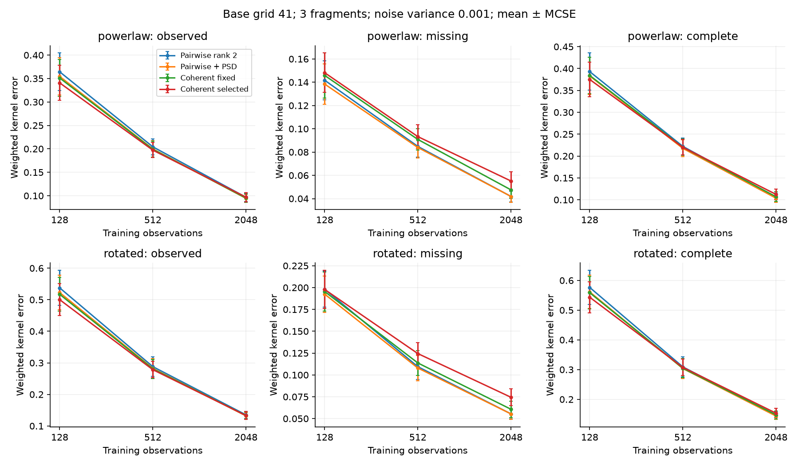
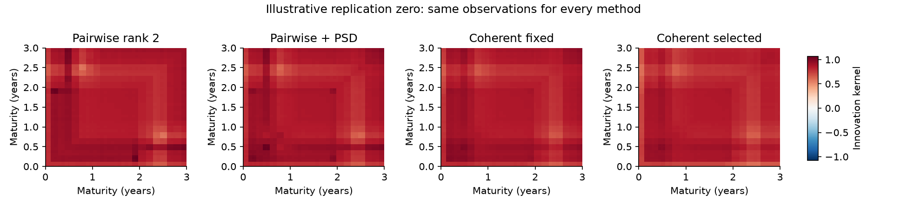
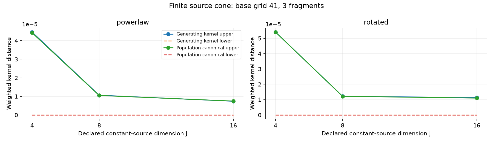

# PSD-consistent covariance completion: paired follow-up

This study fits compatible PSD observed fragments jointly, then completes them using full numerical support. The historical pairwise rank-two estimator and its separate global PSD projection remain baselines. No superiority or identification claim is an acceptance condition.

Seed `20261026`; 20 paired replications; forcing cutoff 512; weekly intervals 0.019230769; training counts [128, 512, 2048]; base grids [41]; covers [3, 9]; noise variances [0.0, 0.001].

## Protocol and chronology

One parent observation pool is generated per replication/model before method, grid, noise and training-prefix views. Training ends at N; validation occupies positions 2049–2176; the following 512 observations are held out. Selection sees corrected observed statistics only and does not refit on validation.

Relative partial penalties [0.0001, 0.001, 0.01] multiply the maximum training pair coverage. The fixed policy uses the candidate nearest 0.001; exact validation ties prefer the larger penalty. Weighted-coordinate eigenvalue floor 1e-05, support cutoff 1e-12, observed-partial optimizer-distance budget 0.0001. The floor is a finite-grid regularizer, not a fixed continuum white-noise operator.

Execution uses 4 process worker(s), with ADMM capped at 100000 iterations and each replication checkpoint bound to the parent source/configuration manifest. Replication seeds and aggregation order are independent of scheduling. Timings are elapsed per-candidate costs in this shared execution environment, not hardware-independent performance claims.

The weighted fitting objective differs from the original-domain Frobenius validation score. Upstream penalties alter observed predictions, so validation can compare them. Hard completion ranks remain invisible to a score restricted to unchanged observed entries. Risk scores are available only when one future fragment measures the whole exposure jointly.

## Kernel errors

Means ± replication-level MCSE. Complete error is against the generating kernel; the machine-readable tables also separate error against its population canonical completion and the canonical-versus-generating discrepancy.

Representative base grid 41, 3 fragments, noise 0.001:

| Model | N | Policy | Observed error | Missing error | Complete error |
|---|---:|---|---:|---:|---:|
| powerlaw | 128 | pairwise_rank2 | 0.36434 ± 0.04 | 0.14169 ± 0.017 | 0.39309 ± 0.043 |
| powerlaw | 128 | pairwise_rank2_psd | 0.35445 ± 0.04 | 0.1384 ± 0.017 | 0.38315 ± 0.042 |
| powerlaw | 128 | coherent_fixed | 0.35115 ± 0.039 | 0.14583 ± 0.019 | 0.38432 ± 0.042 |
| powerlaw | 128 | coherent_selected | 0.34073 ± 0.037 | 0.14815 ± 0.017 | 0.37513 ± 0.039 |
| powerlaw | 2048 | pairwise_rank2 | 0.096718 ± 0.0086 | 0.04187 ± 0.0046 | 0.10582 ± 0.0095 |
| powerlaw | 2048 | pairwise_rank2_psd | 0.09437 ± 0.0083 | 0.041896 ± 0.005 | 0.10375 ± 0.0094 |
| powerlaw | 2048 | coherent_fixed | 0.095028 ± 0.0089 | 0.047512 ± 0.0073 | 0.10699 ± 0.011 |
| powerlaw | 2048 | coherent_selected | 0.096861 ± 0.0098 | 0.055135 ± 0.0079 | 0.11236 ± 0.012 |
| rotated | 128 | pairwise_rank2 | 0.53761 ± 0.056 | 0.19815 ± 0.021 | 0.57645 ± 0.057 |
| rotated | 128 | pairwise_rank2_psd | 0.52281 ± 0.055 | 0.19247 ± 0.021 | 0.56147 ± 0.056 |
| rotated | 128 | coherent_fixed | 0.51717 ± 0.053 | 0.19548 ± 0.022 | 0.55869 ± 0.055 |
| rotated | 128 | coherent_selected | 0.50018 ± 0.051 | 0.19782 ± 0.022 | 0.54352 ± 0.052 |
| rotated | 2048 | pairwise_rank2 | 0.13512 ± 0.011 | 0.055405 ± 0.0059 | 0.14652 ± 0.012 |
| rotated | 2048 | pairwise_rank2_psd | 0.13191 ± 0.011 | 0.055362 ± 0.0065 | 0.14382 ± 0.012 |
| rotated | 2048 | coherent_fixed | 0.13302 ± 0.011 | 0.060698 ± 0.0093 | 0.14794 ± 0.013 |
| rotated | 2048 | coherent_selected | 0.13303 ± 0.013 | 0.074413 ± 0.0097 | 0.15345 ± 0.016 |

These kernel images use one common colour scale and the same observations: powerlaw, base grid 41, 9 fragments, N=512, noise 0.001, replication zero. Nonuniform augmented maturity coordinates are retained. This illustration does not replace the paired summaries.

## Paired observed scores and exposure risks

Central case: N=512, base grid 41, noise variance 0.001; every configured model and fragment cover is shown.

The observed-score difference is coherent selected minus pairwise rank two on identical future observations. Negative values favor the selected strategy for observed-pair covariance loss. MCSE uses replication-paired differences. This comparison does not validate never-observed cross-block covariance.

| Model | Fragments | N | Selected minus raw observed score | Paired replications |
|---|---:|---:|---:|---:|
| powerlaw | 3 | 512 | -0.28728 ± 0.35 | 20/20 |
| powerlaw | 9 | 512 | -0.42876 ± 0.38 | 20/20 |
| rotated | 3 | 512 | -0.24634 ± 0.69 | 20/20 |
| rotated | 9 | 512 | -1.0983 ± 0.59 | 20/20 |

Risk MSE is measured against the generating grid kernel in simulation; it does not imply an operational risk score is available. A future score requires the whole exposure to be observed jointly in an actual fragment. Score availability below counts replications with a score, not individual future dates.

| Model | Fragments | Policy | Exposure | Risk MSE | Operational risk score | Score-available replications |
|---|---:|---|---|---:|---:|---:|
| powerlaw | 3 | pairwise_rank2 | point_spread | 0.034669 ± 0.0069 | 0.032851 ± 0.0069 | 20/20 |
| powerlaw | 3 | pairwise_rank2 | long_spread | 0.0027835 ± 0.0012 | unavailable: no joint future exposure observation | 0/20 |
| powerlaw | 3 | coherent_selected | point_spread | 0.030774 ± 0.0091 | 0.029398 ± 0.0092 | 20/20 |
| powerlaw | 3 | coherent_selected | long_spread | 0.0083649 ± 0.0016 | unavailable: no joint future exposure observation | 0/20 |
| powerlaw | 9 | pairwise_rank2 | point_spread | 0.02037 ± 0.0074 | 0.01853 ± 0.0075 | 20/20 |
| powerlaw | 9 | pairwise_rank2 | long_spread | 0.066097 ± 0.019 | unavailable: no joint future exposure observation | 0/20 |
| powerlaw | 9 | coherent_selected | point_spread | 0.014896 ± 0.0037 | 0.012855 ± 0.0036 | 20/20 |
| powerlaw | 9 | coherent_selected | long_spread | 0.042943 ± 0.0079 | unavailable: no joint future exposure observation | 0/20 |
| rotated | 3 | pairwise_rank2 | point_spread | 0.071085 ± 0.015 | 0.060538 ± 0.015 | 20/20 |
| rotated | 3 | pairwise_rank2 | long_spread | 0.0076513 ± 0.0018 | unavailable: no joint future exposure observation | 0/20 |
| rotated | 3 | coherent_selected | point_spread | 0.077547 ± 0.022 | 0.067591 ± 0.023 | 20/20 |
| rotated | 3 | coherent_selected | long_spread | 0.025161 ± 0.0065 | unavailable: no joint future exposure observation | 0/20 |
| rotated | 9 | pairwise_rank2 | point_spread | 0.033679 ± 0.01 | 0.020889 ± 0.011 | 20/20 |
| rotated | 9 | pairwise_rank2 | long_spread | 0.11764 ± 0.031 | unavailable: no joint future exposure observation | 0/20 |
| rotated | 9 | coherent_selected | point_spread | 0.031317 ± 0.0077 | 0.017684 ± 0.0078 | 20/20 |
| rotated | 9 | coherent_selected | long_spread | 0.069842 ± 0.01 | unavailable: no joint future exposure observation | 0/20 |

## Numerical feasibility and certificates

- `partial_certificates_within_budget`: `True`.
- `coherent_outputs_psd`: `True`.
- `source_controls`: `True`.
- `population_reference_available`: `True`.
- `source_witnesses_feasible`: `True`.
- `passed`: `True`.

All 1440 declared partial candidates are retained in the audit. Their certified distance covers only the weighted observed-partial optimization problem. Completion inverse amplification, sampling, representation and source truncation errors are separate. The shared diagonal restoration is explicitly recorded; coherent completion does not apply a global PSD projection. The historical PSD baseline can modify observed entries and risks.

Comparisons concern whole strategies: coherent fitting changes PSD constraints, upstream penalty, eigenvalue floor and completion support together. They do not isolate a causal benefit from PSD coherence alone. Reported runtime includes projection for the historical PSD baseline and all candidates for selected coherent fitting; the fixed strategy reports its single-candidate cost.

## Constant-source SPDE diagnostic

The diagnostic minimizes distance to kernels generated by a constant PSD source covariance in the declared finite Laguerre space and source trace cap. The returned source is an optimization witness, not an identified physical loading. The convex gap yields a distance interval even if the requested gap tolerance is not attained.

At unfinished solves, upper bounds are distances of the current feasible witnesses. They can be nonmonotone in J even for nested finite classes whose exact minimum distance cannot increase. Read lower and upper bounds together; an increasing upper-bound curve is not evidence that the exact nested-class distance increased.

The source-cone audit separately reports the best weighted symmetric kernel approximation in the evaluation-basis span (SVD relative threshold 1e-12). Total finite-class distance includes that representation mismatch as well as the source PSD/trace restrictions; it cannot be attributed entirely to a transport obstruction.

| Two-dimensional control (interval one year) | Distance lower | Distance upper |
|---|---:|---:|
| generated | 0 | 6.9669218e-13 |
| positive_definite_obstruction | 0.072107537 | 0.072107537 |

72 finite-grid diagnostics are saved; 12 did not reach the requested objective-gap tolerance and retain their valid distance bounds. Population checks cover generating and canonical targets; empirical diagnostics use only the declared illustrative replication zero, middle training count and largest noise variance. They are not Monte Carlo evidence of a universal obstruction.

A strictly positive lower distance establishes that the particular target matrix lies outside the declared finite constant-source class with its trace cap and numerical integration map. It does not exclude an infinite-dimensional SPDE, a larger source support or a time-varying source. Grid/quadrature and omitted forcing uncertainty are not covered by the optimizer gap. The positive-definite two-dimensional control shows why PSD alone need not imply membership in this restricted source cone.

For empirically fitted kernels this is a compatibility diagnostic of the estimate, not a statistical rejection of the data-generating process. No sampling-calibrated rejection test is implemented.

## Artifacts and limits

[Configuration](config.json) · [Source/environment manifest](manifest.json) · [Results](results.json.gz) · [Candidates](candidates.json.gz) · [Selections](selections.json.gz) · [Estimates](estimates.csv.gz) · [Risks](risks.csv.gz) · [Paired differences](paired.csv.gz) · [Source-cone audit](source_cone.json.gz) · [Geometry](geometry.json.gz) · [Representative kernels](representative_kernels.json.gz)

This focused follow-up preserves the historical 100-replication paper controls and 20-replication SPDE fragment evidence. It adds a PSD-consistent strategy and finite source-class diagnostics; it does not establish infinite-dimensional estimation rates, canonical identification, market calibration or forecast performance.

## Compressed evidence

This evidence bundle retains the complete accepted run. CSV files and measurement/audit JSON files are compressed with gzip; artifact links point to those archives. Use `gzip -dc FILE.gz > FILE` to read an uncompressed copy. [Bundle checksums](artifact_sha256.json) record original and published bytes. The unchanged [manifest](manifest.json) retains the originating clean revision and source hashes.
