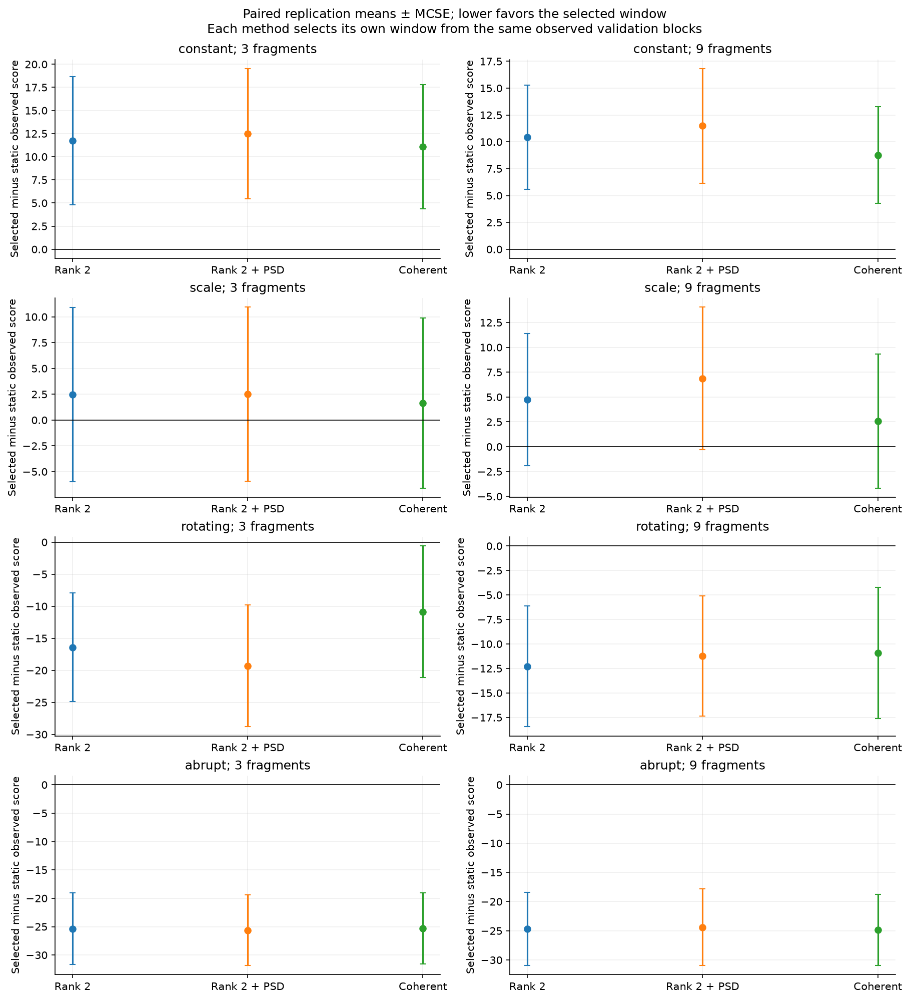
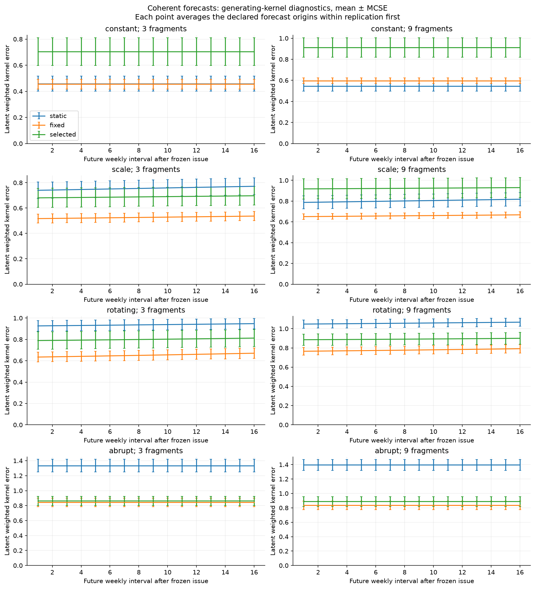
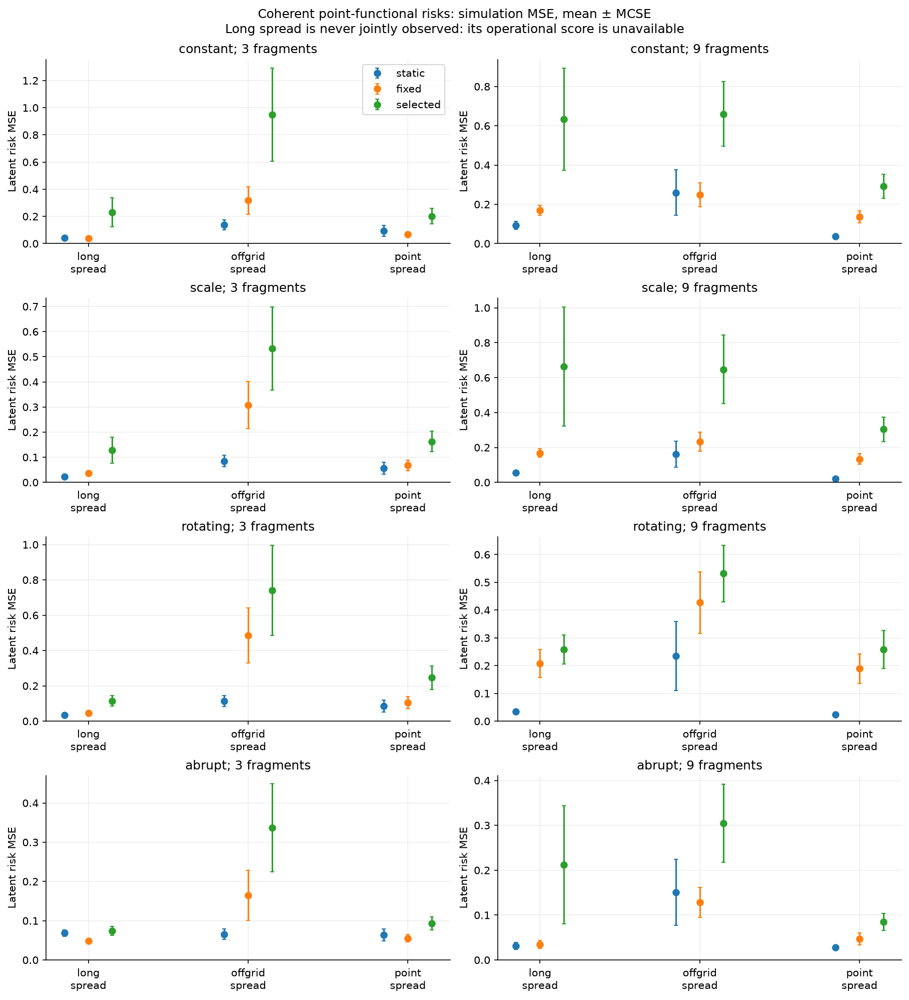

# Covariance-completion forecasts on time-varying transport sources

This fixed-grid follow-up combines existing completion strategies with the predeclared RQ3 frozen-block protocol. It tests whole strategies; no forecast improvement, identification result or new estimator theorem is an acceptance condition.

Seed `20261028`; 20 paired replications; 512 weekly intervals; forcing cutoff 256; base grid 21; fragment catalogues [3, 9]; known point-noise variance 0.001.

## Targets and chronology

The source has a fixed infinite power-law spectrum. Deterministic scale and first-two-mode rotations vary its covariance, held constant within each week. The target for week i is the transported normalized innovation covariance V_i, evaluated on the declared grid. These are clean normalized innovations observed through noisy fragments, rather than innovations reconstructed from sparse/noisy price levels. The forcing cutoff is a finite reference with an explicit remaining tail.

Static fits use intervals 1–128. Fixed fits use the last 128 observations. Each method separately selects among windows [16, 32, 64, 128] at origins [128, 192], on the following 16 observations per origin. Exact ties choose the longest window. No candidate is dropped for failure; if any predeclared validation window is unavailable, that method's selected rule is unavailable.

All validation outcomes precede test origins [256, 272, 304, 448]. Each issue is frozen for the following horizons 1–16, with no use of intervening outcomes. These are predictions of each future weekly covariance, rather than the covariance of a multiweek accumulated return.

One parent measurement pool precedes every method and cover within replication/scenario. A seed-shuffled fragment catalogue repeats cyclically, so every training window contains every declared clique. This is an explicit design choice, not a claim of design parity with older studies. Shared random numbers couple methods; independent replications define MCSE.

Historical rank-two raw completion and its separate weighted global PSD projection are compared with coherent partial fitting and full-support completion. Coherent η=0.001 is fixed; the weighted-coordinate floor is γ/Q² with γ=0.02116 and actual augmented grid size Q. The numerical observed-partial optimizer-distance budget is 0.0001. No additional hyperparameter tuning or forecast model is introduced.

## Observed forecast scores

The reduced observed quadratic score omits a forecast-independent measurement constant and may be negative. Lower differences favor the first rule. Comparisons use identical future fragments and known-noise correction; their magnitudes must not be ranked across fragment designs. The mean and MCSE below average future dates/origins within replication before averaging independent replications.

| Scenario | Fragments | Method | Selected minus static score | Available pairs | Selected minus fixed score | Available pairs |
|---|---:|---|---:|---:|---:|---:|
| constant | 3 | rank2 | 11.7505 ± 6.92 | 20/20 | 16.103 ± 8.54 | 20/20 |
| constant | 3 | rank2_psd | 12.4912 ± 7.06 | 20/20 | 16.972 ± 8.69 | 20/20 |
| constant | 3 | coherent | 11.0986 ± 6.7 | 20/20 | 15.511 ± 8.22 | 20/20 |
| constant | 9 | rank2 | 10.4271 ± 4.87 | 20/20 | 15.8299 ± 4.89 | 20/20 |
| constant | 9 | rank2_psd | 11.4893 ± 5.35 | 20/20 | 17.1727 ± 5.42 | 20/20 |
| constant | 9 | coherent | 8.76205 ± 4.5 | 20/20 | 14.0801 ± 4.48 | 20/20 |
| scale | 3 | rank2 | 2.46118 ± 8.45 | 20/20 | 10.8601 ± 6.4 | 20/20 |
| scale | 3 | rank2_psd | 2.50472 ± 8.43 | 20/20 | 10.7223 ± 6.37 | 20/20 |
| scale | 3 | coherent | 1.65674 ± 8.24 | 20/20 | 10.3169 ± 6.15 | 20/20 |
| scale | 9 | rank2 | 4.74836 ± 6.66 | 20/20 | 14.8741 ± 5.82 | 20/20 |
| scale | 9 | rank2_psd | 6.86783 ± 7.17 | 20/20 | 16.6513 ± 6.43 | 20/20 |
| scale | 9 | coherent | 2.57466 ± 6.73 | 20/20 | 12.88 ± 5.37 | 20/20 |
| rotating | 3 | rank2 | -16.4118 ± 8.47 | 20/20 | 4.46473 ± 4.06 | 20/20 |
| rotating | 3 | rank2_psd | -19.2935 ± 9.52 | 20/20 | 1.42288 ± 3.02 | 20/20 |
| rotating | 3 | coherent | -10.8495 ± 10.2 | 20/20 | 10.1754 ± 6.86 | 20/20 |
| rotating | 9 | rank2 | -12.2976 ± 6.16 | 20/20 | 7.07016 ± 3.36 | 20/20 |
| rotating | 9 | rank2_psd | -11.2093 ± 6.13 | 20/20 | 8.01378 ± 3.64 | 20/20 |
| rotating | 9 | coherent | -10.9353 ± 6.69 | 20/20 | 8.4566 ± 3.55 | 20/20 |
| abrupt | 3 | rank2 | -25.3712 ± 6.29 | 20/20 | 3.13332 ± 3.64 | 20/20 |
| abrupt | 3 | rank2_psd | -25.6341 ± 6.23 | 20/20 | 3.39456 ± 3.74 | 20/20 |
| abrupt | 3 | coherent | -25.3112 ± 6.25 | 20/20 | 2.97631 ± 3.58 | 20/20 |
| abrupt | 9 | rank2 | -24.6545 ± 6.25 | 20/20 | 7.19837 ± 3.93 | 20/20 |
| abrupt | 9 | rank2_psd | -24.3781 ± 6.52 | 20/20 | 8.20026 ± 4.28 | 20/20 |
| abrupt | 9 | coherent | -24.8779 ± 6.09 | 20/20 | 6.55815 ± 3.85 | 20/20 |

If a method is unavailable in some replications, its reported mean/MCSE is conditional on the explicitly counted complete pairs. Such a comparison is not the unconditional performance of all declared replications. Baseline unavailability is retained and does not prevent acceptance of a fully accounted numerical experiment.

## Latent diagnostics and risk-score availability

Kernel and risk errors use the generating finite-reference V_i only after forecasts are issued. They are simulation diagnostics, not selection inputs. A scalar risk proxy exists only on future dates whose one fragment contains the entire point-functional exposure. Long-spread risk therefore has latent MSE but no operational score; pooled coverage does not substitute for joint observation.

| Scenario | Fragments | Exposure | Coherent selected risk MSE | Score-available replications |
|---|---:|---|---:|---:|
| constant | 3 | point_spread | 0.20226 ± 0.0578 | 20/20 |
| constant | 3 | offgrid_spread | 0.949986 ± 0.343 | 20/20 |
| constant | 3 | long_spread | 0.230128 ± 0.108 | 0/20 |
| constant | 9 | point_spread | 0.292449 ± 0.0616 | 20/20 |
| constant | 9 | offgrid_spread | 0.660222 ± 0.164 | 20/20 |
| constant | 9 | long_spread | 0.634454 ± 0.26 | 0/20 |
| scale | 3 | point_spread | 0.162974 ± 0.0406 | 20/20 |
| scale | 3 | offgrid_spread | 0.532847 ± 0.166 | 20/20 |
| scale | 3 | long_spread | 0.127938 ± 0.0516 | 0/20 |
| scale | 9 | point_spread | 0.304573 ± 0.0705 | 20/20 |
| scale | 9 | offgrid_spread | 0.647369 ± 0.197 | 20/20 |
| scale | 9 | long_spread | 0.663659 ± 0.342 | 0/20 |
| rotating | 3 | point_spread | 0.246665 ± 0.0663 | 20/20 |
| rotating | 3 | offgrid_spread | 0.740265 ± 0.255 | 20/20 |
| rotating | 3 | long_spread | 0.114611 ± 0.0301 | 0/20 |
| rotating | 9 | point_spread | 0.258213 ± 0.0682 | 20/20 |
| rotating | 9 | offgrid_spread | 0.53145 ± 0.101 | 20/20 |
| rotating | 9 | long_spread | 0.258518 ± 0.0526 | 0/20 |
| abrupt | 3 | point_spread | 0.093275 ± 0.0171 | 20/20 |
| abrupt | 3 | offgrid_spread | 0.336944 ± 0.112 | 20/20 |
| abrupt | 3 | long_spread | 0.0738962 ± 0.0116 | 0/20 |
| abrupt | 9 | point_spread | 0.0846279 ± 0.0191 | 20/20 |
| abrupt | 9 | offgrid_spread | 0.304576 ± 0.0874 | 20/20 |
| abrupt | 9 | long_spread | 0.211574 ± 0.132 | 0/20 |

## Acceptance, provenance and limits

- `declared_coverage_complete`: `True`.
- `coherent_issued_fits_available`: `True`.
- `coherent_test_forecasts_available`: `True`.
- `coherent_outputs_psd`: `True`.
- `selection_uses_past_only`: `True`.
- `coherent_certificates_within_budget`: `True`.
- `passed`: `True`.

Descriptive availability: 0 unavailable fits; 0 unavailable future score rows. These are retained, with no fallback.

All 6772 issued fits and 92160 future score rows are retained, including unavailable cases. Source/configuration manifests and replication checkpoints record provenance; successful worker results are assembled in seed order.

The optimizer certificate controls only the fitted observed partial kernel. It does not control completion amplification, sampling, omitted source modes or future drift. Grid, forcing cutoff and the floor remain fixed in this prediction study; joint-resolution work is separate. Constant-source and changing-source scenarios can favor different windows, and selected windows need not win. No market calibration, statistical confidence interval or source-loading recovery is claimed.

[Configuration](config.json) · [Manifest](manifest.json) · [Model and tails](model.json.gz) · [Results](results.json.gz) · [Fits](fits.json.gz) · [Selections](selections.json.gz) · [Validation](validation.csv.gz) · [Future scores](forecasts.csv.gz) · [Risks](risks.csv.gz) · [Replication averages](replication_averages.csv.gz) · [Paired differences](paired.csv.gz)

## Compressed evidence

This evidence bundle retains the complete accepted run. CSV files and measurement/audit JSON files are compressed with gzip; artifact links point to those archives. Use `gzip -dc FILE.gz > FILE` to read an uncompressed copy. [Bundle checksums](artifact_sha256.json) record original and published bytes. The unchanged [manifest](manifest.json) retains the originating clean revision and source hashes.
