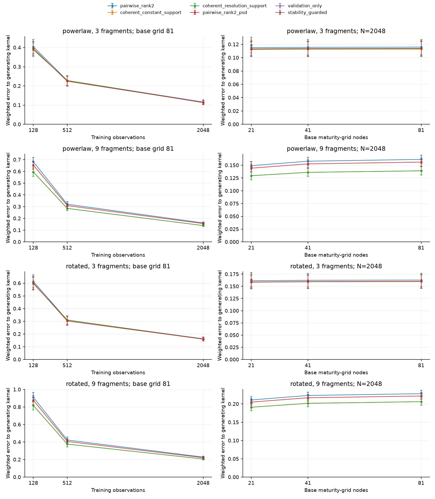
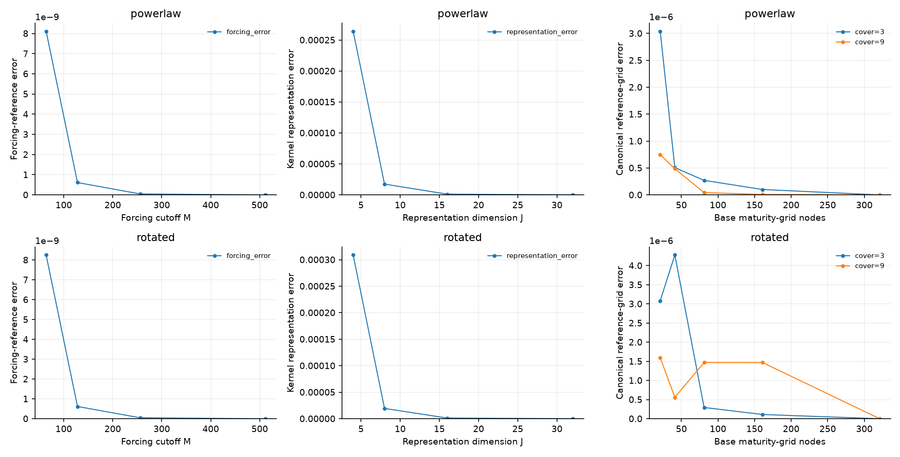
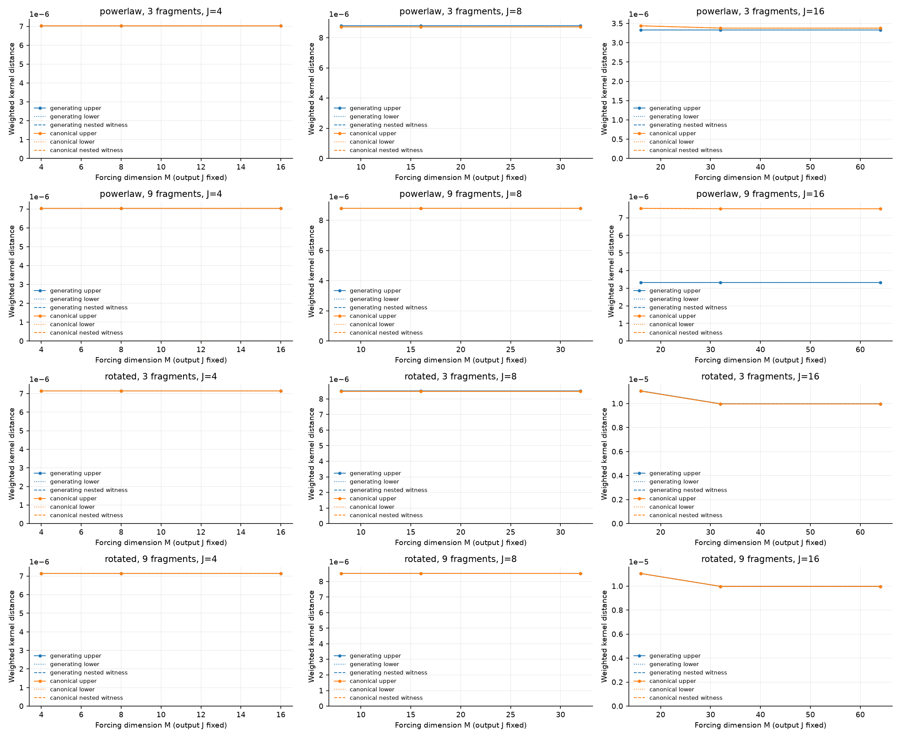

# Covariance completion: ablations and refinement

Declared profile: `refinement`. Seed `20261028`; 20 paired replications; base grids [21, 41, 81]; training counts [128, 512, 2048]; fragment covers [3, 9]; noise variance 0.001.

The ablation profile compares explicit partial-estimation, floor and completion choices. The refinement profile studies changes in grid, representation and forcing cutoff. These questions have different targets; a favorable empirical error is not a population convergence proof.

## Information and numerical boundaries

Every strategy uses the same supplied training observations for its declared case. Partial means include the known fresh point-noise correction and may be indefinite. Upstream shrinkage and coherent PSD constraints can change observed entries; support/rank completion preserves those fitted entries. Selection uses observed validation scores and any predeclared training-split admissibility guard. No latent error, source label, held-out test score or future origin selects a candidate.

Observed validation is blind to differences confined to never-observed pairs. Training split stability and separator inverse amplification are separate diagnostics, not missing-pair risk guarantees or proofs of identification. Unavailable half-fits, conditioning and numerical certificates remain in the audit.

Shared upstream fits are cached across completion rules. A policy visited first bears the upstream solve time; a reused policy bears only its incremental completion time. The recorded runtimes are cache/order-dependent execution diagnostics, not a fair speed ranking of separately executed estimators.

The resolution floor is gamma/Q² in sqrt(W) K sqrt(W) coordinates. Its diagonal baseline trace is gamma/Q; the legacy constant floor and zero floor are explicit ablations. Vanishing baseline trace alone establishes no continuum convergence after potentially ill-conditioned separator inversion. Weighted grid coordinates are not orthonormal H coordinates.

The optimizer gap certifies only the weighted observed-partial optimization error. It excludes sampling, completion amplification, grid, representation, forcing truncation and SPDE-source errors. Raw or rank-truncated completed kernels can remain indefinite; no global PSD projection occurs implicitly.

## Empirical kernel error

The left column fixes the largest declared base grid; the right fixes the largest declared training count. Error bars show replication-level MCSE where available; a missing MCSE is not zero sampling uncertainty. Curves with only one configured point are controls, not refinement evidence. Generating-kernel error, canonical-estimation error and the canonical-versus-generating discrepancy are distinct quantities. Unavailable policies remain in the saved summaries and the central table.

Central table: base grid 81, N=512. Unavailable metrics are not replaced by zero.

| Model | Fragments | Policy | Complete error | Missing error | Canonical error | Observed modification |
|---|---:|---|---:|---:|---:|---:|
| powerlaw | 3 | pairwise_rank2 | 0.22839 ± 0.026 | 0.088298 ± 0.011 | 0.22839 ± 0.026 | 0 ± 0 |
| powerlaw | 3 | coherent_constant_support | 0.22815 ± 0.026 | 0.096446 ± 0.012 | 0.22815 ± 0.026 | 0.88259 ± 0.12 |
| powerlaw | 3 | coherent_resolution_support | 0.22814 ± 0.026 | 0.096426 ± 0.012 | 0.22814 ± 0.026 | 0.88232 ± 0.12 |
| powerlaw | 3 | pairwise_rank2_psd | 0.2245 ± 0.026 | 0.087913 ± 0.011 | 0.2245 ± 0.026 | 0.88653 ± 0.13 |
| powerlaw | 9 | pairwise_rank2 | 0.32062 ± 0.021 | 0.17562 ± 0.012 | 0.32062 ± 0.021 | 0 ± 0 |
| powerlaw | 9 | coherent_constant_support | 0.28497 ± 0.02 | 0.13817 ± 0.0091 | 0.28497 ± 0.02 | 2.0627 ± 0.14 |
| powerlaw | 9 | coherent_resolution_support | 0.28498 ± 0.02 | 0.1382 ± 0.0091 | 0.28498 ± 0.02 | 2.0622 ± 0.14 |
| powerlaw | 9 | pairwise_rank2_psd | 0.30908 ± 0.021 | 0.1617 ± 0.011 | 0.30908 ± 0.021 | 2.0685 ± 0.15 |
| rotated | 3 | pairwise_rank2 | 0.30898 ± 0.034 | 0.11201 ± 0.014 | 0.30898 ± 0.034 | 0 ± 0 |
| rotated | 3 | coherent_constant_support | 0.31047 ± 0.034 | 0.12997 ± 0.016 | 0.31047 ± 0.034 | 1.4229 ± 0.19 |
| rotated | 3 | coherent_resolution_support | 0.31046 ± 0.034 | 0.12997 ± 0.016 | 0.31046 ± 0.034 | 1.4226 ± 0.19 |
| rotated | 3 | pairwise_rank2_psd | 0.30297 ± 0.034 | 0.11427 ± 0.014 | 0.30297 ± 0.034 | 1.4128 ± 0.19 |
| rotated | 9 | pairwise_rank2 | 0.42312 ± 0.032 | 0.22607 ± 0.016 | 0.42312 ± 0.032 | 0 ± 0 |
| rotated | 9 | coherent_constant_support | 0.37633 ± 0.032 | 0.17408 ± 0.014 | 0.37633 ± 0.032 | 2.7622 ± 0.17 |
| rotated | 9 | coherent_resolution_support | 0.37634 ± 0.032 | 0.17409 ± 0.014 | 0.37634 ± 0.032 | 2.7618 ± 0.17 |
| rotated | 9 | pairwise_rank2_psd | 0.40663 ± 0.032 | 0.20376 ± 0.014 | 0.40663 ± 0.032 | 2.8321 ± 0.21 |

## Paired observed scores and stability

Paired comparisons are computed within each replication before aggregation. A lower observed score concerns observed-pair covariance prediction; it does not validate missing cross-blocks. The complete machine-readable paired and stability tables retain availability counts, the declared guard and rejected candidates.

| Model | Fragments | N | Policy | Metric | Paired mean ± MCSE | Available replications |
|---|---:|---:|---|---|---:|---:|
| powerlaw | 3 | 512 | pairwise_rank2 | test_observed_score | 0 ± 0 | 20 |
| powerlaw | 3 | 512 | pairwise_rank2 | test_observed_score_mean_absolute_deviation_from | 0 (MCSE unavailable) | unavailable |
| powerlaw | 3 | 512 | pairwise_rank2 | complete_weighted_error | 0 ± 0 | 20 |
| powerlaw | 3 | 512 | pairwise_rank2 | complete_weighted_error_mean_absolute_deviation_from | 0 (MCSE unavailable) | unavailable |
| powerlaw | 3 | 512 | pairwise_rank2 | missing_weighted_error | 0 ± 0 | 20 |
| powerlaw | 3 | 512 | pairwise_rank2 | missing_weighted_error_mean_absolute_deviation_from | 0 (MCSE unavailable) | unavailable |
| powerlaw | 3 | 512 | coherent_constant_support | test_observed_score | -0.60392 ± 0.29 | 20 |
| powerlaw | 3 | 512 | coherent_constant_support | test_observed_score_mean_absolute_deviation_from | 1.0763 (MCSE unavailable) | unavailable |
| powerlaw | 3 | 512 | coherent_constant_support | complete_weighted_error | -0.00023743 ± 0.0023 | 20 |
| powerlaw | 3 | 512 | coherent_constant_support | complete_weighted_error_mean_absolute_deviation_from | 0.0091155 (MCSE unavailable) | unavailable |
| powerlaw | 3 | 512 | coherent_constant_support | missing_weighted_error | 0.0081476 ± 0.0041 | 20 |
| powerlaw | 3 | 512 | coherent_constant_support | missing_weighted_error_mean_absolute_deviation_from | 0.01563 (MCSE unavailable) | unavailable |
| powerlaw | 3 | 512 | coherent_resolution_support | test_observed_score | -0.60387 ± 0.29 | 20 |
| powerlaw | 3 | 512 | coherent_resolution_support | test_observed_score_mean_absolute_deviation_from | 1.0763 (MCSE unavailable) | unavailable |
| powerlaw | 3 | 512 | coherent_resolution_support | complete_weighted_error | -0.00024575 ± 0.0023 | 20 |
| powerlaw | 3 | 512 | coherent_resolution_support | complete_weighted_error_mean_absolute_deviation_from | 0.0091181 (MCSE unavailable) | unavailable |
| powerlaw | 3 | 512 | coherent_resolution_support | missing_weighted_error | 0.0081274 ± 0.0041 | 20 |
| powerlaw | 3 | 512 | coherent_resolution_support | missing_weighted_error_mean_absolute_deviation_from | 0.015637 (MCSE unavailable) | unavailable |
| powerlaw | 3 | 512 | pairwise_rank2_psd | test_observed_score | -0.039477 ± 0.39 | 20 |
| powerlaw | 3 | 512 | pairwise_rank2_psd | test_observed_score_mean_absolute_deviation_from | 1.2376 (MCSE unavailable) | unavailable |
| powerlaw | 3 | 512 | pairwise_rank2_psd | complete_weighted_error | -0.0038835 ± 0.001 | 20 |
| powerlaw | 3 | 512 | pairwise_rank2_psd | complete_weighted_error_mean_absolute_deviation_from | 0.0029185 (MCSE unavailable) | unavailable |
| powerlaw | 3 | 512 | pairwise_rank2_psd | missing_weighted_error | -0.00038499 ± 0.00079 | 20 |
| powerlaw | 3 | 512 | pairwise_rank2_psd | missing_weighted_error_mean_absolute_deviation_from | 0.0026128 (MCSE unavailable) | unavailable |
| powerlaw | 9 | 512 | pairwise_rank2 | test_observed_score | 0 ± 0 | 20 |
| powerlaw | 9 | 512 | pairwise_rank2 | test_observed_score_mean_absolute_deviation_from | 0 (MCSE unavailable) | unavailable |
| powerlaw | 9 | 512 | pairwise_rank2 | complete_weighted_error | 0 ± 0 | 20 |
| powerlaw | 9 | 512 | pairwise_rank2 | complete_weighted_error_mean_absolute_deviation_from | 0 (MCSE unavailable) | unavailable |
| powerlaw | 9 | 512 | pairwise_rank2 | missing_weighted_error | 0 ± 0 | 20 |
| powerlaw | 9 | 512 | pairwise_rank2 | missing_weighted_error_mean_absolute_deviation_from | 0 (MCSE unavailable) | unavailable |
| powerlaw | 9 | 512 | coherent_constant_support | test_observed_score | -0.86157 ± 0.32 | 20 |
| powerlaw | 9 | 512 | coherent_constant_support | test_observed_score_mean_absolute_deviation_from | 1.2067 (MCSE unavailable) | unavailable |
| powerlaw | 9 | 512 | coherent_constant_support | complete_weighted_error | -0.035652 ± 0.0068 | 20 |
| powerlaw | 9 | 512 | coherent_constant_support | complete_weighted_error_mean_absolute_deviation_from | 0.02352 (MCSE unavailable) | unavailable |
| powerlaw | 9 | 512 | coherent_constant_support | missing_weighted_error | -0.037446 ± 0.0092 | 20 |
| powerlaw | 9 | 512 | coherent_constant_support | missing_weighted_error_mean_absolute_deviation_from | 0.031774 (MCSE unavailable) | unavailable |
| powerlaw | 9 | 512 | coherent_resolution_support | test_observed_score | -0.8616 ± 0.32 | 20 |
| powerlaw | 9 | 512 | coherent_resolution_support | test_observed_score_mean_absolute_deviation_from | 1.2067 (MCSE unavailable) | unavailable |
| powerlaw | 9 | 512 | coherent_resolution_support | complete_weighted_error | -0.035637 ± 0.0068 | 20 |
| powerlaw | 9 | 512 | coherent_resolution_support | complete_weighted_error_mean_absolute_deviation_from | 0.023521 (MCSE unavailable) | unavailable |
| powerlaw | 9 | 512 | coherent_resolution_support | missing_weighted_error | -0.037421 ± 0.0092 | 20 |
| powerlaw | 9 | 512 | coherent_resolution_support | missing_weighted_error_mean_absolute_deviation_from | 0.03179 (MCSE unavailable) | unavailable |
| powerlaw | 9 | 512 | pairwise_rank2_psd | test_observed_score | 1.4528 ± 0.69 | 20 |
| powerlaw | 9 | 512 | pairwise_rank2_psd | test_observed_score_mean_absolute_deviation_from | 2.3239 (MCSE unavailable) | unavailable |
| powerlaw | 9 | 512 | pairwise_rank2_psd | complete_weighted_error | -0.011543 ± 0.0014 | 20 |
| powerlaw | 9 | 512 | pairwise_rank2_psd | complete_weighted_error_mean_absolute_deviation_from | 0.0049309 (MCSE unavailable) | unavailable |
| powerlaw | 9 | 512 | pairwise_rank2_psd | missing_weighted_error | -0.013917 ± 0.0031 | 20 |
| powerlaw | 9 | 512 | pairwise_rank2_psd | missing_weighted_error_mean_absolute_deviation_from | 0.010734 (MCSE unavailable) | unavailable |
| rotated | 3 | 512 | pairwise_rank2 | test_observed_score | 0 ± 0 | 20 |
| rotated | 3 | 512 | pairwise_rank2 | test_observed_score_mean_absolute_deviation_from | 0 (MCSE unavailable) | unavailable |
| rotated | 3 | 512 | pairwise_rank2 | complete_weighted_error | 0 ± 0 | 20 |
| rotated | 3 | 512 | pairwise_rank2 | complete_weighted_error_mean_absolute_deviation_from | 0 (MCSE unavailable) | unavailable |
| rotated | 3 | 512 | pairwise_rank2 | missing_weighted_error | 0 ± 0 | 20 |
| rotated | 3 | 512 | pairwise_rank2 | missing_weighted_error_mean_absolute_deviation_from | 0 (MCSE unavailable) | unavailable |
| rotated | 3 | 512 | coherent_constant_support | test_observed_score | -1.1604 ± 0.49 | 20 |
| rotated | 3 | 512 | coherent_constant_support | test_observed_score_mean_absolute_deviation_from | 1.8056 (MCSE unavailable) | unavailable |
| rotated | 3 | 512 | coherent_constant_support | complete_weighted_error | 0.0014926 ± 0.0031 | 20 |
| rotated | 3 | 512 | coherent_constant_support | complete_weighted_error_mean_absolute_deviation_from | 0.011173 (MCSE unavailable) | unavailable |
| rotated | 3 | 512 | coherent_constant_support | missing_weighted_error | 0.017958 ± 0.0052 | 20 |
| rotated | 3 | 512 | coherent_constant_support | missing_weighted_error_mean_absolute_deviation_from | 0.019412 (MCSE unavailable) | unavailable |
| rotated | 3 | 512 | coherent_resolution_support | test_observed_score | -1.1604 ± 0.49 | 20 |
| rotated | 3 | 512 | coherent_resolution_support | test_observed_score_mean_absolute_deviation_from | 1.8056 (MCSE unavailable) | unavailable |
| rotated | 3 | 512 | coherent_resolution_support | complete_weighted_error | 0.0014886 ± 0.0031 | 20 |
| rotated | 3 | 512 | coherent_resolution_support | complete_weighted_error_mean_absolute_deviation_from | 0.011169 (MCSE unavailable) | unavailable |
| rotated | 3 | 512 | coherent_resolution_support | missing_weighted_error | 0.017951 ± 0.0052 | 20 |
| rotated | 3 | 512 | coherent_resolution_support | missing_weighted_error_mean_absolute_deviation_from | 0.019407 (MCSE unavailable) | unavailable |
| rotated | 3 | 512 | pairwise_rank2_psd | test_observed_score | -0.78679 ± 0.79 | 20 |
| rotated | 3 | 512 | pairwise_rank2_psd | test_observed_score_mean_absolute_deviation_from | 2.6423 (MCSE unavailable) | unavailable |
| rotated | 3 | 512 | pairwise_rank2_psd | complete_weighted_error | -0.0060031 ± 0.0011 | 20 |
| rotated | 3 | 512 | pairwise_rank2_psd | complete_weighted_error_mean_absolute_deviation_from | 0.0039887 (MCSE unavailable) | unavailable |
| rotated | 3 | 512 | pairwise_rank2_psd | missing_weighted_error | 0.0022548 ± 0.0013 | 20 |
| rotated | 3 | 512 | pairwise_rank2_psd | missing_weighted_error_mean_absolute_deviation_from | 0.0046444 (MCSE unavailable) | unavailable |
| rotated | 9 | 512 | pairwise_rank2 | test_observed_score | 0 ± 0 | 20 |
| rotated | 9 | 512 | pairwise_rank2 | test_observed_score_mean_absolute_deviation_from | 0 (MCSE unavailable) | unavailable |
| rotated | 9 | 512 | pairwise_rank2 | complete_weighted_error | 0 ± 0 | 20 |
| rotated | 9 | 512 | pairwise_rank2 | complete_weighted_error_mean_absolute_deviation_from | 0 (MCSE unavailable) | unavailable |
| rotated | 9 | 512 | pairwise_rank2 | missing_weighted_error | 0 ± 0 | 20 |
| rotated | 9 | 512 | pairwise_rank2 | missing_weighted_error_mean_absolute_deviation_from | 0 (MCSE unavailable) | unavailable |
| rotated | 9 | 512 | coherent_constant_support | test_observed_score | -1.312 ± 0.62 | 20 |
| rotated | 9 | 512 | coherent_constant_support | test_observed_score_mean_absolute_deviation_from | 2.2547 (MCSE unavailable) | unavailable |
| rotated | 9 | 512 | coherent_constant_support | complete_weighted_error | -0.046795 ± 0.0079 | 20 |
| rotated | 9 | 512 | coherent_constant_support | complete_weighted_error_mean_absolute_deviation_from | 0.02648 (MCSE unavailable) | unavailable |
| rotated | 9 | 512 | coherent_constant_support | missing_weighted_error | -0.051992 ± 0.01 | 20 |
| rotated | 9 | 512 | coherent_constant_support | missing_weighted_error_mean_absolute_deviation_from | 0.031844 (MCSE unavailable) | unavailable |
| rotated | 9 | 512 | coherent_resolution_support | test_observed_score | -1.3121 ± 0.62 | 20 |
| rotated | 9 | 512 | coherent_resolution_support | test_observed_score_mean_absolute_deviation_from | 2.2546 (MCSE unavailable) | unavailable |
| rotated | 9 | 512 | coherent_resolution_support | complete_weighted_error | -0.046785 ± 0.0079 | 20 |
| rotated | 9 | 512 | coherent_resolution_support | complete_weighted_error_mean_absolute_deviation_from | 0.026481 (MCSE unavailable) | unavailable |
| rotated | 9 | 512 | coherent_resolution_support | missing_weighted_error | -0.051975 ± 0.01 | 20 |
| rotated | 9 | 512 | coherent_resolution_support | missing_weighted_error_mean_absolute_deviation_from | 0.031845 (MCSE unavailable) | unavailable |
| rotated | 9 | 512 | pairwise_rank2_psd | test_observed_score | 2.2636 ± 1.3 | 20 |
| rotated | 9 | 512 | pairwise_rank2_psd | test_observed_score_mean_absolute_deviation_from | 4.135 (MCSE unavailable) | unavailable |
| rotated | 9 | 512 | pairwise_rank2_psd | complete_weighted_error | -0.01649 ± 0.0023 | 20 |
| rotated | 9 | 512 | pairwise_rank2_psd | complete_weighted_error_mean_absolute_deviation_from | 0.0078688 (MCSE unavailable) | unavailable |
| rotated | 9 | 512 | pairwise_rank2_psd | missing_weighted_error | -0.022309 ± 0.0051 | 20 |
| rotated | 9 | 512 | pairwise_rank2_psd | missing_weighted_error_mean_absolute_deviation_from | 0.016063 (MCSE unavailable) | unavailable |

Training-only selection audits (counts, not extra independent samples):

| Model | Grid | Fragments | N | Policy | Available / recorded replications | Selected-candidate counts |
|---|---:|---:|---:|---|---:|---|
| powerlaw | 21 | 3 | 2048 | validation_only | 20/20 | eta0.0001: 9; eta0.001: 2; eta0.01: 9 |
| powerlaw | 21 | 3 | 2048 | stability_guarded | 20/20 | eta0.0001: 9; eta0.001: 2; eta0.01: 9 |
| powerlaw | 21 | 9 | 2048 | validation_only | 20/20 | eta0.0001: 11; eta0.01: 9 |
| powerlaw | 21 | 9 | 2048 | stability_guarded | 20/20 | eta0.0001: 11; eta0.01: 9 |
| rotated | 21 | 3 | 2048 | validation_only | 20/20 | eta0.0001: 10; eta0.001: 1; eta0.01: 9 |
| rotated | 21 | 3 | 2048 | stability_guarded | 20/20 | eta0.0001: 10; eta0.001: 1; eta0.01: 9 |
| rotated | 21 | 9 | 2048 | validation_only | 20/20 | eta0.0001: 12; eta0.01: 8 |
| rotated | 21 | 9 | 2048 | stability_guarded | 20/20 | eta0.0001: 12; eta0.01: 8 |

## Exposure errors and operational score availability

Central case: base grid 81, N=512. Exposure error below is absolute variance error against the generating grid kernel. The operational corrected quadratic score requires a future fragment that observes the entire exposure jointly. A latent error can be evaluated in simulation even when that score is unavailable; the two must not be conflated. Continuous delivery risk, when recorded separately in the raw risk table, also has a grid-quadrature approximation error.

| Model | Fragments | Policy | Exposure | Absolute variance error | Operational risk score | Score-available replications |
|---|---:|---|---|---:|---:|---:|
| powerlaw | 3 | pairwise_rank2 | point_spread | 0.16502 ± 0.033 | 0.046757 ± 0.016 | 20/20 |
| powerlaw | 3 | pairwise_rank2 | offgrid_spread | 0.19678 ± 0.034 | 0.059966 ± 0.023 | 20/20 |
| powerlaw | 3 | pairwise_rank2 | long_spread | 0.038038 ± 0.0099 | unavailable: no joint future exposure observation | 0/20 |
| powerlaw | 3 | pairwise_rank2 | grid_delivery_spread | 0.15844 ± 0.024 | unavailable: no joint future exposure observation | 0/20 |
| powerlaw | 3 | coherent_constant_support | point_spread | 0.10951 ± 0.035 | 0.033761 ± 0.02 | 20/20 |
| powerlaw | 3 | coherent_constant_support | offgrid_spread | 0.1765 ± 0.04 | 0.060694 ± 0.026 | 20/20 |
| powerlaw | 3 | coherent_constant_support | long_spread | 0.068136 ± 0.015 | unavailable: no joint future exposure observation | 0/20 |
| powerlaw | 3 | coherent_constant_support | grid_delivery_spread | 0.14043 ± 0.029 | unavailable: no joint future exposure observation | 0/20 |
| powerlaw | 3 | coherent_resolution_support | point_spread | 0.10931 ± 0.035 | 0.033578 ± 0.02 | 20/20 |
| powerlaw | 3 | coherent_resolution_support | offgrid_spread | 0.17634 ± 0.04 | 0.060507 ± 0.026 | 20/20 |
| powerlaw | 3 | coherent_resolution_support | long_spread | 0.06749 ± 0.015 | unavailable: no joint future exposure observation | 0/20 |
| powerlaw | 3 | coherent_resolution_support | grid_delivery_spread | 0.14042 ± 0.029 | unavailable: no joint future exposure observation | 0/20 |
| powerlaw | 3 | pairwise_rank2_psd | point_spread | 0.10992 ± 0.035 | 0.034662 ± 0.021 | 20/20 |
| powerlaw | 3 | pairwise_rank2_psd | offgrid_spread | 0.18437 ± 0.046 | 0.072795 ± 0.034 | 20/20 |
| powerlaw | 3 | pairwise_rank2_psd | long_spread | 0.065139 ± 0.014 | unavailable: no joint future exposure observation | 0/20 |
| powerlaw | 3 | pairwise_rank2_psd | grid_delivery_spread | 0.14268 ± 0.029 | unavailable: no joint future exposure observation | 0/20 |
| powerlaw | 9 | pairwise_rank2 | point_spread | 0.10757 ± 0.019 | 0.016806 ± 0.0057 | 20/20 |
| powerlaw | 9 | pairwise_rank2 | offgrid_spread | 0.24023 ± 0.038 | 0.082634 ± 0.026 | 20/20 |
| powerlaw | 9 | pairwise_rank2 | long_spread | 0.18786 ± 0.032 | unavailable: no joint future exposure observation | 0/20 |
| powerlaw | 9 | pairwise_rank2 | grid_delivery_spread | 0.13589 ± 0.025 | 0.028941 ± 0.009 | 20/20 |
| powerlaw | 9 | coherent_constant_support | point_spread | 0.099561 ± 0.022 | 0.018128 ± 0.0081 | 20/20 |
| powerlaw | 9 | coherent_constant_support | offgrid_spread | 0.21131 ± 0.044 | 0.08029 ± 0.032 | 20/20 |
| powerlaw | 9 | coherent_constant_support | long_spread | 0.14362 ± 0.015 | unavailable: no joint future exposure observation | 0/20 |
| powerlaw | 9 | coherent_constant_support | grid_delivery_spread | 0.11758 ± 0.028 | 0.028065 ± 0.011 | 20/20 |
| powerlaw | 9 | coherent_resolution_support | point_spread | 0.099185 ± 0.022 | 0.017946 ± 0.0081 | 20/20 |
| powerlaw | 9 | coherent_resolution_support | offgrid_spread | 0.21076 ± 0.044 | 0.080033 ± 0.032 | 20/20 |
| powerlaw | 9 | coherent_resolution_support | long_spread | 0.14317 ± 0.015 | unavailable: no joint future exposure observation | 0/20 |
| powerlaw | 9 | coherent_resolution_support | grid_delivery_spread | 0.11757 ± 0.028 | 0.028057 ± 0.011 | 20/20 |
| powerlaw | 9 | pairwise_rank2_psd | point_spread | 0.19728 ± 0.034 | 0.060702 ± 0.024 | 20/20 |
| powerlaw | 9 | pairwise_rank2_psd | offgrid_spread | 0.30943 ± 0.044 | 0.13167 ± 0.039 | 20/20 |
| powerlaw | 9 | pairwise_rank2_psd | long_spread | 0.22729 ± 0.031 | unavailable: no joint future exposure observation | 0/20 |
| powerlaw | 9 | pairwise_rank2_psd | grid_delivery_spread | 0.15228 ± 0.034 | 0.044537 ± 0.017 | 20/20 |
| rotated | 3 | pairwise_rank2 | point_spread | 0.2734 ± 0.047 | 0.10491 ± 0.037 | 20/20 |
| rotated | 3 | pairwise_rank2 | offgrid_spread | 0.31781 ± 0.054 | 0.14522 ± 0.043 | 20/20 |
| rotated | 3 | pairwise_rank2 | long_spread | 0.078222 ± 0.015 | unavailable: no joint future exposure observation | 0/20 |
| rotated | 3 | pairwise_rank2 | grid_delivery_spread | 0.23999 ± 0.039 | unavailable: no joint future exposure observation | 0/20 |
| rotated | 3 | coherent_constant_support | point_spread | 0.18679 ± 0.048 | 0.068217 ± 0.041 | 20/20 |
| rotated | 3 | coherent_constant_support | offgrid_spread | 0.25704 ± 0.053 | 0.1118 ± 0.041 | 20/20 |
| rotated | 3 | coherent_constant_support | long_spread | 0.10207 ± 0.028 | unavailable: no joint future exposure observation | 0/20 |
| rotated | 3 | coherent_constant_support | grid_delivery_spread | 0.19424 ± 0.047 | unavailable: no joint future exposure observation | 0/20 |
| rotated | 3 | coherent_resolution_support | point_spread | 0.18668 ± 0.048 | 0.067938 ± 0.041 | 20/20 |
| rotated | 3 | coherent_resolution_support | offgrid_spread | 0.25673 ± 0.053 | 0.1115 ± 0.041 | 20/20 |
| rotated | 3 | coherent_resolution_support | long_spread | 0.1017 ± 0.028 | unavailable: no joint future exposure observation | 0/20 |
| rotated | 3 | coherent_resolution_support | grid_delivery_spread | 0.1942 ± 0.047 | unavailable: no joint future exposure observation | 0/20 |
| rotated | 3 | pairwise_rank2_psd | point_spread | 0.18729 ± 0.049 | 0.069216 ± 0.042 | 20/20 |
| rotated | 3 | pairwise_rank2_psd | offgrid_spread | 0.2628 ± 0.059 | 0.12747 ± 0.051 | 20/20 |
| rotated | 3 | pairwise_rank2_psd | long_spread | 0.1107 ± 0.023 | unavailable: no joint future exposure observation | 0/20 |
| rotated | 3 | pairwise_rank2_psd | grid_delivery_spread | 0.19468 ± 0.048 | unavailable: no joint future exposure observation | 0/20 |
| rotated | 9 | pairwise_rank2 | point_spread | 0.15978 ± 0.024 | 0.026232 ± 0.011 | 20/20 |
| rotated | 9 | pairwise_rank2 | offgrid_spread | 0.34543 ± 0.059 | 0.17469 ± 0.06 | 20/20 |
| rotated | 9 | pairwise_rank2 | long_spread | 0.27173 ± 0.045 | unavailable: no joint future exposure observation | 0/20 |
| rotated | 9 | pairwise_rank2 | grid_delivery_spread | 0.20185 ± 0.036 | 0.057419 ± 0.021 | 20/20 |
| rotated | 9 | coherent_constant_support | point_spread | 0.13524 ± 0.029 | 0.025162 ± 0.014 | 20/20 |
| rotated | 9 | coherent_constant_support | offgrid_spread | 0.29935 ± 0.065 | 0.16068 ± 0.07 | 20/20 |
| rotated | 9 | coherent_constant_support | long_spread | 0.20261 ± 0.03 | unavailable: no joint future exposure observation | 0/20 |
| rotated | 9 | coherent_constant_support | grid_delivery_spread | 0.18022 ± 0.04 | 0.056621 ± 0.025 | 20/20 |
| rotated | 9 | coherent_resolution_support | point_spread | 0.1348 ± 0.029 | 0.024924 ± 0.014 | 20/20 |
| rotated | 9 | coherent_resolution_support | offgrid_spread | 0.29871 ± 0.065 | 0.1603 ± 0.069 | 20/20 |
| rotated | 9 | coherent_resolution_support | long_spread | 0.20221 ± 0.03 | unavailable: no joint future exposure observation | 0/20 |
| rotated | 9 | coherent_resolution_support | grid_delivery_spread | 0.18022 ± 0.04 | 0.05661 ± 0.025 | 20/20 |
| rotated | 9 | pairwise_rank2_psd | point_spread | 0.25836 ± 0.045 | 0.097154 ± 0.038 | 20/20 |
| rotated | 9 | pairwise_rank2_psd | offgrid_spread | 0.43842 ± 0.066 | 0.2666 ± 0.084 | 20/20 |
| rotated | 9 | pairwise_rank2_psd | long_spread | 0.33352 ± 0.047 | unavailable: no joint future exposure observation | 0/20 |
| rotated | 9 | pairwise_rank2_psd | grid_delivery_spread | 0.2288 ± 0.05 | 0.095779 ± 0.042 | 20/20 |

## Population refinement

Population audits distinguish forcing-cutoff error, finite-basis representation error and comparison to the finest available declared canonical population grid restricted to the common anchor grid. The canonical-versus-generating discrepancy can persist even when numerical refinement errors decrease. Reference availability, numerical support cutoff, inverse amplification and omitted forcing bounds remain separate columns in the population table; an unavailable reference is not evidence of convergence.

Relative canonical reference error above `1e-4` is a numerical-sensitivity warning, not a statistical acceptance requirement or a continuum-error bound. The actual reference grid used is recorded explicitly; a coarser available reference does not silently become the finest configured grid.

| Model | Type | Grid | Fragments | M | J | Forcing error | Representation error | Canonical reference error | Reference grid | Relative reference error | Canonical/generating discrepancy | Tail bound | Reference available |
|---|---|---:|---:|---:|---:|---:|---:|---:|---:|---:|---:|---:|---|
| powerlaw | forcing |  |  | 64 |  | 8.1136e-09 | unavailable | unavailable |  | unavailable | unavailable | 0.00050954 | True |
| powerlaw | forcing |  |  | 128 |  | 6.1186e-10 | unavailable | unavailable |  | unavailable | unavailable | 0.00012838 | True |
| powerlaw | forcing |  |  | 256 |  | 4.7147e-11 | unavailable | unavailable |  | unavailable | unavailable | 3.2222e-05 | True |
| powerlaw | forcing |  |  | 512 |  | 0 | unavailable | unavailable |  | unavailable | unavailable | 8.0712e-06 | True |
| powerlaw | representation |  |  |  | 4 | unavailable | 0.00026427 | unavailable |  | unavailable | unavailable | unavailable | True |
| powerlaw | representation |  |  |  | 8 | unavailable | 1.7435e-05 | unavailable |  | unavailable | unavailable | unavailable | True |
| powerlaw | representation |  |  |  | 16 | unavailable | 1.2291e-06 | unavailable |  | unavailable | unavailable | unavailable | True |
| powerlaw | representation |  |  |  | 32 | unavailable | 1.0173e-07 | unavailable |  | unavailable | unavailable | unavailable | True |
| powerlaw | grid | 321 | 3 |  |  | unavailable | unavailable | 0 | 321 | 0 | 3.1879e-06 | unavailable | True |
| powerlaw | grid | 321 | 9 |  |  | unavailable | unavailable | 0 | 321 | 0 | 3.1918e-07 | unavailable | True |
| powerlaw | grid | 161 | 3 |  |  | unavailable | unavailable | 1.0008e-07 | 321 | 3.776e-08 | 3.0881e-06 | unavailable | True |
| powerlaw | grid | 161 | 9 |  |  | unavailable | unavailable | 7.9018e-09 | 321 | 2.9813e-09 | 3.1232e-07 | unavailable | True |
| powerlaw | grid | 81 | 3 |  |  | unavailable | unavailable | 2.6999e-07 | 321 | 1.0187e-07 | 2.9184e-06 | unavailable | True |
| powerlaw | grid | 81 | 9 |  |  | unavailable | unavailable | 4.2964e-08 | 321 | 1.621e-08 | 2.7947e-07 | unavailable | True |
| powerlaw | grid | 41 | 3 |  |  | unavailable | unavailable | 5.059e-07 | 321 | 1.9087e-07 | 2.6825e-06 | unavailable | True |
| powerlaw | grid | 41 | 9 |  |  | unavailable | unavailable | 4.8637e-07 | 321 | 1.835e-07 | 7.7387e-07 | unavailable | True |
| powerlaw | grid | 21 | 3 |  |  | unavailable | unavailable | 3.0417e-06 | 321 | 1.1476e-06 | 3.56e-07 | unavailable | True |
| powerlaw | grid | 21 | 9 |  |  | unavailable | unavailable | 7.491e-07 | 321 | 2.8263e-07 | 4.3647e-07 | unavailable | True |
| rotated | forcing |  |  | 64 |  | 8.2507e-09 | unavailable | unavailable |  | unavailable | unavailable | 0.00050954 | True |
| rotated | forcing |  |  | 128 |  | 6.1708e-10 | unavailable | unavailable |  | unavailable | unavailable | 0.00012838 | True |
| rotated | forcing |  |  | 256 |  | 4.7348e-11 | unavailable | unavailable |  | unavailable | unavailable | 3.2222e-05 | True |
| rotated | forcing |  |  | 512 |  | 0 | unavailable | unavailable |  | unavailable | unavailable | 8.0712e-06 | True |
| rotated | representation |  |  |  | 4 | unavailable | 0.00030888 | unavailable |  | unavailable | unavailable | unavailable | True |
| rotated | representation |  |  |  | 8 | unavailable | 1.9414e-05 | unavailable |  | unavailable | unavailable | unavailable | True |
| rotated | representation |  |  |  | 16 | unavailable | 1.3058e-06 | unavailable |  | unavailable | unavailable | unavailable | True |
| rotated | representation |  |  |  | 32 | unavailable | 1.051e-07 | unavailable |  | unavailable | unavailable | unavailable | True |
| rotated | grid | 321 | 3 |  |  | unavailable | unavailable | 0 | 321 | 0 | 3.604e-06 | unavailable | True |
| rotated | grid | 321 | 9 |  |  | unavailable | unavailable | 0 | 321 | 0 | 7.6193e-07 | unavailable | True |
| rotated | grid | 161 | 3 |  |  | unavailable | unavailable | 1.1009e-07 | 321 | 2.9761e-08 | 3.4943e-06 | unavailable | True |
| rotated | grid | 161 | 9 |  |  | unavailable | unavailable | 1.4665e-06 | 321 | 3.9643e-07 | 8.2064e-07 | unavailable | True |
| rotated | grid | 81 | 3 |  |  | unavailable | unavailable | 2.9355e-07 | 321 | 7.9352e-08 | 3.3113e-06 | unavailable | True |
| rotated | grid | 81 | 9 |  |  | unavailable | unavailable | 1.4681e-06 | 321 | 3.9687e-07 | 8.2893e-07 | unavailable | True |
| rotated | grid | 41 | 3 |  |  | unavailable | unavailable | 4.2763e-06 | 321 | 1.156e-06 | 9.1438e-07 | unavailable | True |
| rotated | grid | 41 | 9 |  |  | unavailable | unavailable | 5.597e-07 | 321 | 1.513e-07 | 2.4438e-07 | unavailable | True |
| rotated | grid | 21 | 3 |  |  | unavailable | unavailable | 3.0816e-06 | 321 | 8.3303e-07 | 6.002e-07 | unavailable | True |
| rotated | grid | 21 | 9 |  |  | unavailable | unavailable | 1.5944e-06 | 321 | 4.3102e-07 | 8.8386e-07 | unavailable | True |

### Finite separator perturbation audit

The first-join SPD bound is available for 40/40 recorded population comparisons. Independent finite-matrix controls are available for 6/6 cases. Availability requires the separator perturbation to be smaller than its protected positive spectral gap; otherwise the bound is explicitly unavailable.

These are protected **population** kernel blocks with the declared weighted diagonal floor. The comparison changes the forcing cutoff from the lowest declared M to the fixed reference cutoff. The calculation bounds A S⁻¹ B at the first join only. It is not a bound on empirically fitted kernels, subsequent recursive joins, global completed-kernel error, or continuum error. A floor can improve this finite gap condition while also changing the target; neither effect is concealed.

| Model | Grid | Fragments | Floor | M / reference | Separator gap | Separator perturbation | Bound available | Cross-block bound | Actual cross-block difference |
|---|---:|---:|---|---:|---:|---:|---|---:|---:|
| powerlaw | 321 | 3 | constant | 64 / 512 | 1e-05 | 3.7672e-09 | True | 20.83 | 1.0446e-08 |
| powerlaw | 321 | 3 | resolution | 64 / 512 | 1.991e-07 | 3.7672e-09 | True | 53536 | 1.4528e-07 |
| powerlaw | 321 | 9 | constant | 64 / 512 | 1e-05 | 5.2981e-09 | True | 9.6397 | 5.5268e-10 |
| powerlaw | 321 | 9 | resolution | 64 / 512 | 1.991e-07 | 5.2981e-09 | True | 24968 | 9.53e-10 |
| powerlaw | 161 | 3 | constant | 64 / 512 | 1e-05 | 3.7877e-09 | True | 21.018 | 9.5413e-09 |
| powerlaw | 161 | 3 | resolution | 64 / 512 | 7.6789e-07 | 3.7877e-09 | True | 3580.8 | 3.3273e-08 |
| powerlaw | 161 | 9 | constant | 64 / 512 | 1e-05 | 5.3095e-09 | True | 9.555 | 5.1338e-10 |
| powerlaw | 161 | 9 | resolution | 64 / 512 | 7.6789e-07 | 5.3095e-09 | True | 1630.8 | 7.9197e-10 |
| powerlaw | 81 | 3 | constant | 64 / 512 | 1e-05 | 3.8297e-09 | True | 21.4 | 7.8602e-09 |
| powerlaw | 81 | 3 | resolution | 64 / 512 | 2.861e-06 | 3.8297e-09 | True | 261.69 | 6.8843e-09 |
| powerlaw | 81 | 9 | constant | 64 / 512 | 1e-05 | 5.3416e-09 | True | 9.3865 | 4.355e-10 |
| powerlaw | 81 | 9 | resolution | 64 / 512 | 2.861e-06 | 5.3416e-09 | True | 114.83 | 4.4856e-10 |
| powerlaw | 41 | 3 | constant | 64 / 512 | 1e-05 | 3.9109e-09 | True | 22.135 | 5.0238e-09 |
| powerlaw | 41 | 3 | resolution | 64 / 512 | 1e-05 | 3.9109e-09 | True | 22.135 | 5.0238e-09 |
| powerlaw | 41 | 9 | constant | 64 / 512 | 1e-05 | 5.4928e-09 | True | 8.7352 | 2.6919e-10 |
| powerlaw | 41 | 9 | resolution | 64 / 512 | 1e-05 | 5.4928e-09 | True | 8.7352 | 2.6919e-10 |
| powerlaw | 21 | 3 | constant | 64 / 512 | 1e-05 | 3.9587e-09 | True | 23.024 | 2.3021e-09 |
| powerlaw | 21 | 3 | resolution | 64 / 512 | 3.1302e-05 | 3.9587e-09 | True | 2.3493 | 1.4527e-09 |
| powerlaw | 21 | 9 | constant | 64 / 512 | 1e-05 | 5.9957e-09 | True | 6.8993 | 1.0724e-10 |
| powerlaw | 21 | 9 | resolution | 64 / 512 | 3.1302e-05 | 5.9957e-09 | True | 0.70387 | 5.7253e-12 |
| rotated | 321 | 3 | constant | 64 / 512 | 1e-05 | 3.831e-09 | True | 36.519 | 1.158e-08 |
| rotated | 321 | 3 | resolution | 64 / 512 | 1.991e-07 | 3.831e-09 | True | 93890 | 1.6405e-07 |
| rotated | 321 | 9 | constant | 64 / 512 | 1e-05 | 5.3906e-09 | True | 14.446 | 5.7252e-10 |
| rotated | 321 | 9 | resolution | 64 / 512 | 1.991e-07 | 5.3906e-09 | True | 37435 | 9.6182e-10 |
| rotated | 161 | 3 | constant | 64 / 512 | 1e-05 | 3.8517e-09 | True | 36.824 | 1.0544e-08 |
| rotated | 161 | 3 | resolution | 64 / 512 | 7.6789e-07 | 3.8517e-09 | True | 6273.9 | 4.1523e-08 |
| rotated | 161 | 9 | constant | 64 / 512 | 1e-05 | 5.4022e-09 | True | 14.302 | 5.3004e-10 |
| rotated | 161 | 9 | resolution | 64 / 512 | 7.6789e-07 | 5.4022e-09 | True | 2441.4 | 8.2947e-10 |
| rotated | 81 | 3 | constant | 64 / 512 | 1e-05 | 3.8944e-09 | True | 37.438 | 8.6286e-09 |
| rotated | 81 | 3 | resolution | 64 / 512 | 2.861e-06 | 3.8944e-09 | True | 457.81 | 6.6615e-09 |
| rotated | 81 | 9 | constant | 64 / 512 | 1e-05 | 5.4349e-09 | True | 14.013 | 4.4645e-10 |
| rotated | 81 | 9 | resolution | 64 / 512 | 2.861e-06 | 5.4349e-09 | True | 171.42 | 4.5766e-10 |
| rotated | 41 | 3 | constant | 64 / 512 | 1e-05 | 3.9769e-09 | True | 38.603 | 5.4291e-09 |
| rotated | 41 | 3 | resolution | 64 / 512 | 1e-05 | 3.9769e-09 | True | 38.603 | 5.4291e-09 |
| rotated | 41 | 9 | constant | 64 / 512 | 1e-05 | 5.5889e-09 | True | 12.951 | 2.7107e-10 |
| rotated | 41 | 9 | resolution | 64 / 512 | 1e-05 | 5.5889e-09 | True | 12.951 | 2.7107e-10 |
| rotated | 21 | 3 | constant | 64 / 512 | 1e-05 | 4.0255e-09 | True | 40.173 | 2.4561e-09 |
| rotated | 21 | 3 | resolution | 64 / 512 | 3.1302e-05 | 4.0255e-09 | True | 4.0991 | 1.645e-09 |
| rotated | 21 | 9 | constant | 64 / 512 | 1e-05 | 6.1002e-09 | True | 9.9832 | 1.2751e-10 |
| rotated | 21 | 9 | resolution | 64 / 512 | 3.1302e-05 | 6.1002e-09 | True | 1.0185 | 7.3884e-12 |

## Nested finite SPDE source classes

Each panel fixes output representation J, target grid, model and cover, and increases only the forcing dimension M. Varying output J changes the target representation and is not the nested-class comparison. Lower and upper bounds concern distance of that fixed target kernel to the declared finite constant-PSD-source class. Original upper bounds are feasible-witness distances; unfinished solves can have nonmonotone upper bounds even when the exact distance to truly nested classes cannot increase. The transported nested witness and map-comparison allowance make changes in the numerical transport maps explicit. Increasing unfinished upper bounds are not evidence that the exact nested-class distance increased; convergence and availability flags remain in the table.

A positive finite-class lower bound is not an exclusion of an infinite-dimensional or time-varying SPDE. For empirically fitted targets this is a compatibility diagnostic of an estimate, not a sampling-calibrated rejection of the generating process. Fixed generating tail bounds and numerical map allowances do not become optimizer-gap certificates.

| Model | Fragments | Target | M | J | Lower | Upper | Nested witness upper | Map allowance | Fixed generating tail | Converged | Available | Unavailable reason |
|---|---:|---|---:|---:|---:|---:|---:|---:|---:|---|---|---|
| powerlaw | 3 | generating | 4 | 4 | 0 | 7.033e-06 | 7.033e-06 | 1.4813e-15 | 0.031322 | True | True |  |
| powerlaw | 3 | generating | 8 | 4 | 0 | 7.033e-06 | 7.033e-06 | 1.4817e-15 | 0.0053707 | True | True |  |
| powerlaw | 3 | generating | 16 | 4 | 0 | 7.033e-06 | 7.033e-06 | 1.4832e-15 | 0.00079691 | True | True |  |
| powerlaw | 3 | canonical | 4 | 4 | 0 | 7.0315e-06 | 7.0315e-06 | 1.4813e-15 | 0.031322 | True | True |  |
| powerlaw | 3 | canonical | 8 | 4 | 0 | 7.0315e-06 | 7.0315e-06 | 1.4817e-15 | 0.0053707 | True | True |  |
| powerlaw | 3 | canonical | 16 | 4 | 0 | 7.0315e-06 | 7.0315e-06 | 1.4832e-15 | 0.00079691 | True | True |  |
| powerlaw | 9 | generating | 4 | 4 | 0 | 7.033e-06 | 7.033e-06 | 1.4813e-15 | 0.031322 | True | True |  |
| powerlaw | 9 | generating | 8 | 4 | 0 | 7.033e-06 | 7.033e-06 | 1.4817e-15 | 0.0053707 | True | True |  |
| powerlaw | 9 | generating | 16 | 4 | 0 | 7.033e-06 | 7.033e-06 | 1.4832e-15 | 0.00079691 | True | True |  |
| powerlaw | 9 | canonical | 4 | 4 | 0 | 7.0324e-06 | 7.0324e-06 | 1.4813e-15 | 0.031322 | True | True |  |
| powerlaw | 9 | canonical | 8 | 4 | 0 | 7.0324e-06 | 7.0324e-06 | 1.4817e-15 | 0.0053707 | True | True |  |
| powerlaw | 9 | canonical | 16 | 4 | 0 | 7.0324e-06 | 7.0324e-06 | 1.4832e-15 | 0.00079691 | True | True |  |
| rotated | 3 | generating | 4 | 4 | 0 | 7.1425e-06 | 7.1425e-06 | 1.4813e-15 | 0.031322 | True | True |  |
| rotated | 3 | generating | 8 | 4 | 0 | 7.1425e-06 | 7.1425e-06 | 1.4817e-15 | 0.0053707 | True | True |  |
| rotated | 3 | generating | 16 | 4 | 0 | 7.1425e-06 | 7.1425e-06 | 1.4832e-15 | 0.00079691 | True | True |  |
| rotated | 3 | canonical | 4 | 4 | 0 | 7.1433e-06 | 7.1433e-06 | 1.4813e-15 | 0.031322 | True | True |  |
| rotated | 3 | canonical | 8 | 4 | 0 | 7.1433e-06 | 7.1433e-06 | 1.4817e-15 | 0.0053707 | True | True |  |
| rotated | 3 | canonical | 16 | 4 | 0 | 7.1433e-06 | 7.1433e-06 | 1.4832e-15 | 0.00079691 | True | True |  |
| rotated | 9 | generating | 4 | 4 | 0 | 7.1425e-06 | 7.1425e-06 | 1.4813e-15 | 0.031322 | True | True |  |
| rotated | 9 | generating | 8 | 4 | 0 | 7.1425e-06 | 7.1425e-06 | 1.4817e-15 | 0.0053707 | True | True |  |
| rotated | 9 | generating | 16 | 4 | 0 | 7.1425e-06 | 7.1425e-06 | 1.4832e-15 | 0.00079691 | True | True |  |
| rotated | 9 | canonical | 4 | 4 | 0 | 7.1425e-06 | 7.1425e-06 | 1.4813e-15 | 0.031322 | True | True |  |
| rotated | 9 | canonical | 8 | 4 | 0 | 7.1425e-06 | 7.1425e-06 | 1.4817e-15 | 0.0053707 | True | True |  |
| rotated | 9 | canonical | 16 | 4 | 0 | 7.1424e-06 | 7.1424e-06 | 1.4832e-15 | 0.00079691 | True | True |  |
| powerlaw | 3 | generating | 8 | 8 | 0 | 8.7906e-06 | 8.7906e-06 | 1.4844e-15 | 0.0053766 | True | True |  |
| powerlaw | 3 | generating | 16 | 8 | 0 | 8.7906e-06 | 8.7906e-06 | 1.4858e-15 | 0.00079778 | True | True |  |
| powerlaw | 3 | generating | 32 | 8 | 0 | 8.7906e-06 | 8.7906e-06 | 1.4887e-15 | 0.00010907 | True | True |  |
| powerlaw | 3 | canonical | 8 | 8 | 0 | 8.7134e-06 | 8.7134e-06 | 1.4844e-15 | 0.0053766 | True | True |  |
| powerlaw | 3 | canonical | 16 | 8 | 0 | 8.7134e-06 | 8.7134e-06 | 1.4858e-15 | 0.00079778 | True | True |  |
| powerlaw | 3 | canonical | 32 | 8 | 0 | 8.7134e-06 | 8.7134e-06 | 1.4887e-15 | 0.00010907 | True | True |  |
| powerlaw | 9 | generating | 8 | 8 | 0 | 8.7906e-06 | 8.7906e-06 | 1.4844e-15 | 0.0053766 | True | True |  |
| powerlaw | 9 | generating | 16 | 8 | 0 | 8.7906e-06 | 8.7906e-06 | 1.4858e-15 | 0.00079778 | True | True |  |
| powerlaw | 9 | generating | 32 | 8 | 0 | 8.7906e-06 | 8.7906e-06 | 1.4887e-15 | 0.00010907 | True | True |  |
| powerlaw | 9 | canonical | 8 | 8 | 0 | 8.7905e-06 | 8.7905e-06 | 1.4844e-15 | 0.0053766 | True | True |  |
| powerlaw | 9 | canonical | 16 | 8 | 0 | 8.7905e-06 | 8.7905e-06 | 1.4858e-15 | 0.00079778 | True | True |  |
| powerlaw | 9 | canonical | 32 | 8 | 0 | 8.7905e-06 | 8.7905e-06 | 1.4887e-15 | 0.00010907 | True | True |  |
| rotated | 3 | generating | 8 | 8 | 0 | 8.5138e-06 | 8.5138e-06 | 1.4844e-15 | 0.0053766 | True | True |  |
| rotated | 3 | generating | 16 | 8 | 0 | 8.5136e-06 | 8.5136e-06 | 1.4858e-15 | 0.00079778 | True | True |  |
| rotated | 3 | generating | 32 | 8 | 0 | 8.5126e-06 | 8.5126e-06 | 1.4887e-15 | 0.00010907 | True | True |  |
| rotated | 3 | canonical | 8 | 8 | 0 | 8.4844e-06 | 8.4844e-06 | 1.4844e-15 | 0.0053766 | True | True |  |
| rotated | 3 | canonical | 16 | 8 | 0 | 8.484e-06 | 8.484e-06 | 1.4858e-15 | 0.00079778 | True | True |  |
| rotated | 3 | canonical | 32 | 8 | 0 | 8.483e-06 | 8.483e-06 | 1.4887e-15 | 0.00010907 | True | True |  |
| rotated | 9 | generating | 8 | 8 | 0 | 8.5138e-06 | 8.5138e-06 | 1.4844e-15 | 0.0053766 | True | True |  |
| rotated | 9 | generating | 16 | 8 | 0 | 8.5136e-06 | 8.5136e-06 | 1.4858e-15 | 0.00079778 | True | True |  |
| rotated | 9 | generating | 32 | 8 | 0 | 8.5126e-06 | 8.5126e-06 | 1.4887e-15 | 0.00010907 | True | True |  |
| rotated | 9 | canonical | 8 | 8 | 0 | 8.5139e-06 | 8.5139e-06 | 1.4844e-15 | 0.0053766 | True | True |  |
| rotated | 9 | canonical | 16 | 8 | 0 | 8.5137e-06 | 8.5137e-06 | 1.4858e-15 | 0.00079778 | True | True |  |
| rotated | 9 | canonical | 32 | 8 | 0 | 8.5127e-06 | 8.5127e-06 | 1.4887e-15 | 0.00010907 | True | True |  |
| powerlaw | 3 | generating | 16 | 16 | 0 | 3.3297e-06 | 3.3297e-06 | 1.4863e-15 | 0.00079789 | True | True |  |
| powerlaw | 3 | generating | 32 | 16 | 0 | 3.3297e-06 | 3.3297e-06 | 1.4893e-15 | 0.00010908 | True | True |  |
| powerlaw | 3 | generating | 64 | 16 | 0 | 3.3297e-06 | 3.3297e-06 | 1.4936e-15 | 1.4274e-05 | True | True |  |
| powerlaw | 3 | canonical | 16 | 16 | 0 | 3.4392e-06 | 3.4392e-06 | 1.4863e-15 | 0.00079789 | True | True |  |
| powerlaw | 3 | canonical | 32 | 16 | 0 | 3.3793e-06 | 3.3793e-06 | 1.4893e-15 | 0.00010908 | True | True |  |
| powerlaw | 3 | canonical | 64 | 16 | 0 | 3.3785e-06 | 3.3785e-06 | 1.4936e-15 | 1.4274e-05 | True | True |  |
| powerlaw | 9 | generating | 16 | 16 | 0 | 3.3297e-06 | 3.3297e-06 | 1.4863e-15 | 0.00079789 | True | True |  |
| powerlaw | 9 | generating | 32 | 16 | 0 | 3.3297e-06 | 3.3297e-06 | 1.4893e-15 | 0.00010908 | True | True |  |
| powerlaw | 9 | generating | 64 | 16 | 0 | 3.3297e-06 | 3.3297e-06 | 1.4936e-15 | 1.4274e-05 | True | True |  |
| powerlaw | 9 | canonical | 16 | 16 | 0 | 7.5349e-06 | 7.5349e-06 | 1.4863e-15 | 0.00079789 | True | True |  |
| powerlaw | 9 | canonical | 32 | 16 | 0 | 7.5134e-06 | 7.5134e-06 | 1.4893e-15 | 0.00010908 | True | True |  |
| powerlaw | 9 | canonical | 64 | 16 | 0 | 7.5115e-06 | 7.5115e-06 | 1.4936e-15 | 1.4274e-05 | True | True |  |
| rotated | 3 | generating | 16 | 16 | 0 | 1.1054e-05 | 1.1054e-05 | 1.4863e-15 | 0.00079789 | False | True |  |
| rotated | 3 | generating | 32 | 16 | 0 | 9.9777e-06 | 9.9777e-06 | 1.4893e-15 | 0.00010908 | True | True |  |
| rotated | 3 | generating | 64 | 16 | 0 | 9.9777e-06 | 9.9777e-06 | 1.4936e-15 | 1.4274e-05 | True | True |  |
| rotated | 3 | canonical | 16 | 16 | 0 | 1.1038e-05 | 1.1038e-05 | 1.4863e-15 | 0.00079789 | False | True |  |
| rotated | 3 | canonical | 32 | 16 | 0 | 9.9649e-06 | 9.9649e-06 | 1.4893e-15 | 0.00010908 | True | True |  |
| rotated | 3 | canonical | 64 | 16 | 0 | 9.9649e-06 | 9.9649e-06 | 1.4936e-15 | 1.4274e-05 | True | True |  |
| rotated | 9 | generating | 16 | 16 | 0 | 1.1054e-05 | 1.1054e-05 | 1.4863e-15 | 0.00079789 | False | True |  |
| rotated | 9 | generating | 32 | 16 | 0 | 9.9777e-06 | 9.9777e-06 | 1.4893e-15 | 0.00010908 | True | True |  |
| rotated | 9 | generating | 64 | 16 | 0 | 9.9777e-06 | 9.9777e-06 | 1.4936e-15 | 1.4274e-05 | True | True |  |
| rotated | 9 | canonical | 16 | 16 | 0 | 1.1051e-05 | 1.1051e-05 | 1.4863e-15 | 0.00079789 | False | True |  |
| rotated | 9 | canonical | 32 | 16 | 0 | 9.9772e-06 | 9.9772e-06 | 1.4893e-15 | 0.00010908 | True | True |  |
| rotated | 9 | canonical | 64 | 16 | 0 | 9.9772e-06 | 9.9772e-06 | 1.4936e-15 | 1.4274e-05 | True | True |  |

## Acceptance and retained failures

- `all_declared_cases_recorded`: `True`.
- `all_declared_estimates_recorded`: `True`.
- `declared_primary_available`: `True`.
- `available_primary_outputs_psd`: `True`.
- `available_certificates_within_budget`: `True`.
- `finite_separator_bound_controls`: `True`.
- `available_population_separator_bounds`: `True`.
- `source_controls`: `True`.
- `finite_numeric_outputs`: `True`.
- `passed`: `True`.
- `unavailable_count`: `0`.
- `coherent_fit_count`: `1200`.
- `failed_certificate_count`: `0`.

Independent source-class controls passed: `True`. The complete control audit is retained in `results.json`.

Finite-source controls:

| Control | Lower distance | Upper distance |
|---|---:|---:|
| projected_forcing_support | 0.039315 | 0.039315 |
| projected_forcing_support | 0 | 2.5438e-16 |
| projected_forcing_support | 0 | 2.7756e-16 |

## Saved evidence and limits

[Configuration](config.json) · [Source/environment manifest](manifest.json) · [Results](results.json.gz) · [Empirical summaries](completion_summary.json.gz) · [Paired summaries](paired_summary.json.gz) · [Training stability](stability_summary.json.gz) · [Exposure summaries](risk_summary.json.gz) · [Population audit](population.json.gz) · [Finite separator perturbations](separator_perturbations.json.gz) · [Finite-source nesting](source_nesting.json.gz)

Each summary also has a CSV counterpart. This report reads saved summaries and audits without redoing fits, selecting favorable cases, or pooling dates as independent Monte Carlo replications. These experiments do not establish canonical identification from a fragment cover, uniform continuum stability, market calibration, confidence intervals or unrestricted SPDE admissibility.

## Compressed evidence

This evidence bundle retains the complete accepted run. CSV files and measurement/audit JSON files are compressed with gzip; artifact links point to those archives. Use `gzip -dc FILE.gz > FILE` to read an uncompressed copy. [Bundle checksums](artifact_sha256.json) record original and published bytes. The unchanged [manifest](manifest.json) retains the originating clean revision and source hashes.
