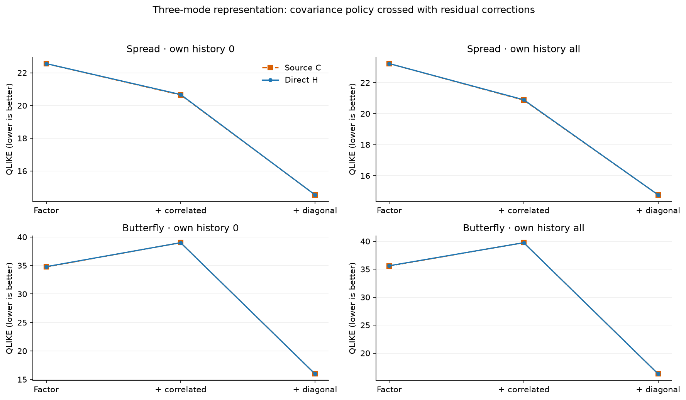
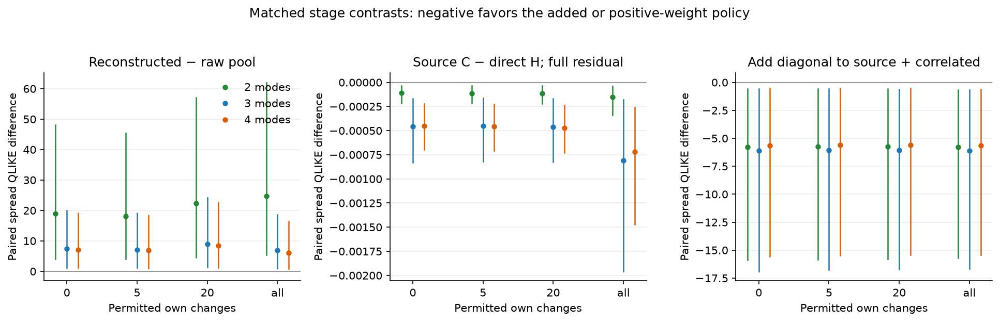
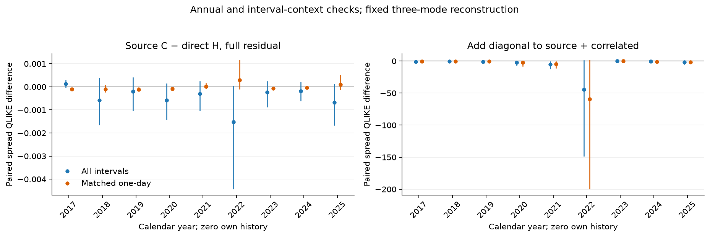
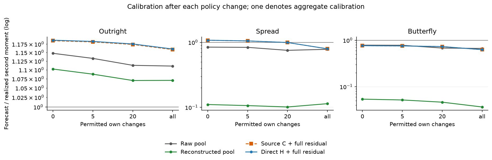

# Copper pipeline mechanisms: 2016–2025

**Question:** how much do curve reconstruction, source-covariance fitting and residual correction change the implemented short-history risk forecasts?

2016 provides initial history; 2017–2025 is descriptive rolling evaluation. **2026 remains held out and is not parsed or scored.** Raw archived counts are preserved, counting conventions are note-based, and unknown declarations remain unknown. Prices and the five-tonne contract multiplier are unchanged.

The holdout concerns observation dates and the 2026 archive, not delivery months. Prices observed in 2025 for contracts delivering in 2026 are contemporaneously known and remain eligible; removing those contracts would truncate the 2025 maturity curve.

Numerical source: `68e3f17f4edc1c4230ad571e38ff7b06c7acd1c9`; clean source at execution: `True`. The run covers 437 scheduled origins and 1,311 target episodes, from 2017-01-03 to 2025-12-24. Repeated targets and contracts are dependent.

Fixed primary settings: 252 adjacent training intervals, 63-session EWMA, own-history budgets [0, 5, 20, all], three Laguerre modes with two/four-mode sensitivities. Outcomes use the next actual session and the same contract IDs. Current target settlements remain visible; hidden older levels are removed before every transformation.

## Imported data and counting audit

| Year | Sessions | Copper rows | Nonfinite settlements | Nonpositive settlements | Zero volume | Zero OI | Declared volume convention | Count normalization unavailable sessions |
| --- | --- | --- | --- | --- | --- | --- | --- | --- |
| 2016 | 244 | 2928 | 0 | 0 | 1 | 0 | double-sided | 0 |
| 2017 | 244 | 2928 | 0 | 0 | 0 | 0 | double-sided | 0 |
| 2018 | 243 | 2916 | 0 | 0 | 0 | 0 | double-sided | 0 |
| 2019 | 244 | 2928 | 0 | 0 | 13 | 0 | double-sided | 0 |
| 2020 | 243 | 2916 | 0 | 0 | 21 | 5 | single-sided | 0 |
| 2021 | 243 | 2916 | 0 | 0 | 16 | 2 | single-sided | 0 |
| 2022 | 242 | 2904 | 0 | 0 | 8 | 2 | single-sided | 0 |
| 2023 | 242 | 2904 | 0 | 0 | 2 | 0 | single-sided | 0 |
| 2024 | 242 | 2904 | 0 | 0 | 0 | 0 | single-sided, unknown | 43 |
| 2025 | 243 | 2916 | 0 | 0 | 0 | 0 | unknown | 243 |

Counts are preserved as archived integers. An opt-in single-sided view divides only explicitly double-sided declarations by two. Missing declarations, including late-2024/2025 workbooks, remain unknown and a full normalized view is unavailable. This study uses count positivity only, so that normalization does not change donor eligibility or rescale prices. The importer audit is limited to 2016–2025.

The ten-year panel adds market regimes and forecast origins, rather than extending the lifetime of any individual contract. All-available current-triad history remains limited by actual listings and overlap inside the 252-interval window. Expired contracts do not remain observable indefinitely.

| Permitted own history | Masked windows | Complete actual-triad changes: min / median / max | Pooled changes: min / median / max |
| --- | --- | --- | --- |
| 0 | 1311 | [0, 0, 0] | [244, 252, 252] |
| 5 | 1311 | [5, 5, 5] | [244, 252, 252] |
| 20 | 1311 | [20, 20, 20] | [244, 252, 252] |
| all | 1311 | [50, 62, 76] | [244, 252, 252] |

## Findings

The contrasts below measure changes in implemented policies on inspected settlements. They do not partition an unobserved true covariance error into causal percentages.

**The practical bottleneck in these controls is the chosen curve representation and its residual-risk repair.** Replacing the source-C estimator with direct innovation H changes the primary spread score by much less than reconstructing raw movements or adding the residual corrections. A small source-policy gap neither proves that C is correctly estimated nor identifies the physical forcing operator.

- **Passing the matched maturity pool through three-mode reconstruction:** zero-history spread QLIKE changes by +7.4832, with descriptive 95% block range [1.175, 20.02] across 437 paired origins.
- **Replacing direct innovation H with source-C fitting, with full residual repair fixed:** zero-history spread QLIKE changes by -0.0005, with descriptive 95% block range [-0.0008303, -0.0001656] across 437 paired origins.
- **Adding correlated residuals and cross terms to source factors:** zero-history spread QLIKE changes by -1.9064, with descriptive 95% block range [-4.63, -0.5171] across 437 paired origins.
- **Adding the donor-excluded diagonal correction:** zero-history spread QLIKE changes by -6.1102, with descriptive 95% block range [-16.89, -0.5667] across 437 paired origins.

Negative changes favor the positive-weight or added policy. Compare the full six cells and interaction contrasts before interpreting a single addition as a general improvement. Availability, annual strata and the one-day control remain part of the evidence.
These matched interventions do not telescope into the entire SPDE-minus-raw-pool performance gap: historical maturity-slot mapping and own-history blending differ from evaluating the current actual contracts at their future maturities. They remain additional policy choices rather than errors uniquely assigned to one of these three stages.

The matched one-day source-C minus direct-H spread difference is -0.000013, with block range [-8.329e-05, 8.163e-05]. This controls interval-length mixing while retaining the source estimator's regularization and constraints.

At zero own history, three-mode reconstruction retains 95.7% of outright, 12.4% of spread and 6.5% of butterfly training second moments in the matched pooling control. These are ratios of mean window moments, rather than shares of true latent risk or out-of-sample calibration.

Full residual repair gives source-C spread QLIKE 14.542, versus raw pooling 15.016; their hedge RMS levels are CNY 923.4 and 898.2. These descriptive levels illustrate that a better risk score need not imply a lower realized hedge RMS; they are not an additional paired significance test.

Correlated residuals alone are not a universal repair: at zero own history the source model's butterfly QLIKE changes from 34.752 to 39.010, and hedge RMS from CNY 1153.2 to 1396.7, despite the improved spread QLIKE. Evaluate all exposures and the diagonal addition separately.

The 2022 diagonal-repair spread contrast is -44.478, a particularly large annual effect. QLIKE means are sensitive to severe underprediction on stress observations; the large pooled effects and wide block ranges should not be read as equal improvement across regimes or as proof of erroneous source quotes.

Annual results are essential: large correction effects and wide block ranges can be concentrated in particular years. The pooled mean is not a claim of equal improvement in every market regime.

## Complete six-cell comparison

Within a row comparison, the reconstructed innovations, residual joint moment and diagonal prediction-error estimate are identical. The source row fits C through interval integration, ridge and a trace constraint; the direct row estimates normalized innovation H. Columns add the named residual corrections. These are policy contrasts, not recovery errors against latent physical truth.



| Own history | Policy | Scored / attempted | Outright QLIKE | Spread QLIKE | Butterfly QLIKE | Spread forecast / realized | Joint quadratic / 10¹² CNY⁴ | Hedge RMS CNY |
| --- | --- | --- | --- | --- | --- | --- | --- | --- |
| 0 | Source C · factor | 1311/1311 | 16.85 | 22.56 | 34.75 | 0.1102 | -173.1 | 1,153 |
| 0 | Source C · correlated | 1311/1311 | 16.85 | 20.65 | 39.01 | 0.1498 | -168.3 | 1,397 |
| 0 | Source C · diagonal | 1311/1311 | 16.85 | 14.54 | 15.97 | 1.076 | -123.1 | 923.4 |
| 0 | Direct H · factor | 1311/1311 | 16.85 | 22.56 | 34.8 | 0.1111 | -171.7 | 1,154 |
| 0 | Direct H · correlated | 1311/1311 | 16.85 | 20.67 | 39 | 0.1506 | -166.8 | 1,396 |
| 0 | Direct H · diagonal | 1311/1311 | 16.85 | 14.54 | 15.97 | 1.077 | -121.5 | 923.3 |
| 0 | Reconstructed pool | 1311/1311 | 16.85 | 22.5 | 34.92 | 0.1106 | -168.9 | 1,160 |
| 5 | Source C · factor | 1311/1311 | 16.85 | 22.48 | 34.69 | 0.1102 | -173.1 | 1,158 |
| 5 | Source C · correlated | 1311/1311 | 16.85 | 20.61 | 38.87 | 0.1497 | -167.9 | 1,397 |
| 5 | Source C · diagonal | 1311/1311 | 16.85 | 14.53 | 15.97 | 1.05 | -123.8 | 927 |
| 5 | Direct H · factor | 1311/1311 | 16.85 | 22.48 | 34.73 | 0.1111 | -171.7 | 1,159 |
| 5 | Direct H · correlated | 1311/1311 | 16.85 | 20.63 | 38.86 | 0.1504 | -166.4 | 1,397 |
| 5 | Direct H · diagonal | 1311/1311 | 16.85 | 14.53 | 15.97 | 1.051 | -122.2 | 926.9 |
| 5 | Reconstructed pool | 1311/1311 | 16.82 | 21.94 | 33.96 | 0.1065 | -558.6 | 1,172 |
| 20 | Source C · factor | 1311/1311 | 16.85 | 22.46 | 34.63 | 0.1102 | -172.7 | 1,158 |
| 20 | Source C · correlated | 1311/1311 | 16.85 | 20.58 | 38.9 | 0.1504 | -167.3 | 1,399 |
| 20 | Source C · diagonal | 1311/1311 | 16.85 | 14.52 | 15.97 | 0.9923 | -124.7 | 927.8 |
| 20 | Direct H · factor | 1311/1311 | 16.85 | 22.47 | 34.68 | 0.1112 | -171.4 | 1,159 |
| 20 | Direct H · correlated | 1311/1311 | 16.85 | 20.6 | 38.89 | 0.1512 | -165.9 | 1,399 |
| 20 | Direct H · diagonal | 1311/1311 | 16.85 | 14.52 | 15.97 | 0.993 | -123.1 | 927.7 |
| 20 | Reconstructed pool | 1311/1311 | 16.84 | 23.73 | 39 | 0.1014 | -420 | 1,202 |
| all | Source C · factor | 1311/1311 | 16.85 | 23.23 | 35.58 | 0.1056 | -173.4 | 1,162 |
| all | Source C · correlated | 1311/1311 | 16.85 | 20.87 | 39.75 | 0.1456 | -167.6 | 1,403 |
| all | Source C · diagonal | 1311/1311 | 16.85 | 14.76 | 16.28 | 0.7943 | -143.8 | 939.2 |
| all | Direct H · factor | 1311/1311 | 16.85 | 23.23 | 35.63 | 0.1066 | -172 | 1,163 |
| all | Direct H · correlated | 1311/1311 | 16.85 | 20.9 | 39.74 | 0.1464 | -166.1 | 1,402 |
| all | Direct H · diagonal | 1311/1311 | 16.85 | 14.76 | 16.28 | 0.7951 | -142.2 | 939 |
| all | Reconstructed pool | 1311/1311 | 16.85 | 21.88 | 50.62 | 0.1139 | -342.8 | 1,499 |

QLIKE is lower-is-better. Calibration is a ratio of origin-averaged forecast and realized second moments, not conditional calibration. Hedge RMS is a settlement-risk outcome with positions bounded to [−2,2], without execution costs.

### Raw-data baselines on the same history budgets

| Own history | Raw-data policy | Scored / attempted | Outright QLIKE | Spread QLIKE | Butterfly QLIKE | Spread forecast / realized | Joint quadratic / 10¹² CNY⁴ | Hedge RMS CNY |
| --- | --- | --- | --- | --- | --- | --- | --- | --- |
| 0 | Same-contract direct | 0/1311 | Unavailable | Unavailable | Unavailable | Unavailable | Unavailable | Unavailable |
| 0 | Raw maturity pool | 1311/1311 | 16.85 | 15.02 | 16.5 | 0.8434 | -151.1 | 898.2 |
| 5 | Same-contract direct | 0/1311 | Unavailable | Unavailable | Unavailable | Unavailable | Unavailable | Unavailable |
| 5 | Raw maturity pool | 1311/1311 | 16.82 | 14.79 | 16.28 | 0.837 | -531.8 | 894.1 |
| 20 | Same-contract direct | 1311/1311 | 16.95 | 14.81 | 16.28 | 0.647 | -409 | 898.8 |
| 20 | Raw maturity pool | 1311/1311 | 16.84 | 14.82 | 16.3 | 0.7529 | -387.7 | 884.8 |
| all | Same-contract direct | 1311/1311 | 16.87 | 15.03 | 16.67 | 0.748 | -345.9 | 913.4 |
| all | Raw maturity pool | 1311/1311 | 16.85 | 14.98 | 16.56 | 0.7808 | -325.6 | 904.1 |

The direct baseline requires at least twenty complete changes and is unavailable below that threshold. Joint quadratic scores omit a forecast-independent term and can be negative. Availability can differ across policies; use matched contrasts rather than unpaired level differences to establish a ranking.

### Maturity strata: raw pooling and the two fully repaired policies

| Target days | Own history | Policy | Scored / attempted | Outright QLIKE | Spread QLIKE | Butterfly QLIKE | Spread forecast / realized | Hedge RMS CNY |
| --- | --- | --- | --- | --- | --- | --- | --- | --- |
| 90 | 0 | Raw maturity pool | 437/437 | 16.78 | 15.1 | 16.47 | 0.7921 | 810.6 |
| 90 | 0 | Source C · diagonal | 437/437 | 16.78 | 14.28 | 15.53 | 0.8704 | 813.5 |
| 90 | 0 | Direct H · diagonal | 437/437 | 16.78 | 14.28 | 15.53 | 0.8719 | 813.6 |
| 90 | all | Raw maturity pool | 437/437 | 16.77 | 15.03 | 16.56 | 0.7825 | 786 |
| 90 | all | Source C · diagonal | 437/437 | 16.78 | 14.88 | 16.28 | 0.7456 | 841.7 |
| 90 | all | Direct H · diagonal | 437/437 | 16.78 | 14.88 | 16.28 | 0.747 | 841.5 |
| 180 | 0 | Raw maturity pool | 437/437 | 16.95 | 14.74 | 16.63 | 0.8421 | 1,024 |
| 180 | 0 | Source C · diagonal | 437/437 | 16.94 | 14.42 | 16.23 | 1.06 | 1,023 |
| 180 | 0 | Direct H · diagonal | 437/437 | 16.94 | 14.42 | 16.23 | 1.061 | 1,023 |
| 180 | all | Raw maturity pool | 437/437 | 17 | 14.66 | 16.56 | 0.7857 | 1,037 |
| 180 | all | Source C · diagonal | 437/437 | 16.94 | 14.43 | 16.28 | 0.763 | 1,030 |
| 180 | all | Direct H · diagonal | 437/437 | 16.94 | 14.43 | 16.28 | 0.7643 | 1,030 |
| 270 | 0 | Raw maturity pool | 437/437 | 16.82 | 15.2 | 16.41 | 0.8776 | 845.5 |
| 270 | 0 | Source C · diagonal | 437/437 | 16.82 | 14.93 | 16.17 | 1.222 | 921.2 |
| 270 | 0 | Direct H · diagonal | 437/437 | 16.82 | 14.93 | 16.17 | 1.222 | 920.8 |
| 270 | all | Raw maturity pool | 437/437 | 16.78 | 15.24 | 16.56 | 0.7758 | 871.6 |
| 270 | all | Source C · diagonal | 437/437 | 16.82 | 14.98 | 16.28 | 0.8498 | 935.9 |
| 270 | all | Direct H · diagonal | 437/437 | 16.82 | 14.98 | 16.28 | 0.8498 | 935.5 |

## Matched reconstruction and source-policy contrasts



The reconstructed pooling control preserves raw donor selection, actual IDs, adjacent intervals, ages, complete counts and own-history blend weights. Only endpoint prices pass through reconstruction. This avoids attributing a change of maturity mapping to curve smoothing. Historical own-triad prices can have tenors outside the 30–365-day fitting domain; their fitted values include extrapolation, so this is an entire reconstruction-policy contrast rather than a pure interpolation-error estimate.

### Reconstructed versus raw maturity pooling

| Modes | Own history | Fixed policy | QLIKE change | 95% block range | Paired origins |
| --- | --- | --- | --- | --- | --- |
| 2 | 0 | fixed_selectors | 18.96 | [4.078, 48.16] | 437 |
| 2 | 5 | fixed_selectors | 18.04 | [4.052, 45.41] | 437 |
| 2 | 20 | fixed_selectors | 22.32 | [4.463, 57.07] | 437 |
| 2 | all | fixed_selectors | 24.67 | [5.468, 62.08] | 437 |
| 3 | 0 | fixed_selectors | 7.483 | [1.175, 20.02] | 437 |
| 3 | 5 | fixed_selectors | 7.144 | [1.125, 19.09] | 437 |
| 3 | 20 | fixed_selectors | 8.908 | [1.237, 24.2] | 437 |
| 3 | all | fixed_selectors | 6.9 | [0.9294, 18.66] | 437 |
| 4 | 0 | fixed_selectors | 7.151 | [1.11, 19.04] | 437 |
| 4 | 5 | fixed_selectors | 6.912 | [1.045, 18.49] | 437 |
| 4 | 20 | fixed_selectors | 8.362 | [1.134, 22.74] | 437 |
| 4 | all | fixed_selectors | 6.037 | [0.799, 16.38] | 437 |

### Source C versus direct H, full residual correction fixed

| Modes | Own history | Fixed policy | QLIKE change | 95% block range | Paired origins |
| --- | --- | --- | --- | --- | --- |
| 2 | 0 | diagonal | -0.0001108 | [-0.0002156, -3.351e-05] | 437 |
| 2 | 5 | diagonal | -0.0001118 | [-0.0002154, -3.341e-05] | 437 |
| 2 | 20 | diagonal | -0.0001154 | [-0.0002223, -3.578e-05] | 437 |
| 2 | all | diagonal | -0.0001531 | [-0.0003372, -3.937e-05] | 437 |
| 3 | 0 | diagonal | -0.0004563 | [-0.0008303, -0.0001656] | 437 |
| 3 | 5 | diagonal | -0.0004521 | [-0.0008226, -0.0001616] | 437 |
| 3 | 20 | diagonal | -0.0004597 | [-0.0008268, -0.0001658] | 437 |
| 3 | all | diagonal | -0.0008115 | [-0.001958, -0.0001765] | 437 |
| 4 | 0 | diagonal | -0.000452 | [-0.0006955, -0.000222] | 437 |
| 4 | 5 | diagonal | -0.000458 | [-0.0007053, -0.000226] | 437 |
| 4 | 20 | diagonal | -0.0004701 | [-0.0007298, -0.0002349] | 437 |
| 4 | all | diagonal | -0.000719 | [-0.001473, -0.000258] | 437 |

### Correlated residual and cross-term addition

| Modes | Own history | Fixed policy | QLIKE change | 95% block range | Paired origins |
| --- | --- | --- | --- | --- | --- |
| 2 | 0 | source | -14.18 | [-35.06, -3.582] | 437 |
| 2 | 5 | source | -14.16 | [-34.98, -3.58] | 437 |
| 2 | 20 | source | -14.19 | [-35.07, -3.58] | 437 |
| 2 | all | source | -14.31 | [-35.35, -3.658] | 437 |
| 3 | 0 | source | -1.906 | [-4.63, -0.5171] | 437 |
| 3 | 5 | source | -1.873 | [-4.531, -0.5149] | 437 |
| 3 | 20 | source | -1.879 | [-4.559, -0.5234] | 437 |
| 3 | all | source | -2.353 | [-5.84, -0.5923] | 437 |
| 4 | 0 | source | -2.061 | [-5.06, -0.5455] | 437 |
| 4 | 5 | source | -1.995 | [-4.877, -0.5422] | 437 |
| 4 | 20 | source | -1.993 | [-4.887, -0.5375] | 437 |
| 4 | all | source | -2.587 | [-6.534, -0.6037] | 437 |

### Diagonal predictive-error addition

| Modes | Own history | Fixed policy | QLIKE change | 95% block range | Paired origins |
| --- | --- | --- | --- | --- | --- |
| 2 | 0 | source | -5.763 | [-15.89, -0.5658] | 437 |
| 2 | 5 | source | -5.75 | [-15.84, -0.5751] | 437 |
| 2 | 20 | source | -5.746 | [-15.78, -0.5798] | 437 |
| 2 | all | source | -5.779 | [-15.7, -0.6673] | 437 |
| 3 | 0 | source | -6.11 | [-16.89, -0.5667] | 437 |
| 3 | 5 | source | -6.074 | [-16.78, -0.5783] | 437 |
| 3 | 20 | source | -6.064 | [-16.7, -0.596] | 437 |
| 3 | all | source | -6.112 | [-16.66, -0.6733] | 437 |
| 4 | 0 | source | -5.636 | [-15.58, -0.5258] | 437 |
| 4 | 5 | source | -5.603 | [-15.48, -0.5132] | 437 |
| 4 | 20 | source | -5.599 | [-15.41, -0.5364] | 437 |
| 4 | all | source | -5.666 | [-15.43, -0.6213] | 437 |

### Interaction: source-policy difference in diagonal-addition effects

| Modes | Own history | Fixed policy | QLIKE change | 95% block range | Paired origins |
| --- | --- | --- | --- | --- | --- |
| 2 | 0 | source_minus_empirical | 0.005088 | [0.001011, 0.013] | 437 |
| 2 | 5 | source_minus_empirical | 0.00519 | [0.001023, 0.01327] | 437 |
| 2 | 20 | source_minus_empirical | 0.005185 | [0.001025, 0.01324] | 437 |
| 2 | all | source_minus_empirical | 0.005165 | [0.001073, 0.0131] | 437 |
| 3 | 0 | source_minus_empirical | 0.02212 | [0.0008942, 0.06405] | 437 |
| 3 | 5 | source_minus_empirical | 0.02142 | [0.000676, 0.06232] | 437 |
| 3 | 20 | source_minus_empirical | 0.02116 | [0.0005637, 0.06175] | 437 |
| 3 | all | source_minus_empirical | 0.02322 | [0.0005735, 0.06783] | 437 |
| 4 | 0 | source_minus_empirical | 0.007564 | [-0.0005117, 0.02284] | 437 |
| 4 | 5 | source_minus_empirical | 0.007343 | [-0.0005037, 0.0223] | 437 |
| 4 | 20 | source_minus_empirical | 0.007115 | [-0.0006576, 0.02183] | 437 |
| 4 | all | source_minus_empirical | 0.008344 | [-0.0007832, 0.02565] | 437 |

Interactions prevent a unique additive allocation of performance gaps to stages. The diagonal correction may include leverage, reconstruction error and representation mismatch; it is not identified fresh noise or physical forcing.

## Calendar, interval-length and calibration checks



The one-day context sets weights to zero for other training intervals, preserves the original state chronology and EWMA ages, and scores only one-day future intervals. Direct H over all intervals is otherwise a mixture of normalized interval moments. Contexts can have different future support; compare their source/direct differences within context, not unpaired score levels.



Targets are averaged within each origin before dates. Circular origin-block draws are shared across contexts, methods, dimensions and budgets; excluded one-day origins remain absent in the full scheduled calendar. Four origins (about twenty sessions) is primary, with 1, 2 and 8-origin sensitivities. These descriptive percentile ranges are not IID Monte Carlo uncertainty or untouched confirmation.

## Known-truth numerical controls

These two synthetic controls are separate experiments. An exact finite transport trajectory has known latent coefficients and C; spatially perturbed twelve-quote snapshots are reconstructed independently. A Gaussian correlated factor/residual increment model verifies cross terms and Schur identities, without claiming its residuals come from a level-consistent SPDE.

| Coefficient input | Covariance policy | Future days | Mean relative kernel error | Replication MCSE |
| --- | --- | --- | --- | --- |
| known_coefficients | direct_H | 1 | 0.09613 | 0.01727 |
| known_coefficients | direct_H | 3 | 0.09619 | 0.01722 |
| known_coefficients | source_C | 1 | 0.09629 | 0.01721 |
| known_coefficients | source_C | 3 | 0.09624 | 0.01722 |
| reconstructed_coefficients | direct_H | 1 | 0.09619 | 0.01727 |
| reconstructed_coefficients | direct_H | 3 | 0.09624 | 0.01723 |
| reconstructed_coefficients | source_C | 1 | 0.09634 | 0.01721 |
| reconstructed_coefficients | source_C | 3 | 0.09629 | 0.01722 |

| Known-block control | Relative kernel error | Spread forecast / truth | Butterfly forecast / truth |
| --- | --- | --- | --- |
| oracle_full_joint | 4.479e-17 | 1 | 1 |
| oracle_omit_cross | 0.1074 | 1.082 | 0.9846 |
| oracle_factor_only | 0.1216 | 0.2063 | 0.005728 |
| oracle_no_diagonal | 0.002173 | 0.8625 | 0.885 |

The exact full-joint residual identity has relative error 4.48e-17. Synthetic MCSE uses 20 independent replications; this differs from the copper calendar-block ranges. Full settings and sampled-joint errors are in [oracle.json](oracle.json).

## Availability, numerical diagnostics and limitations

### Reconstruction retention

All three ratios use means of the corresponding training-window second moments across available masked views; each window uses its fixed EWMA and own-history blend. Fitted, residual and signed-cross parts therefore sum to one up to roundoff. The count reports available diagnostic windows, which overlap and are dependent. These are visible-change diagnostics rather than out-of-sample calibration or latent approximation errors.

| Modes | Own history | Exposure | Available windows | Fitted / raw means | Residual / raw means | Signed cross / raw means | Max identity residual |
| --- | --- | --- | --- | --- | --- | --- | --- |
| 2 | 0 | outright | 1311 | 0.9516 | 0.04168 | 0.006749 | 0 |
| 2 | 0 | spread | 1311 | 0.07409 | 0.9361 | -0.01019 | 0 |
| 2 | 0 | butterfly | 1311 | 0.002359 | 1.011 | -0.01289 | 0 |
| 2 | 5 | outright | 1311 | 0.9509 | 0.04269 | 0.006428 | 0 |
| 2 | 5 | spread | 1311 | 0.07145 | 0.9366 | -0.008013 | 0 |
| 2 | 5 | butterfly | 1311 | 0.001927 | 1.011 | -0.01317 | 0 |
| 2 | 20 | outright | 1311 | 0.955 | 0.03877 | 0.006193 | 0 |
| 2 | 20 | spread | 1311 | 0.07728 | 0.9214 | 0.001372 | 0 |
| 2 | 20 | butterfly | 1311 | 0.001793 | 1.012 | -0.01353 | 0 |
| 2 | all | outright | 1311 | 0.9563 | 0.04012 | 0.003621 | 0 |
| 2 | all | spread | 1311 | 0.06857 | 0.9146 | 0.01681 | 0 |
| 2 | all | butterfly | 1311 | 0.001497 | 1.007 | -0.00811 | 0 |
| 3 | 0 | outright | 1311 | 0.9574 | 0.03307 | 0.009536 | 0 |
| 3 | 0 | spread | 1311 | 0.1242 | 0.737 | 0.1388 | 0 |
| 3 | 0 | butterfly | 1311 | 0.06475 | 0.7921 | 0.1431 | 0 |
| 3 | 5 | outright | 1311 | 0.9565 | 0.03396 | 0.009535 | 0 |
| 3 | 5 | spread | 1311 | 0.1198 | 0.7423 | 0.1378 | 0 |
| 3 | 5 | butterfly | 1311 | 0.06187 | 0.7932 | 0.1449 | 0 |
| 3 | 20 | outright | 1311 | 0.9608 | 0.03239 | 0.006793 | 0 |
| 3 | 20 | spread | 1311 | 0.1331 | 0.7495 | 0.1174 | 0 |
| 3 | 20 | butterfly | 1311 | 0.0657 | 0.804 | 0.1303 | 0 |
| 3 | all | outright | 1311 | 0.9638 | 0.03377 | 0.002478 | 0 |
| 3 | all | spread | 1311 | 0.1496 | 0.7661 | 0.08436 | 0 |
| 3 | all | butterfly | 1311 | 0.05498 | 0.8496 | 0.0954 | 0 |
| 4 | 0 | outright | 1311 | 0.9578 | 0.03151 | 0.01065 | 0 |
| 4 | 0 | spread | 1311 | 0.1306 | 0.7113 | 0.1581 | 0 |
| 4 | 0 | butterfly | 1311 | 0.06372 | 0.7726 | 0.1637 | 0 |
| 4 | 5 | outright | 1311 | 0.957 | 0.03242 | 0.01056 | 0 |
| 4 | 5 | spread | 1311 | 0.1263 | 0.7157 | 0.158 | 0 |
| 4 | 5 | butterfly | 1311 | 0.06108 | 0.7743 | 0.1646 | 0 |
| 4 | 20 | outright | 1311 | 0.9614 | 0.03094 | 0.007697 | 0 |
| 4 | 20 | spread | 1311 | 0.1418 | 0.7237 | 0.1345 | 0 |
| 4 | 20 | butterfly | 1311 | 0.06671 | 0.7902 | 0.1431 | 0 |
| 4 | all | outright | 1311 | 0.9642 | 0.03201 | 0.003774 | 0 |
| 4 | all | spread | 1311 | 0.162 | 0.7214 | 0.1167 | 0 |
| 4 | all | butterfly | 1311 | 0.06516 | 0.8049 | 0.13 | 0 |

### Source certificates and reconstruction leverage

The numerical certificate bounds optimization error under the fitted objective, not statistical error. Leverage concerns the permitted level reconstruction; the donor-excluded predictive correction can contain that estimation uncertainty. Source support and component checks retain their relative scales.

| Modes | Intervals | Own history | Scored | Max relative optimizer bound | Max curve condition | Max level leverage | Max support residual | Max component residual |
| --- | --- | --- | --- | --- | --- | --- | --- | --- |
| 2 | all | 0 | 1311 | 5.604e-06 | 8.835 | 0.5595 | 8.818e-17 | 1.699e-16 |
| 2 | all | all | 1311 | 5.593e-06 | 8.214 | 0.4324 | 4.013e-17 | 1.755e-16 |
| 2 | one_day | 0 | 1074 | 1.633e-06 | 8.835 | 0.5461 | 6.316e-17 | 1.735e-16 |
| 2 | one_day | all | 1074 | 1.554e-06 | 8.214 | 0.4324 | 4.946e-17 | 1.715e-16 |
| 3 | all | 0 | 1311 | 8.05e-06 | 122.3 | 0.8876 | 4.559e-16 | 1.87e-16 |
| 3 | all | all | 1311 | 8.032e-06 | 99.32 | 0.7497 | 3.776e-16 | 1.699e-16 |
| 3 | one_day | 0 | 1074 | 2.233e-06 | 122.3 | 0.8876 | 3.698e-16 | 1.674e-16 |
| 3 | one_day | all | 1074 | 2.223e-06 | 99.32 | 0.7497 | 2.518e-16 | 1.712e-16 |
| 4 | all | 0 | 1311 | 9.986e-06 | 4,116 | 0.9094 | 3.614e-15 | 1.767e-16 |
| 4 | all | all | 1311 | 9.433e-06 | 2,923 | 0.7746 | 2.143e-15 | 1.741e-16 |
| 4 | one_day | 0 | 1074 | 9.997e-06 | 4,116 | 0.9059 | 3.645e-15 | 1.723e-16 |
| 4 | one_day | all | 1074 | 9.966e-06 | 2,923 | 0.7746 | 2.064e-15 | 1.681e-16 |

No unavailable method receives a hidden fallback. Source numerical certificates, PSD/support checks, cross-term identities, reconstruction leverage, donor-excluded prediction errors and cache bounds are retained in [diagnostics.json](diagnostics.json). All history/maturity/year/context/dimension summaries are in [summary.json](summary.json); fixed contrasts, interaction effects and block sensitivities are in [paired.json](paired.json).

The data have monthly maturity spacing and daily observations. Two/four-mode sensitivities change a finite representation; they do not measure continuum convergence. Four residual maturity features plus a diagonal remainder remain restrictive. No real-data latent source or curve truth is available. These are exploratory covariance-risk comparisons, not price forecasting, derivative pricing, new-listing performance or an executable hedge backtest.

Run time: 1572.7 seconds in the recorded environment; see [manifest.json](manifest.json) for archive hashes, convention audit and source provenance. Historical bundles remain unchanged. Raw panels, individual forecasts and P&Ls stay local.

## Reproduction

```sh
uv run spde-covariance benchmark-mechanisms experiments/configs/copper-mechanisms.toml \
  --data data/local/shfe \
  --older-data data/local/shfe-extension/development-2016-2021 \
  --output data/local/shfe/runs/mechanisms-v1 --workers 8 \
  --export experiments/results/copper-mechanisms
uv run python scripts/render_mechanisms.py experiments/results/copper-mechanisms --build-notebook
uv run python scripts/check_notebook.py notebooks/08_copper_mechanism_attribution.ipynb --write-outputs
```

Output directories must be new. Commit numerical source before full runs. The renderer and aggregate-only notebook verify numerical checksums and do not refit models or read exchange files. Read the [protocol](../../../docs/mechanism-attribution.md) and [executed notebook](../../../notebooks/08_copper_mechanism_attribution.ipynb).
