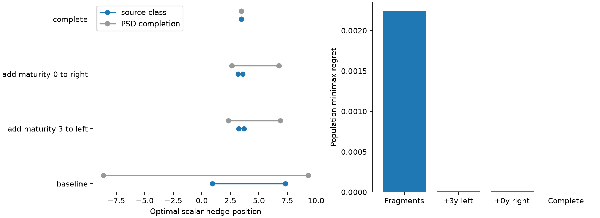
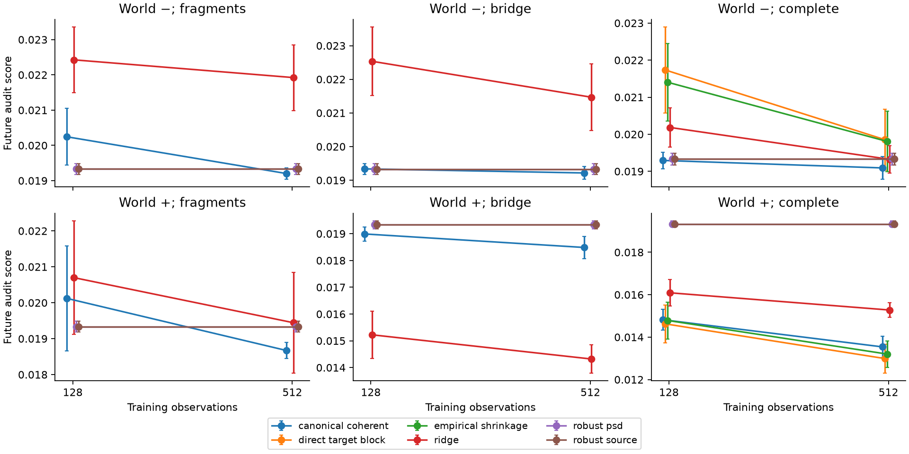
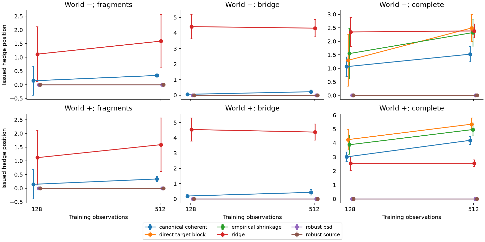

# Identification-to-hedging pilot

The fixed-source population control establishes material decision ambiguity. The sampling study compares predeclared hedge rules; it does not require any rule to win. There is no empirical futures hedging-performance claim. Observations evaluate the J=8 projected curve, not the full curve's point values.

Run: 20 paired replications; training prefixes (128, 512); 2048 complete future audit observations; seed 20261029.

## Population identification

Both generating sources are PSD, trace one and infinite rank. The perturbation is finite-supported; the common power-law tail is fixed. Optimization ranges condition on known trace of the uncertain source block, the fixed tail and the declared finite numerical map. They are identification ranges, not confidence intervals or uniform infinite-dimensional guarantees.

The explicit pair has optimal hedges 1.67708 and 5.27663. Using the other world's hedge adds variance 0.00284185, or 14.698% of unhedged target variance.

| Observations | Source-class hedge interval | Minimax variance hedge | Minimax regret |
|---|---:|---:|---:|
| baseline | [0.940013, 7.328058] | 0.940013 | 0.00223760 |
| add_maturity_3_to_left | [3.214088, 3.697386] | 3.214088 | 0.00001281 |
| add_maturity_0_to_right | [3.176792, 3.571875] | 3.176792 | 0.00000856 |
| complete | [3.476854, 3.476854] | 3.476854 | 0.00000000 |

The minimax-variance hedge and minimax-regret hedge solve different objectives. The latter is the interval midpoint in this unconstrained one-instrument population control. The sample study instead imposes a position limit. Canonical completion is a structural selection; its compatibility with the source class is not presumed.



## Past-only sampling study

Native-fragment training observations are identical between worlds. Added observations and complete-panel controls are nested views of the same parent data. Each method sees only its training prefix. Held-out observations start after the largest prefix and are never used for selection. Gaussian bands are constructed without truth; their coverage requires centered independent common Gaussian rows, deterministic masks and fixed known fresh noise. The conditional fixed source-tail assumption is stronger than unrestricted covariance completion.

The primary score is noise-corrected squared residual on a **complete future audit panel**. This evaluates controlled masking; it is not an operational score for an unobserved native cross-fragment exposure. Native score availability/counts are retained in estimates.json. Latent residual variance and regret are separate simulation diagnostics.

Mean ± MCSE below uses independent replications. Worlds, dates and methods are paired, not additional independent replications. Means condition on available fits, and paired contrasts use their common available replications. Unavailable methods retain reasons in the fit audit.

| World | Design | N | Method | Available | Future audit score ± MCSE | Latent residual variance |
|---|---|---:|---|---:|---:|---:|
| 0 | bridge | 128 | canonical_coherent | 20/20 | 0.0193378 ± 0.000161062 | 0.0193138 |
| 0 | bridge | 128 | direct_target_block | 0/20 | unavailable ± unavailable | unavailable |
| 0 | bridge | 128 | empirical_shrinkage | 0/20 | unavailable ± unavailable | unavailable |
| 0 | bridge | 128 | ridge | 20/20 | 0.0225357 ± 0.00101903 | 0.0229337 |
| 0 | bridge | 128 | robust_psd | 20/20 | 0.0193298 ± 0.000157617 | 0.0193347 |
| 0 | bridge | 128 | robust_source | 20/20 | 0.0193298 ± 0.000157617 | 0.0193347 |
| 0 | bridge | 512 | canonical_coherent | 20/20 | 0.0192163 ± 0.000189127 | 0.0192424 |
| 0 | bridge | 512 | direct_target_block | 0/20 | unavailable ± unavailable | unavailable |
| 0 | bridge | 512 | empirical_shrinkage | 0/20 | unavailable ± unavailable | unavailable |
| 0 | bridge | 512 | ridge | 20/20 | 0.0214669 ± 0.000986811 | 0.0215304 |
| 0 | bridge | 512 | robust_psd | 20/20 | 0.0193298 ± 0.000157617 | 0.0193347 |
| 0 | bridge | 512 | robust_source | 20/20 | 0.0193298 ± 0.000157617 | 0.0193347 |
| 0 | complete | 128 | canonical_coherent | 20/20 | 0.0192941 ± 0.000226426 | 0.0193347 |
| 0 | complete | 128 | direct_target_block | 17/20 | 0.0217343 ± 0.00115938 | 0.0219784 |
| 0 | complete | 128 | empirical_shrinkage | 18/20 | 0.021403 ± 0.00104189 | 0.0220253 |
| 0 | complete | 128 | ridge | 20/20 | 0.0201838 ± 0.000527729 | 0.0200365 |
| 0 | complete | 128 | robust_psd | 20/20 | 0.0193298 ± 0.000157617 | 0.0193347 |
| 0 | complete | 128 | robust_source | 20/20 | 0.0193298 ± 0.000157617 | 0.0193347 |
| 0 | complete | 512 | canonical_coherent | 20/20 | 0.0190922 ± 0.000307331 | 0.0190415 |
| 0 | complete | 512 | direct_target_block | 20/20 | 0.019855 ± 0.000819165 | 0.0199219 |
| 0 | complete | 512 | empirical_shrinkage | 20/20 | 0.0198064 ± 0.000815518 | 0.0198532 |
| 0 | complete | 512 | ridge | 20/20 | 0.0193239 ± 0.000375285 | 0.0190991 |
| 0 | complete | 512 | robust_psd | 20/20 | 0.0193298 ± 0.000157617 | 0.0193347 |
| 0 | complete | 512 | robust_source | 20/20 | 0.0193298 ± 0.000157617 | 0.0193347 |
| 0 | fragments | 128 | canonical_coherent | 20/20 | 0.0202451 ± 0.000808892 | 0.0204151 |
| 0 | fragments | 128 | direct_target_block | 0/20 | unavailable ± unavailable | unavailable |
| 0 | fragments | 128 | empirical_shrinkage | 0/20 | unavailable ± unavailable | unavailable |
| 0 | fragments | 128 | ridge | 20/20 | 0.0224261 ± 0.000931046 | 0.022947 |
| 0 | fragments | 128 | robust_psd | 20/20 | 0.0193298 ± 0.000157617 | 0.0193347 |
| 0 | fragments | 128 | robust_source | 20/20 | 0.0193298 ± 0.000157617 | 0.0193347 |
| 0 | fragments | 512 | canonical_coherent | 20/20 | 0.0192027 ± 0.000164597 | 0.0191446 |
| 0 | fragments | 512 | direct_target_block | 0/20 | unavailable ± unavailable | unavailable |
| 0 | fragments | 512 | empirical_shrinkage | 0/20 | unavailable ± unavailable | unavailable |
| 0 | fragments | 512 | ridge | 20/20 | 0.0219227 ± 0.000932855 | 0.0226973 |
| 0 | fragments | 512 | robust_psd | 20/20 | 0.0193298 ± 0.000157617 | 0.0193347 |
| 0 | fragments | 512 | robust_source | 20/20 | 0.0193298 ± 0.000157617 | 0.0193347 |
| 1 | bridge | 128 | canonical_coherent | 20/20 | 0.0189914 ± 0.00026862 | 0.018956 |
| 1 | bridge | 128 | direct_target_block | 0/20 | unavailable ± unavailable | unavailable |
| 1 | bridge | 128 | empirical_shrinkage | 0/20 | unavailable ± unavailable | unavailable |
| 1 | bridge | 128 | ridge | 20/20 | 0.0152242 ± 0.000877224 | 0.0157622 |
| 1 | bridge | 128 | robust_psd | 20/20 | 0.0193343 ± 0.000149771 | 0.0193347 |
| 1 | bridge | 128 | robust_source | 20/20 | 0.0193343 ± 0.000149771 | 0.0193347 |
| 1 | bridge | 512 | canonical_coherent | 20/20 | 0.0184863 ± 0.000413369 | 0.0185166 |
| 1 | bridge | 512 | direct_target_block | 0/20 | unavailable ± unavailable | unavailable |
| 1 | bridge | 512 | empirical_shrinkage | 0/20 | unavailable ± unavailable | unavailable |
| 1 | bridge | 512 | ridge | 20/20 | 0.0143195 ± 0.000525217 | 0.0146022 |
| 1 | bridge | 512 | robust_psd | 20/20 | 0.0193343 ± 0.000149771 | 0.0193347 |
| 1 | bridge | 512 | robust_source | 20/20 | 0.0193343 ± 0.000149771 | 0.0193347 |
| 1 | complete | 128 | canonical_coherent | 20/20 | 0.0148215 ± 0.00049707 | 0.0148497 |
| 1 | complete | 128 | direct_target_block | 14/20 | 0.0146257 ± 0.000896611 | 0.0150057 |
| 1 | complete | 128 | empirical_shrinkage | 14/20 | 0.0147848 ± 0.000867384 | 0.0150023 |
| 1 | complete | 128 | ridge | 20/20 | 0.0160891 ± 0.000623833 | 0.0159827 |
| 1 | complete | 128 | robust_psd | 20/20 | 0.0193343 ± 0.000149771 | 0.0193347 |
| 1 | complete | 128 | robust_source | 20/20 | 0.0193343 ± 0.000149771 | 0.0193347 |
| 1 | complete | 512 | canonical_coherent | 20/20 | 0.0135411 ± 0.000496433 | 0.0138252 |
| 1 | complete | 512 | direct_target_block | 18/20 | 0.0129901 ± 0.000683981 | 0.0139825 |
| 1 | complete | 512 | empirical_shrinkage | 18/20 | 0.0132015 ± 0.000621402 | 0.0140385 |
| 1 | complete | 512 | ridge | 20/20 | 0.0152773 ± 0.000347109 | 0.0151048 |
| 1 | complete | 512 | robust_psd | 20/20 | 0.0193343 ± 0.000149771 | 0.0193347 |
| 1 | complete | 512 | robust_source | 20/20 | 0.0193343 ± 0.000149771 | 0.0193347 |
| 1 | fragments | 128 | canonical_coherent | 20/20 | 0.0201228 ± 0.0014578 | 0.0201904 |
| 1 | fragments | 128 | direct_target_block | 0/20 | unavailable ± unavailable | unavailable |
| 1 | fragments | 128 | empirical_shrinkage | 0/20 | unavailable ± unavailable | unavailable |
| 1 | fragments | 128 | ridge | 20/20 | 0.0206991 ± 0.00158351 | 0.021184 |
| 1 | fragments | 128 | robust_psd | 20/20 | 0.0193343 ± 0.000149771 | 0.0193347 |
| 1 | fragments | 128 | robust_source | 20/20 | 0.0193343 ± 0.000149771 | 0.0193347 |
| 1 | fragments | 512 | canonical_coherent | 20/20 | 0.0186717 ± 0.000226736 | 0.0186131 |
| 1 | fragments | 512 | direct_target_block | 0/20 | unavailable ± unavailable | unavailable |
| 1 | fragments | 512 | empirical_shrinkage | 0/20 | unavailable ± unavailable | unavailable |
| 1 | fragments | 512 | ridge | 20/20 | 0.0194434 ± 0.00140201 | 0.0201866 |
| 1 | fragments | 512 | robust_psd | 20/20 | 0.0193343 ± 0.000149771 | 0.0193347 |
| 1 | fragments | 512 | robust_source | 20/20 | 0.0193343 ± 0.000149771 | 0.0193347 |





Paired differences relative to coherent canonical completion are in [paired.csv](paired.csv.gz), separately for observed future scores and latent risk. Point-kernel observed/missing/complete errors and exposure errors remain in [estimates.json](estimates.json.gz). A robust hedge is a decision, not a full kernel estimator. No off-grid extension is assumed for a grid completion.

## Acceptance and limitations

```json
{
  "passed": true,
  "population_identification_gate": true,
  "all_scheduled_replications_completed": true,
  "unavailable_results_retained": 341,
  "no_estimator_superiority_requirement": true,
  "all_prespecified_point_and_robust_fits_available": true,
  "complete_direct_control_available": true,
  "direct_noise_correction_may_be_indefinite": true
}
```

A successful optimizer check is not an exact numerical certificate. Failed or inaccurate SDP solves remain unavailable. The small SHFE coverage audit establishes data/metadata accessibility only; no market model, execution cost or trading advantage has been calibrated. Simultaneous Gaussian bands do not yet cover dependent real futures-price changes. See the repository's docs/identified-hedging.md and docs/futures-data.md for scope.

## Artifacts and provenance

This evidence bundle retains the complete accepted run. CSV files and measurement/audit JSON files are compressed with gzip; artifact links point to those archives. Use `gzip -dc FILE.gz > FILE` to read an uncompressed copy. [Bundle checksums](artifact_sha256.json) record original and published bytes. The unchanged [manifest](manifest.json) retains the originating clean revision and source hashes.

[Configuration](config.json), [manifest](manifest.json), [control and numerical checks](control.json.gz), [population endpoint witnesses](population.json.gz), [all estimates](estimates.json.gz), [fit and band diagnostics](fit_audit.json.gz), [results](results.json.gz), [summary](summary.csv.gz), [paired differences](paired.csv.gz), [status](status.json).

Figures and presentation were re-rendered from unchanged numerical artifacts. The [rendering manifest](rendering_manifest.json.gz) records that separate source revision; the original numerical manifest is unchanged.
