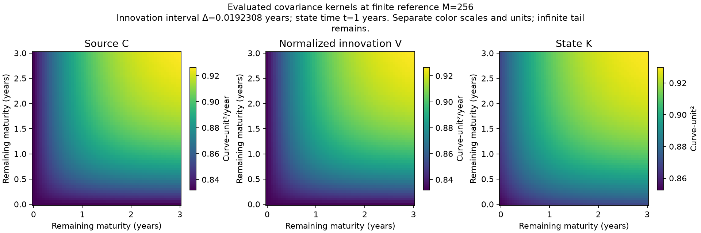
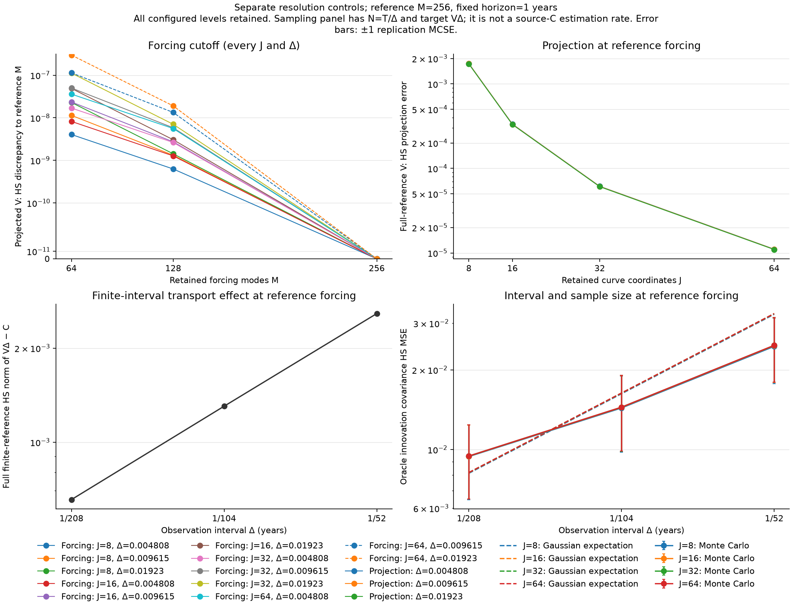
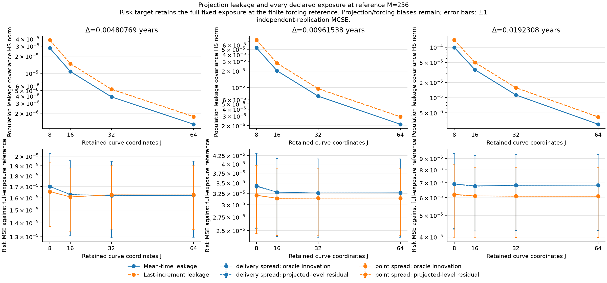

# Fixed infinite-rank transport: foundation benchmark

This is a reproducible finite-representation study of one fixed infinite-rank additive transport model. It is not a new estimator theorem. Source C, normalized innovation VΔ and state Kt have different targets and units. The protocol and projection/tail formulas are in [the methods protocol](https://github.com/xrough/spde-covariance/blob/main/docs/infinite-transport.md); retain the machine-readable configuration and provenance alongside this report.

Study: infinite-transport; seed: 20261024; independent path replications: 20; horizon: 1 years.

Declared forcing modes M: (64, 128, 256); curve projection dimensions J: (8, 16, 32, 64); intervals Δ in years: ('0.00480769', '0.00961538', '0.0192308'). Source exponent: 3; infinite source trace: 1. Prefix weights are never renormalized.

## Covariance kernels and fixed figure selections

Kernels use full forcing reference M=256, the largest configured interval Δ=0.0192308, the declared state horizon and a common maturity grid. They are not J-projected kernels and not an infinite model computed exactly. Color scales are separate: C and V have covariance-per-year units; K has state-covariance units. Evaluated kernels describe curve evaluations, not automatically a Lebesgue kernel for the Sobolev-space operator.

Figure choices use configured resolutions, never smallest realized errors. The forcing panel retains every valid J/Δ combination. Projection, interval, leakage and risk panels use the largest forcing reference and every configured projection/frequency/exposure. Positive errors use logarithmic axes; exact zeros remain visible on symmetric-log axes. Error bars denote one Monte Carlo standard error rather than confidence intervals.

## Population remainders and finite-reference differences

Analytic truncation inequalities are evaluated in floating point. They are distinct from numerical quadrature/block-exponential agreement, which is a cross-check rather than an interval-arithmetic certificate. Full trace or state-MSE bounds and finite-J covariance HS bounds have different scopes and units. A finite reference retains a nonzero infinite tail.

| M | Δ (years) | Full source trace tail | Full V trace tail bound | Full state MSE tail bound at T |
| ---: | ---: | ---: | ---: | ---: |
| 64 | 0.00480769 | 9.99769e-05 | 0.000100217 | 0.000136756 |
| 64 | 0.00961538 | 9.99769e-05 | 0.000100456 | 0.000136756 |
| 64 | 0.0192308 | 9.99769e-05 | 0.000100932 | 0.000136756 |
| 128 | 0.00480769 | 2.51902e-05 | 2.52507e-05 | 3.44572e-05 |
| 128 | 0.00961538 | 2.51902e-05 | 2.5311e-05 | 3.44572e-05 |
| 128 | 0.0192308 | 2.51902e-05 | 2.54309e-05 | 3.44572e-05 |
| 256 | 0.00480769 | 6.32221e-06 | 6.33738e-06 | 8.64801e-06 |
| 256 | 0.00961538 | 6.32221e-06 | 6.3525e-06 | 8.64801e-06 |
| 256 | 0.0192308 | 6.32221e-06 | 6.38261e-06 | 8.64801e-06 |

Finite-J bounds below control omitted-source covariance in the declared observation projection; they are not full-state trace bounds. The operational bound includes both current innovations and unresolved previous-state leakage, with its maximum at the last preceding-state time T−Δ. Tail resolution is assessed by the runner against the configured budget, separately from numerical identity checks.

| M | J | Δ | Projected V tail HS bound | Maximum operational tail HS bound | Tail resolved |
| ---: | ---: | ---: | ---: | ---: | --- |
| 64 | 8 | 0.00480769 | 8.5526e-06 | 1.96489e-05 | False |
| 64 | 8 | 0.00961538 | 8.53726e-06 | 1.9287e-05 | False |
| 64 | 8 | 0.0192308 | 8.50679e-06 | 1.85963e-05 | False |
| 64 | 16 | 0.00480769 | 1.20916e-05 | 3.43521e-05 | False |
| 64 | 16 | 0.00961538 | 1.20662e-05 | 3.31246e-05 | False |
| 64 | 16 | 0.0192308 | 1.20158e-05 | 3.08725e-05 | False |
| 64 | 32 | 0.00480769 | 1.70975e-05 | 6.17241e-05 | False |
| 64 | 32 | 0.00961538 | 1.70591e-05 | 5.7457e-05 | False |
| 64 | 32 | 0.0192308 | 1.69826e-05 | 5.01948e-05 | False |
| 64 | 64 | 0.00480769 | 2.41776e-05 | 0.000110303 | False |
| 64 | 64 | 0.00961538 | 2.41215e-05 | 9.6031e-05 | False |
| 64 | 64 | 0.0192308 | 2.40098e-05 | 7.49721e-05 | False |
| 128 | 8 | 0.00480769 | 1.09413e-06 | 2.51367e-06 | True |
| 128 | 8 | 0.00961538 | 1.09217e-06 | 2.46738e-06 | True |
| 128 | 8 | 0.0192308 | 1.08827e-06 | 2.37902e-06 | True |
| 128 | 16 | 0.00480769 | 1.54687e-06 | 4.39465e-06 | True |
| 128 | 16 | 0.00961538 | 1.54363e-06 | 4.23761e-06 | True |
| 128 | 16 | 0.0192308 | 1.53718e-06 | 3.94951e-06 | True |
| 128 | 32 | 0.00480769 | 2.18727e-06 | 7.89634e-06 | True |
| 128 | 32 | 0.00961538 | 2.18236e-06 | 7.35045e-06 | True |
| 128 | 32 | 0.0192308 | 2.17258e-06 | 6.42139e-06 | True |
| 128 | 64 | 0.00480769 | 3.09304e-06 | 1.4111e-05 | False |
| 128 | 64 | 0.00961538 | 3.08585e-06 | 1.22852e-05 | False |
| 128 | 64 | 0.0192308 | 3.07156e-06 | 9.59115e-06 | True |
| 256 | 8 | 0.00480769 | 1.38369e-07 | 3.17891e-07 | True |
| 256 | 8 | 0.00961538 | 1.38121e-07 | 3.12037e-07 | True |
| 256 | 8 | 0.0192308 | 1.37628e-07 | 3.00862e-07 | True |
| 256 | 16 | 0.00480769 | 1.95624e-07 | 5.55769e-07 | True |
| 256 | 16 | 0.00961538 | 1.95214e-07 | 5.35909e-07 | True |
| 256 | 16 | 0.0192308 | 1.94399e-07 | 4.99474e-07 | True |
| 256 | 32 | 0.00480769 | 2.76613e-07 | 9.98609e-07 | True |
| 256 | 32 | 0.00961538 | 2.75991e-07 | 9.29574e-07 | True |
| 256 | 32 | 0.0192308 | 2.74755e-07 | 8.12081e-07 | True |
| 256 | 64 | 0.00480769 | 3.9116e-07 | 1.78454e-06 | True |
| 256 | 64 | 0.00961538 | 3.90252e-07 | 1.55365e-06 | True |
| 256 | 64 | 0.0192308 | 3.88444e-07 | 1.21294e-06 | True |

The forcing-panel HS discrepancies are between J-projected finite covariances and the largest configured forcing reference. The projection panel reports the full finite-reference HS difference between V and its zero-extended J projection. A separate interval panel shows the full finite-reference HS difference between VΔ and C. The sampling panel uses oracle innovation sample covariance with N=T/Δ and compares its HS MSE with the exact Gaussian expectation. It changes both the finite-interval target V and the sample count; it is not a theorem about estimation of C. Only configured cases with J≤M are simulated.

All finite-reference population covariance differences

| M | J | Δ | Projected V forcing difference | V projection error | Projected state K forcing difference | Mean leakage HS | Terminal leakage HS |
| ---: | ---: | ---: | ---: | ---: | ---: | ---: | ---: |
| 64 | 8 | 0.00480769 | 4.0433e-09 | 0.00174293 | 5.67361e-08 | 2.76802e-05 | 3.83309e-05 |
| 64 | 8 | 0.00961538 | 1.13861e-08 | 0.00173503 | 5.67361e-08 | 5.32566e-05 | 7.40674e-05 |
| 64 | 8 | 0.0192308 | 2.29228e-08 | 0.00172008 | 5.67361e-08 | 9.86433e-05 | 0.000138363 |
| 64 | 16 | 0.00480769 | 8.20739e-09 | 0.000333913 | 1.11708e-07 | 1.06576e-05 | 1.4592e-05 |
| 64 | 16 | 0.00961538 | 2.34861e-08 | 0.000332468 | 1.11708e-07 | 2.00157e-05 | 2.7555e-05 |
| 64 | 16 | 0.0192308 | 4.89718e-08 | 0.00032982 | 1.11708e-07 | 3.53603e-05 | 4.92032e-05 |
| 64 | 32 | 0.00480769 | 1.69167e-08 | 6.0462e-05 | 2.17386e-07 | 3.58578e-06 | 4.88115e-06 |
| 64 | 32 | 0.00961538 | 5.00236e-08 | 6.02163e-05 | 2.17386e-07 | 6.45711e-06 | 8.84686e-06 |
| 64 | 32 | 0.0192308 | 1.12186e-07 | 5.97814e-05 | 2.17386e-07 | 1.05056e-05 | 1.45797e-05 |
| 64 | 64 | 0.00480769 | 3.59561e-08 | 0 | 1.25889e-06 | 0 | 0 |
| 64 | 64 | 0.00961538 | 1.13713e-07 | 0 | 1.25889e-06 | 0 | 0 |
| 64 | 64 | 0.0192308 | 2.96879e-07 | 0 | 1.25889e-06 | 0 | 0 |
| 128 | 8 | 0.00480769 | 6.27166e-10 | 0.00174297 | 4.47694e-09 | 2.77324e-05 | 3.84025e-05 |
| 128 | 8 | 0.00961538 | 1.31956e-09 | 0.00173506 | 4.47694e-09 | 5.33514e-05 | 7.42e-05 |
| 128 | 8 | 0.0192308 | 1.42452e-09 | 0.00172012 | 4.47694e-09 | 9.88078e-05 | 0.000138599 |
| 128 | 16 | 0.00480769 | 1.27362e-09 | 0.000334093 | 8.8829e-09 | 1.07667e-05 | 1.47422e-05 |
| 128 | 16 | 0.00961538 | 2.72671e-09 | 0.00033265 | 8.8829e-09 | 2.021e-05 | 2.78278e-05 |
| 128 | 16 | 0.0192308 | 3.05027e-09 | 0.000330007 | 8.8829e-09 | 3.56831e-05 | 4.96696e-05 |
| 128 | 32 | 0.00480769 | 2.62745e-09 | 6.14399e-05 | 1.63344e-08 | 3.83165e-06 | 5.21707e-06 |
| 128 | 32 | 0.00961538 | 5.82926e-09 | 6.11947e-05 | 1.63344e-08 | 6.87919e-06 | 9.43493e-06 |
| 128 | 32 | 0.0192308 | 7.03611e-09 | 6.07602e-05 | 1.63344e-08 | 1.11517e-05 | 1.55077e-05 |
| 128 | 64 | 0.00480769 | 5.59466e-09 | 1.09075e-05 | 3.34535e-08 | 1.20334e-06 | 1.63473e-06 |
| 128 | 64 | 0.00961538 | 1.33541e-08 | 1.0868e-05 | 3.34535e-08 | 1.99481e-06 | 2.7341e-06 |
| 128 | 64 | 0.0192308 | 1.90407e-08 | 1.07987e-05 | 3.34535e-08 | 2.7862e-06 | 3.88404e-06 |
| 256 | 8 | 0.00480769 | 0 | 0.00174297 | 0 | 2.77413e-05 | 3.84147e-05 |
| 256 | 8 | 0.00961538 | 0 | 0.00173507 | 0 | 5.33677e-05 | 7.42228e-05 |
| 256 | 8 | 0.0192308 | 0 | 0.00172013 | 0 | 9.88364e-05 | 0.00013864 |
| 256 | 16 | 0.00480769 | 0 | 0.000334099 | 0 | 1.07846e-05 | 1.47669e-05 |
| 256 | 16 | 0.00961538 | 0 | 0.000332657 | 0 | 2.02421e-05 | 2.78729e-05 |
| 256 | 16 | 0.0192308 | 0 | 0.000330014 | 0 | 3.57375e-05 | 4.97477e-05 |
| 256 | 32 | 0.00480769 | 0 | 6.14712e-05 | 0 | 3.86824e-06 | 5.26771e-06 |
| 256 | 32 | 0.00961538 | 0 | 6.12264e-05 | 0 | 6.94222e-06 | 9.52381e-06 |
| 256 | 32 | 0.0192308 | 0 | 6.07919e-05 | 0 | 1.12511e-05 | 1.56506e-05 |
| 256 | 64 | 0.00480769 | 0 | 1.10806e-05 | 0 | 1.28249e-06 | 1.74392e-06 |
| 256 | 64 | 0.00961538 | 0 | 1.10412e-05 | 0 | 2.12078e-06 | 2.91146e-06 |
| 256 | 64 | 0.0192308 | 0 | 1.09714e-05 | 0 | 2.9582e-06 | 4.13176e-06 |

## Monte Carlo covariance diagnostics

Each MSE is a squared HS error, not a root error. Entries are independent-replication means ± MCSE. Within-path dates and coupled resolutions are not counted as independent replications. Oracle sample covariance is compared with projected V at the same M,J,Δ. Operational residual sample second moments are reported against both this innovation target and their correct time-average population covariance Rbar. The latter residuals are generally dependent and have a past-dependent conditional mean; the oracle iid Gaussian formula is not applied to them.

| M | J | Δ | Oracle vs projected V | Gaussian expectation | Operational vs projected V | Operational vs Rbar |
| ---: | ---: | ---: | ---: | ---: | ---: | ---: |
| 64 | 8 | 0.00480769 | 0.00940489 ± 0.00294006 | 0.00812968 | 0.00942172 ± 0.0029438 | 0.00942192 ± 0.00294373 |
| 64 | 8 | 0.00961538 | 0.0143528 ± 0.00459761 | 0.0162437 | 0.0143709 ± 0.0046039 | 0.0143711 ± 0.00460376 |
| 64 | 8 | 0.0192308 | 0.0245322 ± 0.00678242 | 0.0324263 | 0.0245696 ± 0.00678463 | 0.0245706 ± 0.00678457 |
| 64 | 16 | 0.00480769 | 0.00943441 ± 0.00294022 | 0.00816981 | 0.00942881 ± 0.00293642 | 0.00942885 ± 0.00293641 |
| 64 | 16 | 0.00961538 | 0.0144255 ± 0.00460012 | 0.0163235 | 0.014416 ± 0.00459364 | 0.0144161 ± 0.00459362 |
| 64 | 16 | 0.0192308 | 0.0246994 ± 0.0067846 | 0.0325843 | 0.0246824 ± 0.00677199 | 0.0246826 ± 0.00677198 |
| 64 | 32 | 0.00480769 | 0.00944591 ± 0.00294058 | 0.00818064 | 0.00944255 ± 0.00293798 | 0.00944256 ± 0.00293798 |
| 64 | 32 | 0.00961538 | 0.01445 ± 0.00460004 | 0.0163451 | 0.0144456 ± 0.00459474 | 0.0144456 ± 0.00459474 |
| 64 | 32 | 0.0192308 | 0.0247441 ± 0.00678408 | 0.0326269 | 0.0247358 ± 0.00677692 | 0.0247358 ± 0.00677692 |
| 64 | 64 | 0.00480769 | 0.0094486 ± 0.00294063 | 0.00818344 | 0.0094486 ± 0.00294063 | 0.0094486 ± 0.00294063 |
| 64 | 64 | 0.00961538 | 0.0144553 ± 0.00460003 | 0.0163507 | 0.0144553 ± 0.00460003 | 0.0144553 ± 0.00460003 |
| 64 | 64 | 0.0192308 | 0.0247552 ± 0.00678399 | 0.0326379 | 0.0247552 ± 0.00678399 | 0.0247552 ± 0.00678399 |
| 128 | 8 | 0.00480769 | 0.0094048 ± 0.0029401 | 0.00812968 | 0.00942086 ± 0.00294375 | 0.00942105 ± 0.00294368 |
| 128 | 8 | 0.00961538 | 0.014352 ± 0.00459748 | 0.0162437 | 0.014368 ± 0.00460353 | 0.0143682 ± 0.00460339 |
| 128 | 8 | 0.0192308 | 0.0245319 ± 0.00678241 | 0.0324263 | 0.0245678 ± 0.00678474 | 0.0245688 ± 0.00678468 |
| 128 | 16 | 0.00480769 | 0.00943432 ± 0.00294027 | 0.00816981 | 0.00942772 ± 0.0029363 | 0.00942776 ± 0.00293629 |
| 128 | 16 | 0.00961538 | 0.0144247 ± 0.00459999 | 0.0163235 | 0.0144124 ± 0.00459299 | 0.0144124 ± 0.00459297 |
| 128 | 16 | 0.0192308 | 0.024699 ± 0.00678461 | 0.0325843 | 0.0246791 ± 0.0067717 | 0.0246792 ± 0.0067717 |
| 128 | 32 | 0.00480769 | 0.00944582 ± 0.00294062 | 0.00818064 | 0.00944136 ± 0.00293778 | 0.00944136 ± 0.00293778 |
| 128 | 32 | 0.00961538 | 0.0144492 ± 0.00459992 | 0.0163451 | 0.0144419 ± 0.00459397 | 0.0144419 ± 0.00459396 |
| 128 | 32 | 0.0192308 | 0.0247437 ± 0.00678409 | 0.0326269 | 0.0247324 ± 0.00677641 | 0.0247324 ± 0.00677641 |
| 128 | 64 | 0.00480769 | 0.00944852 ± 0.00294067 | 0.00818344 | 0.00944804 ± 0.00294061 | 0.00944804 ± 0.00294061 |
| 128 | 64 | 0.00961538 | 0.0144545 ± 0.0045999 | 0.0163507 | 0.0144538 ± 0.00459982 | 0.0144538 ± 0.00459982 |
| 128 | 64 | 0.0192308 | 0.0247548 ± 0.006784 | 0.032638 | 0.0247518 ± 0.0067836 | 0.0247518 ± 0.0067836 |
| 256 | 8 | 0.00480769 | 0.00940489 ± 0.00294011 | 0.00812968 | 0.00942106 ± 0.00294382 | 0.00942126 ± 0.00294375 |
| 256 | 8 | 0.00961538 | 0.0143521 ± 0.00459749 | 0.0162437 | 0.0143682 ± 0.00460358 | 0.0143684 ± 0.00460343 |
| 256 | 8 | 0.0192308 | 0.0245323 ± 0.00678248 | 0.0324263 | 0.0245678 ± 0.00678482 | 0.0245687 ± 0.00678476 |
| 256 | 16 | 0.00480769 | 0.00943441 ± 0.00294027 | 0.00816981 | 0.00942793 ± 0.00293636 | 0.00942796 ± 0.00293635 |
| 256 | 16 | 0.00961538 | 0.0144248 ± 0.0046 | 0.0163235 | 0.0144125 ± 0.00459303 | 0.0144126 ± 0.00459301 |
| 256 | 16 | 0.0192308 | 0.0246993 ± 0.00678468 | 0.0325843 | 0.0246791 ± 0.00677173 | 0.0246792 ± 0.00677172 |
| 256 | 32 | 0.00480769 | 0.0094459 ± 0.00294063 | 0.00818064 | 0.00944154 ± 0.00293782 | 0.00944155 ± 0.00293782 |
| 256 | 32 | 0.00961538 | 0.0144493 ± 0.00459993 | 0.0163451 | 0.014442 ± 0.00459402 | 0.014442 ± 0.00459402 |
| 256 | 32 | 0.0192308 | 0.024744 ± 0.00678416 | 0.0326269 | 0.0247324 ± 0.00677633 | 0.0247324 ± 0.00677633 |
| 256 | 64 | 0.00480769 | 0.0094486 ± 0.00294068 | 0.00818344 | 0.00944813 ± 0.00294064 | 0.00944813 ± 0.00294064 |
| 256 | 64 | 0.00961538 | 0.0144546 ± 0.00459992 | 0.0163507 | 0.0144536 ± 0.00459983 | 0.0144536 ± 0.00459983 |
| 256 | 64 | 0.0192308 | 0.0247551 ± 0.00678406 | 0.032638 | 0.0247512 ± 0.00678348 | 0.0247512 ± 0.00678348 |

Coupled terminal-state and sample-leakage diagnostics

State forcing coupling compares the M path with its shared-forcing largest-M reference; the projected coupling compares their J projections. State projection compares the M path with its own J projection. These are state squared-norm errors, distinct from covariance HS errors and from the remaining infinite-state mean-square bound.

| M | J | Δ | State forcing coupling MSE | Projected forcing coupling MSE | State projection MSE | Mean squared residual leakage |
| ---: | ---: | ---: | ---: | ---: | ---: | ---: |
| 64 | 8 | 0.00480769 | 5.96523e-05 ± 2.17329e-06 | 5.42389e-08 ± 1.67101e-08 | 0.00276353 ± 0.000236331 | 3.85539e-05 ± 1.02559e-05 |
| 64 | 8 | 0.00961538 | 5.96523e-05 ± 2.17329e-06 | 5.42389e-08 ± 1.67101e-08 | 0.00276353 ± 0.000236331 | 7.43879e-05 ± 1.99059e-05 |
| 64 | 8 | 0.0192308 | 5.96523e-05 ± 2.17329e-06 | 5.42389e-08 ± 1.67101e-08 | 0.00276353 ± 0.000236331 | 0.000138992 ± 3.78927e-05 |
| 64 | 16 | 0.00480769 | 5.96523e-05 ± 2.17329e-06 | 1.16515e-07 ± 2.83947e-08 | 0.000855605 ± 5.67286e-05 | 9.78476e-06 ± 1.06717e-06 |
| 64 | 16 | 0.00961538 | 5.96523e-05 ± 2.17329e-06 | 1.16515e-07 ± 2.83947e-08 | 0.000855605 ± 5.67286e-05 | 1.84011e-05 ± 2.01918e-06 |
| 64 | 16 | 0.0192308 | 5.96523e-05 ± 2.17329e-06 | 1.16515e-07 ± 2.83947e-08 | 0.000855605 ± 5.67286e-05 | 3.24438e-05 ± 3.68707e-06 |
| 64 | 32 | 0.00480769 | 5.96523e-05 ± 2.17329e-06 | 2.63516e-07 ± 4.75483e-08 | 0.000173566 ± 1.15293e-05 | 3.66525e-06 ± 5.03078e-07 |
| 64 | 32 | 0.00961538 | 5.96523e-05 ± 2.17329e-06 | 2.63516e-07 ± 4.75483e-08 | 0.000173566 ± 1.15293e-05 | 6.64537e-06 ± 9.27977e-07 |
| 64 | 32 | 0.0192308 | 5.96523e-05 ± 2.17329e-06 | 2.63516e-07 ± 4.75483e-08 | 0.000173566 ± 1.15293e-05 | 1.07891e-05 ± 1.58894e-06 |
| 64 | 64 | 0.00480769 | 5.96523e-05 ± 2.17329e-06 | 1.89213e-06 ± 2.97361e-07 | 0 ± 0 | 0 ± 0 |
| 64 | 64 | 0.00961538 | 5.96523e-05 ± 2.17329e-06 | 1.89213e-06 ± 2.97361e-07 | 0 ± 0 | 0 ± 0 |
| 64 | 64 | 0.0192308 | 5.96523e-05 ± 2.17329e-06 | 1.89213e-06 ± 2.97361e-07 | 0 ± 0 | 0 ± 0 |
| 128 | 8 | 0.00480769 | 1.20278e-05 ± 3.8562e-07 | 4.60132e-09 ± 1.02548e-09 | 0.00281083 ± 0.000237035 | 3.87068e-05 ± 1.02458e-05 |
| 128 | 8 | 0.00961538 | 1.20278e-05 ± 3.8562e-07 | 4.60132e-09 ± 1.02548e-09 | 0.00281083 ± 0.000237035 | 7.46316e-05 ± 1.98789e-05 |
| 128 | 8 | 0.0192308 | 1.20278e-05 ± 3.8562e-07 | 4.60132e-09 ± 1.02548e-09 | 0.00281083 ± 0.000237035 | 0.000139423 ± 3.78391e-05 |
| 128 | 16 | 0.00480769 | 1.20278e-05 ± 3.8562e-07 | 9.55381e-09 ± 1.91917e-09 | 0.000902814 ± 5.52305e-05 | 1.00032e-05 ± 1.1037e-06 |
| 128 | 16 | 0.00961538 | 1.20278e-05 ± 3.8562e-07 | 9.55381e-09 ± 1.91917e-09 | 0.000902814 ± 5.52305e-05 | 1.87931e-05 ± 2.08456e-06 |
| 128 | 16 | 0.0192308 | 1.20278e-05 ± 3.8562e-07 | 9.55381e-09 ± 1.91917e-09 | 0.000902814 ± 5.52305e-05 | 3.31089e-05 ± 3.80847e-06 |
| 128 | 32 | 0.00480769 | 1.20278e-05 ± 3.8562e-07 | 2.04544e-08 ± 3.42609e-09 | 0.000221042 ± 1.22169e-05 | 4.04706e-06 ± 5.2027e-07 |
| 128 | 32 | 0.00961538 | 1.20278e-05 ± 3.8562e-07 | 2.04544e-08 ± 3.42609e-09 | 0.000221042 ± 1.22169e-05 | 7.30656e-06 ± 9.58081e-07 |
| 128 | 32 | 0.0192308 | 1.20278e-05 ± 3.8562e-07 | 2.04544e-08 ± 3.42609e-09 | 0.000221042 ± 1.22169e-05 | 1.18271e-05 ± 1.66048e-06 |
| 128 | 64 | 0.00480769 | 1.20278e-05 ± 3.8562e-07 | 4.07843e-08 ± 6.98126e-09 | 4.56032e-05 ± 2.10712e-06 | 1.03066e-06 ± 1.15457e-07 |
| 128 | 64 | 0.00961538 | 1.20278e-05 ± 3.8562e-07 | 4.07843e-08 ± 6.98126e-09 | 4.56032e-05 ± 2.10712e-06 | 1.72974e-06 ± 1.98279e-07 |
| 128 | 64 | 0.0192308 | 1.20278e-05 ± 3.8562e-07 | 4.07843e-08 ± 6.98126e-09 | 4.56032e-05 ± 2.10712e-06 | 2.4386e-06 ± 2.94004e-07 |
| 256 | 8 | 0.00480769 | 0 ± 0 | 0 ± 0 | 0.00282284 ± 0.000236884 | 3.8713e-05 ± 1.02427e-05 |
| 256 | 8 | 0.00961538 | 0 ± 0 | 0 ± 0 | 0.00282284 ± 0.000236884 | 7.46407e-05 ± 1.98743e-05 |
| 256 | 8 | 0.0192308 | 0 ± 0 | 0 ± 0 | 0.00282284 ± 0.000236884 | 0.000139453 ± 3.78353e-05 |
| 256 | 16 | 0.00480769 | 0 ± 0 | 0 ± 0 | 0.000914923 ± 5.50277e-05 | 9.98634e-06 ± 1.09862e-06 |
| 256 | 16 | 0.00961538 | 0 ± 0 | 0 ± 0 | 0.000914923 ± 5.50277e-05 | 1.87637e-05 ± 2.07644e-06 |
| 256 | 16 | 0.0192308 | 0 ± 0 | 0 ± 0 | 0.000914923 ± 5.50277e-05 | 3.30612e-05 ± 3.79841e-06 |
| 256 | 32 | 0.00480769 | 0 ± 0 | 0 ± 0 | 0.000233177 ± 1.21792e-05 | 4.08107e-06 ± 5.30012e-07 |
| 256 | 32 | 0.00961538 | 0 ± 0 | 0 ± 0 | 0.000233177 ± 1.21792e-05 | 7.35984e-06 ± 9.74346e-07 |
| 256 | 32 | 0.0192308 | 0 ± 0 | 0 ± 0 | 0.000233177 ± 1.21792e-05 | 1.19087e-05 ± 1.68693e-06 |
| 256 | 64 | 0.00480769 | 0 ± 0 | 0 ± 0 | 5.77602e-05 ± 2.1495e-06 | 1.09464e-06 ± 1.02056e-07 |
| 256 | 64 | 0.00961538 | 0 ± 0 | 0 ± 0 | 5.77602e-05 ± 2.1495e-06 | 1.83716e-06 ± 1.78924e-07 |
| 256 | 64 | 0.0192308 | 0 ± 0 | 0 ± 0 | 5.77602e-05 ± 2.1495e-06 | 2.58539e-06 ± 2.71566e-07 |

## Leakage and fixed-exposure risk

An exposure is fixed in infinite H and restricted to J coordinates without renormalization. Both risk MSEs below use the full-exposure risk at the largest finite forcing reference, not the smaller projected risk. Signed projection bias is projected risk minus full-exposure risk at the same M; signed forcing bias is full-exposure risk at M minus full-exposure reference risk. Leakage bias is the exposure quadratic form of the time-average leakage covariance. These are different sources of error, and finite-reference agreement does not remove the remaining infinite tail.

### Paired error differences at reference forcing

Each entry is operational minus oracle MSE, averaged from within-path loss differences, then summarized across independent replications. A positive value means larger operational error against the same target; covariance targets projected V, while risks target the full-exposure reference. MCSE is paired, not a combination of separate standard errors. Differences may have either sign and are not a winner acceptance gate.

| J | Δ | Covariance MSE difference ± MCSE | delivery spread risk MSE difference ± MCSE | point spread risk MSE difference ± MCSE |
| ---: | ---: | ---: | ---: | ---: |
| 8 | 0.00480769 | 1.61699e-05 ± 9.08481e-06 | -2.09232e-08 ± 5.0008e-08 | -2.55229e-08 ± 4.4749e-08 |
| 8 | 0.00961538 | 1.61035e-05 ± 1.89353e-05 | -1.44697e-07 ± 1.57576e-07 | -8.97809e-08 ± 1.3189e-07 |
| 8 | 0.0192308 | 3.55182e-05 ± 6.66618e-05 | -2.6544e-07 ± 3.29799e-07 | -2.95779e-07 ± 2.8597e-07 |
| 16 | 0.00480769 | -6.48323e-06 ± 4.77938e-06 | 8.01211e-09 ± 2.61768e-08 | 1.38824e-09 ± 3.31935e-09 |
| 16 | 0.00961538 | -1.22608e-05 ± 1.17663e-05 | -4.1514e-10 ± 8.26123e-08 | 2.4692e-10 ± 1.23551e-08 |
| 16 | 0.0192308 | -2.0214e-05 ± 2.02765e-05 | -2.36274e-07 ± 2.16259e-07 | -3.34408e-08 ± 3.61186e-08 |
| 32 | 0.00480769 | -4.36241e-06 ± 3.07284e-06 | -2.58429e-09 ± 4.94991e-09 | 1.0746e-09 ± 2.45907e-09 |
| 32 | 0.00961538 | -7.29241e-06 ± 6.98495e-06 | -5.17015e-09 ± 1.16547e-08 | 1.63021e-09 ± 6.87839e-09 |
| 32 | 0.0192308 | -1.15944e-05 ± 1.32185e-05 | 7.79284e-09 ± 2.40405e-08 | -4.47993e-09 ± 1.00567e-08 |
| 64 | 0.00480769 | -4.75352e-07 ± 5.06527e-07 | -8.33509e-10 ± 6.58193e-10 | 4.22576e-09 ± 3.1829e-09 |
| 64 | 0.00961538 | -1.00392e-06 ± 1.22521e-06 | -2.0324e-09 ± 1.58428e-09 | 1.06735e-08 ± 7.93164e-09 |
| 64 | 0.0192308 | -3.93239e-06 ± 2.01386e-06 | -6.20425e-09 ± 5.68822e-09 | 2.59743e-08 ± 2.52303e-08 |

Every forcing/projection/interval/exposure risk result

| M | J | Δ | Exposure | Oracle risk MSE ± MCSE | Operational risk MSE ± MCSE | Projection bias | Forcing bias | Leakage bias |
| ---: | ---: | ---: | --- | ---: | ---: | ---: | ---: | ---: |
| 64 | 8 | 0.00480769 | delivery_spread | 1.70192e-05 ± 3.28e-06 | 1.69983e-05 ± 3.29452e-06 | -0.00010003 | -5.53321e-09 | 1.63237e-06 |
| 64 | 8 | 0.00480769 | point_spread | 1.65639e-05 ± 2.83931e-06 | 1.65382e-05 ± 2.83891e-06 | -4.62934e-05 | -5.90432e-08 | 1.4847e-06 |
| 64 | 8 | 0.00961538 | delivery_spread | 3.42917e-05 ± 8.8139e-06 | 3.4143e-05 ± 8.79609e-06 | -0.000100519 | -5.50168e-09 | 3.1894e-06 |
| 64 | 8 | 0.00961538 | point_spread | 3.20985e-05 ± 7.54997e-06 | 3.20039e-05 ± 7.53636e-06 | -4.63639e-05 | -5.91409e-08 | 2.92721e-06 |
| 64 | 8 | 0.0192308 | delivery_spread | 6.91766e-05 ± 2.55645e-05 | 6.89109e-05 ± 2.55419e-05 | -0.000101382 | -5.44407e-09 | 6.09071e-06 |
| 64 | 8 | 0.0192308 | point_spread | 6.21315e-05 ± 2.21892e-05 | 6.18375e-05 ± 2.21603e-05 | -4.6449e-05 | -5.92336e-08 | 5.69075e-06 |
| 64 | 16 | 0.00480769 | delivery_spread | 1.62861e-05 ± 3.24045e-06 | 1.62945e-05 ± 3.23153e-06 | -3.67827e-06 | -5.53321e-09 | 1.58887e-07 |
| 64 | 16 | 0.00480769 | point_spread | 1.60828e-05 ± 2.70141e-06 | 1.60842e-05 ± 2.70147e-06 | -5.23757e-06 | -5.90432e-08 | 2.85227e-09 |
| 64 | 16 | 0.00961538 | delivery_spread | 3.27741e-05 ± 8.8167e-06 | 3.27772e-05 ± 8.76882e-06 | -3.70741e-06 | -5.50168e-09 | 3.13151e-07 |
| 64 | 16 | 0.00961538 | point_spread | 3.14022e-05 ± 7.2671e-06 | 3.1403e-05 ± 7.26174e-06 | -5.18751e-06 | -5.91409e-08 | 6.79957e-09 |
| 64 | 16 | 0.0192308 | delivery_spread | 6.77822e-05 ± 2.52121e-05 | 6.75513e-05 ± 2.50416e-05 | -3.75666e-06 | -5.44407e-09 | 6.08738e-07 |
| 64 | 16 | 0.0192308 | point_spread | 6.10838e-05 ± 2.11966e-05 | 6.1051e-05 ± 2.11705e-05 | -5.08709e-06 | -5.92336e-08 | 1.837e-08 |
| 64 | 32 | 0.00480769 | delivery_spread | 1.61909e-05 ± 3.26386e-06 | 1.61873e-05 ± 3.26189e-06 | -7.13861e-08 | -5.53321e-09 | 5.483e-09 |
| 64 | 32 | 0.00480769 | point_spread | 1.62657e-05 ± 2.74229e-06 | 1.62672e-05 ± 2.74264e-06 | -7.71576e-08 | -5.90432e-08 | 1.23368e-09 |
| 64 | 32 | 0.00961538 | delivery_spread | 3.25995e-05 ± 8.83995e-06 | 3.25915e-05 ± 8.83832e-06 | -7.29041e-08 | -5.50168e-09 | 1.07935e-08 |
| 64 | 32 | 0.00961538 | point_spread | 3.14289e-05 ± 7.25659e-06 | 3.14317e-05 ± 7.25696e-06 | -7.60225e-08 | -5.91409e-08 | 2.18445e-09 |
| 64 | 32 | 0.0192308 | delivery_spread | 6.81875e-05 ± 2.54458e-05 | 6.81867e-05 ± 2.54412e-05 | -7.55358e-08 | -5.44407e-09 | 2.09225e-08 |
| 64 | 32 | 0.0192308 | point_spread | 6.09342e-05 ± 2.12132e-05 | 6.09327e-05 ± 2.12141e-05 | -7.36464e-08 | -5.92336e-08 | 3.36363e-09 |
| 64 | 64 | 0.00480769 | delivery_spread | 1.62121e-05 ± 3.2619e-06 | 1.62121e-05 ± 3.2619e-06 | 0 | -5.53321e-09 | 0 |
| 64 | 64 | 0.00480769 | point_spread | 1.62546e-05 ± 2.74223e-06 | 1.62546e-05 ± 2.74223e-06 | 0 | -5.90432e-08 | 0 |
| 64 | 64 | 0.00961538 | delivery_spread | 3.264e-05 ± 8.82929e-06 | 3.264e-05 ± 8.82929e-06 | 0 | -5.50168e-09 | 0 |
| 64 | 64 | 0.00961538 | point_spread | 3.14343e-05 ± 7.25969e-06 | 3.14343e-05 ± 7.25969e-06 | 0 | -5.91409e-08 | 0 |
| 64 | 64 | 0.0192308 | delivery_spread | 6.82536e-05 ± 2.54322e-05 | 6.82536e-05 ± 2.54322e-05 | 0 | -5.44407e-09 | 0 |
| 64 | 64 | 0.0192308 | point_spread | 6.09125e-05 ± 2.12017e-05 | 6.09125e-05 ± 2.12017e-05 | 0 | -5.92336e-08 | 0 |
| 128 | 8 | 0.00480769 | delivery_spread | 1.70193e-05 ± 3.28004e-06 | 1.69953e-05 ± 3.29363e-06 | -0.000100035 | -2.65108e-10 | 1.63545e-06 |
| 128 | 8 | 0.00480769 | point_spread | 1.65641e-05 ± 2.83933e-06 | 1.65362e-05 ± 2.83758e-06 | -4.6351e-05 | -1.30864e-09 | 1.4875e-06 |
| 128 | 8 | 0.00961538 | delivery_spread | 3.42925e-05 ± 8.81366e-06 | 3.41397e-05 ± 8.79889e-06 | -0.000100523 | -2.64362e-10 | 3.19508e-06 |
| 128 | 8 | 0.00961538 | point_spread | 3.21007e-05 ± 7.55006e-06 | 3.20045e-05 ± 7.53852e-06 | -4.64212e-05 | -1.31716e-09 | 2.93242e-06 |
| 128 | 8 | 0.0192308 | delivery_spread | 6.9176e-05 ± 2.55662e-05 | 6.88901e-05 ± 2.55438e-05 | -0.000101386 | -2.62887e-10 | 6.10087e-06 |
| 128 | 8 | 0.0192308 | point_spread | 6.2135e-05 ± 2.21907e-05 | 6.18228e-05 ± 2.21609e-05 | -4.65056e-05 | -1.33783e-09 | 5.70025e-06 |
| 128 | 16 | 0.00480769 | delivery_spread | 1.62861e-05 ± 3.24037e-06 | 1.62963e-05 ± 3.23145e-06 | -3.68343e-06 | -2.65108e-10 | 1.60516e-07 |
| 128 | 16 | 0.00480769 | point_spread | 1.60828e-05 ± 2.70141e-06 | 1.60844e-05 ± 2.70157e-06 | -5.2953e-06 | -1.30864e-09 | 2.88157e-09 |
| 128 | 16 | 0.00961538 | delivery_spread | 3.27737e-05 ± 8.81687e-06 | 3.27782e-05 ± 8.76552e-06 | -3.71233e-06 | -2.64362e-10 | 3.16194e-07 |
| 128 | 16 | 0.00961538 | point_spread | 3.1402e-05 ± 7.26709e-06 | 3.14028e-05 ± 7.26138e-06 | -5.24532e-06 | -1.31716e-09 | 6.866e-09 |
| 128 | 16 | 0.0192308 | delivery_spread | 6.7783e-05 ± 2.52116e-05 | 6.75604e-05 ± 2.50346e-05 | -3.76108e-06 | -2.62887e-10 | 6.14304e-07 |
| 128 | 16 | 0.0192308 | point_spread | 6.10833e-05 ± 2.11965e-05 | 6.1052e-05 ± 2.11699e-05 | -5.14496e-06 | -1.33783e-09 | 1.8539e-08 |
| 128 | 32 | 0.00480769 | delivery_spread | 1.61909e-05 ± 3.2639e-06 | 1.61875e-05 ± 3.26249e-06 | -7.66328e-08 | -2.65108e-10 | 5.85926e-09 |
| 128 | 32 | 0.00480769 | point_spread | 1.62657e-05 ± 2.74229e-06 | 1.62671e-05 ± 2.74263e-06 | -1.34887e-07 | -1.30864e-09 | 1.31826e-09 |
| 128 | 32 | 0.00961538 | delivery_spread | 3.25997e-05 ± 8.83987e-06 | 3.25929e-05 ± 8.84098e-06 | -7.80704e-08 | -2.64362e-10 | 1.15007e-08 |
| 128 | 32 | 0.00961538 | point_spread | 3.14286e-05 ± 7.25658e-06 | 3.14308e-05 ± 7.2562e-06 | -1.33831e-07 | -1.31716e-09 | 2.32717e-09 |
| 128 | 32 | 0.0192308 | delivery_spread | 6.81872e-05 ± 2.54461e-05 | 6.81909e-05 ± 2.54484e-05 | -8.05218e-08 | -2.62887e-10 | 2.2214e-08 |
| 128 | 32 | 0.0192308 | point_spread | 6.09337e-05 ± 2.12131e-05 | 6.09309e-05 ± 2.12121e-05 | -1.31508e-07 | -1.33783e-09 | 3.57024e-09 |
| 128 | 64 | 0.00480769 | delivery_spread | 1.62121e-05 ± 3.26189e-06 | 1.62112e-05 ± 3.26147e-06 | -5.26636e-09 | -2.65108e-10 | 7.26163e-11 |
| 128 | 64 | 0.00480769 | point_spread | 1.62547e-05 ± 2.74224e-06 | 1.62589e-05 ± 2.74307e-06 | -5.76863e-08 | -1.30864e-09 | 1.96469e-09 |
| 128 | 64 | 0.00961538 | delivery_spread | 3.264e-05 ± 8.82932e-06 | 3.26379e-05 ± 8.82825e-06 | -5.23061e-09 | -2.64362e-10 | 1.47228e-10 |
| 128 | 64 | 0.00961538 | point_spread | 3.14354e-05 ± 7.25974e-06 | 3.14461e-05 ± 7.26389e-06 | -5.76508e-08 | -1.31716e-09 | 3.62447e-09 |
| 128 | 64 | 0.0192308 | delivery_spread | 6.82536e-05 ± 2.54321e-05 | 6.82463e-05 ± 2.54294e-05 | -5.15621e-09 | -2.62887e-10 | 3.01721e-10 |
| 128 | 64 | 0.0192308 | point_spread | 6.09147e-05 ± 2.12023e-05 | 6.09447e-05 ± 2.12139e-05 | -5.73382e-08 | -1.33783e-09 | 6.16334e-09 |
| 256 | 8 | 0.00480769 | delivery_spread | 1.7019e-05 ± 3.27987e-06 | 1.6998e-05 ± 3.29445e-06 | -0.000100035 | 0 | 1.63597e-06 |
| 256 | 8 | 0.00480769 | point_spread | 1.65638e-05 ± 2.83919e-06 | 1.65383e-05 ± 2.83792e-06 | -4.63523e-05 | 0 | 1.48798e-06 |
| 256 | 8 | 0.00961538 | delivery_spread | 3.42927e-05 ± 8.81345e-06 | 3.4148e-05 ± 8.80128e-06 | -0.000100524 | 0 | 3.19606e-06 |
| 256 | 8 | 0.00961538 | point_spread | 3.2101e-05 ± 7.54986e-06 | 3.20112e-05 ± 7.53963e-06 | -4.64224e-05 | 0 | 2.93331e-06 |
| 256 | 8 | 0.0192308 | delivery_spread | 6.91778e-05 ± 2.55665e-05 | 6.89123e-05 ± 2.55519e-05 | -0.000101387 | 0 | 6.10264e-06 |
| 256 | 8 | 0.0192308 | point_spread | 6.21365e-05 ± 2.21907e-05 | 6.18408e-05 ± 2.21676e-05 | -4.65069e-05 | 0 | 5.70189e-06 |
| 256 | 16 | 0.00480769 | delivery_spread | 1.62862e-05 ± 3.24048e-06 | 1.62943e-05 ± 3.23077e-06 | -3.68368e-06 | 0 | 1.60783e-07 |
| 256 | 16 | 0.00480769 | point_spread | 1.60828e-05 ± 2.70142e-06 | 1.60842e-05 ± 2.70154e-06 | -5.29661e-06 | 0 | 2.88637e-09 |
| 256 | 16 | 0.00961538 | delivery_spread | 3.27735e-05 ± 8.81708e-06 | 3.2773e-05 ± 8.76359e-06 | -3.71255e-06 | 0 | 3.16697e-07 |
| 256 | 16 | 0.00961538 | point_spread | 3.14019e-05 ± 7.26711e-06 | 3.14022e-05 ± 7.26126e-06 | -5.24664e-06 | 0 | 6.87693e-09 |
| 256 | 16 | 0.0192308 | delivery_spread | 6.77812e-05 ± 2.52112e-05 | 6.7545e-05 ± 2.50286e-05 | -3.76129e-06 | 0 | 6.1524e-07 |
| 256 | 16 | 0.0192308 | point_spread | 6.1083e-05 ± 2.11964e-05 | 6.10495e-05 ± 2.11689e-05 | -5.1463e-06 | 0 | 1.85672e-08 |
| 256 | 32 | 0.00480769 | delivery_spread | 1.61908e-05 ± 3.26385e-06 | 1.61882e-05 ± 3.26282e-06 | -7.6894e-08 | 0 | 5.91526e-09 |
| 256 | 32 | 0.00480769 | point_spread | 1.62657e-05 ± 2.74231e-06 | 1.62668e-05 ± 2.74258e-06 | -1.36195e-07 | 0 | 1.33085e-09 |
| 256 | 32 | 0.00961538 | delivery_spread | 3.25998e-05 ± 8.83977e-06 | 3.25946e-05 ± 8.84188e-06 | -7.83253e-08 | 0 | 1.16062e-08 |
| 256 | 32 | 0.00961538 | point_spread | 3.14286e-05 ± 7.25661e-06 | 3.14302e-05 ± 7.25605e-06 | -1.35146e-07 | 0 | 2.34849e-09 |
| 256 | 32 | 0.0192308 | delivery_spread | 6.81883e-05 ± 2.54464e-05 | 6.81961e-05 ± 2.54513e-05 | -8.07713e-08 | 0 | 2.24112e-08 |
| 256 | 32 | 0.0192308 | point_spread | 6.09334e-05 ± 2.12131e-05 | 6.0929e-05 ± 2.1211e-05 | -1.32843e-07 | 0 | 3.60212e-09 |
| 256 | 64 | 0.00480769 | delivery_spread | 1.62121e-05 ± 3.26191e-06 | 1.62112e-05 ± 3.26146e-06 | -5.53115e-09 | 0 | 7.74012e-11 |
| 256 | 64 | 0.00480769 | point_spread | 1.62545e-05 ± 2.74217e-06 | 1.62588e-05 ± 2.74307e-06 | -5.8986e-08 | 0 | 2.09404e-09 |
| 256 | 64 | 0.00961538 | delivery_spread | 3.26399e-05 ± 8.82935e-06 | 3.26379e-05 ± 8.82828e-06 | -5.49406e-09 | 0 | 1.56551e-10 |
| 256 | 64 | 0.00961538 | point_spread | 3.14356e-05 ± 7.25962e-06 | 3.14463e-05 ± 7.26376e-06 | -5.89447e-08 | 0 | 3.85368e-09 |
| 256 | 64 | 0.0192308 | delivery_spread | 6.82531e-05 ± 2.54319e-05 | 6.82469e-05 ± 2.54297e-05 | -5.41727e-09 | 0 | 3.20236e-10 |
| 256 | 64 | 0.0192308 | point_spread | 6.09165e-05 ± 2.12026e-05 | 6.09425e-05 ± 2.12132e-05 | -5.86366e-08 | 0 | 6.54237e-09 |

## Numerical checks and acceptance

Acceptance is the runner's predeclared numerical and reference-resolution audit. It does not demand superiority of any estimator or claim new statistical consistency. An unresolved tail in a smoke run remains explicitly unresolved; it is not upgraded to a passed full-study tail condition.

| Check | Recorded value |
| --- | --- |
| failed_fits | 0 |
| maximum_covariance_error_bound | 5.65966e-08 |
| maximum_leakage_identity_error | 8.4609e-14 |
| maximum_time_composition_error | 6.07292e-14 |
| numerical_checks_passed | True |
| passed | True |
| reference_cases | 2 |
| reference_passed | True |
| reference_resolution_passed | True |
| statistical_performance_gate | unavailable |
| tail_budget | 1e-05 |

Numerical cross-checks and restricted-dimension fits

Covariance fits are limited to the configured small fit dimensions; population and direct sample-covariance diagnostics at large J do not imply a lifted large-J optimization. Solver certificates concern the finite objective in floating point, not statistical error or an infinite-dimensional proof.

| Check | Recorded value |
| --- | --- |
| [0].M | 64 |
| [0].error | 2.22806e-16 |
| [0].name | state_covariance_integration |
| [0].passed | True |
| [0].tolerance | 1e-09 |
| [1].M | 64 |
| [1].error | 2.67537e-15 |
| [1].name | transport_composition |
| [1].passed | True |
| [1].tolerance | 1e-10 |
| [2].M | 64 |
| [2].error | 3.71231e-16 |
| [2].name | transport_evaluation |
| [2].passed | True |
| [2].tolerance | 1e-10 |
| [3].M | 64 |
| [3].error | 2.22045e-16 |
| [3].name | source_trace_and_tail |
| [3].passed | True |
| [3].tolerance | 1e-09 |
| [4].M | 64 |
| [4].delta | 0.0192308 |
| [4].error | 1.57865e-16 |
| [4].name | innovation_covariance_integration |
| [4].passed | True |
| [4].tolerance | 1e-09 |
| [5].M | 64 |
| [5].delta | 0.0192308 |
| [5].error | 1.62821e-16 |
| [5].name | composed_state_covariance |
| [5].passed | True |
| [5].tolerance | 1e-09 |
| [6].M | 64 |
| [6].delta | 0.00961538 |
| [6].error | 1.68009e-16 |
| [6].name | innovation_covariance_integration |
| [6].passed | True |
| [6].tolerance | 1e-09 |
| [7].M | 64 |
| [7].delta | 0.00961538 |
| [7].error | 1.6891e-16 |
| [7].name | composed_state_covariance |
| [7].passed | True |
| [7].tolerance | 1e-09 |
| [8].M | 64 |
| [8].delta | 0.00480769 |
| [8].error | 7.77814e-16 |
| [8].name | innovation_covariance_integration |
| [8].passed | True |
| [8].tolerance | 1e-09 |
| [9].M | 64 |
| [9].delta | 0.00480769 |
| [9].error | 1.70644e-16 |
| [9].name | composed_state_covariance |
| [9].passed | True |
| [9].tolerance | 1e-09 |
| [10].M | 128 |
| [10].error | 2.23755e-16 |
| [10].name | state_covariance_integration |
| [10].passed | True |
| [10].tolerance | 1e-09 |
| [11].M | 128 |
| [11].error | 9.05694e-15 |
| [11].name | transport_composition |
| [11].passed | True |
| [11].tolerance | 1e-10 |
| [12].M | 128 |
| [12].error | 7.08635e-16 |
| [12].name | transport_evaluation |
| [12].passed | True |
| [12].tolerance | 1e-10 |
| [13].M | 128 |
| [13].error | 2.22045e-16 |
| [13].name | source_trace_and_tail |
| [13].passed | True |
| [13].tolerance | 1e-09 |
| [14].M | 128 |
| [14].delta | 0.0192308 |
| [14].error | 3.22002e-15 |
| [14].name | innovation_covariance_integration |
| [14].passed | True |
| [14].tolerance | 1e-09 |
| [15].M | 128 |
| [15].delta | 0.0192308 |
| [15].error | 4.33774e-15 |
| [15].name | composed_state_covariance |
| [15].passed | True |
| [15].tolerance | 1e-09 |
| [16].M | 128 |
| [16].delta | 0.00961538 |
| [16].error | 3.22002e-15 |
| [16].name | innovation_covariance_integration |
| [16].passed | True |
| [16].tolerance | 1e-09 |
| [17].M | 128 |
| [17].delta | 0.00961538 |
| [17].error | 4.33046e-15 |
| [17].name | composed_state_covariance |
| [17].passed | True |
| [17].tolerance | 1e-09 |
| [18].M | 128 |
| [18].delta | 0.00480769 |
| [18].error | 3.22001e-15 |
| [18].name | innovation_covariance_integration |
| [18].passed | True |
| [18].tolerance | 1e-09 |
| [19].M | 128 |
| [19].delta | 0.00480769 |
| [19].error | 3.88678e-15 |
| [19].name | composed_state_covariance |
| [19].passed | True |
| [19].tolerance | 1e-09 |
| [20].M | 256 |
| [20].error | 2.2699e-16 |
| [20].name | state_covariance_integration |
| [20].passed | True |
| [20].tolerance | 1e-09 |
| [21].M | 256 |
| [21].error | 2.17812e-14 |
| [21].name | transport_composition |
| [21].passed | True |
| [21].tolerance | 1e-10 |
| [22].M | 256 |
| [22].error | 8.78637e-16 |
| [22].name | transport_evaluation |
| [22].passed | True |
| [22].tolerance | 1e-10 |
| [23].M | 256 |
| [23].error | 2.22045e-16 |
| [23].name | source_trace_and_tail |
| [23].passed | True |
| [23].tolerance | 1e-09 |
| [24].M | 256 |
| [24].delta | 0.0192308 |
| [24].error | 1.12861e-15 |
| [24].name | innovation_covariance_integration |
| [24].passed | True |
| [24].tolerance | 1e-09 |
| [25].M | 256 |
| [25].delta | 0.0192308 |
| [25].error | 1.35232e-15 |
| [25].name | composed_state_covariance |
| [25].passed | True |
| [25].tolerance | 1e-09 |
| [26].M | 256 |
| [26].delta | 0.00961538 |
| [26].error | 1.12881e-15 |
| [26].name | innovation_covariance_integration |
| [26].passed | True |
| [26].tolerance | 1e-09 |
| [27].M | 256 |
| [27].delta | 0.00961538 |
| [27].error | 8.93347e-16 |
| [27].name | composed_state_covariance |
| [27].passed | True |
| [27].tolerance | 1e-09 |
| [28].M | 256 |
| [28].delta | 0.00480769 |
| [28].error | 1.12881e-15 |
| [28].name | innovation_covariance_integration |
| [28].passed | True |
| [28].tolerance | 1e-09 |
| [29].M | 256 |
| [29].delta | 0.00480769 |
| [29].error | 1.45207e-15 |
| [29].name | composed_state_covariance |
| [29].passed | True |
| [29].tolerance | 1e-09 |
| [30].J | 8 |
| [30].M | 64 |
| [30].delta | 0.0192308 |
| [30].error | 2.7542e-14 |
| [30].name | operational_leakage_formula |
| [30].passed | True |
| [30].tolerance | 1e-09 |
| [31].J | 8 |
| [31].M | 64 |
| [31].delta | 0.0192308 |
| [31].error | 0 |
| [31].name | projected_tail_domination |
| [31].passed | True |
| [31].tolerance | 1e-09 |
| [32].J | 8 |
| [32].M | 64 |
| [32].delta | 0.0192308 |
| [32].error | 0 |
| [32].name | operational_tail_domination |
| [32].passed | True |
| [32].tolerance | 1e-09 |
| [33].J | 16 |
| [33].M | 64 |
| [33].delta | 0.0192308 |
| [33].error | 8.65341e-15 |
| [33].name | operational_leakage_formula |
| [33].passed | True |
| [33].tolerance | 1e-09 |
| [34].J | 16 |
| [34].M | 64 |
| [34].delta | 0.0192308 |
| [34].error | 0 |
| [34].name | projected_tail_domination |
| [34].passed | True |
| [34].tolerance | 1e-09 |
| [35].J | 16 |
| [35].M | 64 |
| [35].delta | 0.0192308 |
| [35].error | 0 |
| [35].name | operational_tail_domination |
| [35].passed | True |
| [35].tolerance | 1e-09 |
| [36].J | 32 |
| [36].M | 64 |
| [36].delta | 0.0192308 |
| [36].error | 4.97533e-15 |
| [36].name | operational_leakage_formula |
| [36].passed | True |
| [36].tolerance | 1e-09 |
| [37].J | 32 |
| [37].M | 64 |
| [37].delta | 0.0192308 |
| [37].error | 0 |
| [37].name | projected_tail_domination |
| [37].passed | True |
| [37].tolerance | 1e-09 |
| [38].J | 32 |
| [38].M | 64 |
| [38].delta | 0.0192308 |
| [38].error | 0 |
| [38].name | operational_tail_domination |
| [38].passed | True |
| [38].tolerance | 1e-09 |
| [39].J | 64 |
| [39].M | 64 |
| [39].delta | 0.0192308 |
| [39].error | 1.63504e-14 |
| [39].name | operational_leakage_formula |
| [39].passed | True |
| [39].tolerance | 1e-09 |
| [40].J | 64 |
| [40].M | 64 |
| [40].delta | 0.0192308 |
| [40].error | 0 |
| [40].name | projected_tail_domination |
| [40].passed | True |
| [40].tolerance | 1e-09 |
| [41].J | 64 |
| [41].M | 64 |
| [41].delta | 0.0192308 |
| [41].error | 0 |
| [41].name | operational_tail_domination |
| [41].passed | True |
| [41].tolerance | 1e-09 |
| [42].J | 8 |
| [42].M | 64 |
| [42].delta | 0.00961538 |
| [42].error | 5.56591e-14 |
| [42].name | operational_leakage_formula |
| [42].passed | True |
| [42].tolerance | 1e-09 |
| [43].J | 8 |
| [43].M | 64 |
| [43].delta | 0.00961538 |
| [43].error | 0 |
| [43].name | projected_tail_domination |
| [43].passed | True |
| [43].tolerance | 1e-09 |
| [44].J | 8 |
| [44].M | 64 |
| [44].delta | 0.00961538 |
| [44].error | 0 |
| [44].name | operational_tail_domination |
| [44].passed | True |
| [44].tolerance | 1e-09 |
| [45].J | 16 |
| [45].M | 64 |
| [45].delta | 0.00961538 |
| [45].error | 7.79914e-14 |
| [45].name | operational_leakage_formula |
| [45].passed | True |
| [45].tolerance | 1e-09 |
| [46].J | 16 |
| [46].M | 64 |
| [46].delta | 0.00961538 |
| [46].error | 0 |
| [46].name | projected_tail_domination |
| [46].passed | True |
| [46].tolerance | 1e-09 |
| [47].J | 16 |
| [47].M | 64 |
| [47].delta | 0.00961538 |
| [47].error | 0 |
| [47].name | operational_tail_domination |
| [47].passed | True |
| [47].tolerance | 1e-09 |
| [48].J | 32 |
| [48].M | 64 |
| [48].delta | 0.00961538 |
| [48].error | 5.62172e-14 |
| [48].name | operational_leakage_formula |
| [48].passed | True |
| [48].tolerance | 1e-09 |
| [49].J | 32 |
| [49].M | 64 |
| [49].delta | 0.00961538 |
| [49].error | 0 |
| [49].name | projected_tail_domination |
| [49].passed | True |
| [49].tolerance | 1e-09 |
| [50].J | 32 |
| [50].M | 64 |
| [50].delta | 0.00961538 |
| [50].error | 0 |
| [50].name | operational_tail_domination |
| [50].passed | True |
| [50].tolerance | 1e-09 |
| [51].J | 64 |
| [51].M | 64 |
| [51].delta | 0.00961538 |
| [51].error | 6.68661e-14 |
| [51].name | operational_leakage_formula |
| [51].passed | True |
| [51].tolerance | 1e-09 |
| [52].J | 64 |
| [52].M | 64 |
| [52].delta | 0.00961538 |
| [52].error | 0 |
| [52].name | projected_tail_domination |
| [52].passed | True |
| [52].tolerance | 1e-09 |
| [53].J | 64 |
| [53].M | 64 |
| [53].delta | 0.00961538 |
| [53].error | 0 |
| [53].name | operational_tail_domination |
| [53].passed | True |
| [53].tolerance | 1e-09 |
| [54].J | 8 |
| [54].M | 64 |
| [54].delta | 0.00480769 |
| [54].error | 1.16676e-13 |
| [54].name | operational_leakage_formula |
| [54].passed | True |
| [54].tolerance | 1e-09 |
| [55].J | 8 |
| [55].M | 64 |
| [55].delta | 0.00480769 |
| [55].error | 0 |
| [55].name | projected_tail_domination |
| [55].passed | True |
| [55].tolerance | 1e-09 |
| [56].J | 8 |
| [56].M | 64 |
| [56].delta | 0.00480769 |
| [56].error | 0 |
| [56].name | operational_tail_domination |
| [56].passed | True |
| [56].tolerance | 1e-09 |
| [57].J | 16 |
| [57].M | 64 |
| [57].delta | 0.00480769 |
| [57].error | 1.68949e-13 |
| [57].name | operational_leakage_formula |
| [57].passed | True |
| [57].tolerance | 1e-09 |
| [58].J | 16 |
| [58].M | 64 |
| [58].delta | 0.00480769 |
| [58].error | 0 |
| [58].name | projected_tail_domination |
| [58].passed | True |
| [58].tolerance | 1e-09 |
| [59].J | 16 |
| [59].M | 64 |
| [59].delta | 0.00480769 |
| [59].error | 0 |
| [59].name | operational_tail_domination |
| [59].passed | True |
| [59].tolerance | 1e-09 |
| [60].J | 32 |
| [60].M | 64 |
| [60].delta | 0.00480769 |
| [60].error | 3.91826e-14 |
| [60].name | operational_leakage_formula |
| [60].passed | True |
| [60].tolerance | 1e-09 |
| [61].J | 32 |
| [61].M | 64 |
| [61].delta | 0.00480769 |
| [61].error | 0 |
| [61].name | projected_tail_domination |
| [61].passed | True |
| [61].tolerance | 1e-09 |
| [62].J | 32 |
| [62].M | 64 |
| [62].delta | 0.00480769 |
| [62].error | 0 |
| [62].name | operational_tail_domination |
| [62].passed | True |
| [62].tolerance | 1e-09 |
| [63].J | 64 |
| [63].M | 64 |
| [63].delta | 0.00480769 |
| [63].error | 1.78546e-14 |
| [63].name | operational_leakage_formula |
| [63].passed | True |
| [63].tolerance | 1e-09 |
| [64].J | 64 |
| [64].M | 64 |
| [64].delta | 0.00480769 |
| [64].error | 0 |
| [64].name | projected_tail_domination |
| [64].passed | True |
| [64].tolerance | 1e-09 |
| [65].J | 64 |
| [65].M | 64 |
| [65].delta | 0.00480769 |
| [65].error | 0 |
| [65].name | operational_tail_domination |
| [65].passed | True |
| [65].tolerance | 1e-09 |
| [66].J | 8 |
| [66].M | 128 |
| [66].delta | 0.0192308 |
| [66].error | 2.93721e-14 |
| [66].name | operational_leakage_formula |
| [66].passed | True |
| [66].tolerance | 1e-09 |
| [67].J | 8 |
| [67].M | 128 |
| [67].delta | 0.0192308 |
| [67].error | 0 |
| [67].name | projected_tail_domination |
| [67].passed | True |
| [67].tolerance | 1e-09 |
| [68].J | 8 |
| [68].M | 128 |
| [68].delta | 0.0192308 |
| [68].error | 0 |
| [68].name | operational_tail_domination |
| [68].passed | True |
| [68].tolerance | 1e-09 |
| [69].J | 16 |
| [69].M | 128 |
| [69].delta | 0.0192308 |
| [69].error | 3.38344e-14 |
| [69].name | operational_leakage_formula |
| [69].passed | True |
| [69].tolerance | 1e-09 |
| [70].J | 16 |
| [70].M | 128 |
| [70].delta | 0.0192308 |
| [70].error | 0 |
| [70].name | projected_tail_domination |
| [70].passed | True |
| [70].tolerance | 1e-09 |
| [71].J | 16 |
| [71].M | 128 |
| [71].delta | 0.0192308 |
| [71].error | 0 |
| [71].name | operational_tail_domination |
| [71].passed | True |
| [71].tolerance | 1e-09 |
| [72].J | 32 |
| [72].M | 128 |
| [72].delta | 0.0192308 |
| [72].error | 1.91288e-14 |
| [72].name | operational_leakage_formula |
| [72].passed | True |
| [72].tolerance | 1e-09 |
| [73].J | 32 |
| [73].M | 128 |
| [73].delta | 0.0192308 |
| [73].error | 0 |
| [73].name | projected_tail_domination |
| [73].passed | True |
| [73].tolerance | 1e-09 |
| [74].J | 32 |
| [74].M | 128 |
| [74].delta | 0.0192308 |
| [74].error | 0 |
| [74].name | operational_tail_domination |
| [74].passed | True |
| [74].tolerance | 1e-09 |
| [75].J | 64 |
| [75].M | 128 |
| [75].delta | 0.0192308 |
| [75].error | 4.37358e-14 |
| [75].name | operational_leakage_formula |
| [75].passed | True |
| [75].tolerance | 1e-09 |
| [76].J | 64 |
| [76].M | 128 |
| [76].delta | 0.0192308 |
| [76].error | 0 |
| [76].name | projected_tail_domination |
| [76].passed | True |
| [76].tolerance | 1e-09 |
| [77].J | 64 |
| [77].M | 128 |
| [77].delta | 0.0192308 |
| [77].error | 0 |
| [77].name | operational_tail_domination |
| [77].passed | True |
| [77].tolerance | 1e-09 |
| [78].J | 8 |
| [78].M | 128 |
| [78].delta | 0.00961538 |
| [78].error | 1.28782e-13 |
| [78].name | operational_leakage_formula |
| [78].passed | True |
| [78].tolerance | 1e-09 |
| [79].J | 8 |
| [79].M | 128 |
| [79].delta | 0.00961538 |
| [79].error | 0 |
| [79].name | projected_tail_domination |
| [79].passed | True |
| [79].tolerance | 1e-09 |
| [80].J | 8 |
| [80].M | 128 |
| [80].delta | 0.00961538 |
| [80].error | 0 |
| [80].name | operational_tail_domination |
| [80].passed | True |
| [80].tolerance | 1e-09 |
| [81].J | 16 |
| [81].M | 128 |
| [81].delta | 0.00961538 |
| [81].error | 1.50117e-13 |
| [81].name | operational_leakage_formula |
| [81].passed | True |
| [81].tolerance | 1e-09 |
| [82].J | 16 |
| [82].M | 128 |
| [82].delta | 0.00961538 |
| [82].error | 0 |
| [82].name | projected_tail_domination |
| [82].passed | True |
| [82].tolerance | 1e-09 |
| [83].J | 16 |
| [83].M | 128 |
| [83].delta | 0.00961538 |
| [83].error | 0 |
| [83].name | operational_tail_domination |
| [83].passed | True |
| [83].tolerance | 1e-09 |
| [84].J | 32 |
| [84].M | 128 |
| [84].delta | 0.00961538 |
| [84].error | 1.60074e-13 |
| [84].name | operational_leakage_formula |
| [84].passed | True |
| [84].tolerance | 1e-09 |
| [85].J | 32 |
| [85].M | 128 |
| [85].delta | 0.00961538 |
| [85].error | 0 |
| [85].name | projected_tail_domination |
| [85].passed | True |
| [85].tolerance | 1e-09 |
| [86].J | 32 |
| [86].M | 128 |
| [86].delta | 0.00961538 |
| [86].error | 0 |
| [86].name | operational_tail_domination |
| [86].passed | True |
| [86].tolerance | 1e-09 |
| [87].J | 64 |
| [87].M | 128 |
| [87].delta | 0.00961538 |
| [87].error | 2.52118e-13 |
| [87].name | operational_leakage_formula |
| [87].passed | True |
| [87].tolerance | 1e-09 |
| [88].J | 64 |
| [88].M | 128 |
| [88].delta | 0.00961538 |
| [88].error | 0 |
| [88].name | projected_tail_domination |
| [88].passed | True |
| [88].tolerance | 1e-09 |
| [89].J | 64 |
| [89].M | 128 |
| [89].delta | 0.00961538 |
| [89].error | 0 |
| [89].name | operational_tail_domination |
| [89].passed | True |
| [89].tolerance | 1e-09 |
| [90].J | 8 |
| [90].M | 128 |
| [90].delta | 0.00480769 |
| [90].error | 1.13519e-13 |
| [90].name | operational_leakage_formula |
| [90].passed | True |
| [90].tolerance | 1e-09 |
| [91].J | 8 |
| [91].M | 128 |
| [91].delta | 0.00480769 |
| [91].error | 0 |
| [91].name | projected_tail_domination |
| [91].passed | True |
| [91].tolerance | 1e-09 |
| [92].J | 8 |
| [92].M | 128 |
| [92].delta | 0.00480769 |
| [92].error | 0 |
| [92].name | operational_tail_domination |
| [92].passed | True |
| [92].tolerance | 1e-09 |
| [93].J | 16 |
| [93].M | 128 |
| [93].delta | 0.00480769 |
| [93].error | 1.36133e-13 |
| [93].name | operational_leakage_formula |
| [93].passed | True |
| [93].tolerance | 1e-09 |
| [94].J | 16 |
| [94].M | 128 |
| [94].delta | 0.00480769 |
| [94].error | 0 |
| [94].name | projected_tail_domination |
| [94].passed | True |
| [94].tolerance | 1e-09 |
| [95].J | 16 |
| [95].M | 128 |
| [95].delta | 0.00480769 |
| [95].error | 0 |
| [95].name | operational_tail_domination |
| [95].passed | True |
| [95].tolerance | 1e-09 |
| [96].J | 32 |
| [96].M | 128 |
| [96].delta | 0.00480769 |
| [96].error | 1.39624e-13 |
| [96].name | operational_leakage_formula |
| [96].passed | True |
| [96].tolerance | 1e-09 |
| [97].J | 32 |
| [97].M | 128 |
| [97].delta | 0.00480769 |
| [97].error | 0 |
| [97].name | projected_tail_domination |
| [97].passed | True |
| [97].tolerance | 1e-09 |
| [98].J | 32 |
| [98].M | 128 |
| [98].delta | 0.00480769 |
| [98].error | 0 |
| [98].name | operational_tail_domination |
| [98].passed | True |
| [98].tolerance | 1e-09 |
| [99].J | 64 |
| [99].M | 128 |
| [99].delta | 0.00480769 |
| [99].error | 1.49064e-13 |
| [99].name | operational_leakage_formula |
| [99].passed | True |
| [99].tolerance | 1e-09 |
| [100].J | 64 |
| [100].M | 128 |
| [100].delta | 0.00480769 |
| [100].error | 0 |
| [100].name | projected_tail_domination |
| [100].passed | True |
| [100].tolerance | 1e-09 |
| [101].J | 64 |
| [101].M | 128 |
| [101].delta | 0.00480769 |
| [101].error | 0 |
| [101].name | operational_tail_domination |
| [101].passed | True |
| [101].tolerance | 1e-09 |
| [102].J | 8 |
| [102].M | 256 |
| [102].delta | 0.0192308 |
| [102].error | 7.80809e-14 |
| [102].name | operational_leakage_formula |
| [102].passed | True |
| [102].tolerance | 1e-09 |
| [103].J | 8 |
| [103].M | 256 |
| [103].delta | 0.0192308 |
| [103].error | 0 |
| [103].name | projected_tail_domination |
| [103].passed | True |
| [103].tolerance | 1e-09 |
| [104].J | 8 |
| [104].M | 256 |
| [104].delta | 0.0192308 |
| [104].error | 0 |
| [104].name | operational_tail_domination |
| [104].passed | True |
| [104].tolerance | 1e-09 |
| [105].J | 16 |
| [105].M | 256 |
| [105].delta | 0.0192308 |
| [105].error | 8.36673e-14 |
| [105].name | operational_leakage_formula |
| [105].passed | True |
| [105].tolerance | 1e-09 |
| [106].J | 16 |
| [106].M | 256 |
| [106].delta | 0.0192308 |
| [106].error | 0 |
| [106].name | projected_tail_domination |
| [106].passed | True |
| [106].tolerance | 1e-09 |
| [107].J | 16 |
| [107].M | 256 |
| [107].delta | 0.0192308 |
| [107].error | 0 |
| [107].name | operational_tail_domination |
| [107].passed | True |
| [107].tolerance | 1e-09 |
| [108].J | 32 |
| [108].M | 256 |
| [108].delta | 0.0192308 |
| [108].error | 1.02039e-13 |
| [108].name | operational_leakage_formula |
| [108].passed | True |
| [108].tolerance | 1e-09 |
| [109].J | 32 |
| [109].M | 256 |
| [109].delta | 0.0192308 |
| [109].error | 0 |
| [109].name | projected_tail_domination |
| [109].passed | True |
| [109].tolerance | 1e-09 |
| [110].J | 32 |
| [110].M | 256 |
| [110].delta | 0.0192308 |
| [110].error | 0 |
| [110].name | operational_tail_domination |
| [110].passed | True |
| [110].tolerance | 1e-09 |
| [111].J | 64 |
| [111].M | 256 |
| [111].delta | 0.0192308 |
| [111].error | 5.69449e-14 |
| [111].name | operational_leakage_formula |
| [111].passed | True |
| [111].tolerance | 1e-09 |
| [112].J | 64 |
| [112].M | 256 |
| [112].delta | 0.0192308 |
| [112].error | 0 |
| [112].name | projected_tail_domination |
| [112].passed | True |
| [112].tolerance | 1e-09 |
| [113].J | 64 |
| [113].M | 256 |
| [113].delta | 0.0192308 |
| [113].error | 0 |
| [113].name | operational_tail_domination |
| [113].passed | True |
| [113].tolerance | 1e-09 |
| [114].J | 8 |
| [114].M | 256 |
| [114].delta | 0.00961538 |
| [114].error | 1.05867e-13 |
| [114].name | operational_leakage_formula |
| [114].passed | True |
| [114].tolerance | 1e-09 |
| [115].J | 8 |
| [115].M | 256 |
| [115].delta | 0.00961538 |
| [115].error | 0 |
| [115].name | projected_tail_domination |
| [115].passed | True |
| [115].tolerance | 1e-09 |
| [116].J | 8 |
| [116].M | 256 |
| [116].delta | 0.00961538 |
| [116].error | 0 |
| [116].name | operational_tail_domination |
| [116].passed | True |
| [116].tolerance | 1e-09 |
| [117].J | 16 |
| [117].M | 256 |
| [117].delta | 0.00961538 |
| [117].error | 9.94528e-14 |
| [117].name | operational_leakage_formula |
| [117].passed | True |
| [117].tolerance | 1e-09 |
| [118].J | 16 |
| [118].M | 256 |
| [118].delta | 0.00961538 |
| [118].error | 0 |
| [118].name | projected_tail_domination |
| [118].passed | True |
| [118].tolerance | 1e-09 |
| [119].J | 16 |
| [119].M | 256 |
| [119].delta | 0.00961538 |
| [119].error | 0 |
| [119].name | operational_tail_domination |
| [119].passed | True |
| [119].tolerance | 1e-09 |
| [120].J | 32 |
| [120].M | 256 |
| [120].delta | 0.00961538 |
| [120].error | 1.35978e-13 |
| [120].name | operational_leakage_formula |
| [120].passed | True |
| [120].tolerance | 1e-09 |
| [121].J | 32 |
| [121].M | 256 |
| [121].delta | 0.00961538 |
| [121].error | 0 |
| [121].name | projected_tail_domination |
| [121].passed | True |
| [121].tolerance | 1e-09 |
| [122].J | 32 |
| [122].M | 256 |
| [122].delta | 0.00961538 |
| [122].error | 0 |
| [122].name | operational_tail_domination |
| [122].passed | True |
| [122].tolerance | 1e-09 |
| [123].J | 64 |
| [123].M | 256 |
| [123].delta | 0.00961538 |
| [123].error | 1.14669e-13 |
| [123].name | operational_leakage_formula |
| [123].passed | True |
| [123].tolerance | 1e-09 |
| [124].J | 64 |
| [124].M | 256 |
| [124].delta | 0.00961538 |
| [124].error | 0 |
| [124].name | projected_tail_domination |
| [124].passed | True |
| [124].tolerance | 1e-09 |
| [125].J | 64 |
| [125].M | 256 |
| [125].delta | 0.00961538 |
| [125].error | 0 |
| [125].name | operational_tail_domination |
| [125].passed | True |
| [125].tolerance | 1e-09 |
| [126].J | 8 |
| [126].M | 256 |
| [126].delta | 0.00480769 |
| [126].error | 2.80119e-13 |
| [126].name | operational_leakage_formula |
| [126].passed | True |
| [126].tolerance | 1e-09 |
| [127].J | 8 |
| [127].M | 256 |
| [127].delta | 0.00480769 |
| [127].error | 0 |
| [127].name | projected_tail_domination |
| [127].passed | True |
| [127].tolerance | 1e-09 |
| [128].J | 8 |
| [128].M | 256 |
| [128].delta | 0.00480769 |
| [128].error | 0 |
| [128].name | operational_tail_domination |
| [128].passed | True |
| [128].tolerance | 1e-09 |
| [129].J | 16 |
| [129].M | 256 |
| [129].delta | 0.00480769 |
| [129].error | 3.14276e-13 |
| [129].name | operational_leakage_formula |
| [129].passed | True |
| [129].tolerance | 1e-09 |
| [130].J | 16 |
| [130].M | 256 |
| [130].delta | 0.00480769 |
| [130].error | 0 |
| [130].name | projected_tail_domination |
| [130].passed | True |
| [130].tolerance | 1e-09 |
| [131].J | 16 |
| [131].M | 256 |
| [131].delta | 0.00480769 |
| [131].error | 0 |
| [131].name | operational_tail_domination |
| [131].passed | True |
| [131].tolerance | 1e-09 |
| [132].J | 32 |
| [132].M | 256 |
| [132].delta | 0.00480769 |
| [132].error | 2.76389e-13 |
| [132].name | operational_leakage_formula |
| [132].passed | True |
| [132].tolerance | 1e-09 |
| [133].J | 32 |
| [133].M | 256 |
| [133].delta | 0.00480769 |
| [133].error | 0 |
| [133].name | projected_tail_domination |
| [133].passed | True |
| [133].tolerance | 1e-09 |
| [134].J | 32 |
| [134].M | 256 |
| [134].delta | 0.00480769 |
| [134].error | 0 |
| [134].name | operational_tail_domination |
| [134].passed | True |
| [134].tolerance | 1e-09 |
| [135].J | 64 |
| [135].M | 256 |
| [135].delta | 0.00480769 |
| [135].error | 2.19211e-13 |
| [135].name | operational_leakage_formula |
| [135].passed | True |
| [135].tolerance | 1e-09 |
| [136].J | 64 |
| [136].M | 256 |
| [136].delta | 0.00480769 |
| [136].error | 0 |
| [136].name | projected_tail_domination |
| [136].passed | True |
| [136].tolerance | 1e-09 |
| [137].J | 64 |
| [137].M | 256 |
| [137].delta | 0.00480769 |
| [137].error | 0 |
| [137].name | operational_tail_domination |
| [137].passed | True |
| [137].tolerance | 1e-09 |
| [138].clipped_negative_trace | -0 |
| [138].covariance_scale | 0.00403377 |
| [138].error | 2.93628e-18 |
| [138].factorization_error | 2.93628e-18 |
| [138].lower | 0 |
| [138].minimum_eigenvalue | 1.5177e-08 |
| [138].name | forcing_band_factorization |
| [138].passed | True |
| [138].tolerance | 4.03377e-12 |
| [138].upper | 64 |
| [139].clipped_negative_trace | 5.31055e-23 |
| [139].covariance_scale | 5.24401e-08 |
| [139].error | 1.64142e-22 |
| [139].factorization_error | 1.64142e-22 |
| [139].lower | 64 |
| [139].minimum_eigenvalue | -8.34932e-24 |
| [139].name | forcing_band_factorization |
| [139].passed | True |
| [139].tolerance | 5.24401e-17 |
| [139].upper | 128 |
| [140].clipped_negative_trace | 1.44016e-23 |
| [140].covariance_scale | 9.36651e-09 |
| [140].error | 3.77157e-23 |
| [140].factorization_error | 3.77157e-23 |
| [140].lower | 128 |
| [140].minimum_eigenvalue | -7.36763e-25 |
| [140].name | forcing_band_factorization |
| [140].passed | True |
| [140].tolerance | 9.36651e-18 |
| [140].upper | 256 |
| reference_checks[0].J | 8 |
| reference_checks[0].M | 256 |
| reference_checks[0].converged | True |
| reference_checks[0].covariance_error_bound | 2.79354e-08 |
| reference_checks[0].delta | 0.0192308 |
| reference_checks[0].input_kind | oracle |
| reference_checks[0].matrix_discrepancy | 1.23903e-15 |
| reference_checks[0].reference_refinements | 0 |
| reference_checks[0].reference_solver_tolerance | 1e-10 |
| reference_checks[0].replication | 0 |
| reference_checks[1].J | 8 |
| reference_checks[1].M | 256 |
| reference_checks[1].converged | True |
| reference_checks[1].covariance_error_bound | 6.14425e-08 |
| reference_checks[1].delta | 0.0192308 |
| reference_checks[1].input_kind | operational |
| reference_checks[1].matrix_discrepancy | 1.78723e-15 |
| reference_checks[1].reference_refinements | 0 |
| reference_checks[1].reference_solver_tolerance | 1e-10 |
| reference_checks[1].replication | 0 |
| fit_summary[0].J | 8 |
| fit_summary[0].centered_hs_error_mcse | 0.0179809 |
| fit_summary[0].centered_hs_error_mean | 0.135552 |
| fit_summary[0].covariance_error_bound_mcse | 1.38772e-09 |
| fit_summary[0].covariance_error_bound_mean | 2.24626e-08 |
| fit_summary[0].delta | 0.0192308 |
| fit_summary[0].input_kind | oracle |
| fit_summary[0].operator_hs_error_mcse | 0.0179809 |
| fit_summary[0].operator_hs_error_mean | 0.135552 |
| fit_summary[0].replications | 20 |
| fit_summary[1].J | 8 |
| fit_summary[1].centered_hs_error_mcse | 0.0179604 |
| fit_summary[1].centered_hs_error_mean | 0.135741 |
| fit_summary[1].covariance_error_bound_mcse | 2.02541e-09 |
| fit_summary[1].covariance_error_bound_mean | 2.57169e-08 |
| fit_summary[1].delta | 0.0192308 |
| fit_summary[1].input_kind | operational |
| fit_summary[1].operator_hs_error_mcse | 0.0179607 |
| fit_summary[1].operator_hs_error_mean | 0.135736 |
| fit_summary[1].replications | 20 |
| fit_summary[2].J | 16 |
| fit_summary[2].centered_hs_error_mcse | 0.0179099 |
| fit_summary[2].centered_hs_error_mean | 0.136344 |
| fit_summary[2].covariance_error_bound_mcse | 2.18328e-09 |
| fit_summary[2].covariance_error_bound_mean | 2.73903e-08 |
| fit_summary[2].delta | 0.0192308 |
| fit_summary[2].input_kind | oracle |
| fit_summary[2].operator_hs_error_mcse | 0.0179099 |
| fit_summary[2].operator_hs_error_mean | 0.136344 |
| fit_summary[2].replications | 20 |
| fit_summary[3].J | 16 |
| fit_summary[3].centered_hs_error_mcse | 0.0178992 |
| fit_summary[3].centered_hs_error_mean | 0.136297 |
| fit_summary[3].covariance_error_bound_mcse | 2.0722e-09 |
| fit_summary[3].covariance_error_bound_mean | 2.40011e-08 |
| fit_summary[3].delta | 0.0192308 |
| fit_summary[3].input_kind | operational |
| fit_summary[3].operator_hs_error_mcse | 0.0178993 |
| fit_summary[3].operator_hs_error_mean | 0.136297 |
| fit_summary[3].replications | 20 |
| fit_summary[4].J | 8 |
| fit_summary[4].centered_hs_error_mcse | 0.0153372 |
| fit_summary[4].centered_hs_error_mean | 0.0993749 |
| fit_summary[4].covariance_error_bound_mcse | 1.71447e-09 |
| fit_summary[4].covariance_error_bound_mean | 2.11449e-08 |
| fit_summary[4].delta | 0.00961538 |
| fit_summary[4].input_kind | oracle |
| fit_summary[4].operator_hs_error_mcse | 0.0153372 |
| fit_summary[4].operator_hs_error_mean | 0.0993749 |
| fit_summary[4].replications | 20 |
| fit_summary[5].J | 8 |
| fit_summary[5].centered_hs_error_mcse | 0.0153448 |
| fit_summary[5].centered_hs_error_mean | 0.0994363 |
| fit_summary[5].covariance_error_bound_mcse | 1.63665e-09 |
| fit_summary[5].covariance_error_bound_mean | 2.36881e-08 |
| fit_summary[5].delta | 0.00961538 |
| fit_summary[5].input_kind | operational |
| fit_summary[5].operator_hs_error_mcse | 0.0153452 |
| fit_summary[5].operator_hs_error_mean | 0.0994339 |
| fit_summary[5].replications | 20 |
| fit_summary[6].J | 16 |
| fit_summary[6].centered_hs_error_mcse | 0.0152927 |
| fit_summary[6].centered_hs_error_mean | 0.0998691 |
| fit_summary[6].covariance_error_bound_mcse | 1.75852e-09 |
| fit_summary[6].covariance_error_bound_mean | 2.58741e-08 |
| fit_summary[6].delta | 0.00961538 |
| fit_summary[6].input_kind | oracle |
| fit_summary[6].operator_hs_error_mcse | 0.0152927 |
| fit_summary[6].operator_hs_error_mean | 0.0998691 |
| fit_summary[6].replications | 20 |
| fit_summary[7].J | 16 |
| fit_summary[7].centered_hs_error_mcse | 0.0152825 |
| fit_summary[7].centered_hs_error_mean | 0.0998381 |
| fit_summary[7].covariance_error_bound_mcse | 1.79221e-09 |
| fit_summary[7].covariance_error_bound_mean | 2.14952e-08 |
| fit_summary[7].delta | 0.00961538 |
| fit_summary[7].input_kind | operational |
| fit_summary[7].operator_hs_error_mcse | 0.0152826 |
| fit_summary[7].operator_hs_error_mean | 0.0998377 |
| fit_summary[7].replications | 20 |
| fit_summary[8].J | 8 |
| fit_summary[8].centered_hs_error_mcse | 0.0105775 |
| fit_summary[8].centered_hs_error_mean | 0.0854698 |
| fit_summary[8].covariance_error_bound_mcse | 1.82783e-09 |
| fit_summary[8].covariance_error_bound_mean | 2.42959e-08 |
| fit_summary[8].delta | 0.00480769 |
| fit_summary[8].input_kind | oracle |
| fit_summary[8].operator_hs_error_mcse | 0.0105775 |
| fit_summary[8].operator_hs_error_mean | 0.0854698 |
| fit_summary[8].replications | 20 |
| fit_summary[9].J | 8 |
| fit_summary[9].centered_hs_error_mcse | 0.0105925 |
| fit_summary[9].centered_hs_error_mean | 0.0855312 |
| fit_summary[9].covariance_error_bound_mcse | 1.8776e-09 |
| fit_summary[9].covariance_error_bound_mean | 2.37092e-08 |
| fit_summary[9].delta | 0.00480769 |
| fit_summary[9].input_kind | operational |
| fit_summary[9].operator_hs_error_mcse | 0.0105925 |
| fit_summary[9].operator_hs_error_mean | 0.08553 |
| fit_summary[9].replications | 20 |
| fit_summary[10].J | 16 |
| fit_summary[10].centered_hs_error_mcse | 0.0105429 |
| fit_summary[10].centered_hs_error_mean | 0.085723 |
| fit_summary[10].covariance_error_bound_mcse | 1.84257e-09 |
| fit_summary[10].covariance_error_bound_mean | 2.62559e-08 |
| fit_summary[10].delta | 0.00480769 |
| fit_summary[10].input_kind | oracle |
| fit_summary[10].operator_hs_error_mcse | 0.0105429 |
| fit_summary[10].operator_hs_error_mean | 0.085723 |
| fit_summary[10].replications | 20 |
| fit_summary[11].J | 16 |
| fit_summary[11].centered_hs_error_mcse | 0.0105349 |
| fit_summary[11].centered_hs_error_mean | 0.0857045 |
| fit_summary[11].covariance_error_bound_mcse | 1.75942e-09 |
| fit_summary[11].covariance_error_bound_mean | 2.40583e-08 |
| fit_summary[11].delta | 0.00480769 |
| fit_summary[11].input_kind | operational |
| fit_summary[11].operator_hs_error_mcse | 0.0105349 |
| fit_summary[11].operator_hs_error_mean | 0.0857042 |
| fit_summary[11].replications | 20 |

## Limits of the experiment

Known transport, zero initial state, no extra drift, deterministic trace-class source and clean projected levels are built into this foundation. No price-level measurement-noise inverse problem, unknown generator, stochastic volatility, new inference rate or market forecasting claim is tested here. Finite-reference coupling discrepancies and analytic infinite remainders are complementary diagnostics, not interchangeable guarantees.

## Compressed evidence

This evidence bundle retains the complete accepted run. CSV files and measurement/audit JSON files are compressed with gzip; artifact links point to those archives. Use `gzip -dc FILE.gz > FILE` to read an uncompressed copy. [Bundle checksums](artifact_sha256.json) record original and published bytes. The unchanged [manifest](manifest.json) retains the originating clean revision and source hashes.
