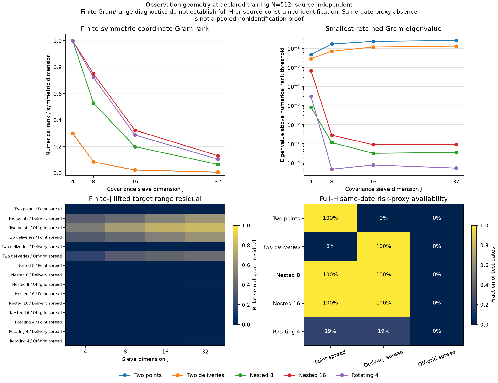
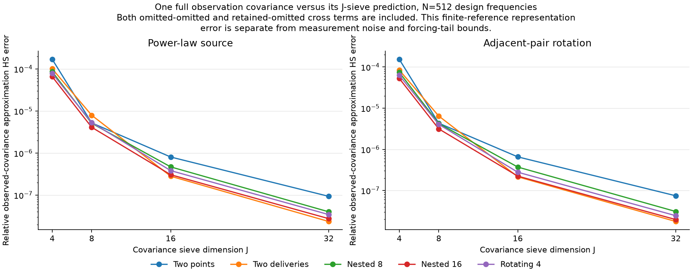
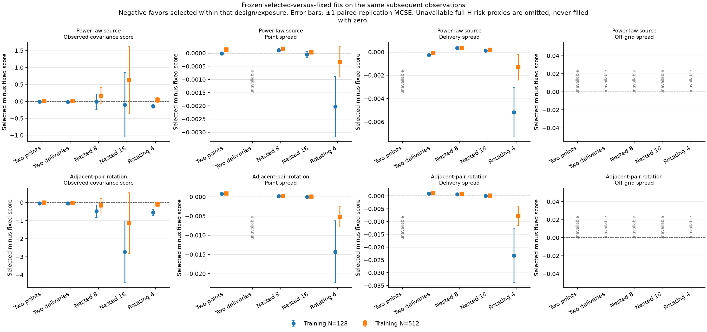

# Partial-innovation observations: fixed-interval study

This study estimates normalized innovation covariance VΔ at a fixed interval (weekly in the full protocol). It does not estimate source C or reconstruct innovations from sparse/noisy price levels. The [protocol](https://github.com/xrough/spde-covariance/blob/main/docs/partial-observations.md) separates finite Gram geometry, full-H functional spans, same-date risk-proxy availability and observation approximation.

Study: partial-observations; seed: 20261025; independent replications: 20. Preserve config.json, source/environment manifest and raw candidate/selection/replication outcomes with this report.

Reference M=256; Δ=0.019231 years; candidate J=(4, 8, 16); relative penalties=(0.001, 0.01, 0.1). Finite solver covariance budget=0.0001; numerical rank relative threshold=1e-10; analytic reference-tail budget=1e-05. These budgets concern different errors.

Training prefixes: (128, 512); validation dates 513–640; disjoint test dates 641–768. Fits remain frozen after validation, with no validation refit. The same full 16-contract parent observations supply every candidate J.

## Population observation geometry

The geometry panel uses the largest declared training size and retains every design and geometry dimension. Geometry does not depend on the source covariance. Finite Gram range statements concern the unrestricted fitted covariance sieve; generic covariance witnesses need not arise from a positive SPDE source. The proxy panel uses analytic full-H functional spans on actual test-date contracts, not finite-coordinate coincidence.

## Observation approximation before sampling error

All source/design/dimension combinations are retained, using the largest declared training size's date-map frequencies. One full contract observation is generated before any candidate J. Population full-minus-sieve covariance includes retained-omitted cross terms and may be indefinite; it is not independent omitted-coordinate noise. Finite-source tails remain separate from this representation error.

All configured population geometry and observation-approximation rows

Geometry uses normalized date weights. Rank and target range diagnostics depend on a declared numerical threshold, not sample count as an unnormalized multiplier. Approximation HS values are root-mean-square norms across the actual date maps; their relative value divides by the corresponding RMS full observation-covariance norm. Tail-tail and cross-term norms are shown separately; their norms do not add to the norm of their sum.

| Design | N | J | Gram rank/dimension | Smallest retained eigenvalue |
| --- | ---: | ---: | --- | ---: |
| Two points | 128 | 4 | 3/10 | 0.0047135 |
| Two points | 128 | 8 | 3/36 | 0.016842 |
| Two points | 128 | 16 | 3/136 | 0.022852 |
| Two points | 128 | 32 | 3/528 | 0.025562 |
| Two points | 512 | 4 | 3/10 | 0.0047135 |
| Two points | 512 | 8 | 3/36 | 0.016842 |
| Two points | 512 | 16 | 3/136 | 0.022852 |
| Two points | 512 | 32 | 3/528 | 0.025562 |
| Two deliveries | 128 | 4 | 3/10 | 0.0028358 |
| Two deliveries | 128 | 8 | 3/36 | 0.0070791 |
| Two deliveries | 128 | 16 | 3/136 | 0.011576 |
| Two deliveries | 128 | 32 | 3/528 | 0.012955 |
| Two deliveries | 512 | 4 | 3/10 | 0.0028358 |
| Two deliveries | 512 | 8 | 3/36 | 0.0070791 |
| Two deliveries | 512 | 16 | 3/136 | 0.011576 |
| Two deliveries | 512 | 32 | 3/528 | 0.012955 |
| Nested 8 | 128 | 4 | 10/10 | 8.0257e-06 |
| Nested 8 | 128 | 8 | 19/36 | 1.1403e-07 |
| Nested 8 | 128 | 16 | 27/136 | 3.1135e-08 |
| Nested 8 | 128 | 32 | 34/528 | 3.4311e-08 |
| Nested 8 | 512 | 4 | 10/10 | 8.0257e-06 |
| Nested 8 | 512 | 8 | 19/36 | 1.1403e-07 |
| Nested 8 | 512 | 16 | 27/136 | 3.1135e-08 |
| Nested 8 | 512 | 32 | 34/528 | 3.4311e-08 |
| Nested 16 | 128 | 4 | 10/10 | 0.00067413 |
| Nested 16 | 128 | 8 | 27/36 | 2.7485e-07 |
| Nested 16 | 128 | 16 | 44/136 | 8.7925e-08 |
| Nested 16 | 128 | 32 | 69/528 | 8.8742e-08 |
| Nested 16 | 512 | 4 | 10/10 | 0.00067413 |
| Nested 16 | 512 | 8 | 27/36 | 2.7485e-07 |
| Nested 16 | 512 | 16 | 44/136 | 8.7925e-08 |
| Nested 16 | 512 | 32 | 69/528 | 8.8742e-08 |
| Rotating 4 | 128 | 4 | 10/10 | 3.0839e-05 |
| Rotating 4 | 128 | 8 | 26/36 | 4.5811e-09 |
| Rotating 4 | 128 | 16 | 39/136 | 7.5199e-09 |
| Rotating 4 | 128 | 32 | 55/528 | 5.2114e-09 |
| Rotating 4 | 512 | 4 | 10/10 | 3.0839e-05 |
| Rotating 4 | 512 | 8 | 26/36 | 4.5811e-09 |
| Rotating 4 | 512 | 16 | 39/136 | 7.5199e-09 |
| Rotating 4 | 512 | 32 | 55/528 | 5.2114e-09 |

Full-H rows below use analytic functional Gram calculations, independent of J. Same-date availability concerns a scalar proxy; union membership concerns linear functionals. Neither alone proves pooled covariance identification or SPDE source admissibility. Coefficients and precise residuals remain in full_h_geometry.json.

| Design | Scope | N | Contract indices | Exposure | In span | Relative full-H residual |
| --- | --- | ---: | --- | --- | --- | ---: |
| Two points | same_date | unavailable | [0, 1] | Point spread | True | 5.4995e-16 |
| Two points | same_date | unavailable | [0, 1] | Delivery spread | False | 0.56504 |
| Two points | same_date | unavailable | [0, 1] | Off-grid spread | False | 0.74732 |
| Two points | training_union_functional_span | 128 | [0, 1] | Point spread | True | 5.4995e-16 |
| Two points | training_union_functional_span | 128 | [0, 1] | Delivery spread | False | 0.56504 |
| Two points | training_union_functional_span | 128 | [0, 1] | Off-grid spread | False | 0.74732 |
| Two points | training_union_functional_span | 512 | [0, 1] | Point spread | True | 5.4995e-16 |
| Two points | training_union_functional_span | 512 | [0, 1] | Delivery spread | False | 0.56504 |
| Two points | training_union_functional_span | 512 | [0, 1] | Off-grid spread | False | 0.74732 |
| Two deliveries | same_date | unavailable | [2, 3] | Point spread | False | 0.55265 |
| Two deliveries | same_date | unavailable | [2, 3] | Delivery spread | True | 5.9743e-16 |
| Two deliveries | same_date | unavailable | [2, 3] | Off-grid spread | False | 0.44671 |
| Two deliveries | training_union_functional_span | 128 | [2, 3] | Point spread | False | 0.55265 |
| Two deliveries | training_union_functional_span | 128 | [2, 3] | Delivery spread | True | 5.9743e-16 |
| Two deliveries | training_union_functional_span | 128 | [2, 3] | Off-grid spread | False | 0.44671 |
| Two deliveries | training_union_functional_span | 512 | [2, 3] | Point spread | False | 0.55265 |
| Two deliveries | training_union_functional_span | 512 | [2, 3] | Delivery spread | True | 5.9743e-16 |
| Two deliveries | training_union_functional_span | 512 | [2, 3] | Off-grid spread | False | 0.44671 |
| Nested 8 | same_date | unavailable | [0, 1, 2, 3, 4, 5, 6, 7] | Point spread | True | 2.2944e-14 |
| Nested 8 | same_date | unavailable | [0, 1, 2, 3, 4, 5, 6, 7] | Delivery spread | True | 6.504e-15 |
| Nested 8 | same_date | unavailable | [0, 1, 2, 3, 4, 5, 6, 7] | Off-grid spread | False | 0.30565 |
| Nested 8 | training_union_functional_span | 128 | [0, 1, 2, 3, 4, 5, 6, 7] | Point spread | True | 2.2944e-14 |
| Nested 8 | training_union_functional_span | 128 | [0, 1, 2, 3, 4, 5, 6, 7] | Delivery spread | True | 6.504e-15 |
| Nested 8 | training_union_functional_span | 128 | [0, 1, 2, 3, 4, 5, 6, 7] | Off-grid spread | False | 0.30565 |
| Nested 8 | training_union_functional_span | 512 | [0, 1, 2, 3, 4, 5, 6, 7] | Point spread | True | 2.2944e-14 |
| Nested 8 | training_union_functional_span | 512 | [0, 1, 2, 3, 4, 5, 6, 7] | Delivery spread | True | 6.504e-15 |
| Nested 8 | training_union_functional_span | 512 | [0, 1, 2, 3, 4, 5, 6, 7] | Off-grid spread | False | 0.30565 |
| Nested 16 | same_date | unavailable | [0, 1, 2, 3, 4, 5, 6, 7, 8, 9, 10, 11, 12, 13, 14, 15] | Point spread | True | 7.6388e-14 |
| Nested 16 | same_date | unavailable | [0, 1, 2, 3, 4, 5, 6, 7, 8, 9, 10, 11, 12, 13, 14, 15] | Delivery spread | True | 9.7421e-15 |
| Nested 16 | same_date | unavailable | [0, 1, 2, 3, 4, 5, 6, 7, 8, 9, 10, 11, 12, 13, 14, 15] | Off-grid spread | False | 0.27588 |
| Nested 16 | training_union_functional_span | 128 | [0, 1, 2, 3, 4, 5, 6, 7, 8, 9, 10, 11, 12, 13, 14, 15] | Point spread | True | 7.6388e-14 |
| Nested 16 | training_union_functional_span | 128 | [0, 1, 2, 3, 4, 5, 6, 7, 8, 9, 10, 11, 12, 13, 14, 15] | Delivery spread | True | 9.7421e-15 |
| Nested 16 | training_union_functional_span | 128 | [0, 1, 2, 3, 4, 5, 6, 7, 8, 9, 10, 11, 12, 13, 14, 15] | Off-grid spread | False | 0.27588 |
| Nested 16 | training_union_functional_span | 512 | [0, 1, 2, 3, 4, 5, 6, 7, 8, 9, 10, 11, 12, 13, 14, 15] | Point spread | True | 7.6388e-14 |
| Nested 16 | training_union_functional_span | 512 | [0, 1, 2, 3, 4, 5, 6, 7, 8, 9, 10, 11, 12, 13, 14, 15] | Delivery spread | True | 9.7421e-15 |
| Nested 16 | training_union_functional_span | 512 | [0, 1, 2, 3, 4, 5, 6, 7, 8, 9, 10, 11, 12, 13, 14, 15] | Off-grid spread | False | 0.27588 |
| Rotating 4 | same_date | unavailable | [0, 1, 2, 3] | Point spread | True | 1.0438e-14 |
| Rotating 4 | same_date | unavailable | [0, 1, 2, 3] | Delivery spread | True | 4.5983e-15 |
| Rotating 4 | same_date | unavailable | [0, 1, 2, 3] | Off-grid spread | False | 0.42523 |
| Rotating 4 | same_date | unavailable | [1, 2, 3, 4] | Point spread | False | 0.42135 |
| Rotating 4 | same_date | unavailable | [1, 2, 3, 4] | Delivery spread | True | 9.7018e-15 |
| Rotating 4 | same_date | unavailable | [1, 2, 3, 4] | Off-grid spread | False | 0.4313 |
| Rotating 4 | same_date | unavailable | [2, 3, 4, 5] | Point spread | False | 0.46865 |
| Rotating 4 | same_date | unavailable | [2, 3, 4, 5] | Delivery spread | True | 2.5508e-14 |
| Rotating 4 | same_date | unavailable | [2, 3, 4, 5] | Off-grid spread | False | 0.4453 |
| Rotating 4 | same_date | unavailable | [3, 4, 5, 6] | Point spread | False | 0.6652 |
| Rotating 4 | same_date | unavailable | [3, 4, 5, 6] | Delivery spread | False | 0.45334 |
| Rotating 4 | same_date | unavailable | [3, 4, 5, 6] | Off-grid spread | False | 0.56502 |
| Rotating 4 | same_date | unavailable | [4, 5, 6, 7] | Point spread | False | 0.72801 |
| Rotating 4 | same_date | unavailable | [4, 5, 6, 7] | Delivery spread | False | 0.53021 |
| Rotating 4 | same_date | unavailable | [4, 5, 6, 7] | Off-grid spread | False | 0.53916 |
| Rotating 4 | same_date | unavailable | [5, 6, 7, 8] | Point spread | False | 0.63521 |
| Rotating 4 | same_date | unavailable | [5, 6, 7, 8] | Delivery spread | False | 0.48982 |
| Rotating 4 | same_date | unavailable | [5, 6, 7, 8] | Off-grid spread | False | 0.51513 |
| Rotating 4 | same_date | unavailable | [6, 7, 8, 9] | Point spread | False | 0.62297 |
| Rotating 4 | same_date | unavailable | [6, 7, 8, 9] | Delivery spread | False | 0.61032 |
| Rotating 4 | same_date | unavailable | [6, 7, 8, 9] | Off-grid spread | False | 0.60687 |
| Rotating 4 | same_date | unavailable | [7, 8, 9, 10] | Point spread | False | 0.63729 |
| Rotating 4 | same_date | unavailable | [7, 8, 9, 10] | Delivery spread | False | 0.67686 |
| Rotating 4 | same_date | unavailable | [7, 8, 9, 10] | Off-grid spread | False | 0.60955 |
| Rotating 4 | same_date | unavailable | [8, 9, 10, 11] | Point spread | False | 0.63729 |
| Rotating 4 | same_date | unavailable | [8, 9, 10, 11] | Delivery spread | False | 0.67686 |
| Rotating 4 | same_date | unavailable | [8, 9, 10, 11] | Off-grid spread | False | 0.60955 |
| Rotating 4 | same_date | unavailable | [9, 10, 11, 12] | Point spread | False | 0.89043 |
| Rotating 4 | same_date | unavailable | [9, 10, 11, 12] | Delivery spread | False | 0.81917 |
| Rotating 4 | same_date | unavailable | [9, 10, 11, 12] | Off-grid spread | False | 0.71262 |
| Rotating 4 | same_date | unavailable | [10, 11, 12, 13] | Point spread | False | 0.89448 |
| Rotating 4 | same_date | unavailable | [10, 11, 12, 13] | Delivery spread | False | 0.89903 |
| Rotating 4 | same_date | unavailable | [10, 11, 12, 13] | Off-grid spread | False | 0.89926 |
| Rotating 4 | same_date | unavailable | [11, 12, 13, 14] | Point spread | False | 0.89742 |
| Rotating 4 | same_date | unavailable | [11, 12, 13, 14] | Delivery spread | False | 0.90183 |
| Rotating 4 | same_date | unavailable | [11, 12, 13, 14] | Off-grid spread | False | 0.90206 |
| Rotating 4 | same_date | unavailable | [12, 13, 14, 15] | Point spread | False | 0.89807 |
| Rotating 4 | same_date | unavailable | [12, 13, 14, 15] | Delivery spread | False | 0.90245 |
| Rotating 4 | same_date | unavailable | [12, 13, 14, 15] | Off-grid spread | False | 0.90267 |
| Rotating 4 | same_date | unavailable | [13, 14, 15, 0] | Point spread | False | 0.59673 |
| Rotating 4 | same_date | unavailable | [13, 14, 15, 0] | Delivery spread | False | 0.61835 |
| Rotating 4 | same_date | unavailable | [13, 14, 15, 0] | Off-grid spread | False | 0.61942 |
| Rotating 4 | same_date | unavailable | [14, 15, 0, 1] | Point spread | True | 1.9117e-15 |
| Rotating 4 | same_date | unavailable | [14, 15, 0, 1] | Delivery spread | False | 0.52638 |
| Rotating 4 | same_date | unavailable | [14, 15, 0, 1] | Off-grid spread | False | 0.61963 |
| Rotating 4 | same_date | unavailable | [15, 0, 1, 2] | Point spread | True | 2.6105e-15 |
| Rotating 4 | same_date | unavailable | [15, 0, 1, 2] | Delivery spread | False | 0.303 |
| Rotating 4 | same_date | unavailable | [15, 0, 1, 2] | Off-grid spread | False | 0.44323 |
| Rotating 4 | training_union_functional_span | 128 | [0, 1, 2, 3, 4, 5, 6, 7, 8, 9, 10, 11, 12, 13, 14, 15] | Point spread | True | 7.6388e-14 |
| Rotating 4 | training_union_functional_span | 128 | [0, 1, 2, 3, 4, 5, 6, 7, 8, 9, 10, 11, 12, 13, 14, 15] | Delivery spread | True | 9.7421e-15 |
| Rotating 4 | training_union_functional_span | 128 | [0, 1, 2, 3, 4, 5, 6, 7, 8, 9, 10, 11, 12, 13, 14, 15] | Off-grid spread | False | 0.27588 |
| Rotating 4 | training_union_functional_span | 512 | [0, 1, 2, 3, 4, 5, 6, 7, 8, 9, 10, 11, 12, 13, 14, 15] | Point spread | True | 7.6388e-14 |
| Rotating 4 | training_union_functional_span | 512 | [0, 1, 2, 3, 4, 5, 6, 7, 8, 9, 10, 11, 12, 13, 14, 15] | Delivery spread | True | 9.7421e-15 |
| Rotating 4 | training_union_functional_span | 512 | [0, 1, 2, 3, 4, 5, 6, 7, 8, 9, 10, 11, 12, 13, 14, 15] | Off-grid spread | False | 0.27588 |

| Source | Design | N | J | Full-minus-sieve RMS HS | Relative RMS HS | Omitted-omitted RMS HS | Cross-sum RMS HS | Observation reference-tail bound |
| --- | --- | ---: | ---: | ---: | ---: | ---: | ---: | ---: |
| Power-law source | Two deliveries | 128 | 4 | 0.00017799 | 0.00010077 | 0.00017703 | 3.331e-06 | 1.5623e-07 |
| Power-law source | Two deliveries | 128 | 8 | 1.3977e-05 | 7.9135e-06 | 1.3028e-05 | 9.5621e-07 | 1.5623e-07 |
| Power-law source | Two deliveries | 128 | 16 | 4.9646e-07 | 2.8108e-07 | 4.593e-07 | 4.0604e-08 | 1.5623e-07 |
| Power-law source | Two deliveries | 128 | 32 | 4.1683e-08 | 2.36e-08 | 4.1634e-08 | 1.423e-09 | 1.5623e-07 |
| Power-law source | Two deliveries | 512 | 4 | 0.00017799 | 0.00010077 | 0.00017703 | 3.331e-06 | 1.5623e-07 |
| Power-law source | Two deliveries | 512 | 8 | 1.3977e-05 | 7.9135e-06 | 1.3028e-05 | 9.5621e-07 | 1.5623e-07 |
| Power-law source | Two deliveries | 512 | 16 | 4.9646e-07 | 2.8108e-07 | 4.593e-07 | 4.0604e-08 | 1.5623e-07 |
| Power-law source | Two deliveries | 512 | 32 | 4.1683e-08 | 2.36e-08 | 4.1634e-08 | 1.423e-09 | 1.5623e-07 |
| Power-law source | Two points | 128 | 4 | 0.00029577 | 0.00016966 | 0.00029068 | 6.3361e-06 | 1.4734e-07 |
| Power-law source | Two points | 128 | 8 | 9.092e-06 | 5.2154e-06 | 8.5937e-06 | 6.382e-07 | 1.4734e-07 |
| Power-law source | Two points | 128 | 16 | 1.4034e-06 | 8.0502e-07 | 1.393e-06 | 2.7287e-08 | 1.4734e-07 |
| Power-law source | Two points | 128 | 32 | 1.6302e-07 | 9.351e-08 | 1.4927e-07 | 1.3859e-08 | 1.4734e-07 |
| Power-law source | Two points | 512 | 4 | 0.00029577 | 0.00016966 | 0.00029068 | 6.3361e-06 | 1.4734e-07 |
| Power-law source | Two points | 512 | 8 | 9.092e-06 | 5.2154e-06 | 8.5937e-06 | 6.382e-07 | 1.4734e-07 |
| Power-law source | Two points | 512 | 16 | 1.4034e-06 | 8.0502e-07 | 1.393e-06 | 2.7287e-08 | 1.4734e-07 |
| Power-law source | Two points | 512 | 32 | 1.6302e-07 | 9.351e-08 | 1.4927e-07 | 1.3859e-08 | 1.4734e-07 |
| Power-law source | Nested 16 | 128 | 4 | 0.00093434 | 6.5602e-05 | 0.00090971 | 5.4252e-05 | 1.2654e-06 |
| Power-law source | Nested 16 | 128 | 8 | 5.8349e-05 | 4.0968e-06 | 5.6853e-05 | 5.4882e-06 | 1.2654e-06 |
| Power-law source | Nested 16 | 128 | 16 | 4.3445e-06 | 3.0503e-07 | 4.1385e-06 | 6.3936e-07 | 1.2654e-06 |
| Power-law source | Nested 16 | 128 | 32 | 3.9263e-07 | 2.7567e-08 | 3.7053e-07 | 6.553e-08 | 1.2654e-06 |
| Power-law source | Nested 16 | 512 | 4 | 0.00093434 | 6.5602e-05 | 0.00090971 | 5.4252e-05 | 1.2654e-06 |
| Power-law source | Nested 16 | 512 | 8 | 5.8349e-05 | 4.0968e-06 | 5.6853e-05 | 5.4882e-06 | 1.2654e-06 |
| Power-law source | Nested 16 | 512 | 16 | 4.3445e-06 | 3.0503e-07 | 4.1385e-06 | 6.3936e-07 | 1.2654e-06 |
| Power-law source | Nested 16 | 512 | 32 | 3.9263e-07 | 2.7567e-08 | 3.7053e-07 | 6.553e-08 | 1.2654e-06 |
| Power-law source | Nested 8 | 128 | 4 | 0.00060338 | 8.6189e-05 | 0.00059521 | 3.472e-05 | 5.8685e-07 |
| Power-law source | Nested 8 | 128 | 8 | 3.5691e-05 | 5.0982e-06 | 3.3769e-05 | 4.5614e-06 | 5.8685e-07 |
| Power-law source | Nested 8 | 128 | 16 | 3.28e-06 | 4.6853e-07 | 3.1222e-06 | 4.9173e-07 | 5.8685e-07 |
| Power-law source | Nested 8 | 128 | 32 | 2.8069e-07 | 4.0094e-08 | 2.5725e-07 | 5.605e-08 | 5.8685e-07 |
| Power-law source | Nested 8 | 512 | 4 | 0.00060338 | 8.6189e-05 | 0.00059521 | 3.472e-05 | 5.8685e-07 |
| Power-law source | Nested 8 | 512 | 8 | 3.5691e-05 | 5.0982e-06 | 3.3769e-05 | 4.5614e-06 | 5.8685e-07 |
| Power-law source | Nested 8 | 512 | 16 | 3.28e-06 | 4.6853e-07 | 3.1222e-06 | 4.9173e-07 | 5.8685e-07 |
| Power-law source | Nested 8 | 512 | 32 | 2.8069e-07 | 4.0094e-08 | 2.5725e-07 | 5.605e-08 | 5.8685e-07 |
| Power-law source | Rotating 4 | 128 | 4 | 0.00028061 | 7.8567e-05 | 0.0002728 | 1.3642e-05 | 3.2444e-07 |
| Power-law source | Rotating 4 | 128 | 8 | 1.8964e-05 | 5.3095e-06 | 1.8498e-05 | 1.6441e-06 | 3.2444e-07 |
| Power-law source | Rotating 4 | 128 | 16 | 1.3642e-06 | 3.8195e-07 | 1.299e-06 | 1.8311e-07 | 3.2444e-07 |
| Power-law source | Rotating 4 | 128 | 32 | 1.2305e-07 | 3.4452e-08 | 1.1677e-07 | 1.5603e-08 | 3.2444e-07 |
| Power-law source | Rotating 4 | 512 | 4 | 0.00028061 | 7.8567e-05 | 0.0002728 | 1.3642e-05 | 3.2444e-07 |
| Power-law source | Rotating 4 | 512 | 8 | 1.8964e-05 | 5.3095e-06 | 1.8498e-05 | 1.6441e-06 | 3.2444e-07 |
| Power-law source | Rotating 4 | 512 | 16 | 1.3642e-06 | 3.8195e-07 | 1.299e-06 | 1.8311e-07 | 3.2444e-07 |
| Power-law source | Rotating 4 | 512 | 32 | 1.2305e-07 | 3.4452e-08 | 1.1677e-07 | 1.5603e-08 | 3.2444e-07 |
| Adjacent-pair rotation | Two deliveries | 128 | 4 | 0.00020485 | 8.4238e-05 | 0.00020345 | 4.0697e-06 | 1.5623e-07 |
| Adjacent-pair rotation | Two deliveries | 128 | 8 | 1.5682e-05 | 6.4487e-06 | 1.4608e-05 | 1.0799e-06 | 1.5623e-07 |
| Adjacent-pair rotation | Two deliveries | 128 | 16 | 5.235e-07 | 2.1528e-07 | 4.8373e-07 | 4.3456e-08 | 1.5623e-07 |
| Adjacent-pair rotation | Two deliveries | 128 | 32 | 4.297e-08 | 1.7671e-08 | 4.2919e-08 | 1.4756e-09 | 1.5623e-07 |
| Adjacent-pair rotation | Two deliveries | 512 | 4 | 0.00020485 | 8.4238e-05 | 0.00020345 | 4.0697e-06 | 1.5623e-07 |
| Adjacent-pair rotation | Two deliveries | 512 | 8 | 1.5682e-05 | 6.4487e-06 | 1.4608e-05 | 1.0799e-06 | 1.5623e-07 |
| Adjacent-pair rotation | Two deliveries | 512 | 16 | 5.235e-07 | 2.1528e-07 | 4.8373e-07 | 4.3456e-08 | 1.5623e-07 |
| Adjacent-pair rotation | Two deliveries | 512 | 32 | 4.297e-08 | 1.7671e-08 | 4.2919e-08 | 1.4756e-09 | 1.5623e-07 |
| Adjacent-pair rotation | Two points | 128 | 4 | 0.00034912 | 0.00015421 | 0.0003428 | 7.7086e-06 | 1.4734e-07 |
| Adjacent-pair rotation | Two points | 128 | 8 | 9.7761e-06 | 4.3182e-06 | 9.2073e-06 | 7.171e-07 | 1.4734e-07 |
| Adjacent-pair rotation | Two points | 128 | 16 | 1.4861e-06 | 6.5645e-07 | 1.4749e-06 | 2.925e-08 | 1.4734e-07 |
| Adjacent-pair rotation | Two points | 128 | 32 | 1.6845e-07 | 7.4407e-08 | 1.5419e-07 | 1.4381e-08 | 1.4734e-07 |
| Adjacent-pair rotation | Two points | 512 | 4 | 0.00034912 | 0.00015421 | 0.0003428 | 7.7086e-06 | 1.4734e-07 |
| Adjacent-pair rotation | Two points | 512 | 8 | 9.7761e-06 | 4.3182e-06 | 9.2073e-06 | 7.171e-07 | 1.4734e-07 |
| Adjacent-pair rotation | Two points | 512 | 16 | 1.4861e-06 | 6.5645e-07 | 1.4749e-06 | 2.925e-08 | 1.4734e-07 |
| Adjacent-pair rotation | Two points | 512 | 32 | 1.6845e-07 | 7.4407e-08 | 1.5419e-07 | 1.4381e-08 | 1.4734e-07 |
| Adjacent-pair rotation | Nested 16 | 128 | 4 | 0.0010925 | 5.2951e-05 | 0.0010613 | 6.5592e-05 | 1.2654e-06 |
| Adjacent-pair rotation | Nested 16 | 128 | 8 | 6.4814e-05 | 3.1414e-06 | 6.3089e-05 | 6.1857e-06 | 1.2654e-06 |
| Adjacent-pair rotation | Nested 16 | 128 | 16 | 4.6176e-06 | 2.2381e-07 | 4.3961e-06 | 6.8373e-07 | 1.2654e-06 |
| Adjacent-pair rotation | Nested 16 | 128 | 32 | 4.0579e-07 | 1.9668e-08 | 3.8282e-07 | 6.803e-08 | 1.2654e-06 |
| Adjacent-pair rotation | Nested 16 | 512 | 4 | 0.0010925 | 5.2951e-05 | 0.0010613 | 6.5592e-05 | 1.2654e-06 |
| Adjacent-pair rotation | Nested 16 | 512 | 8 | 6.4814e-05 | 3.1414e-06 | 6.3089e-05 | 6.1857e-06 | 1.2654e-06 |
| Adjacent-pair rotation | Nested 16 | 512 | 16 | 4.6176e-06 | 2.2381e-07 | 4.3961e-06 | 6.8373e-07 | 1.2654e-06 |
| Adjacent-pair rotation | Nested 16 | 512 | 32 | 4.0579e-07 | 1.9668e-08 | 3.8282e-07 | 6.803e-08 | 1.2654e-06 |
| Adjacent-pair rotation | Nested 8 | 128 | 4 | 0.00069942 | 7.4416e-05 | 0.00068869 | 4.2012e-05 | 5.8685e-07 |
| Adjacent-pair rotation | Nested 8 | 128 | 8 | 3.9799e-05 | 4.2344e-06 | 3.7604e-05 | 5.147e-06 | 5.8685e-07 |
| Adjacent-pair rotation | Nested 8 | 128 | 16 | 3.4884e-06 | 3.7115e-07 | 3.3187e-06 | 5.2711e-07 | 5.8685e-07 |
| Adjacent-pair rotation | Nested 8 | 128 | 32 | 2.9013e-07 | 3.0869e-08 | 2.6577e-07 | 5.8177e-08 | 5.8685e-07 |
| Adjacent-pair rotation | Nested 8 | 512 | 4 | 0.00069942 | 7.4416e-05 | 0.00068869 | 4.2012e-05 | 5.8685e-07 |
| Adjacent-pair rotation | Nested 8 | 512 | 8 | 3.9799e-05 | 4.2344e-06 | 3.7604e-05 | 5.147e-06 | 5.8685e-07 |
| Adjacent-pair rotation | Nested 8 | 512 | 16 | 3.4884e-06 | 3.7115e-07 | 3.3187e-06 | 5.2711e-07 | 5.8685e-07 |
| Adjacent-pair rotation | Nested 8 | 512 | 32 | 2.9013e-07 | 3.0869e-08 | 2.6577e-07 | 5.8177e-08 | 5.8685e-07 |
| Adjacent-pair rotation | Rotating 4 | 128 | 4 | 0.0003282 | 6.3093e-05 | 0.00031839 | 1.6564e-05 | 3.2444e-07 |
| Adjacent-pair rotation | Rotating 4 | 128 | 8 | 2.1012e-05 | 4.0393e-06 | 2.0479e-05 | 1.8561e-06 | 3.2444e-07 |
| Adjacent-pair rotation | Rotating 4 | 128 | 16 | 1.4474e-06 | 2.7824e-07 | 1.3774e-06 | 1.9596e-07 | 3.2444e-07 |
| Adjacent-pair rotation | Rotating 4 | 128 | 32 | 1.2707e-07 | 2.4428e-08 | 1.2054e-07 | 1.6205e-08 | 3.2444e-07 |
| Adjacent-pair rotation | Rotating 4 | 512 | 4 | 0.0003282 | 6.3093e-05 | 0.00031839 | 1.6564e-05 | 3.2444e-07 |
| Adjacent-pair rotation | Rotating 4 | 512 | 8 | 2.1012e-05 | 4.0393e-06 | 2.0479e-05 | 1.8561e-06 | 3.2444e-07 |
| Adjacent-pair rotation | Rotating 4 | 512 | 16 | 1.4474e-06 | 2.7824e-07 | 1.3774e-06 | 1.9596e-07 | 3.2444e-07 |
| Adjacent-pair rotation | Rotating 4 | 512 | 32 | 1.2707e-07 | 2.4428e-08 | 1.2054e-07 | 1.6205e-08 | 3.2444e-07 |

## Frozen fits on subsequent observations

Scores omit candidate-independent constants and can be negative. Each entry is an independent-replication mean ± MCSE. Compare rules on the same future observations; absolute scores across different designs are not a common-information ranking. Selected/fixed matrices use training only and remain frozen after validation.

| Source | Design | N | Selected test score | Fixed test score | Selected latent HS error | Fixed latent HS error |
| --- | --- | ---: | ---: | ---: | ---: | ---: |
| Power-law source | Two points | 128 | -2.9335 ± 0.15001 | -2.9229 ± 0.15875 | 0.56926 ± 0.0026646 | 0.55945 ± 0.0020235 |
| Power-law source | Two points | 512 | -2.9367 ± 0.14241 | -2.9414 ± 0.15272 | 0.56625 ± 0.0026589 | 0.55531 ± 0.00023981 |
| Power-law source | Two deliveries | 128 | -2.9989 ± 0.15574 | -2.9837 ± 0.16365 | 0.60799 ± 0.0032558 | 0.60338 ± 0.0017914 |
| Power-law source | Two deliveries | 512 | -2.9979 ± 0.14812 | -3.0003 ± 0.15833 | 0.60475 ± 0.0037833 | 0.6 ± 0.00018561 |
| Power-law source | Nested 8 | 128 | -47.111 ± 2.4304 | -47.098 ± 2.5868 | 0.32984 ± 0.034309 | 0.1738 ± 0.008066 |
| Power-law source | Nested 8 | 512 | -47.195 ± 2.3456 | -47.359 ± 2.4975 | 0.28173 ± 0.037063 | 0.14612 ± 0.0027069 |
| Power-law source | Nested 16 | 128 | -194.3 ± 10.23 | -194.2 ± 10.827 | 0.38001 ± 0.03538 | 0.21103 ± 0.0083414 |
| Power-law source | Nested 16 | 512 | -194.54 ± 9.8888 | -195.17 ± 10.509 | 0.32954 ± 0.038234 | 0.18974 ± 0.0031897 |
| Power-law source | Rotating 4 | 128 | -12.154 ± 0.6396 | -12.016 ± 0.68347 | 0.592 ± 0.036192 | 1.0407 ± 0.071427 |
| Power-law source | Rotating 4 | 512 | -12.231 ± 0.60261 | -12.27 ± 0.65602 | 0.45047 ± 0.032182 | 0.55565 ± 0.036062 |
| Adjacent-pair rotation | Two points | 128 | -4.7308 ± 0.24708 | -4.6885 ± 0.25208 | 0.35186 ± 0.003777 | 0.35823 ± 0.0067896 |
| Adjacent-pair rotation | Two points | 512 | -4.7294 ± 0.23983 | -4.7178 ± 0.25375 | 0.34888 ± 0.0013877 | 0.34867 ± 0.00087459 |
| Adjacent-pair rotation | Two deliveries | 128 | -5.4302 ± 0.28647 | -5.3872 ± 0.29025 | 0.34805 ± 0.0040303 | 0.35411 ± 0.0070568 |
| Adjacent-pair rotation | Two deliveries | 512 | -5.4382 ± 0.2766 | -5.4245 ± 0.292 | 0.34445 ± 0.0018768 | 0.34419 ± 0.0008979 |
| Adjacent-pair rotation | Nested 8 | 128 | -81.222 ± 4.3405 | -80.741 ± 4.3882 | 0.20816 ± 0.015741 | 0.1672 ± 0.011513 |
| Adjacent-pair rotation | Nested 8 | 512 | -81.406 ± 4.1794 | -81.243 ± 4.408 | 0.19306 ± 0.016314 | 0.14165 ± 0.0022371 |
| Adjacent-pair rotation | Nested 16 | 128 | -391.05 ± 20.951 | -388.31 ± 21.187 | 0.18733 ± 0.014953 | 0.13244 ± 0.013239 |
| Adjacent-pair rotation | Nested 16 | 512 | -392.05 ± 20.278 | -390.92 ± 21.252 | 0.1502 ± 0.015626 | 0.10161 ± 0.002994 |
| Adjacent-pair rotation | Rotating 4 | 128 | -24.909 ± 1.3271 | -24.352 ± 1.3538 | 0.39958 ± 0.04895 | 1.302 ± 0.074838 |
| Adjacent-pair rotation | Rotating 4 | 512 | -25.064 ± 1.2618 | -24.958 ± 1.3214 | 0.41934 ± 0.070777 | 0.80001 ± 0.051578 |

## Candidate choices

Validation selects observed-space prediction loss, not latent operator/risk error. Exact ties prefer smaller J, then larger relative penalty. The fixed baseline is J=16, relative penalty 0.001, from the same candidate fits; neither rule refits through validation.

| Source | Design | N | Selected (J, relative penalty): replication counts |
| --- | --- | ---: | --- |
| Power-law source | Two points | 128 | (16, 0.001): 9; (16, 0.1): 11 |
| Power-law source | Two points | 512 | (16, 0.001): 10; (16, 0.01): 1; (16, 0.1): 9 |
| Power-law source | Two deliveries | 128 | (4, 0.001): 1; (16, 0.001): 8; (16, 0.01): 1; (16, 0.1): 10 |
| Power-law source | Two deliveries | 512 | (4, 0.001): 2; (16, 0.001): 8; (16, 0.01): 1; (16, 0.1): 9 |
| Power-law source | Nested 8 | 128 | (4, 0.001): 4; (4, 0.01): 2; (8, 0.001): 4; (8, 0.1): 1; (16, 0.001): 1; (16, 0.1): 8 |
| Power-law source | Nested 8 | 512 | (4, 0.001): 5; (4, 0.01): 2; (8, 0.001): 4; (16, 0.001): 2; (16, 0.1): 7 |
| Power-law source | Nested 16 | 128 | (4, 0.001): 5; (4, 0.01): 1; (8, 0.001): 3; (8, 0.1): 3; (16, 0.001): 1; (16, 0.01): 1; (16, 0.1): 6 |
| Power-law source | Nested 16 | 512 | (4, 0.001): 6; (4, 0.01): 2; (8, 0.001): 2; (8, 0.1): 3; (16, 0.001): 3; (16, 0.1): 4 |
| Power-law source | Rotating 4 | 128 | (4, 0.001): 3; (4, 0.01): 3; (4, 0.1): 6; (8, 0.001): 1; (8, 0.1): 1; (16, 0.001): 3; (16, 0.01): 2; (16, 0.1): 1 |
| Power-law source | Rotating 4 | 512 | (4, 0.001): 8; (4, 0.01): 1; (4, 0.1): 4; (8, 0.1): 2; (16, 0.001): 4; (16, 0.1): 1 |
| Adjacent-pair rotation | Two points | 128 | (4, 0.001): 3; (4, 0.01): 1; (4, 0.1): 8; (16, 0.001): 5; (16, 0.1): 3 |
| Adjacent-pair rotation | Two points | 512 | (4, 0.001): 2; (4, 0.01): 1; (4, 0.1): 6; (16, 0.001): 5; (16, 0.01): 4; (16, 0.1): 2 |
| Adjacent-pair rotation | Two deliveries | 128 | (4, 0.001): 2; (4, 0.01): 2; (4, 0.1): 1; (8, 0.001): 1; (8, 0.1): 8; (16, 0.001): 4; (16, 0.01): 1; (16, 0.1): 1 |
| Adjacent-pair rotation | Two deliveries | 512 | (4, 0.001): 3; (4, 0.01): 1; (8, 0.01): 1; (8, 0.1): 7; (16, 0.001): 4; (16, 0.01): 3; (16, 0.1): 1 |
| Adjacent-pair rotation | Nested 8 | 128 | (4, 0.001): 3; (4, 0.1): 5; (8, 0.001): 6; (8, 0.1): 4; (16, 0.01): 2 |
| Adjacent-pair rotation | Nested 8 | 512 | (4, 0.001): 3; (4, 0.1): 3; (8, 0.001): 4; (8, 0.1): 5; (16, 0.001): 3; (16, 0.01): 2 |
| Adjacent-pair rotation | Nested 16 | 128 | (4, 0.001): 4; (4, 0.1): 2; (8, 0.001): 3; (8, 0.1): 7; (16, 0.001): 1; (16, 0.01): 2; (16, 0.1): 1 |
| Adjacent-pair rotation | Nested 16 | 512 | (4, 0.001): 6; (4, 0.01): 1; (4, 0.1): 2; (8, 0.001): 4; (8, 0.1): 4; (16, 0.01): 3 |
| Adjacent-pair rotation | Rotating 4 | 128 | (4, 0.001): 2; (4, 0.01): 3; (4, 0.1): 7; (8, 0.01): 1; (8, 0.1): 1; (16, 0.001): 1; (16, 0.01): 2; (16, 0.1): 3 |
| Adjacent-pair rotation | Rotating 4 | 512 | (4, 0.001): 2; (4, 0.01): 4; (4, 0.1): 5; (8, 0.1): 2; (16, 0.001): 4; (16, 0.01): 1; (16, 0.1): 2 |

## Fixed full-H exposure risks

Future scalar proxy scores require a same-date full-H functional representation. Failure of this availability test is not a pooled covariance nonidentification proof. Plugin risks restrict a fixed full-H exposure to the fitted J without renormalization; their latent errors use full-reference V risk. Direct risk estimates use training proxies on available dates only. Latent errors never select a candidate.

Every source/design/training-size/exposure/rule result

| Source | Design | N | Exposure | Rule | Available train/test dates | Future risk score ± MCSE | Latent risk MSE ± MCSE |
| --- | --- | ---: | --- | --- | --- | ---: | ---: |
| Power-law source | Two points | 128 | Point spread | selected | 128/128 | -0.0012912 ± 8.2019e-05 | 0.0003161 ± 3.2756e-05 |
| Power-law source | Two points | 128 | Point spread | fixed | 128/128 | -0.0012786 ± 7.638e-05 | 0.00032074 ± 3.6922e-05 |
| Power-law source | Two points | 128 | Point spread | direct | 128/128 | -0.0015111 ± 0.0001226 | 2.4703e-05 ± 8.4558e-06 |
| Power-law source | Two points | 128 | Delivery spread | selected | 0/0 | unavailable | 0.00069028 ± 7.3013e-05 |
| Power-law source | Two points | 128 | Delivery spread | fixed | 0/0 | unavailable | 0.00042868 ± 3.3694e-05 |
| Power-law source | Two points | 128 | Delivery spread | direct | 0/0 | unavailable | unavailable |
| Power-law source | Two points | 128 | Off-grid spread | selected | 0/0 | unavailable | 0.0010033 ± 7.0539e-05 |
| Power-law source | Two points | 128 | Off-grid spread | fixed | 0/0 | unavailable | 0.00074862 ± 3.2504e-05 |
| Power-law source | Two points | 128 | Off-grid spread | direct | 0/0 | unavailable | unavailable |
| Power-law source | Two points | 512 | Point spread | selected | 512/128 | -0.0011793 ± 6.472e-05 | 0.00040173 ± 5.2995e-05 |
| Power-law source | Two points | 512 | Point spread | fixed | 512/128 | -0.001311 ± 7.1395e-05 | 0.00029274 ± 1.4503e-05 |
| Power-law source | Two points | 512 | Point spread | direct | 512/128 | -0.0015227 ± 0.00012633 | 6.6755e-06 ± 2.4399e-06 |
| Power-law source | Two points | 512 | Delivery spread | selected | 0/0 | unavailable | 0.00073418 ± 8.2753e-05 |
| Power-law source | Two points | 512 | Delivery spread | fixed | 0/0 | unavailable | 0.00039494 ± 1.5749e-05 |
| Power-law source | Two points | 512 | Delivery spread | direct | 0/0 | unavailable | unavailable |
| Power-law source | Two points | 512 | Off-grid spread | selected | 0/0 | unavailable | 0.0010357 ± 7.4419e-05 |
| Power-law source | Two points | 512 | Off-grid spread | fixed | 0/0 | unavailable | 0.00072021 ± 1.5554e-05 |
| Power-law source | Two points | 512 | Off-grid spread | direct | 0/0 | unavailable | unavailable |
| Power-law source | Two deliveries | 128 | Point spread | selected | 0/0 | unavailable | 0.0001617 ± 4.915e-05 |
| Power-law source | Two deliveries | 128 | Point spread | fixed | 0/0 | unavailable | 0.00028828 ± 5.0582e-05 |
| Power-law source | Two deliveries | 128 | Point spread | direct | 0/0 | unavailable | unavailable |
| Power-law source | Two deliveries | 128 | Delivery spread | selected | 128/128 | -0.0011672 ± 0.0001004 | 0.00046352 ± 7.7697e-05 |
| Power-law source | Two deliveries | 128 | Delivery spread | fixed | 128/128 | -0.00091927 ± 8.7438e-05 | 0.00071656 ± 7.477e-05 |
| Power-law source | Two deliveries | 128 | Delivery spread | direct | 128/128 | -0.0015514 ± 0.00013482 | 3.9644e-05 ± 1.1612e-05 |
| Power-law source | Two deliveries | 128 | Off-grid spread | selected | 0/0 | unavailable | 0.00077914 ± 7.1449e-05 |
| Power-law source | Two deliveries | 128 | Off-grid spread | fixed | 0/0 | unavailable | 0.00095536 ± 6.8207e-05 |
| Power-law source | Two deliveries | 128 | Off-grid spread | direct | 0/0 | unavailable | unavailable |
| Power-law source | Two deliveries | 512 | Point spread | selected | 0/0 | unavailable | 0.00020329 ± 5.3296e-05 |
| Power-law source | Two deliveries | 512 | Point spread | fixed | 0/0 | unavailable | 0.00029272 ± 2.0732e-05 |
| Power-law source | Two deliveries | 512 | Point spread | direct | 0/0 | unavailable | unavailable |
| Power-law source | Two deliveries | 512 | Delivery spread | selected | 512/128 | -0.0010252 ± 9.7859e-05 | 0.00061914 ± 8.4149e-05 |
| Power-law source | Two deliveries | 512 | Delivery spread | fixed | 512/128 | -0.00092382 ± 5.4405e-05 | 0.00072649 ± 2.8995e-05 |
| Power-law source | Two deliveries | 512 | Delivery spread | direct | 512/128 | -0.0015879 ± 0.00012264 | 7.948e-06 ± 1.4816e-06 |
| Power-law source | Two deliveries | 512 | Off-grid spread | selected | 0/0 | unavailable | 0.00093739 ± 7.6749e-05 |
| Power-law source | Two deliveries | 512 | Off-grid spread | fixed | 0/0 | unavailable | 0.00097013 ± 2.6954e-05 |
| Power-law source | Two deliveries | 512 | Off-grid spread | direct | 0/0 | unavailable | unavailable |
| Power-law source | Nested 8 | 128 | Point spread | selected | 128/128 | -0.0013235 ± 0.00011705 | 0.00027994 ± 7.5942e-05 |
| Power-law source | Nested 8 | 128 | Point spread | fixed | 128/128 | -0.001433 ± 9.2014e-05 | 0.00013924 ± 2.3801e-05 |
| Power-law source | Nested 8 | 128 | Point spread | direct | 128/128 | -0.0015111 ± 0.0001226 | 2.4703e-05 ± 8.4558e-06 |
| Power-law source | Nested 8 | 128 | Delivery spread | selected | 128/128 | -0.0012107 ± 0.00011572 | 0.00040248 ± 8.655e-05 |
| Power-law source | Nested 8 | 128 | Delivery spread | fixed | 128/128 | -0.0015679 ± 0.00012209 | 3.4004e-05 ± 6.6229e-06 |
| Power-law source | Nested 8 | 128 | Delivery spread | direct | 128/128 | -0.0015514 ± 0.00013482 | 3.9644e-05 ± 1.1612e-05 |
| Power-law source | Nested 8 | 128 | Off-grid spread | selected | 0/0 | unavailable | 0.0005372 ± 0.00010725 |
| Power-law source | Nested 8 | 128 | Off-grid spread | fixed | 0/0 | unavailable | 4.3892e-05 ± 8.139e-06 |
| Power-law source | Nested 8 | 128 | Off-grid spread | direct | 0/0 | unavailable | unavailable |
| Power-law source | Nested 8 | 512 | Point spread | selected | 512/128 | -0.0012932 ± 0.00011917 | 0.00036033 ± 7.6992e-05 |
| Power-law source | Nested 8 | 512 | Point spread | fixed | 512/128 | -0.0014592 ± 9.1144e-05 | 0.0001218 ± 1.103e-05 |
| Power-law source | Nested 8 | 512 | Point spread | direct | 512/128 | -0.0015227 ± 0.00012633 | 6.6755e-06 ± 2.4399e-06 |
| Power-law source | Nested 8 | 512 | Delivery spread | selected | 512/128 | -0.0012494 ± 0.00013113 | 0.00041459 ± 8.7692e-05 |
| Power-law source | Nested 8 | 512 | Delivery spread | fixed | 512/128 | -0.0015959 ± 0.00011927 | 7.3425e-06 ± 1.9299e-06 |
| Power-law source | Nested 8 | 512 | Delivery spread | direct | 512/128 | -0.0015879 ± 0.00012264 | 7.948e-06 ± 1.4816e-06 |
| Power-law source | Nested 8 | 512 | Off-grid spread | selected | 0/0 | unavailable | 0.00050479 ± 0.00011037 |
| Power-law source | Nested 8 | 512 | Off-grid spread | fixed | 0/0 | unavailable | 1.0894e-05 ± 2.6117e-06 |
| Power-law source | Nested 8 | 512 | Off-grid spread | direct | 0/0 | unavailable | unavailable |
| Power-law source | Nested 16 | 128 | Point spread | selected | 128/128 | -0.0012831 ± 0.00014232 | 0.00034442 ± 8.3847e-05 |
| Power-law source | Nested 16 | 128 | Point spread | fixed | 128/128 | -0.001227 ± 7.2919e-05 | 0.00037929 ± 3.9358e-05 |
| Power-law source | Nested 16 | 128 | Point spread | direct | 128/128 | -0.0015111 ± 0.0001226 | 2.4703e-05 ± 8.4558e-06 |
| Power-law source | Nested 16 | 128 | Delivery spread | selected | 128/128 | -0.0013371 ± 0.00011425 | 0.00028217 ± 7.9134e-05 |
| Power-law source | Nested 16 | 128 | Delivery spread | fixed | 128/128 | -0.0014717 ± 9.6555e-05 | 0.0001329 ± 2.3623e-05 |
| Power-law source | Nested 16 | 128 | Delivery spread | direct | 128/128 | -0.0015514 ± 0.00013482 | 3.9644e-05 ± 1.1612e-05 |
| Power-law source | Nested 16 | 128 | Off-grid spread | selected | 0/0 | unavailable | 0.0003187 ± 8.573e-05 |
| Power-law source | Nested 16 | 128 | Off-grid spread | fixed | 0/0 | unavailable | 9.8444e-05 ± 1.9054e-05 |
| Power-law source | Nested 16 | 128 | Off-grid spread | direct | 0/0 | unavailable | unavailable |
| Power-law source | Nested 16 | 512 | Point spread | selected | 512/128 | -0.0012142 ± 0.00011054 | 0.00043444 ± 8.4767e-05 |
| Power-law source | Nested 16 | 512 | Point spread | fixed | 512/128 | -0.0012439 ± 6.6995e-05 | 0.00037168 ± 1.7812e-05 |
| Power-law source | Nested 16 | 512 | Point spread | direct | 512/128 | -0.0015227 ± 0.00012633 | 6.6755e-06 ± 2.4399e-06 |
| Power-law source | Nested 16 | 512 | Delivery spread | selected | 512/128 | -0.0013251 ± 0.00011444 | 0.00034224 ± 7.2903e-05 |
| Power-law source | Nested 16 | 512 | Delivery spread | fixed | 512/128 | -0.0015085 ± 9.3166e-05 | 0.00010908 ± 1.2152e-05 |
| Power-law source | Nested 16 | 512 | Delivery spread | direct | 512/128 | -0.0015879 ± 0.00012264 | 7.948e-06 ± 1.4816e-06 |
| Power-law source | Nested 16 | 512 | Off-grid spread | selected | 0/0 | unavailable | 0.00035583 ± 8.0431e-05 |
| Power-law source | Nested 16 | 512 | Off-grid spread | fixed | 0/0 | unavailable | 6.8482e-05 ± 1.0533e-05 |
| Power-law source | Nested 16 | 512 | Off-grid spread | direct | 0/0 | unavailable | unavailable |
| Power-law source | Rotating 4 | 128 | Point spread | selected | 24/24 | -0.00059964 ± 0.00045556 | 0.00097818 ± 0.00038155 |
| Power-law source | Rotating 4 | 128 | Point spread | fixed | 24/24 | 0.0014327 ± 0.0013538 | 0.0031318 ± 0.0012999 |
| Power-law source | Rotating 4 | 128 | Point spread | direct | 24/24 | -0.0014205 ± 0.00028599 | 6.5506e-05 ± 2.4947e-05 |
| Power-law source | Rotating 4 | 128 | Delivery spread | selected | 24/24 | -0.00025635 ± 0.00085184 | 0.0012319 ± 0.00073568 |
| Power-law source | Rotating 4 | 128 | Delivery spread | fixed | 24/24 | 0.0049285 ± 0.0023447 | 0.0064192 ± 0.0020661 |
| Power-law source | Rotating 4 | 128 | Delivery spread | direct | 24/24 | -0.00099215 ± 0.00044426 | 0.00033161 ± 0.0002017 |
| Power-law source | Rotating 4 | 128 | Off-grid spread | selected | 0/0 | unavailable | 0.0018138 ± 0.0010594 |
| Power-law source | Rotating 4 | 128 | Off-grid spread | fixed | 0/0 | unavailable | 0.01103 ± 0.0039645 |
| Power-law source | Rotating 4 | 128 | Off-grid spread | direct | 0/0 | unavailable | unavailable |
| Power-law source | Rotating 4 | 512 | Point spread | selected | 96/24 | -0.00091931 ± 0.00035056 | 0.00057277 ± 0.00012016 |
| Power-law source | Rotating 4 | 512 | Point spread | fixed | 96/24 | -0.00058407 ± 0.00067635 | 0.00089219 ± 0.00039163 |
| Power-law source | Rotating 4 | 512 | Point spread | direct | 96/24 | -0.0015123 ± 0.00025574 | 3.6335e-05 ± 9.8343e-06 |
| Power-law source | Rotating 4 | 512 | Delivery spread | selected | 96/24 | -0.00070707 ± 0.00051745 | 0.0011177 ± 0.00038384 |
| Power-law source | Rotating 4 | 512 | Delivery spread | fixed | 96/24 | 0.00060131 ± 0.0011547 | 0.0019601 ± 0.00077129 |
| Power-law source | Rotating 4 | 512 | Delivery spread | direct | 96/24 | -0.0014092 ± 0.00033184 | 6.5379e-05 ± 1.7864e-05 |
| Power-law source | Rotating 4 | 512 | Off-grid spread | selected | 0/0 | unavailable | 0.0020261 ± 0.0009353 |
| Power-law source | Rotating 4 | 512 | Off-grid spread | fixed | 0/0 | unavailable | 0.0029574 ± 0.00085086 |
| Power-law source | Rotating 4 | 512 | Off-grid spread | direct | 0/0 | unavailable | unavailable |
| Adjacent-pair rotation | Two points | 128 | Point spread | selected | 128/128 | -0.009725 ± 0.00041802 | 0.0011664 ± 0.00021079 |
| Adjacent-pair rotation | Two points | 128 | Point spread | fixed | 128/128 | -0.010548 ± 0.00058232 | 0.00016913 ± 4.2866e-05 |
| Adjacent-pair rotation | Two points | 128 | Point spread | direct | 128/128 | -0.010407 ± 0.00063819 | 0.00017936 ± 5.0873e-05 |
| Adjacent-pair rotation | Two points | 128 | Delivery spread | selected | 0/0 | unavailable | 0.0030899 ± 0.00033191 |
| Adjacent-pair rotation | Two points | 128 | Delivery spread | fixed | 0/0 | unavailable | 0.0013244 ± 0.00013892 |
| Adjacent-pair rotation | Two points | 128 | Delivery spread | direct | 0/0 | unavailable | unavailable |
| Adjacent-pair rotation | Two points | 128 | Off-grid spread | selected | 0/0 | unavailable | 0.0050095 ± 0.00036063 |
| Adjacent-pair rotation | Two points | 128 | Off-grid spread | fixed | 0/0 | unavailable | 0.0035533 ± 0.00016131 |
| Adjacent-pair rotation | Two points | 128 | Off-grid spread | direct | 0/0 | unavailable | unavailable |
| Adjacent-pair rotation | Two points | 512 | Point spread | selected | 512/128 | -0.0097882 ± 0.00048844 | 0.0011564 ± 0.00021766 |
| Adjacent-pair rotation | Two points | 512 | Point spread | fixed | 512/128 | -0.01066 ± 0.00058812 | 6.6024e-05 ± 1.4125e-05 |
| Adjacent-pair rotation | Two points | 512 | Point spread | direct | 512/128 | -0.010564 ± 0.00064814 | 3.095e-05 ± 8.6253e-06 |
| Adjacent-pair rotation | Two points | 512 | Delivery spread | selected | 0/0 | unavailable | 0.0031126 ± 0.00031447 |
| Adjacent-pair rotation | Two points | 512 | Delivery spread | fixed | 0/0 | unavailable | 0.0013227 ± 5.284e-05 |
| Adjacent-pair rotation | Two points | 512 | Delivery spread | direct | 0/0 | unavailable | unavailable |
| Adjacent-pair rotation | Two points | 512 | Off-grid spread | selected | 0/0 | unavailable | 0.0051285 ± 0.00031469 |
| Adjacent-pair rotation | Two points | 512 | Off-grid spread | fixed | 0/0 | unavailable | 0.0035891 ± 6.1093e-05 |
| Adjacent-pair rotation | Two points | 512 | Off-grid spread | direct | 0/0 | unavailable | unavailable |
| Adjacent-pair rotation | Two deliveries | 128 | Point spread | selected | 0/0 | unavailable | 0.00025775 ± 5.443e-05 |
| Adjacent-pair rotation | Two deliveries | 128 | Point spread | fixed | 0/0 | unavailable | 0.00056243 ± 0.00020135 |
| Adjacent-pair rotation | Two deliveries | 128 | Point spread | direct | 0/0 | unavailable | unavailable |
| Adjacent-pair rotation | Two deliveries | 128 | Delivery spread | selected | 128/128 | -0.0095357 ± 0.00052154 | 0.0013249 ± 0.0002198 |
| Adjacent-pair rotation | Two deliveries | 128 | Delivery spread | fixed | 128/128 | -0.010449 ± 0.00061794 | 0.0002656 ± 6.4262e-05 |
| Adjacent-pair rotation | Two deliveries | 128 | Delivery spread | direct | 128/128 | -0.010314 ± 0.00073168 | 0.00024122 ± 7.8545e-05 |
| Adjacent-pair rotation | Two deliveries | 128 | Off-grid spread | selected | 0/0 | unavailable | 0.002882 ± 0.00031401 |
| Adjacent-pair rotation | Two deliveries | 128 | Off-grid spread | fixed | 0/0 | unavailable | 0.0013188 ± 0.00015327 |
| Adjacent-pair rotation | Two deliveries | 128 | Off-grid spread | direct | 0/0 | unavailable | unavailable |
| Adjacent-pair rotation | Two deliveries | 512 | Point spread | selected | 0/0 | unavailable | 0.00026075 ± 6.381e-05 |
| Adjacent-pair rotation | Two deliveries | 512 | Point spread | fixed | 0/0 | unavailable | 0.00023746 ± 4.7002e-05 |
| Adjacent-pair rotation | Two deliveries | 512 | Point spread | direct | 0/0 | unavailable | unavailable |
| Adjacent-pair rotation | Two deliveries | 512 | Delivery spread | selected | 512/128 | -0.0094596 ± 0.00050843 | 0.0013974 ± 0.00021505 |
| Adjacent-pair rotation | Two deliveries | 512 | Delivery spread | fixed | 512/128 | -0.010551 ± 0.00059054 | 0.00020584 ± 3.2137e-05 |
| Adjacent-pair rotation | Two deliveries | 512 | Delivery spread | direct | 512/128 | -0.010563 ± 0.00068997 | 4.3136e-05 ± 1.1591e-05 |
| Adjacent-pair rotation | Two deliveries | 512 | Off-grid spread | selected | 0/0 | unavailable | 0.0030031 ± 0.00030054 |
| Adjacent-pair rotation | Two deliveries | 512 | Off-grid spread | fixed | 0/0 | unavailable | 0.0014048 ± 7.0406e-05 |
| Adjacent-pair rotation | Two deliveries | 512 | Off-grid spread | direct | 0/0 | unavailable | unavailable |
| Adjacent-pair rotation | Nested 8 | 128 | Point spread | selected | 128/128 | -0.010326 ± 0.0005193 | 0.00041601 ± 9.5606e-05 |
| Adjacent-pair rotation | Nested 8 | 128 | Point spread | fixed | 128/128 | -0.01048 ± 0.00062584 | 0.00014916 ± 4.1693e-05 |
| Adjacent-pair rotation | Nested 8 | 128 | Point spread | direct | 128/128 | -0.010407 ± 0.00063819 | 0.00017936 ± 5.0873e-05 |
| Adjacent-pair rotation | Nested 8 | 128 | Delivery spread | selected | 128/128 | -0.0097856 ± 0.00055298 | 0.0010038 ± 0.00022216 |
| Adjacent-pair rotation | Nested 8 | 128 | Delivery spread | fixed | 128/128 | -0.010449 ± 0.00066891 | 0.00014732 ± 3.4821e-05 |
| Adjacent-pair rotation | Nested 8 | 128 | Delivery spread | direct | 128/128 | -0.010314 ± 0.00073168 | 0.00024122 ± 7.8545e-05 |
| Adjacent-pair rotation | Nested 8 | 128 | Off-grid spread | selected | 0/0 | unavailable | 0.0016623 ± 0.00035158 |
| Adjacent-pair rotation | Nested 8 | 128 | Off-grid spread | fixed | 0/0 | unavailable | 0.00017634 ± 4.0891e-05 |
| Adjacent-pair rotation | Nested 8 | 128 | Off-grid spread | direct | 0/0 | unavailable | unavailable |
| Adjacent-pair rotation | Nested 8 | 512 | Point spread | selected | 512/128 | -0.010447 ± 0.00058372 | 0.00039818 ± 9.9255e-05 |
| Adjacent-pair rotation | Nested 8 | 512 | Point spread | fixed | 512/128 | -0.010636 ± 0.00062136 | 2.4867e-05 ± 6.5068e-06 |
| Adjacent-pair rotation | Nested 8 | 512 | Point spread | direct | 512/128 | -0.010564 ± 0.00064814 | 3.095e-05 ± 8.6253e-06 |
| Adjacent-pair rotation | Nested 8 | 512 | Delivery spread | selected | 512/128 | -0.0098758 ± 0.00061845 | 0.00096823 ± 0.00023973 |
| Adjacent-pair rotation | Nested 8 | 512 | Delivery spread | fixed | 512/128 | -0.01061 ± 0.00065756 | 2.7168e-05 ± 6.858e-06 |
| Adjacent-pair rotation | Nested 8 | 512 | Delivery spread | direct | 512/128 | -0.010563 ± 0.00068997 | 4.3136e-05 ± 1.1591e-05 |
| Adjacent-pair rotation | Nested 8 | 512 | Off-grid spread | selected | 0/0 | unavailable | 0.0015802 ± 0.00037802 |
| Adjacent-pair rotation | Nested 8 | 512 | Off-grid spread | fixed | 0/0 | unavailable | 5.4559e-05 ± 1.3162e-05 |
| Adjacent-pair rotation | Nested 8 | 512 | Off-grid spread | direct | 0/0 | unavailable | unavailable |
| Adjacent-pair rotation | Nested 16 | 128 | Point spread | selected | 128/128 | -0.010561 ± 0.00060011 | 0.00015641 ± 4.6197e-05 |
| Adjacent-pair rotation | Nested 16 | 128 | Point spread | fixed | 128/128 | -0.010516 ± 0.00061546 | 0.00014733 ± 3.5012e-05 |
| Adjacent-pair rotation | Nested 16 | 128 | Point spread | direct | 128/128 | -0.010407 ± 0.00063819 | 0.00017936 ± 5.0873e-05 |
| Adjacent-pair rotation | Nested 16 | 128 | Delivery spread | selected | 128/128 | -0.010416 ± 0.00059748 | 0.00030168 ± 5.9423e-05 |
| Adjacent-pair rotation | Nested 16 | 128 | Delivery spread | fixed | 128/128 | -0.010424 ± 0.00067464 | 0.00015688 ± 3.6081e-05 |
| Adjacent-pair rotation | Nested 16 | 128 | Delivery spread | direct | 128/128 | -0.010314 ± 0.00073168 | 0.00024122 ± 7.8545e-05 |
| Adjacent-pair rotation | Nested 16 | 128 | Off-grid spread | selected | 0/0 | unavailable | 0.00054879 ± 0.00010939 |
| Adjacent-pair rotation | Nested 16 | 128 | Off-grid spread | fixed | 0/0 | unavailable | 0.00017744 ± 4.1772e-05 |
| Adjacent-pair rotation | Nested 16 | 128 | Off-grid spread | direct | 0/0 | unavailable | unavailable |
| Adjacent-pair rotation | Nested 16 | 512 | Point spread | selected | 512/128 | -0.010622 ± 0.00058318 | 0.00012003 ± 2.8853e-05 |
| Adjacent-pair rotation | Nested 16 | 512 | Point spread | fixed | 512/128 | -0.010655 ± 0.00060608 | 3.9022e-05 ± 9.3937e-06 |
| Adjacent-pair rotation | Nested 16 | 512 | Point spread | direct | 512/128 | -0.010564 ± 0.00064814 | 3.095e-05 ± 8.6253e-06 |
| Adjacent-pair rotation | Nested 16 | 512 | Delivery spread | selected | 512/128 | -0.010459 ± 0.00061375 | 0.00027526 ± 6.4028e-05 |
| Adjacent-pair rotation | Nested 16 | 512 | Delivery spread | fixed | 512/128 | -0.010607 ± 0.00065871 | 2.8351e-05 ± 7.1242e-06 |
| Adjacent-pair rotation | Nested 16 | 512 | Delivery spread | direct | 512/128 | -0.010563 ± 0.00068997 | 4.3136e-05 ± 1.1591e-05 |
| Adjacent-pair rotation | Nested 16 | 512 | Off-grid spread | selected | 0/0 | unavailable | 0.00047536 ± 0.00011238 |
| Adjacent-pair rotation | Nested 16 | 512 | Off-grid spread | fixed | 0/0 | unavailable | 3.3553e-05 ± 8.3814e-06 |
| Adjacent-pair rotation | Nested 16 | 512 | Off-grid spread | direct | 0/0 | unavailable | unavailable |
| Adjacent-pair rotation | Rotating 4 | 128 | Point spread | selected | 24/24 | -0.010753 ± 0.0018336 | 0.0012634 ± 0.00034263 |
| Adjacent-pair rotation | Rotating 4 | 128 | Point spread | fixed | 24/24 | 0.0035516 ± 0.0083311 | 0.015612 ± 0.0078269 |
| Adjacent-pair rotation | Rotating 4 | 128 | Point spread | direct | 24/24 | -0.0095709 ± 0.0022982 | 0.001148 ± 0.00043195 |
| Adjacent-pair rotation | Rotating 4 | 128 | Delivery spread | selected | 24/24 | -0.0095699 ± 0.0019703 | 0.0018397 ± 0.00058592 |
| Adjacent-pair rotation | Rotating 4 | 128 | Delivery spread | fixed | 24/24 | 0.013721 ± 0.011133 | 0.023508 ± 0.0093871 |
| Adjacent-pair rotation | Rotating 4 | 128 | Delivery spread | direct | 24/24 | -0.0061088 ± 0.0031753 | 0.0031309 ± 0.0021188 |
| Adjacent-pair rotation | Rotating 4 | 128 | Off-grid spread | selected | 0/0 | unavailable | 0.0023449 ± 0.00070232 |
| Adjacent-pair rotation | Rotating 4 | 128 | Off-grid spread | fixed | 0/0 | unavailable | 0.024999 ± 0.0089036 |
| Adjacent-pair rotation | Rotating 4 | 128 | Off-grid spread | direct | 0/0 | unavailable | unavailable |
| Adjacent-pair rotation | Rotating 4 | 512 | Point spread | selected | 96/24 | -0.010665 ± 0.0017721 | 0.0005827 ± 0.00012664 |
| Adjacent-pair rotation | Rotating 4 | 512 | Point spread | fixed | 96/24 | -0.0054453 ± 0.0038137 | 0.0058234 ± 0.0020633 |
| Adjacent-pair rotation | Rotating 4 | 512 | Point spread | direct | 96/24 | -0.010841 ± 0.0017815 | 0.00029297 ± 8.9776e-05 |
| Adjacent-pair rotation | Rotating 4 | 512 | Delivery spread | selected | 96/24 | -0.0095608 ± 0.0017102 | 0.0010127 ± 0.00023138 |
| Adjacent-pair rotation | Rotating 4 | 512 | Delivery spread | fixed | 96/24 | -0.0016594 ± 0.004463 | 0.0082863 ± 0.0030346 |
| Adjacent-pair rotation | Rotating 4 | 512 | Delivery spread | direct | 96/24 | -0.010029 ± 0.0019664 | 0.0004406 ± 0.00016066 |
| Adjacent-pair rotation | Rotating 4 | 512 | Off-grid spread | selected | 0/0 | unavailable | 0.0020901 ± 0.00062542 |
| Adjacent-pair rotation | Rotating 4 | 512 | Off-grid spread | fixed | 0/0 | unavailable | 0.0096135 ± 0.0036942 |
| Adjacent-pair rotation | Rotating 4 | 512 | Off-grid spread | direct | 0/0 | unavailable | unavailable |

## Numerical acceptance and reference scope

An optimizer certificate concerns the finite constrained objective in floating point. Analytic forcing-tail bounds are distinct from quadrature checks, candidate-J observation approximation and Monte Carlo sampling error. No winner, full-H identification, source-C recovery or spatially uniform theorem is an acceptance requirement.

| Check | Recorded value |
| --- | --- |
| candidate_fits | 3600 |
| failed_fits | 0 |
| maximum_covariance_error_bound | 9.9997e-05 |
| numerical_error_budget | 0.0001 |
| passed | True |
| population_passed | True |
| reference_cases | 2 |
| reference_passed | True |
| reference_resolution_passed | True |
| statistical_performance_gate | unavailable |

Reference-solver checks and model/protocol metadata

| Field | Recorded value |
| --- | --- |
| reference_checks[0].J | 4 |
| reference_checks[0].N | 128 |
| reference_checks[0].converged | True |
| reference_checks[0].covariance_error_bound | 1.4415e-06 |
| reference_checks[0].design | fixed_points |
| reference_checks[0].matrix_discrepancy | 3.0938e-10 |
| reference_checks[0].reference_refinements | 0 |
| reference_checks[0].reference_solver_tolerance | 1e-10 |
| reference_checks[0].relative_regularization | 0.001 |
| reference_checks[0].replication | 0 |
| reference_checks[0].scenario | powerlaw |
| reference_checks[1].J | 4 |
| reference_checks[1].N | 128 |
| reference_checks[1].converged | True |
| reference_checks[1].covariance_error_bound | 2.9849e-06 |
| reference_checks[1].design | fixed_points |
| reference_checks[1].matrix_discrepancy | 1.5138e-09 |
| reference_checks[1].reference_refinements | 0 |
| reference_checks[1].reference_solver_tolerance | 1e-10 |
| reference_checks[1].relative_regularization | 0.001 |
| reference_checks[1].replication | 0 |
| reference_checks[1].scenario | rotated |
| model.basis_family_id | laguerre-halfline:af0574916acf8d2582c9cf76832de42c3222aac4af72e62882def540071acaf1 |
| model.contracts[0].end | unavailable |
| model.contracts[0].kind | point |
| model.contracts[0].start | 0.5 |
| model.contracts[1].end | unavailable |
| model.contracts[1].kind | point |
| model.contracts[1].start | 1.5 |
| model.contracts[2].end | 1 |
| model.contracts[2].kind | delivery |
| model.contracts[2].start | 0.5 |
| model.contracts[3].end | 2 |
| model.contracts[3].kind | delivery |
| model.contracts[3].start | 1.5 |
| model.contracts[4].end | unavailable |
| model.contracts[4].kind | point |
| model.contracts[4].start | 0 |
| model.contracts[5].end | unavailable |
| model.contracts[5].kind | point |
| model.contracts[5].start | 1 |
| model.contracts[6].end | unavailable |
| model.contracts[6].kind | point |
| model.contracts[6].start | 2 |
| model.contracts[7].end | unavailable |
| model.contracts[7].kind | point |
| model.contracts[7].start | 3 |
| model.contracts[8].end | unavailable |
| model.contracts[8].kind | point |
| model.contracts[8].start | 0.25 |
| model.contracts[9].end | unavailable |
| model.contracts[9].kind | point |
| model.contracts[9].start | 1.25 |
| model.contracts[10].end | unavailable |
| model.contracts[10].kind | point |
| model.contracts[10].start | 2.5 |
| model.contracts[11].end | unavailable |
| model.contracts[11].kind | point |
| model.contracts[11].start | 3.5 |
| model.contracts[12].end | unavailable |
| model.contracts[12].kind | point |
| model.contracts[12].start | 4 |
| model.contracts[13].end | unavailable |
| model.contracts[13].kind | point |
| model.contracts[13].start | 4.5 |
| model.contracts[14].end | unavailable |
| model.contracts[14].kind | point |
| model.contracts[14].start | 5 |
| model.contracts[15].end | unavailable |
| model.contracts[15].kind | point |
| model.contracts[15].start | 6 |
| model.fixed_grid_witness.available | True |
| model.fixed_grid_witness.exposure_risk_difference | 0.014094 |
| model.fixed_grid_witness.observation_residual | 2.8485e-17 |
| model.fixed_grid_witness.scope | unrestricted covariance experiment; no SPDE source-family admissibility claim |
| model.sources.powerlaw.exponent | 3 |
| model.sources.powerlaw.finite_trace | 0.99999 |
| model.sources.powerlaw.infinite_trace | 1 |
| model.sources.powerlaw.name | powerlaw |
| model.sources.powerlaw.rotation_angle | 0 |
| model.sources.powerlaw.rotation_convention | R=[[cos,-sin],[sin,cos]]; C=R diag(q) R.T |
| model.sources.powerlaw.rotation_pairs | (e0,e1),(e2,e3),... |
| model.sources.powerlaw.source_family_id | partial-source:aae9ec6fddaff1aa7e38 |
| model.sources.powerlaw.spectrum_family_id | power-law-source:d7d5c3d8ea2641d49a1b30e88b683a1ae06d9bac9f2d3a62246b321acf1546b7 |
| model.sources.rotated.exponent | 3 |
| model.sources.rotated.finite_trace | 0.99999 |
| model.sources.rotated.infinite_trace | 1 |
| model.sources.rotated.name | rotated |
| model.sources.rotated.rotation_angle | 0.5236 |
| model.sources.rotated.rotation_convention | R=[[cos,-sin],[sin,cos]]; C=R diag(q) R.T |
| model.sources.rotated.rotation_pairs | (e0,e1),(e2,e3),... |
| model.sources.rotated.source_family_id | partial-source:cfbe5d08eb7bc1b8b34f |
| model.sources.rotated.spectrum_family_id | power-law-source:d7d5c3d8ea2641d49a1b30e88b683a1ae06d9bac9f2d3a62246b321acf1546b7 |
| model.tail_bounds.powerlaw.full_innovation_trace_bound | 6.3826e-06 |
| model.tail_bounds.powerlaw.full_source_trace_tail | 6.3222e-06 |
| model.tail_bounds.powerlaw.observed_hs_bound | 1.2654e-06 |
| model.tail_bounds.powerlaw.observed_operator_bound | 1.264e-06 |
| model.tail_bounds.powerlaw.q_M | 4.9009e-08 |
| model.tail_bounds.powerlaw.risk_bounds.delivery_spread | 4.8541e-08 |
| model.tail_bounds.powerlaw.risk_bounds.offgrid_spread | 4.8541e-08 |
| model.tail_bounds.powerlaw.risk_bounds.point_spread | 4.8541e-08 |
| model.tail_bounds.powerlaw.scope | analytic infinite-source omission bounds; finite reference is not infinite truth |
| model.tail_bounds.rotated.full_innovation_trace_bound | 6.3826e-06 |
| model.tail_bounds.rotated.full_source_trace_tail | 6.3222e-06 |
| model.tail_bounds.rotated.observed_hs_bound | 1.2654e-06 |
| model.tail_bounds.rotated.observed_operator_bound | 1.264e-06 |
| model.tail_bounds.rotated.q_M | 4.9009e-08 |
| model.tail_bounds.rotated.risk_bounds.delivery_spread | 4.8541e-08 |
| model.tail_bounds.rotated.risk_bounds.offgrid_spread | 4.8541e-08 |
| model.tail_bounds.rotated.risk_bounds.point_spread | 4.8541e-08 |
| model.tail_bounds.rotated.scope | analytic infinite-source omission bounds; finite reference is not infinite truth |
| numerical_checks.powerlaw.absolute_hs_discrepancy | 1.1286e-15 |
| numerical_checks.powerlaw.doublings | 3 |
| numerical_checks.powerlaw.minimum_eigenvalue | 3.4243e-08 |
| numerical_checks.powerlaw.numerical_error_certificate | False |
| numerical_checks.powerlaw.quadrature_order | 24 |
| numerical_checks.powerlaw.relative_hs_discrepancy | 1.3454e-15 |
| numerical_checks.powerlaw.small_step | 0.0024038 |
| numerical_checks.rotated.absolute_hs_discrepancy | 7.3752e-16 |
| numerical_checks.rotated.doublings | 3 |
| numerical_checks.rotated.minimum_eigenvalue | 3.4453e-08 |
| numerical_checks.rotated.numerical_error_certificate | False |
| numerical_checks.rotated.quadrature_order | 24 |
| numerical_checks.rotated.relative_hs_discrepancy | 8.7622e-16 |
| numerical_checks.rotated.small_step | 0.0024038 |
| protocol.availability | same-date proxy failure is not a proof of pooled covariance nonidentification |
| protocol.baseline | J=16, relative ridge=0.001 |
| protocol.data | one noisy sixteen-contract parent observation before choosing J or design subsets |
| protocol.direct_risk | mean of same-date analytic full-H proxies on available training dates |
| protocol.finite_geometry | Gram/range statements concern the unrestricted finite-J covariance class |
| protocol.latent_information | used only for population approximation and post-selection diagnostics |
| protocol.mcse | independent-replication MCSE; rule comparisons paired on identical observations |
| protocol.omission | full-minus-sieve covariance includes cross terms; not known independent noise |
| protocol.score | \|\|O_J B O_J.T\|\|² - 2 <yy.T-N,O_J B O_J.T>; common constant omitted |
| protocol.selection | observed validation score only; exact ties smaller J then larger relative ridge |
| protocol.test | common disjoint block after validation; fitted matrices frozen, no validation refit |
| protocol.training | nested first-N prefixes; common validation begins after maximum training count |
| protocol.witness_scope | generic unrestricted covariance experiment; no SPDE-source admissibility claim |

The experiment uses known transport and fresh independent innovation-observation noise. No source-constrained identification theorem, uniform regularity rate, confidence-interval coverage or empirical futures forecast is established here.

## Compressed evidence

This evidence bundle retains the complete accepted run. CSV files and measurement/audit JSON files are compressed with gzip; artifact links point to those archives. Use `gzip -dc FILE.gz > FILE` to read an uncompressed copy. [Bundle checksums](artifact_sha256.json) record original and published bytes. The unchanged [manifest](manifest.json) retains the originating clean revision and source hashes.
