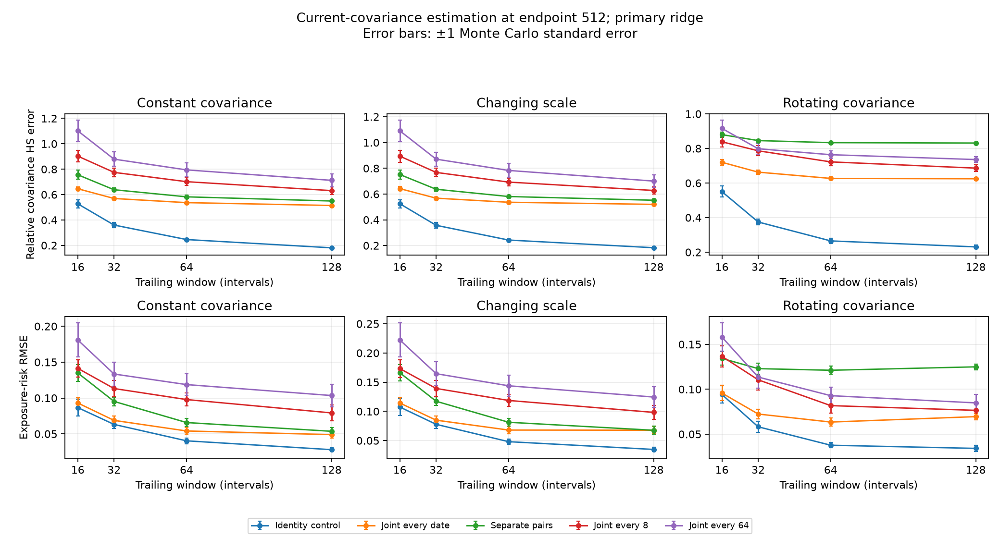
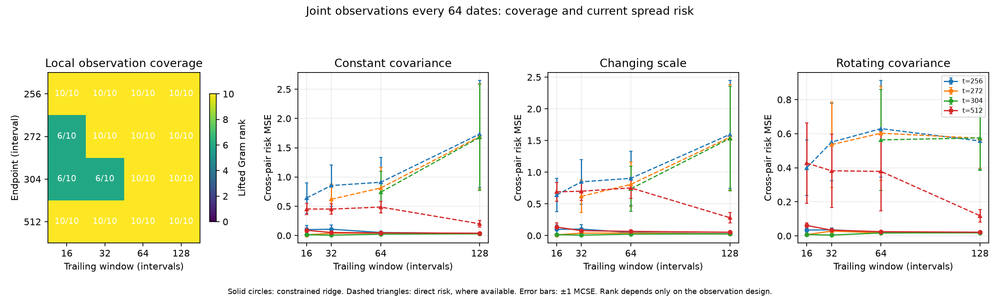
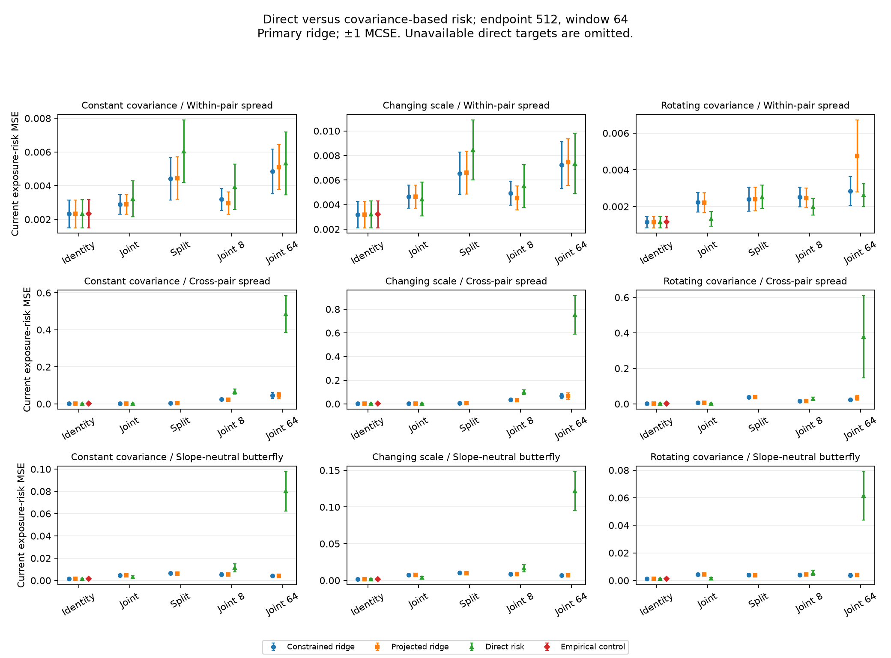

# Research question 2: local covariance and targeted risk

Configuration `rq2`: 20 paired replications, 512 independent innovations, Δ=0.019230769 years, seed `20261023`.

The target at endpoint n is the current finite-interval innovation covariance V_n, or a declared exposure variance aᵀV_n a. The experiment directly samples Gaussian innovations; transport extraction is covered by the separate Stage 1 benchmark. No instantaneous diffusion covariance or forecast is fitted here.

All windows and ridge strengths are declared before simulation. Latent truths enter evaluation and analytic controls only, never parameter selection. Observations and noise are paired across methods, windows, and nested maturity designs. The noiseless identity design is a separate information control.

## Locality and coverage

The first figure uses the latest declared endpoint and the primary constrained ridge. Each curve is a separate observation design; panels distinguish scale variation from rotation with unchanged eigenvalues. Error bars are ±1 Monte Carlo standard error (MCSE), not confidence intervals. The abrupt-change scenario is a separate stress case in the tables and raw results.

The rank heatmap uses joint observations every 64 dates and every declared endpoint/window. Rank is a property of the design and is the same across covariance paths. Risk panels retain separate endpoint curves. Full pooled rank identifies a common covariance; it does not identify the terminal covariance of an unrestricted changing path. A missing direct estimate remains unavailable; regularized covariance-based risks are still reported for unidentified targets and must be interpreted through their diagnostics.

For A_i(B)=O_i B O_iᵀ, Q=Σ_i w_i A_i* A_i. The observation-weighted moment bias is b=Σ_i w_i A_i* A_i(V_i−V_n). Before PSD/trace constraints, the population ridge solution obeys (Q+λI)(B°−V_n)=b−λV_n. The saved moment-bias norm is measured in this normal-equation space; it is not itself a covariance error.

## Declared snapshot: endpoint 512, window 64

The following table reports every design and scenario for the primary constrained ridge at this predetermined snapshot. The machine-readable outputs retain all endpoints, windows, methods and ridge sensitivity settings.

| Scenario | Design | Relative covariance HS error ± MCSE | Observed covariance RMSE ± MCSE | Exposure-risk RMSE ± MCSE |
| --- | --- | ---: | ---: | ---: |
| Constant covariance | Joint every date | 0.53681 ± 0.0075662 | 0.049018 ± 0.0058877 | 0.054048 ± 0.0046935 |
| Constant covariance | Separate pairs | 0.58246 ± 0.013533 | 0.032098 ± 0.0055595 | 0.065803 ± 0.005464 |
| Constant covariance | Joint every 8 | 0.70177 ± 0.031149 | 0.039379 ± 0.0038556 | 0.097853 ± 0.0089262 |
| Constant covariance | Joint every 64 | 0.79455 ± 0.055167 | 0.034331 ± 0.0051544 | 0.11871 ± 0.014974 |
| Constant covariance | Identity control | 0.24616 ± 0.010853 | 0.13483 ± 0.0059446 | 0.040322 ± 0.0041308 |
| Changing scale | Joint every date | 0.53624 ± 0.0071027 | 0.061003 ± 0.006789 | 0.067994 ± 0.0059495 |
| Changing scale | Separate pairs | 0.5808 ± 0.012536 | 0.039962 ± 0.0064805 | 0.08135 ± 0.0064353 |
| Changing scale | Joint every 8 | 0.69284 ± 0.029532 | 0.049197 ± 0.0047669 | 0.11871 ± 0.010427 |
| Changing scale | Joint every 64 | 0.78332 ± 0.053699 | 0.042568 ± 0.0058773 | 0.14381 ± 0.01805 |
| Changing scale | Identity control | 0.2428 ± 0.009811 | 0.16623 ± 0.0067171 | 0.048112 ± 0.004709 |
| Rotating covariance | Joint every date | 0.62676 ± 0.008414 | 0.021082 ± 0.0018852 | 0.063495 ± 0.0046339 |
| Rotating covariance | Separate pairs | 0.83357 ± 0.0038707 | 0.019152 ± 0.0022553 | 0.12115 ± 0.004481 |
| Rotating covariance | Joint every 8 | 0.72229 ± 0.021001 | 0.023806 ± 0.0023927 | 0.081787 ± 0.0080706 |
| Rotating covariance | Joint every 64 | 0.76389 ± 0.022158 | 0.020187 ± 0.0022793 | 0.092875 ± 0.0096221 |
| Rotating covariance | Identity control | 0.26527 ± 0.015631 | 0.14529 ± 0.0085614 | 0.037692 ± 0.0029645 |
| Abrupt change (stress) | Joint every date | 0.60102 ± 0.0083458 | 0.027304 ± 0.0025526 | 0.069608 ± 0.0058444 |
| Abrupt change (stress) | Separate pairs | 0.80458 ± 0.0044034 | 0.019862 ± 0.0022767 | 0.12691 ± 0.0071355 |
| Abrupt change (stress) | Joint every 8 | 0.69036 ± 0.019677 | 0.02342 ± 0.0017877 | 0.094106 ± 0.0096217 |
| Abrupt change (stress) | Joint every 64 | 0.70146 ± 0.018417 | 0.021117 ± 0.0021851 | 0.091089 ± 0.0079738 |
| Abrupt change (stress) | Identity control | 0.24616 ± 0.010853 | 0.13483 ± 0.0059446 | 0.045677 ± 0.0034825 |

HS error uses the declared orthonormal H coordinates. Observed covariance RMSE projects terminal covariance error through each local observation map: (Σ_i w_i ‖O_i(B−V_n)O_iᵀ‖²_F)¹ᐟ². It measures the visible part of the terminal error. Exposures are normalized to unit H norm. Finite-sample risk estimates may be negative for the linear direct estimator.

## Local geometry and temporal moment bias

This is the same declared snapshot. Target availability is the common-covariance range check at the configured rank threshold. The moment-bias norm is deterministic and therefore has no MCSE.

| Scenario | Design | Gram rank | Moment bias HS | Targets passing range check |
| --- | --- | ---: | ---: | --- |
| Constant covariance | Joint every date | 10/10 | 0 | Within-pair spread, Cross-pair spread, Slope-neutral butterfly |
| Constant covariance | Separate pairs | 6/10 | 0 | Within-pair spread |
| Constant covariance | Joint every 8 | 10/10 | 0 | Within-pair spread, Cross-pair spread, Slope-neutral butterfly |
| Constant covariance | Joint every 64 | 10/10 | 0 | Within-pair spread, Cross-pair spread, Slope-neutral butterfly |
| Constant covariance | Identity control | 10/10 | 0 | Within-pair spread, Cross-pair spread, Slope-neutral butterfly |
| Changing scale | Joint every date | 10/10 | 0.0073052 | Within-pair spread, Cross-pair spread, Slope-neutral butterfly |
| Changing scale | Separate pairs | 6/10 | 0.0031789 | Within-pair spread |
| Changing scale | Joint every 8 | 10/10 | 0.003975 | Within-pair spread, Cross-pair spread, Slope-neutral butterfly |
| Changing scale | Joint every 64 | 10/10 | 0.0031789 | Within-pair spread, Cross-pair spread, Slope-neutral butterfly |
| Changing scale | Identity control | 10/10 | 0.016882 | Within-pair spread, Cross-pair spread, Slope-neutral butterfly |
| Rotating covariance | Joint every date | 10/10 | 0.0031188 | Within-pair spread, Cross-pair spread, Slope-neutral butterfly |
| Rotating covariance | Separate pairs | 6/10 | 0.0019248 | Within-pair spread |
| Rotating covariance | Joint every 8 | 10/10 | 0.0022374 | Within-pair spread, Cross-pair spread, Slope-neutral butterfly |
| Rotating covariance | Joint every 64 | 10/10 | 0.0019248 | Within-pair spread, Cross-pair spread, Slope-neutral butterfly |
| Rotating covariance | Identity control | 10/10 | 0.040908 | Within-pair spread, Cross-pair spread, Slope-neutral butterfly |
| Abrupt change (stress) | Joint every date | 10/10 | 0 | Within-pair spread, Cross-pair spread, Slope-neutral butterfly |
| Abrupt change (stress) | Separate pairs | 6/10 | 0 | Within-pair spread |
| Abrupt change (stress) | Joint every 8 | 10/10 | 0 | Within-pair spread, Cross-pair spread, Slope-neutral butterfly |
| Abrupt change (stress) | Joint every 64 | 10/10 | 0 | Within-pair spread, Cross-pair spread, Slope-neutral butterfly |
| Abrupt change (stress) | Identity control | 10/10 | 0 | Within-pair spread, Cross-pair spread, Slope-neutral butterfly |

## Direct versus covariance-based risks

For T=aaᵀ in ran(Q), set u=Q†svec(T) and U_i=smat(A_i u). The direct estimator is Σ_i w_i〈U_i,Z_i〉. Its exact bias against the terminal target is Σ_i w_i〈U_i,A_i(V_i−V_n)〉. Under the stated independent Gaussian model, its variance is 2Σ_i w_i² tr(U_iΣ_iU_iΣ_i), with Σ_i=O_iV_iO_iᵀ+N_i. Saved analytic MSE is bias²+variance. This range check is a common-covariance observability check; under a changing path, a direct estimate need not be unbiased for terminal risk.

Direct-estimator diagnostics below use the predeclared rotating covariance scenario at the same snapshot. Values are empirical bias/MSE with MCSE, followed by exact Gaussian-model values; discrepancies are Monte Carlo variation, not a numerical certificate.

| Design | Target | Identified | Bias ± MCSE | MSE ± MCSE | Analytic bias | Analytic variance | Analytic MSE |
| --- | --- | --- | ---: | ---: | ---: | ---: | ---: |
| Joint every date | Within-pair spread | True | -2.0412e-05 ± 0.0083765 | 0.0013331 ± 0.00039573 | -0.0038224 | 0.0018291 | 0.0018437 |
| Joint every date | Cross-pair spread | True | -0.03609 ± 0.0090943 | 0.0028739 ± 0.00080649 | -0.018329 | 0.0023417 | 0.0026777 |
| Joint every date | Slope-neutral butterfly | True | 0.01046 ± 0.0090692 | 0.0016722 ± 0.00066565 | 0.00064212 | 0.0017949 | 0.0017953 |
| Separate pairs | Within-pair spread | True | -0.001392 ± 0.011518 | 0.0025225 ± 0.00064517 | -0.0038802 | 0.0036564 | 0.0036714 |
| Separate pairs | Cross-pair spread | False | unavailable | unavailable | unavailable | unavailable | unavailable |
| Separate pairs | Slope-neutral butterfly | False | unavailable | unavailable | unavailable | unavailable | unavailable |
| Joint every 8 | Within-pair spread | True | -0.0019363 ± 0.010204 | 0.0019822 ± 0.00045349 | -0.0037873 | 0.0029273 | 0.0029417 |
| Joint every 8 | Cross-pair spread | True | -0.0084627 ± 0.039501 | 0.029718 ± 0.0076429 | -0.015314 | 0.035333 | 0.035567 |
| Joint every 8 | Slope-neutral butterfly | True | 0.030014 ± 0.015654 | 0.0055566 ± 0.0018498 | 0.0010433 | 0.013051 | 0.013052 |
| Joint every 64 | Within-pair spread | True | 0.00049385 ± 0.011773 | 0.0026336 ± 0.00062781 | -0.0037626 | 0.003549 | 0.0035632 |
| Joint every 64 | Cross-pair spread | True | -0.012906 ± 0.14109 | 0.37838 ± 0.2322 | 0.0084244 | 0.30515 | 0.30522 |
| Joint every 64 | Slope-neutral butterfly | True | -0.01094 ± 0.056874 | 0.061579 ± 0.017643 | 0.0047916 | 0.10332 | 0.10334 |
| Identity control | Within-pair spread | True | -0.0049289 ± 0.0077222 | 0.0011573 ± 0.00031643 | -0.0038224 | 0.001616 | 0.0016306 |
| Identity control | Cross-pair spread | True | -0.029952 ± 0.0090476 | 0.0024524 ± 0.00077585 | -0.018329 | 0.0021485 | 0.0024845 |
| Identity control | Slope-neutral butterfly | True | 0.0096617 ± 0.0074494 | 0.0011477 ± 0.00033859 | 0.00064212 | 0.0014473 | 0.0014477 |

### Paired risk-error differences

These differences use the same rotating covariance snapshot. Positive MSE difference means the comparison method has larger squared error than constrained ridge. MCSE is calculated from replication-level paired differences, not from independent standard errors.

| Design | Target | Comparison method | MSE difference ± MCSE |
| --- | --- | --- | ---: |
| Joint every date | Within-pair spread | Projected ridge | -1.6887e-05 ± 6.817e-06 |
| Joint every date | Within-pair spread | Direct risk | -0.00090018 ± 0.00052981 |
| Joint every date | Cross-pair spread | Projected ridge | -0.0002633 ± 8.6905e-05 |
| Joint every date | Cross-pair spread | Direct risk | -0.0037321 ± 0.00050246 |
| Joint every date | Slope-neutral butterfly | Projected ridge | -2.365e-05 ± 1.0386e-05 |
| Joint every date | Slope-neutral butterfly | Direct risk | -0.0028073 ± 0.0011904 |
| Separate pairs | Within-pair spread | Projected ridge | 4.6609e-06 ± 1.1681e-05 |
| Separate pairs | Within-pair spread | Direct risk | 0.00012367 ± 0.00048619 |
| Separate pairs | Cross-pair spread | Projected ridge | 0.00012444 ± 0.00014197 |
| Separate pairs | Cross-pair spread | Direct risk | unavailable ± unavailable |
| Separate pairs | Slope-neutral butterfly | Projected ridge | -9.3818e-05 ± 5.6146e-05 |
| Separate pairs | Slope-neutral butterfly | Direct risk | unavailable ± unavailable |
| Joint every 8 | Within-pair spread | Projected ridge | -4.644e-05 ± 5.9361e-05 |
| Joint every 8 | Within-pair spread | Direct risk | -0.00053693 ± 0.00043405 |
| Joint every 8 | Cross-pair spread | Projected ridge | -0.0017158 ± 0.0010204 |
| Joint every 8 | Cross-pair spread | Direct risk | 0.012621 ± 0.0055506 |
| Joint every 8 | Slope-neutral butterfly | Projected ridge | 0.00021459 ± 0.00010963 |
| Joint every 8 | Slope-neutral butterfly | Direct risk | 0.0013929 ± 0.0023838 |
| Joint every 64 | Within-pair spread | Projected ridge | 0.0019144 ± 0.0018295 |
| Joint every 64 | Within-pair spread | Direct risk | -0.00021418 ± 0.00055425 |
| Joint every 64 | Cross-pair spread | Projected ridge | 0.0091567 ± 0.011647 |
| Joint every 64 | Cross-pair spread | Direct risk | 0.35378 ± 0.22968 |
| Joint every 64 | Slope-neutral butterfly | Projected ridge | 0.00023689 ± 0.00017015 |
| Joint every 64 | Slope-neutral butterfly | Direct risk | 0.05787 ± 0.017961 |
| Identity control | Within-pair spread | Projected ridge | -7.7249e-19 ± 1.7327e-18 |
| Identity control | Within-pair spread | Empirical control | -1.6956e-08 ± 3.4287e-06 |
| Identity control | Within-pair spread | Direct risk | -1.6956e-08 ± 3.4287e-06 |
| Identity control | Cross-pair spread | Projected ridge | -1.3705e-18 ± 1.3814e-18 |
| Identity control | Cross-pair spread | Empirical control | -1.1939e-05 ± 3.79e-06 |
| Identity control | Cross-pair spread | Direct risk | -1.1939e-05 ± 3.79e-06 |
| Identity control | Slope-neutral butterfly | Projected ridge | 1.694e-18 ± 2.455e-18 |
| Identity control | Slope-neutral butterfly | Empirical control | 6.3838e-06 ± 3.642e-06 |
| Identity control | Slope-neutral butterfly | Direct risk | 6.3838e-06 ± 3.642e-06 |

## Numerical acceptance and reproducibility

Acceptance: **PASS**.

Run acceptance checks numerical feasibility and certificates and selected independent convex references. Separate tests check deterministic design ranks, target ranges, covariance paths and temporal boundaries. It does not require a statistical ranking of methods or a favorable risk result. Numerical covariance-error certificates bound distance to the constrained optimizer, not estimation error against latent truth.

| Check | Result |
| --- | --- |
| passed | True |
| failed fits | 0 |
| failures | [] |
| feasibility passed | True |
| reference passed | True |
| reference checks requested | True |
| reference cases | 4 |
| maximum covariance error bound | 0.0001 |
| numerical error budget | 0.0001 |
| statistical performance gate | unavailable |

Independent convex-reference cases recorded: 4.

`results.json` retains covariance summaries, risk bias/MSE, paired differences, analytic direct-risk controls, observation spectra and target diagnostics, moment bias, reference checks and acceptance. Replication-level CSV files retain the paired statistical measurements. `manifest.json` records the resolved configuration, source hashes, revision, environment and solver settings; provenance must be interpreted with its dirty-source flag.

The protocol is documented in [research-question-2.md](../../../docs/research-question-2.md) in a standard experiments/runs/<run> output directory. This finite-dimensional Gaussian study does not establish confidence-interval coverage, recovery of instantaneous C, robustness to price-level noise or market forecasting performance.

## Compressed evidence

This evidence bundle retains the complete accepted run. CSV files and measurement/audit JSON files are compressed with gzip; artifact links point to those archives. Use `gzip -dc FILE.gz > FILE` to read an uncompressed copy. [Bundle checksums](artifact_sha256.json) record original and published bytes. The unchanged [manifest](manifest.json) retains the originating clean revision and source hashes.
