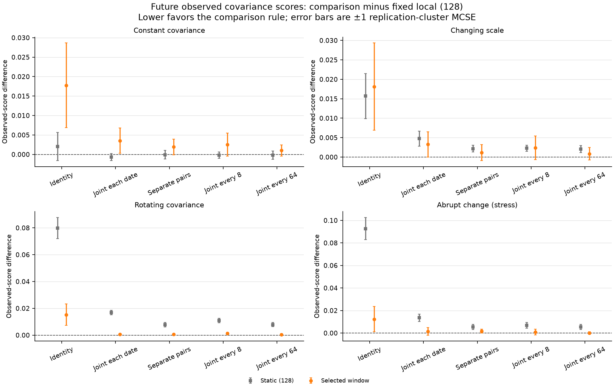
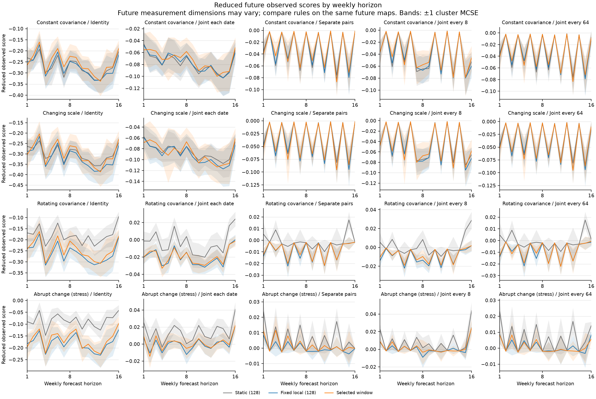
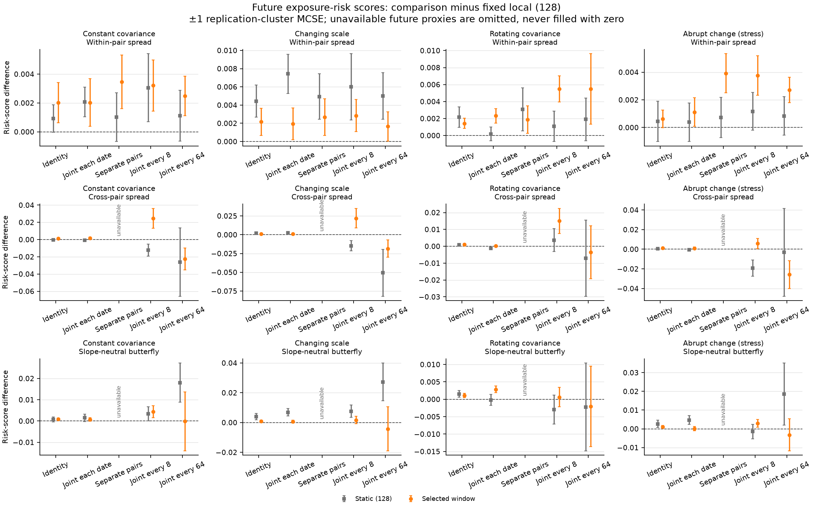

# Research question 3: forecasting innovation covariance

Configuration `rq3`: 20 independent paired replications, 512 weekly innovations, Δ=0.019230769 years, seed `20261023`.

This study asks whether refitting a recent innovation covariance improves future observed quadratic scores, and when past-only window selection helps or hurts. The target is the covariance of each subsequent weekly innovation. It is not instantaneous diffusion covariance C, an accumulated multiweek-return covariance, or a prediction of the curve level. The experiment reuses the configured finite-dimensional RQ2 covariance paths and nested observation designs, directly sampling independent Gaussian innovations with known measurement-noise covariance. It does not establish market forecasting performance.

## Issued forecasts and chronological separation

| Rule | Training and update policy |
| --- | --- |
| Static (128) | Fit intervals 1 through 128 once and reuse that same matrix at every test origin. |
| Fixed local (128) | Refit the trailing 128 past intervals at each test origin. |
| Selected window | Select once from 16, 32, 64, 128 using only the declared validation blocks; refit that chosen trailing window at each test origin. |

Validation origins are 128, 192; their outcomes end at interval 208. Selection is frozen before the first test origin 256. The selected window is not retuned after observing test outcomes. At each test origin the fitted covariance is frozen for the next 16 separate weekly innovations. All rules face the same future observations; the noiseless identity design is a separate information control.

| Test origin | Future intervals scored |
| ---: | --- |
| 256 | 257 through 272 |
| 272 | 273 through 288 |
| 304 | 305 through 320 |
| 448 | 449 through 464 |

## Observed scoring rule

For a future observation y with map O and known noise covariance N, the noise-corrected measurement is Z. The issued forecast B is scored without latent covariance:

```math
Z=yy^\top-N,\qquad A(B)=OBO^\top,
s(B)=\|A(B)\|_F^2-2\langle Z,A(B)\rangle_F.
```

The forecast-independent squared norm of Z is omitted. Scores may therefore be negative. Expected score differences compare squared error in the future observed covariance space under the stated noise model. They do not identify every full-operator direction or provide a Gaussian likelihood score.

For an identifiable future exposure, the operational risk score is forecast_variance² − 2 × forecast_variance × noise_corrected_future_risk_proxy. Its omitted proxy-squared constant is also common across forecast rules. Availability is checked at the future observation map, separately from training rank.

All Monte Carlo standard errors (MCSE) treat one independent replication as a cluster. Origins and horizons are averaged within replication, including paired differences; they are not counted as independent replications. MCSE is unavailable when fewer than two independent clusters are present. Figures and tables use predeclared scenarios, designs, origins and horizons, with no selection of favorable outcomes.

## Primary future observed scores

Lower scores are better for the same future observation design. Absolute scores from different designs are not a common-information ranking. Each entry is a replication-cluster mean ± MCSE, averaged over the declared test origins and weekly horizons within each replication. Reduced quadratic scores can be negative.



| Scenario | Design | Static (128) | Fixed local (128) | Selected window |
| --- | --- | ---: | ---: | ---: |
| Constant covariance | Identity | -0.26869 ± 0.014924 | -0.27071 ± 0.016081 | -0.25294 ± 0.018066 |
| Constant covariance | Joint each date | -0.07713 ± 0.0052422 | -0.076423 ± 0.0055416 | -0.072883 ± 0.0071128 |
| Constant covariance | Separate pairs | -0.032497 ± 0.0040805 | -0.032425 ± 0.003604 | -0.030497 ± 0.0046207 |
| Constant covariance | Joint every 8 | -0.040103 ± 0.0033884 | -0.039921 ± 0.0032426 | -0.037366 ± 0.0048666 |
| Constant covariance | Joint every 64 | -0.032969 ± 0.003863 | -0.032792 ± 0.0035019 | -0.031784 ± 0.003947 |
| Changing scale | Identity | -0.30056 ± 0.013422 | -0.31626 ± 0.017881 | -0.29814 ± 0.019312 |
| Changing scale | Joint each date | -0.085596 ± 0.0051743 | -0.090333 ± 0.006607 | -0.087058 ± 0.0081461 |
| Changing scale | Separate pairs | -0.036796 ± 0.0037904 | -0.038958 ± 0.0042311 | -0.03782 ± 0.0052382 |
| Changing scale | Joint every 8 | -0.045553 ± 0.0033984 | -0.047822 ± 0.0038997 | -0.045455 ± 0.0055918 |
| Changing scale | Joint every 64 | -0.037404 ± 0.0036099 | -0.039444 ± 0.0041136 | -0.038587 ± 0.0047558 |
| Rotating covariance | Identity | -0.18022 ± 0.012213 | -0.26012 ± 0.015621 | -0.24482 ± 0.017793 |
| Rotating covariance | Joint each date | -0.0032552 ± 0.0033477 | -0.020166 ± 0.0023423 | -0.019583 ± 0.0021928 |
| Rotating covariance | Separate pairs | -0.00095551 ± 0.0026088 | -0.0087466 ± 0.0013831 | -0.0082065 ± 0.0015626 |
| Rotating covariance | Joint every 8 | 0.0016177 ± 0.0025278 | -0.009252 ± 0.0014429 | -0.0079364 ± 0.001755 |
| Rotating covariance | Joint every 64 | -0.0008343 ± 0.0024123 | -0.008741 ± 0.0013282 | -0.0082435 ± 0.0014561 |
| Abrupt change (stress) | Identity | -0.086283 ± 0.010797 | -0.179 ± 0.015722 | -0.16673 ± 0.019052 |
| Abrupt change (stress) | Joint each date | 0.01367 ± 0.0038858 | 0.00010771 ± 0.0028753 | 0.0015347 ± 0.0048291 |
| Abrupt change (stress) | Separate pairs | 0.0055139 ± 0.0025616 | 5.2283e-05 ± 0.0020187 | 0.0017053 ± 0.0030676 |
| Abrupt change (stress) | Joint every 8 | 0.0077507 ± 0.0027925 | 0.00098215 ± 0.0023533 | 0.0018041 ± 0.0039891 |
| Abrupt change (stress) | Joint every 64 | 0.0062268 ± 0.0025503 | 0.00083566 ± 0.0020968 | 0.00084837 ± 0.0025848 |

### Paired differences against fixed local

A positive difference means the comparison rule has a larger score than fixed local on the same future data. MCSE uses within-replication paired differences, not a combination of independent standard errors. No superiority of adaptation is an acceptance requirement.

| Scenario | Design | Static minus fixed ± MCSE | Selected minus fixed ± MCSE |
| --- | --- | ---: | ---: |
| Constant covariance | Identity | 0.0020232 ± 0.0036163 | 0.017773 ± 0.01088 |
| Constant covariance | Joint each date | -0.00070709 ± 0.00090696 | 0.00354 ± 0.0032504 |
| Constant covariance | Separate pairs | -7.2379e-05 ± 0.0011113 | 0.0019281 ± 0.0020275 |
| Constant covariance | Joint every 8 | -0.00018114 ± 0.00080357 | 0.0025554 ± 0.0029626 |
| Constant covariance | Joint every 64 | -0.00017643 ± 0.0010792 | 0.0010085 ± 0.0014355 |
| Changing scale | Identity | 0.015707 ± 0.0057956 | 0.018126 ± 0.011227 |
| Changing scale | Joint each date | 0.0047374 ± 0.0019235 | 0.0032753 ± 0.003256 |
| Changing scale | Separate pairs | 0.0021613 ± 0.00087739 | 0.001138 ± 0.0020665 |
| Changing scale | Joint every 8 | 0.0022686 ± 0.00078574 | 0.0023664 ± 0.0030458 |
| Changing scale | Joint every 64 | 0.0020403 ± 0.00092393 | 0.00085732 ± 0.0015883 |
| Rotating covariance | Identity | 0.079897 ± 0.0078302 | 0.015294 ± 0.0078923 |
| Rotating covariance | Joint each date | 0.01691 ± 0.0016589 | 0.00058297 ± 0.00047342 |
| Rotating covariance | Separate pairs | 0.0077911 ± 0.0015597 | 0.00054015 ± 0.00061838 |
| Rotating covariance | Joint every 8 | 0.01087 ± 0.0016721 | 0.0013156 ± 0.00073133 |
| Rotating covariance | Joint every 64 | 0.0079067 ± 0.0014653 | 0.00049752 ± 0.00057057 |
| Abrupt change (stress) | Identity | 0.09272 ± 0.009845 | 0.01227 ± 0.011207 |
| Abrupt change (stress) | Joint each date | 0.013562 ± 0.0031944 | 0.001427 ± 0.0033883 |
| Abrupt change (stress) | Separate pairs | 0.0054616 ± 0.0023398 | 0.001653 ± 0.0016947 |
| Abrupt change (stress) | Joint every 8 | 0.0067685 ± 0.0025181 | 0.00082195 ± 0.0025566 |
| Abrupt change (stress) | Joint every 64 | 0.0053912 ± 0.0023757 | 1.2705e-05 ± 0.0011938 |

## Window selection before the test period

The selected rule chooses one trailing-window length from past validation scores for each scenario/design/replication. It then refits that fixed choice at each test origin. Counts below are independent replication choices, not counts of dates or horizons. Latent covariance, risk and kernel errors do not select a window.

| Scenario | Design | Window 16 | Window 32 | Window 64 | Window 128 | Choices |
| --- | --- | ---: | ---: | ---: | ---: | ---: |
| Constant covariance | Identity | 2 | 1 | 4 | 13 | 20 |
| Constant covariance | Joint each date | 3 | 4 | 3 | 10 | 20 |
| Constant covariance | Separate pairs | 4 | 4 | 5 | 7 | 20 |
| Constant covariance | Joint every 8 | 4 | 3 | 6 | 7 | 20 |
| Constant covariance | Joint every 64 | 3 | 3 | 6 | 8 | 20 |
| Changing scale | Identity | 2 | 1 | 4 | 13 | 20 |
| Changing scale | Joint each date | 4 | 4 | 4 | 8 | 20 |
| Changing scale | Separate pairs | 3 | 4 | 5 | 8 | 20 |
| Changing scale | Joint every 8 | 4 | 2 | 4 | 10 | 20 |
| Changing scale | Joint every 64 | 3 | 3 | 7 | 7 | 20 |
| Rotating covariance | Identity | 2 | 4 | 5 | 9 | 20 |
| Rotating covariance | Joint each date | 3 | 6 | 3 | 8 | 20 |
| Rotating covariance | Separate pairs | 2 | 5 | 5 | 8 | 20 |
| Rotating covariance | Joint every 8 | 3 | 6 | 5 | 6 | 20 |
| Rotating covariance | Joint every 64 | 3 | 5 | 6 | 6 | 20 |
| Abrupt change (stress) | Identity | 2 | 1 | 4 | 13 | 20 |
| Abrupt change (stress) | Joint each date | 3 | 4 | 3 | 10 | 20 |
| Abrupt change (stress) | Separate pairs | 4 | 4 | 5 | 7 | 20 |
| Abrupt change (stress) | Joint every 8 | 4 | 3 | 6 | 7 | 20 |
| Abrupt change (stress) | Joint every 64 | 3 | 3 | 6 | 8 | 20 |

## Horizon and origin sensitivity



Every configured scenario/design panel is retained. These are raw reduced scores, not normalized by the number of future measurements. Future observation dimensions and maps can vary with horizon, especially for occasional joint measurements. Compare rules on the same future maps; score magnitudes across different horizons/designs are not a common-information ranking. The same issued covariance is used at all horizons in a block. Horizon-specific means first average the test origins within a replication; their MCSE is across independent replications. These are separate weekly covariance forecasts, not a covariance for an accumulated multiweek return. Bands show marginal MCSE, not simultaneous confidence bands or paired-difference uncertainty.

<details>
<summary>Scores at every predeclared test origin</summary>

Within each origin, horizons are averaged inside each independent replication before calculating MCSE.

| Scenario | Design | Origin | Static (128) | Fixed local (128) | Selected window |
| --- | --- | ---: | ---: | ---: | ---: |
| Constant covariance | Identity | 256 | -0.27263 ± 0.028946 | -0.27424 ± 0.029707 | -0.23613 ± 0.046546 |
| Constant covariance | Identity | 272 | -0.23971 ± 0.02368 | -0.23441 ± 0.025141 | -0.2177 ± 0.02517 |
| Constant covariance | Identity | 304 | -0.26419 ± 0.029659 | -0.26695 ± 0.030797 | -0.25499 ± 0.029182 |
| Constant covariance | Identity | 448 | -0.29822 ± 0.030088 | -0.30724 ± 0.033475 | -0.30293 ± 0.032113 |
| Constant covariance | Joint each date | 256 | -0.072634 ± 0.011976 | -0.07286 ± 0.012292 | -0.06039 ± 0.021437 |
| Constant covariance | Joint each date | 272 | -0.062468 ± 0.0075063 | -0.060478 ± 0.0075666 | -0.058186 ± 0.0071004 |
| Constant covariance | Joint each date | 304 | -0.071 ± 0.0091573 | -0.070153 ± 0.0093361 | -0.068417 ± 0.0093133 |
| Constant covariance | Joint each date | 448 | -0.10242 ± 0.016351 | -0.1022 ± 0.016266 | -0.10454 ± 0.016873 |
| Constant covariance | Separate pairs | 256 | -0.026416 ± 0.0062098 | -0.027715 ± 0.0062743 | -0.019465 ± 0.010495 |
| Constant covariance | Separate pairs | 272 | -0.029637 ± 0.0070859 | -0.028896 ± 0.0062243 | -0.026764 ± 0.0059903 |
| Constant covariance | Separate pairs | 304 | -0.022796 ± 0.0063249 | -0.022764 ± 0.0059752 | -0.02399 ± 0.0054194 |
| Constant covariance | Separate pairs | 448 | -0.051141 ± 0.0096767 | -0.050325 ± 0.0089395 | -0.05177 ± 0.011077 |
| Constant covariance | Joint every 8 | 256 | -0.032949 ± 0.0071157 | -0.034808 ± 0.0079042 | -0.023988 ± 0.015217 |
| Constant covariance | Joint every 8 | 272 | -0.040102 ± 0.0061568 | -0.039489 ± 0.0060489 | -0.036604 ± 0.0047492 |
| Constant covariance | Joint every 8 | 304 | -0.026774 ± 0.0064931 | -0.026172 ± 0.0070128 | -0.026196 ± 0.0066191 |
| Constant covariance | Joint every 8 | 448 | -0.060585 ± 0.010841 | -0.059217 ± 0.0098716 | -0.062676 ± 0.011413 |
| Constant covariance | Joint every 64 | 256 | -0.026403 ± 0.0061599 | -0.027772 ± 0.0064296 | -0.022313 ± 0.0093136 |
| Constant covariance | Joint every 64 | 272 | -0.029434 ± 0.0069969 | -0.028349 ± 0.0062008 | -0.027279 ± 0.0057021 |
| Constant covariance | Joint every 64 | 304 | -0.024771 ± 0.0069621 | -0.024773 ± 0.0069872 | -0.025752 ± 0.006149 |
| Constant covariance | Joint every 64 | 448 | -0.051267 ± 0.0096582 | -0.050275 ± 0.0088357 | -0.05179 ± 0.010192 |
| Changing scale | Identity | 256 | -0.27307 ± 0.023445 | -0.27999 ± 0.027984 | -0.24293 ± 0.044472 |
| Changing scale | Identity | 272 | -0.25328 ± 0.020151 | -0.24959 ± 0.024473 | -0.23328 ± 0.024935 |
| Changing scale | Identity | 304 | -0.28807 ± 0.025794 | -0.29813 ± 0.031894 | -0.28467 ± 0.030696 |
| Changing scale | Identity | 448 | -0.38781 ± 0.029331 | -0.43735 ± 0.04507 | -0.43168 ± 0.044053 |
| Changing scale | Joint each date | 256 | -0.0728 ± 0.0096558 | -0.074243 ± 0.011658 | -0.062496 ± 0.020803 |
| Changing scale | Joint each date | 272 | -0.066399 ± 0.0064344 | -0.064551 ± 0.0072971 | -0.061725 ± 0.0073886 |
| Changing scale | Joint each date | 304 | -0.077352 ± 0.0081551 | -0.078283 ± 0.0096686 | -0.076066 ± 0.009908 |
| Changing scale | Joint each date | 448 | -0.12583 ± 0.016304 | -0.14426 ± 0.02192 | -0.14795 ± 0.023754 |
| Changing scale | Separate pairs | 256 | -0.02764 ± 0.0049642 | -0.028552 ± 0.0059633 | -0.02079 ± 0.010366 |
| Changing scale | Separate pairs | 272 | -0.03112 ± 0.0058908 | -0.030646 ± 0.0060753 | -0.029444 ± 0.0057464 |
| Changing scale | Separate pairs | 304 | -0.026997 ± 0.0054063 | -0.026059 ± 0.006149 | -0.026545 ± 0.0057061 |
| Changing scale | Separate pairs | 448 | -0.061429 ± 0.0098434 | -0.070573 ± 0.012132 | -0.0745 ± 0.014858 |
| Changing scale | Joint every 8 | 256 | -0.034597 ± 0.0056346 | -0.035953 ± 0.0075265 | -0.024721 ± 0.014818 |
| Changing scale | Joint every 8 | 272 | -0.041551 ± 0.0051899 | -0.041756 ± 0.0059098 | -0.038404 ± 0.0046876 |
| Changing scale | Joint every 8 | 304 | -0.032306 ± 0.0055963 | -0.030301 ± 0.0072339 | -0.03074 ± 0.0069599 |
| Changing scale | Joint every 8 | 448 | -0.073757 ± 0.011194 | -0.083277 ± 0.013366 | -0.087956 ± 0.015919 |
| Changing scale | Joint every 64 | 256 | -0.027576 ± 0.0049215 | -0.028631 ± 0.0061265 | -0.022837 ± 0.0090427 |
| Changing scale | Joint every 64 | 272 | -0.030895 ± 0.0057903 | -0.030127 ± 0.0060332 | -0.029027 ± 0.0056569 |
| Changing scale | Joint every 64 | 304 | -0.029652 ± 0.0059778 | -0.028534 ± 0.0071795 | -0.029073 ± 0.0064696 |
| Changing scale | Joint every 64 | 448 | -0.061491 ± 0.0098454 | -0.070483 ± 0.01199 | -0.073409 ± 0.014217 |
| Rotating covariance | Identity | 256 | -0.218 ± 0.025024 | -0.26047 ± 0.028989 | -0.231 ± 0.045914 |
| Rotating covariance | Identity | 272 | -0.1802 ± 0.018889 | -0.22594 ± 0.024278 | -0.21481 ± 0.024536 |
| Rotating covariance | Identity | 304 | -0.1987 ± 0.025159 | -0.25548 ± 0.030491 | -0.24252 ± 0.031122 |
| Rotating covariance | Identity | 448 | -0.12398 ± 0.018156 | -0.29858 ± 0.032493 | -0.29096 ± 0.029344 |
| Rotating covariance | Joint each date | 256 | -0.020022 ± 0.0081671 | -0.030091 ± 0.0063167 | -0.028783 ± 0.0063245 |
| Rotating covariance | Joint each date | 272 | -0.0052884 ± 0.0057004 | -0.018749 ± 0.0042519 | -0.018399 ± 0.0041444 |
| Rotating covariance | Joint each date | 304 | -0.0084459 ± 0.0058776 | -0.021931 ± 0.0046162 | -0.022026 ± 0.0044428 |
| Rotating covariance | Joint each date | 448 | 0.020735 ± 0.0044221 | -0.0098911 ± 0.0020844 | -0.0091221 ± 0.0018294 |
| Rotating covariance | Separate pairs | 256 | -0.0062347 ± 0.0039994 | -0.011864 ± 0.0028566 | -0.0093211 ± 0.0046012 |
| Rotating covariance | Separate pairs | 272 | -0.0051842 ± 0.0044004 | -0.010729 ± 0.002895 | -0.010964 ± 0.0029068 |
| Rotating covariance | Separate pairs | 304 | 0.0016457 ± 0.0037807 | -0.0066398 ± 0.0024773 | -0.006893 ± 0.0022395 |
| Rotating covariance | Separate pairs | 448 | 0.0059511 ± 0.0038727 | -0.0057543 ± 0.0015636 | -0.0056475 ± 0.001415 |
| Rotating covariance | Joint every 8 | 256 | -0.0035529 ± 0.0046915 | -0.011395 ± 0.003226 | -0.0086079 ± 0.0049428 |
| Rotating covariance | Joint every 8 | 272 | -0.0028171 ± 0.0041262 | -0.010931 ± 0.0028593 | -0.010671 ± 0.0027384 |
| Rotating covariance | Joint every 8 | 304 | 0.0017782 ± 0.0037621 | -0.0086699 ± 0.0028093 | -0.0067149 ± 0.003087 |
| Rotating covariance | Joint every 8 | 448 | 0.011063 ± 0.0040061 | -0.0060118 ± 0.0015984 | -0.0057514 ± 0.0015781 |
| Rotating covariance | Joint every 64 | 256 | -0.0061317 ± 0.0040063 | -0.01176 ± 0.0028631 | -0.011313 ± 0.0029599 |
| Rotating covariance | Joint every 64 | 272 | -0.0052657 ± 0.0043465 | -0.010823 ± 0.0029184 | -0.010829 ± 0.0028864 |
| Rotating covariance | Joint every 64 | 304 | 0.0020123 ± 0.0034248 | -0.0066096 ± 0.0025263 | -0.0055795 ± 0.0025279 |
| Rotating covariance | Joint every 64 | 448 | 0.0060478 ± 0.0038461 | -0.0057716 ± 0.0015563 | -0.0052526 ± 0.0016618 |
| Abrupt change (stress) | Identity | 256 | -0.088511 ± 0.019839 | -0.088329 ± 0.021005 | -0.038652 ± 0.041376 |
| Abrupt change (stress) | Identity | 272 | -0.075051 ± 0.017658 | -0.11409 ± 0.021289 | -0.11504 ± 0.021596 |
| Abrupt change (stress) | Identity | 304 | -0.093995 ± 0.017243 | -0.20635 ± 0.021261 | -0.21032 ± 0.021748 |
| Abrupt change (stress) | Identity | 448 | -0.087574 ± 0.015185 | -0.30724 ± 0.033475 | -0.30293 ± 0.032113 |
| Abrupt change (stress) | Joint each date | 256 | 0.016433 ± 0.0061582 | 0.013676 ± 0.0059632 | 0.026416 ± 0.014391 |
| Abrupt change (stress) | Joint each date | 272 | 0.0115 ± 0.0077067 | 0.0047234 ± 0.007368 | 0.0025156 ± 0.0074997 |
| Abrupt change (stress) | Joint each date | 304 | 0.019615 ± 0.0053229 | 0.00051114 ± 0.0039895 | -0.0054448 ± 0.0031877 |
| Abrupt change (stress) | Joint each date | 448 | 0.0071304 ± 0.0056953 | -0.018479 ± 0.0024486 | -0.017348 ± 0.0027417 |
| Abrupt change (stress) | Separate pairs | 256 | 0.0089766 ± 0.0040374 | 0.0076925 ± 0.0040391 | 0.02117 ± 0.011448 |
| Abrupt change (stress) | Separate pairs | 272 | 0.002627 ± 0.0052776 | -0.00026472 ± 0.0044946 | -0.0026927 ± 0.00356 |
| Abrupt change (stress) | Separate pairs | 304 | 0.0099426 ± 0.0035275 | 0.0020902 ± 0.0032007 | -0.0027025 ± 0.0021144 |
| Abrupt change (stress) | Separate pairs | 448 | 0.00050936 ± 0.0037373 | -0.0093089 ± 0.0016385 | -0.0089535 ± 0.001722 |
| Abrupt change (stress) | Joint every 8 | 256 | 0.010903 ± 0.0052046 | 0.0094825 ± 0.0050155 | 0.020335 ± 0.015025 |
| Abrupt change (stress) | Joint every 8 | 272 | 0.003514 ± 0.0054757 | 0.0017142 ± 0.0052913 | -0.0013545 ± 0.0037622 |
| Abrupt change (stress) | Joint every 8 | 304 | 0.013882 ± 0.0036511 | 0.0032781 ± 0.0030653 | -0.0014269 ± 0.0026388 |
| Abrupt change (stress) | Joint every 8 | 448 | 0.0027037 ± 0.0036222 | -0.010546 ± 0.0015875 | -0.010337 ± 0.0015938 |
| Abrupt change (stress) | Joint every 64 | 256 | 0.0087733 ± 0.0040231 | 0.0078966 ± 0.0040901 | 0.014649 ± 0.0093481 |
| Abrupt change (stress) | Joint every 64 | 272 | 0.0024998 ± 0.0051959 | 0.00028082 ± 0.0046422 | -0.0018146 ± 0.0035411 |
| Abrupt change (stress) | Joint every 64 | 304 | 0.013407 ± 0.0037382 | 0.0044187 ± 0.0032806 | -0.00033965 ± 0.0027566 |
| Abrupt change (stress) | Joint every 64 | 448 | 0.00022714 ± 0.0036501 | -0.0092536 ± 0.0016083 | -0.0091011 ± 0.0016203 |

</details>

## Operational future exposure-risk scores



A future risk proxy is used only when that future observation map identifies the declared exposure variance. Full-rank past training geometry does not make a missing future cross-pair observation available. In particular, joint-every-64 training windows may have full rank while most of their future cross-spread proxies remain unavailable. Unavailable rows have no score; they are not zero errors.

Availability is the number of usable future date/horizon rows per rule, with independent replication clusters shown separately. Eligible dates per replication are the total available rows divided by the planned independent replication count; the future design is deterministic. The table uses the common future-design availability from fixed local; the same future maps score all rules. Each risk score averages available rows within each replication before MCSE. Availability varies by target and design, so comparison across different subsets requires care.

| Scenario | Design | Target | Eligible dates/rep | Available rows / planned | Replication clusters | Static (128) | Fixed local (128) | Selected window |
| --- | --- | --- | ---: | ---: | ---: | ---: | ---: | ---: |
| Constant covariance | Identity | Within-pair spread | 64 | 1280 / 1280 | 20 | -0.058443 ± 0.004413 | -0.05936 ± 0.0043748 | -0.057346 ± 0.004449 |
| Constant covariance | Identity | Cross-pair spread | 64 | 1280 / 1280 | 20 | -0.04506 ± 0.0030417 | -0.044762 ± 0.0030444 | -0.043403 ± 0.0031091 |
| Constant covariance | Identity | Slope-neutral butterfly | 64 | 1280 / 1280 | 20 | -0.048451 ± 0.0037106 | -0.049264 ± 0.0041496 | -0.048415 ± 0.0041299 |
| Constant covariance | Joint each date | Within-pair spread | 64 | 1280 / 1280 | 20 | -0.056272 ± 0.0037029 | -0.058338 ± 0.0039914 | -0.05631 ± 0.0041119 |
| Constant covariance | Joint each date | Cross-pair spread | 64 | 1280 / 1280 | 20 | -0.0452 ± 0.0031684 | -0.044518 ± 0.0030609 | -0.042804 ± 0.0031673 |
| Constant covariance | Joint each date | Slope-neutral butterfly | 64 | 1280 / 1280 | 20 | -0.042964 ± 0.0026791 | -0.044479 ± 0.003431 | -0.043696 ± 0.0035562 |
| Constant covariance | Separate pairs | Within-pair spread | 32 | 640 / 1280 | 20 | -0.05295 ± 0.0061123 | -0.053967 ± 0.0060605 | -0.050503 ± 0.0063514 |
| Constant covariance | Separate pairs | Cross-pair spread | 0 | 0 / 1280 | 0 | unavailable | unavailable | unavailable |
| Constant covariance | Separate pairs | Slope-neutral butterfly | 0 | 0 / 1280 | 0 | unavailable | unavailable | unavailable |
| Constant covariance | Joint every 8 | Within-pair spread | 40 | 800 / 1280 | 20 | -0.052543 ± 0.0051198 | -0.055598 ± 0.0056994 | -0.052386 ± 0.0049118 |
| Constant covariance | Joint every 8 | Cross-pair spread | 8 | 160 / 1280 | 20 | -0.026384 ± 0.0079359 | -0.014137 ± 0.010727 | 0.010542 ± 0.01662 |
| Constant covariance | Joint every 8 | Slope-neutral butterfly | 8 | 160 / 1280 | 20 | -0.046649 ± 0.011197 | -0.050016 ± 0.011303 | -0.045669 ± 0.010838 |
| Constant covariance | Joint every 64 | Within-pair spread | 33 | 660 / 1280 | 20 | -0.054874 ± 0.0060023 | -0.05599 ± 0.0061426 | -0.053512 ± 0.0059416 |
| Constant covariance | Joint every 64 | Cross-pair spread | 1 | 20 / 1280 | 20 | 0.047989 ± 0.044123 | 0.074113 ± 0.018992 | 0.051631 ± 0.016252 |
| Constant covariance | Joint every 64 | Slope-neutral butterfly | 1 | 20 / 1280 | 20 | -0.07066 ± 0.030971 | -0.088687 ± 0.036511 | -0.088828 ± 0.036126 |
| Changing scale | Identity | Within-pair spread | 64 | 1280 / 1280 | 20 | -0.064887 ± 0.0038426 | -0.069316 ± 0.0049824 | -0.067162 ± 0.0051295 |
| Changing scale | Identity | Cross-pair spread | 64 | 1280 / 1280 | 20 | -0.050913 ± 0.0026574 | -0.053075 ± 0.0033329 | -0.051795 ± 0.0034167 |
| Changing scale | Identity | Slope-neutral butterfly | 64 | 1280 / 1280 | 20 | -0.052585 ± 0.0033471 | -0.056552 ± 0.0046301 | -0.055681 ± 0.0046624 |
| Changing scale | Joint each date | Within-pair spread | 64 | 1280 / 1280 | 20 | -0.059357 ± 0.0031406 | -0.06678 ± 0.0045911 | -0.064836 ± 0.0049495 |
| Changing scale | Joint each date | Cross-pair spread | 64 | 1280 / 1280 | 20 | -0.050083 ± 0.0028594 | -0.05268 ± 0.0033295 | -0.051656 ± 0.0035487 |
| Changing scale | Joint each date | Slope-neutral butterfly | 64 | 1280 / 1280 | 20 | -0.042841 ± 0.0024396 | -0.049693 ± 0.0038805 | -0.049094 ± 0.0042036 |
| Changing scale | Separate pairs | Within-pair spread | 32 | 640 / 1280 | 20 | -0.058169 ± 0.0055217 | -0.063107 ± 0.0069423 | -0.060428 ± 0.0076193 |
| Changing scale | Separate pairs | Cross-pair spread | 0 | 0 / 1280 | 0 | unavailable | unavailable | unavailable |
| Changing scale | Separate pairs | Slope-neutral butterfly | 0 | 0 / 1280 | 0 | unavailable | unavailable | unavailable |
| Changing scale | Joint every 8 | Within-pair spread | 40 | 800 / 1280 | 20 | -0.057948 ± 0.0045548 | -0.063945 ± 0.0065487 | -0.061111 ± 0.0058702 |
| Changing scale | Joint every 8 | Cross-pair spread | 8 | 160 / 1280 | 20 | -0.036359 ± 0.0066547 | -0.021676 ± 0.010601 | 0.00029726 ± 0.017698 |
| Changing scale | Joint every 8 | Slope-neutral butterfly | 8 | 160 / 1280 | 20 | -0.047153 ± 0.010119 | -0.054768 ± 0.012438 | -0.053082 ± 0.011992 |
| Changing scale | Joint every 64 | Within-pair spread | 33 | 660 / 1280 | 20 | -0.060081 ± 0.0057548 | -0.065071 ± 0.006922 | -0.063413 ± 0.0070569 |
| Changing scale | Joint every 64 | Cross-pair spread | 1 | 20 / 1280 | 20 | 0.016974 ± 0.035676 | 0.067698 ± 0.018136 | 0.049181 ± 0.015687 |
| Changing scale | Joint every 64 | Slope-neutral butterfly | 1 | 20 / 1280 | 20 | -0.066902 ± 0.026961 | -0.09415 ± 0.037687 | -0.098354 ± 0.039226 |
| Rotating covariance | Identity | Within-pair spread | 64 | 1280 / 1280 | 20 | -0.043682 ± 0.004812 | -0.04584 ± 0.0040682 | -0.044408 ± 0.0037525 |
| Rotating covariance | Identity | Cross-pair spread | 64 | 1280 / 1280 | 20 | -0.033497 ± 0.003803 | -0.034388 ± 0.0035303 | -0.033417 ± 0.0035827 |
| Rotating covariance | Identity | Slope-neutral butterfly | 64 | 1280 / 1280 | 20 | -0.048011 ± 0.0044906 | -0.049548 ± 0.0048275 | -0.048467 ± 0.0047601 |
| Rotating covariance | Joint each date | Within-pair spread | 64 | 1280 / 1280 | 20 | -0.045444 ± 0.0041907 | -0.045627 ± 0.0036464 | -0.043303 ± 0.0033943 |
| Rotating covariance | Joint each date | Cross-pair spread | 64 | 1280 / 1280 | 20 | -0.033645 ± 0.0034084 | -0.032504 ± 0.0028452 | -0.032361 ± 0.0030522 |
| Rotating covariance | Joint each date | Slope-neutral butterfly | 64 | 1280 / 1280 | 20 | -0.043518 ± 0.0029438 | -0.043346 ± 0.0036122 | -0.040497 ± 0.003589 |
| Rotating covariance | Separate pairs | Within-pair spread | 32 | 640 / 1280 | 20 | -0.045218 ± 0.0068453 | -0.048306 ± 0.0053586 | -0.046416 ± 0.0053306 |
| Rotating covariance | Separate pairs | Cross-pair spread | 0 | 0 / 1280 | 0 | unavailable | unavailable | unavailable |
| Rotating covariance | Separate pairs | Slope-neutral butterfly | 0 | 0 / 1280 | 0 | unavailable | unavailable | unavailable |
| Rotating covariance | Joint every 8 | Within-pair spread | 40 | 800 / 1280 | 20 | -0.04449 ± 0.0057477 | -0.045583 ± 0.0045827 | -0.040087 ± 0.004187 |
| Rotating covariance | Joint every 8 | Cross-pair spread | 8 | 160 / 1280 | 20 | -0.022639 ± 0.006463 | -0.026291 ± 0.0058086 | -0.01128 ± 0.0063309 |
| Rotating covariance | Joint every 8 | Slope-neutral butterfly | 8 | 160 / 1280 | 20 | -0.043256 ± 0.010993 | -0.040269 ± 0.009089 | -0.039644 ± 0.010635 |
| Rotating covariance | Joint every 64 | Within-pair spread | 33 | 660 / 1280 | 20 | -0.046808 ± 0.0068193 | -0.048709 ± 0.0055938 | -0.043221 ± 0.0057576 |
| Rotating covariance | Joint every 64 | Cross-pair spread | 1 | 20 / 1280 | 20 | -0.039018 ± 0.039714 | -0.031935 ± 0.031888 | -0.035409 ± 0.026292 |
| Rotating covariance | Joint every 64 | Slope-neutral butterfly | 1 | 20 / 1280 | 20 | -0.082658 ± 0.038146 | -0.080441 ± 0.029013 | -0.082483 ± 0.035576 |
| Abrupt change (stress) | Identity | Within-pair spread | 64 | 1280 / 1280 | 20 | -0.062618 ± 0.005961 | -0.063066 ± 0.0067142 | -0.06244 ± 0.0065232 |
| Abrupt change (stress) | Identity | Cross-pair spread | 64 | 1280 / 1280 | 20 | -0.066926 ± 0.0036326 | -0.06755 ± 0.004042 | -0.066435 ± 0.004211 |
| Abrupt change (stress) | Identity | Slope-neutral butterfly | 64 | 1280 / 1280 | 20 | -0.071813 ± 0.0051597 | -0.074458 ± 0.0061143 | -0.073351 ± 0.00602 |
| Abrupt change (stress) | Joint each date | Within-pair spread | 64 | 1280 / 1280 | 20 | -0.059717 ± 0.0054188 | -0.060108 ± 0.0059193 | -0.058989 ± 0.0055577 |
| Abrupt change (stress) | Joint each date | Cross-pair spread | 64 | 1280 / 1280 | 20 | -0.066481 ± 0.0040697 | -0.066014 ± 0.0041222 | -0.06499 ± 0.0047208 |
| Abrupt change (stress) | Joint each date | Slope-neutral butterfly | 64 | 1280 / 1280 | 20 | -0.061342 ± 0.0038025 | -0.066007 ± 0.0046292 | -0.065843 ± 0.004433 |
| Abrupt change (stress) | Separate pairs | Within-pair spread | 32 | 640 / 1280 | 20 | -0.054308 ± 0.0053699 | -0.055034 ± 0.0051085 | -0.051114 ± 0.0050002 |
| Abrupt change (stress) | Separate pairs | Cross-pair spread | 0 | 0 / 1280 | 0 | unavailable | unavailable | unavailable |
| Abrupt change (stress) | Separate pairs | Slope-neutral butterfly | 0 | 0 / 1280 | 0 | unavailable | unavailable | unavailable |
| Abrupt change (stress) | Joint every 8 | Within-pair spread | 40 | 800 / 1280 | 20 | -0.055794 ± 0.0051878 | -0.056958 ± 0.0051234 | -0.0532 ± 0.0049474 |
| Abrupt change (stress) | Joint every 8 | Cross-pair spread | 8 | 160 / 1280 | 20 | -0.052078 ± 0.010499 | -0.03295 ± 0.010494 | -0.027125 ± 0.010321 |
| Abrupt change (stress) | Joint every 8 | Slope-neutral butterfly | 8 | 160 / 1280 | 20 | -0.062591 ± 0.0099667 | -0.061159 ± 0.010434 | -0.058268 ± 0.0093386 |
| Abrupt change (stress) | Joint every 64 | Within-pair spread | 33 | 660 / 1280 | 20 | -0.056123 ± 0.0058838 | -0.056953 ± 0.0055911 | -0.05424 ± 0.0055207 |
| Abrupt change (stress) | Joint every 64 | Cross-pair spread | 1 | 20 / 1280 | 20 | 0.020479 ± 0.052856 | 0.023615 ± 0.022518 | -0.0022 ± 0.014833 |
| Abrupt change (stress) | Joint every 64 | Slope-neutral butterfly | 1 | 20 / 1280 | 20 | -0.08296 ± 0.028468 | -0.10148 ± 0.041855 | -0.1047 ± 0.04825 |
## Simulation-only latent diagnostics

The following diagnostics use latent future covariance or exposures and are unavailable in an observed-data deployment. They evaluate the issued frozen forecasts against each future interval, are kept separate from the primary observed scores, and never enter selection or acceptance as a statistical performance threshold. HS errors use the declared orthonormal H coordinates; a regularized full-operator estimate is still reported when the design leaves directions unidentified.

| Scenario | Design | Rule | Relative operator HS error ± MCSE | Observed covariance error ± MCSE | Off-grid kernel RMSE ± MCSE | Exposure-risk RMSE ± MCSE |
| --- | --- | --- | ---: | ---: | ---: | ---: |
| Constant covariance | Identity | Static (128) | 0.18792 ± 0.011633 | 0.10293 ± 0.0063719 | 0.0061521 ± 0.00056779 | 0.028786 ± 0.003211 |
| Constant covariance | Identity | Fixed local (128) | 0.174 ± 0.008127 | 0.095302 ± 0.0044513 | 0.0055161 ± 0.00038513 | 0.026918 ± 0.0019318 |
| Constant covariance | Identity | Selected window | 0.23045 ± 0.030441 | 0.12622 ± 0.016673 | 0.0077462 ± 0.0012996 | 0.035983 ± 0.0049425 |
| Constant covariance | Joint each date | Static (128) | 0.49947 ± 0.0060538 | 0.034993 ± 0.0028889 | 0.0063646 ± 0.00055373 | 0.045068 ± 0.0040448 |
| Constant covariance | Joint each date | Fixed local (128) | 0.50834 ± 0.0033335 | 0.033946 ± 0.0028957 | 0.0056651 ± 0.00038825 | 0.045563 ± 0.002823 |
| Constant covariance | Joint each date | Selected window | 0.55146 ± 0.017276 | 0.054111 ± 0.0087357 | 0.0092274 ± 0.0014514 | 0.058665 ± 0.0055169 |
| Constant covariance | Separate pairs | Static (128) | 0.54692 ± 0.008626 | 0.023107 ± 0.0028737 | 0.0080959 ± 0.00074215 | 0.051785 ± 0.0046886 |
| Constant covariance | Separate pairs | Fixed local (128) | 0.55826 ± 0.0069468 | 0.024605 ± 0.0024796 | 0.0077036 ± 0.00061644 | 0.055228 ± 0.0035112 |
| Constant covariance | Separate pairs | Selected window | 0.63487 ± 0.023023 | 0.042282 ± 0.0056407 | 0.013652 ± 0.0019245 | 0.081281 ± 0.0071545 |
| Constant covariance | Joint every 8 | Static (128) | 0.59205 ± 0.013957 | 0.025751 ± 0.0031624 | 0.0095395 ± 0.00079971 | 0.064014 ± 0.0065834 |
| Constant covariance | Joint every 8 | Fixed local (128) | 0.66179 ± 0.015914 | 0.030448 ± 0.0022022 | 0.011687 ± 0.00088499 | 0.083866 ± 0.0066907 |
| Constant covariance | Joint every 8 | Selected window | 0.79492 ± 0.045298 | 0.049692 ± 0.0062418 | 0.018358 ± 0.0018682 | 0.10951 ± 0.010004 |
| Constant covariance | Joint every 64 | Static (128) | 0.73038 ± 0.04887 | 0.023693 ± 0.0027023 | 0.012327 ± 0.0012164 | 0.10781 ± 0.013554 |
| Constant covariance | Joint every 64 | Fixed local (128) | 0.77216 ± 0.030768 | 0.027714 ± 0.0026452 | 0.014214 ± 0.0011882 | 0.10774 ± 0.0075845 |
| Constant covariance | Joint every 64 | Selected window | 0.81275 ± 0.039659 | 0.039591 ± 0.0044526 | 0.017021 ± 0.0016855 | 0.12033 ± 0.011649 |
| Changing scale | Identity | Static (128) | 0.27696 ± 0.0086559 | 0.16397 ± 0.0050621 | 0.013656 ± 0.0010105 | 0.060392 ± 0.0040672 |
| Changing scale | Identity | Fixed local (128) | 0.1776 ± 0.0073317 | 0.1041 ± 0.0042699 | 0.0063351 ± 0.00046379 | 0.031521 ± 0.0022752 |
| Changing scale | Identity | Selected window | 0.23157 ± 0.029323 | 0.13517 ± 0.016862 | 0.0085446 ± 0.0012783 | 0.04002 ± 0.0050925 |
| Changing scale | Joint each date | Static (128) | 0.55462 ± 0.0058626 | 0.078348 ± 0.0058743 | 0.01371 ± 0.0010449 | 0.089278 ± 0.0041551 |
| Changing scale | Joint each date | Fixed local (128) | 0.51719 ± 0.0034583 | 0.0405 ± 0.0036079 | 0.0065414 ± 0.00047188 | 0.058695 ± 0.0030404 |
| Changing scale | Joint each date | Selected window | 0.55958 ± 0.015427 | 0.060077 ± 0.0086239 | 0.010333 ± 0.0014505 | 0.070474 ± 0.0049545 |
| Changing scale | Separate pairs | Static (128) | 0.58137 ± 0.0078819 | 0.041147 ± 0.0035576 | 0.013879 ± 0.0012776 | 0.08602 ± 0.0052134 |
| Changing scale | Separate pairs | Fixed local (128) | 0.56194 ± 0.0065416 | 0.027836 ± 0.0024579 | 0.0087552 ± 0.00063766 | 0.064203 ± 0.0037241 |
| Changing scale | Separate pairs | Selected window | 0.62247 ± 0.018211 | 0.042973 ± 0.0047737 | 0.01347 ± 0.0015927 | 0.085305 ± 0.0065554 |
| Changing scale | Joint every 8 | Static (128) | 0.60019 ± 0.0096269 | 0.049718 ± 0.0040015 | 0.014283 ± 0.0012292 | 0.088604 ± 0.006696 |
| Changing scale | Joint every 8 | Fixed local (128) | 0.65121 ± 0.013665 | 0.033913 ± 0.0022867 | 0.012476 ± 0.00085734 | 0.089788 ± 0.0060027 |
| Changing scale | Joint every 8 | Selected window | 0.77676 ± 0.04461 | 0.052108 ± 0.0065634 | 0.019184 ± 0.0019058 | 0.11204 ± 0.010363 |
| Changing scale | Joint every 64 | Static (128) | 0.69445 ± 0.030753 | 0.04199 ± 0.0036632 | 0.017271 ± 0.001407 | 0.11411 ± 0.0062211 |
| Changing scale | Joint every 64 | Fixed local (128) | 0.74974 ± 0.02735 | 0.030727 ± 0.0024364 | 0.015339 ± 0.0011106 | 0.11059 ± 0.0068026 |
| Changing scale | Joint every 64 | Selected window | 0.79717 ± 0.038099 | 0.043197 ± 0.0043803 | 0.01801 ± 0.0017242 | 0.12623 ± 0.012028 |
| Rotating covariance | Identity | Static (128) | 0.57788 ± 0.010508 | 0.31652 ± 0.0057554 | 0.018995 ± 0.00092677 | 0.037238 ± 0.0033947 |
| Rotating covariance | Identity | Fixed local (128) | 0.24492 ± 0.0077579 | 0.13415 ± 0.0042492 | 0.0067833 ± 0.00043783 | 0.024922 ± 0.0021191 |
| Rotating covariance | Identity | Selected window | 0.29498 ± 0.022223 | 0.16157 ± 0.012172 | 0.0081582 ± 0.00082493 | 0.034833 ± 0.0042294 |
| Rotating covariance | Joint each date | Static (128) | 0.73049 ± 0.0075042 | 0.12382 ± 0.0060422 | 0.019177 ± 0.00089419 | 0.044375 ± 0.0033999 |
| Rotating covariance | Joint each date | Fixed local (128) | 0.54176 ± 0.0057443 | 0.036164 ± 0.0023126 | 0.0069068 ± 0.00041264 | 0.05783 ± 0.0033383 |
| Rotating covariance | Joint each date | Selected window | 0.55979 ± 0.0089433 | 0.040606 ± 0.003127 | 0.0085478 ± 0.00071427 | 0.067213 ± 0.0045186 |
| Rotating covariance | Separate pairs | Static (128) | 0.80922 ± 0.0092807 | 0.06293 ± 0.0041911 | 0.018938 ± 0.0011893 | 0.057719 ± 0.0036696 |
| Rotating covariance | Separate pairs | Fixed local (128) | 0.73392 ± 0.0035199 | 0.020418 ± 0.0016373 | 0.0097204 ± 0.00052883 | 0.073765 ± 0.0030161 |
| Rotating covariance | Separate pairs | Selected window | 0.75817 ± 0.0081031 | 0.024695 ± 0.0019229 | 0.011264 ± 0.00070514 | 0.080982 ± 0.0033891 |
| Rotating covariance | Joint every 8 | Static (128) | 0.78436 ± 0.022393 | 0.080188 ± 0.0051436 | 0.021336 ± 0.0016332 | 0.071493 ± 0.0059567 |
| Rotating covariance | Joint every 8 | Fixed local (128) | 0.61843 ± 0.012397 | 0.024948 ± 0.0020528 | 0.0096021 ± 0.00067218 | 0.075592 ± 0.0038107 |
| Rotating covariance | Joint every 8 | Selected window | 0.71487 ± 0.02639 | 0.032069 ± 0.0028133 | 0.013447 ± 0.0012222 | 0.093842 ± 0.0061601 |
| Rotating covariance | Joint every 64 | Static (128) | 0.85056 ± 0.015596 | 0.064539 ± 0.0043174 | 0.019873 ± 0.0015649 | 0.091612 ± 0.0087936 |
| Rotating covariance | Joint every 64 | Fixed local (128) | 0.73795 ± 0.010873 | 0.021388 ± 0.0016814 | 0.011095 ± 0.0007879 | 0.092885 ± 0.004512 |
| Rotating covariance | Joint every 64 | Selected window | 0.78346 ± 0.021562 | 0.028571 ± 0.0029563 | 0.013166 ± 0.0011424 | 0.1046 ± 0.0069907 |
| Abrupt change (stress) | Identity | Static (128) | 0.82873 ± 0.013371 | 0.45391 ± 0.0073234 | 0.025033 ± 0.0012624 | 0.052937 ± 0.0035041 |
| Abrupt change (stress) | Identity | Fixed local (128) | 0.57665 ± 0.01042 | 0.31584 ± 0.0057073 | 0.016696 ± 0.00076726 | 0.045451 ± 0.0022267 |
| Abrupt change (stress) | Identity | Selected window | 0.57878 ± 0.018486 | 0.31701 ± 0.010125 | 0.016848 ± 0.0011525 | 0.050647 ± 0.003661 |
| Abrupt change (stress) | Joint each date | Static (128) | 0.91128 ± 0.010034 | 0.16556 ± 0.0073512 | 0.025078 ± 0.0012762 | 0.083996 ± 0.004135 |
| Abrupt change (stress) | Joint each date | Fixed local (128) | 0.77517 ± 0.0088348 | 0.10564 ± 0.0054539 | 0.016825 ± 0.00079557 | 0.076822 ± 0.0029881 |
| Abrupt change (stress) | Joint each date | Selected window | 0.76261 ± 0.016103 | 0.098172 ± 0.0090718 | 0.016275 ± 0.0012563 | 0.082821 ± 0.0040657 |
| Abrupt change (stress) | Separate pairs | Static (128) | 0.93595 ± 0.013899 | 0.080182 ± 0.0051464 | 0.025241 ± 0.0016114 | 0.085133 ± 0.0055487 |
| Abrupt change (stress) | Separate pairs | Fixed local (128) | 0.87205 ± 0.0084916 | 0.052381 ± 0.0035879 | 0.019012 ± 0.0009249 | 0.097969 ± 0.0046766 |
| Abrupt change (stress) | Separate pairs | Selected window | 0.88086 ± 0.015113 | 0.050832 ± 0.0047945 | 0.019071 ± 0.0013884 | 0.11956 ± 0.0074216 |
| Abrupt change (stress) | Joint every 8 | Static (128) | 0.94085 ± 0.031793 | 0.099142 ± 0.0056361 | 0.026017 ± 0.0017492 | 0.090124 ± 0.0069322 |
| Abrupt change (stress) | Joint every 8 | Fixed local (128) | 0.82068 ± 0.024813 | 0.065059 ± 0.0044229 | 0.018372 ± 0.0013574 | 0.094612 ± 0.004575 |
| Abrupt change (stress) | Joint every 8 | Selected window | 0.80539 ± 0.027078 | 0.058084 ± 0.0056755 | 0.017871 ± 0.0016178 | 0.10483 ± 0.0059596 |
| Abrupt change (stress) | Joint every 64 | Static (128) | 0.95941 ± 0.028537 | 0.082456 ± 0.0050108 | 0.024516 ± 0.0017501 | 0.12516 ± 0.0097174 |
| Abrupt change (stress) | Joint every 64 | Fixed local (128) | 0.85595 ± 0.034785 | 0.055376 ± 0.0043944 | 0.018255 ± 0.0019121 | 0.10937 ± 0.0053982 |
| Abrupt change (stress) | Joint every 64 | Selected window | 0.86018 ± 0.032833 | 0.050538 ± 0.0042966 | 0.017779 ± 0.0016587 | 0.11985 ± 0.0095905 |

## Training geometry and numerical acceptance

Training Gram ranks below describe recorded fits on the declared origin/window grid and are deterministic properties of the observation design, shared across covariance paths and replications. An unavailable cell means no fit was recorded for that cell; it is not a rank failure or a claim that its observations are unavailable. The denominator is the dimension of the symmetric parameter space. A trailing fit uses intervals origin−window+1 through origin; the static fit uses its first declared block once. Geometry spectra, thresholds and target-range diagnostics are retained in `geometry.json`, with exact training bounds and geometry references in `forecasts.json`.

| Design | Window | Origin 128 | Origin 192 | Origin 256 | Origin 272 | Origin 304 | Origin 448 |
| --- | ---: | ---: | ---: | ---: | ---: | ---: | ---: |
| Identity | 16 | 10/10 | 10/10 | 10/10 | 10/10 | 10/10 | 10/10 |
| Identity | 32 | 10/10 | 10/10 | 10/10 | 10/10 | 10/10 | 10/10 |
| Identity | 64 | 10/10 | 10/10 | 10/10 | 10/10 | 10/10 | 10/10 |
| Identity | 128 | 10/10 | 10/10 | 10/10 | 10/10 | 10/10 | 10/10 |
| Joint each date | 16 | 10/10 | 10/10 | 10/10 | 10/10 | 10/10 | 10/10 |
| Joint each date | 32 | 10/10 | 10/10 | 10/10 | 10/10 | 10/10 | 10/10 |
| Joint each date | 64 | 10/10 | 10/10 | 10/10 | 10/10 | 10/10 | 10/10 |
| Joint each date | 128 | 10/10 | 10/10 | 10/10 | 10/10 | 10/10 | 10/10 |
| Separate pairs | 16 | 6/10 | 6/10 | 6/10 | 6/10 | 6/10 | 6/10 |
| Separate pairs | 32 | 6/10 | 6/10 | 6/10 | 6/10 | 6/10 | 6/10 |
| Separate pairs | 64 | 6/10 | 6/10 | 6/10 | 6/10 | 6/10 | 6/10 |
| Separate pairs | 128 | 6/10 | 6/10 | 6/10 | 6/10 | 6/10 | 6/10 |
| Joint every 8 | 16 | 10/10 | 10/10 | 10/10 | 10/10 | 10/10 | 10/10 |
| Joint every 8 | 32 | 10/10 | 10/10 | 10/10 | 10/10 | 10/10 | 10/10 |
| Joint every 8 | 64 | 10/10 | 10/10 | 10/10 | 10/10 | 10/10 | 10/10 |
| Joint every 8 | 128 | 10/10 | 10/10 | 10/10 | 10/10 | 10/10 | 10/10 |
| Joint every 64 | 16 | 10/10 | 10/10 | 10/10 | 6/10 | 6/10 | 10/10 |
| Joint every 64 | 32 | 10/10 | 10/10 | 10/10 | 10/10 | 6/10 | 10/10 |
| Joint every 64 | 64 | 10/10 | 10/10 | 10/10 | 10/10 | 10/10 | 10/10 |
| Joint every 64 | 128 | 10/10 | 10/10 | 10/10 | 10/10 | 10/10 | 10/10 |

Numerical acceptance: **PASS**.

Acceptance checks feasibility, optimizer error certificates and the declared independent convex references. A covariance-error certificate bounds numerical distance to the constrained optimizer, not sampling, approximation or forecasting error. MCSE is not a numerical certificate or a confidence-interval coverage claim. There is no statistical superiority gate.

| Check | Result |
| --- | --- |
| failed fits | 0 |
| feasibility passed | True |
| reference passed | True |
| reference checks requested | True |
| reference cases | 4 |
| reference cases expected | 4 |
| maximum covariance error bound | 0.0001 |
| numerical error budget | 0.0001 |
| statistical performance gate | none (no superiority requirement) |

## Artifacts and provenance

This evidence bundle retains the complete accepted run. CSV files and measurement/audit JSON files are compressed with gzip; artifact links point to those archives. Use `gzip -dc FILE.gz > FILE` to read an uncompressed copy. [Bundle checksums](artifact_sha256.json) record original and published bytes. The unchanged [manifest](manifest.json) retains the originating clean revision and source hashes.

[results.json](results.json.gz) contains the clustered summaries, paired comparisons, selection audit, geometry, model settings and acceptance. [scores.csv](scores.csv.gz) retains future observed scores; [risks.csv](risks.csv.gz) retains operational risk scores and availability; [truth_metrics.csv](truth_metrics.csv.gz) is simulation-only, including nullspace and weak-direction HS errors. [forecasts.json](forecasts.json.gz) stores every issued covariance, its training bounds, basis, issue time and geometry reference. [selection_audit.json](selection_audit.json.gz) retains candidate validation scores. [geometry.json](geometry.json.gz) retains training spectra and target diagnostics; [fit_diagnostics.json](fit_diagnostics.json.gz) retains per-fit certificates; [observation_schedule.json](observation_schedule.json.gz) records the future maps and noise covariances.

[manifest.json](manifest.json) records the resolved configuration, seed, source hashes/revision, environment, solver settings and dirty-source flag. Interpret provenance using that manifest rather than a release label alone. Statistical uncertainty, numerical certificates and simulation-only truth error answer different questions.

The predeclared [RQ3 protocol](../../../docs/research-question-3.md) and [method definitions](../../../docs/methods.md) are repository links that also work when this report is copied into `experiments/results/rq3/`. The study assumes correctly specified centered innovations, known fresh observation-noise covariance and deterministic observation designs. It does not establish robustness to curve-level noise, general misspecification, confidence-interval coverage or market risk calibration.
