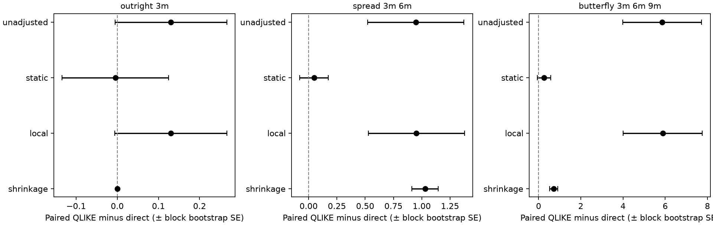
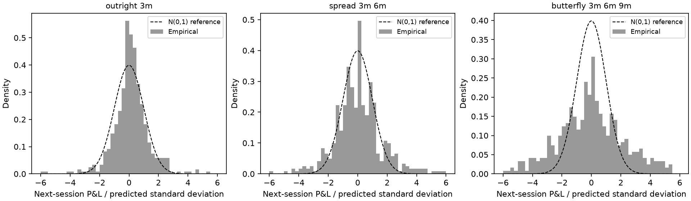

# First SHFE copper calibration and risk study

This is a historical settlement-risk experiment, not a trading strategy or a proof of the latent SPDE model.

Test origins: 2024-01-02–2025-12-30 (484 origins). Validation selected a trailing window of 252 intervals.
Direct and shrinkage baselines independently selected {'direct': 63, 'shrinkage': 63}.

Data: 11628 copper rows, 969 sessions and 60 contract IDs. Cross-sectional RMSE [min, Q1, median, Q3, max] in CNY/tonne: [9.69, 34.06, 48.58, 72.69, 968.45].

The finite exact Laguerre model reconstructs daily curves at contract-month midpoint tenors. Source covariance C is fitted through the actual calendar-interval integration maps; it is a model-dependent calibration, not identified physical forcing. Drift is set to zero. The scored squared P&L is a conditional second-moment proxy, approximating variance under that drift assumption.

## Out-of-sample risk calibration

| Exposure | Method | N | Realized / predicted variance | QLIKE |
| --- | --- | ---: | ---: | ---: |
| outright_3m | direct | 484 | 1.096 | 17.266 |
| outright_3m | shrinkage | 484 | 1.096 | 17.266 |
| outright_3m | spde_dim2 | 484 | 1.187 | 17.395 |
| outright_3m | spde_dim4 | 484 | 1.183 | 17.395 |
| outright_3m | spde_fixed126 | 484 | 1.165 | 17.377 |
| outright_3m | spde_local | 484 | 1.186 | 17.396 |
| outright_3m | spde_smoother | 484 | 1.187 | 17.396 |
| outright_3m | spde_static | 484 | 0.935 | 17.261 |
| outright_3m | unadjusted | 484 | 1.186 | 17.396 |
| spread_3m_6m | direct | 484 | 0.455 | 13.609 |
| spread_3m_6m | shrinkage | 484 | 0.094 | 14.638 |
| spread_3m_6m | spde_dim2 | 484 | 2.674 | 14.799 |
| spread_3m_6m | spde_dim4 | 484 | 2.122 | 14.317 |
| spread_3m_6m | spde_fixed126 | 484 | 2.246 | 15.072 |
| spread_3m_6m | spde_local | 484 | 2.279 | 14.562 |
| spread_3m_6m | spde_smoother | 484 | 2.703 | 14.872 |
| spread_3m_6m | spde_static | 484 | 0.636 | 13.658 |
| spread_3m_6m | unadjusted | 484 | 2.239 | 14.556 |
| butterfly_3m_6m_9m | direct | 484 | 0.658 | 15.066 |
| butterfly_3m_6m_9m | shrinkage | 484 | 0.139 | 15.773 |
| butterfly_3m_6m_9m | spde_dim2 | 484 | 225.382 | 345.112 |
| butterfly_3m_6m_9m | spde_dim4 | 484 | 7.038 | 20.991 |
| butterfly_3m_6m_9m | spde_fixed126 | 484 | 7.117 | 23.161 |
| butterfly_3m_6m_9m | spde_local | 484 | 6.933 | 20.948 |
| butterfly_3m_6m_9m | spde_smoother | 484 | 15.461 | 31.400 |
| butterfly_3m_6m_9m | spde_static | 484 | 1.515 | 15.326 |
| butterfly_3m_6m_9m | unadjusted | 484 | 6.857 | 20.916 |

QLIKE levels include log(CNY²), and comparisons are valid within each exposure on common dates. Availability differs by method; paired differences below use the intersection of each method's and the direct baseline's available dates.

## Paired score comparisons

| Exposure | Method minus direct | N | Mean QLIKE difference | Block bootstrap SE |
| --- | --- | ---: | ---: | ---: |
| outright_3m | shrinkage | 484 | -0.0000 | 0.0000 |
| outright_3m | spde_dim2 | 484 | 0.1291 | 0.1357 |
| outright_3m | spde_dim4 | 484 | 0.1294 | 0.1359 |
| outright_3m | spde_fixed126 | 484 | 0.1110 | 0.0970 |
| outright_3m | spde_local | 484 | 0.1303 | 0.1360 |
| outright_3m | spde_smoother | 484 | 0.1301 | 0.1360 |
| outright_3m | spde_static | 484 | -0.0045 | 0.1294 |
| outright_3m | unadjusted | 484 | 0.1304 | 0.1361 |
| spread_3m_6m | shrinkage | 484 | 1.0296 | 0.1160 |
| spread_3m_6m | spde_dim2 | 484 | 1.1906 | 0.4946 |
| spread_3m_6m | spde_dim4 | 484 | 0.7087 | 0.3696 |
| spread_3m_6m | spde_fixed126 | 484 | 1.4636 | 0.5954 |
| spread_3m_6m | spde_local | 484 | 0.9530 | 0.4261 |
| spread_3m_6m | spde_smoother | 484 | 1.2633 | 0.5046 |
| spread_3m_6m | spde_static | 484 | 0.0490 | 0.1265 |
| spread_3m_6m | unadjusted | 484 | 0.9477 | 0.4242 |
| butterfly_3m_6m_9m | shrinkage | 484 | 0.7063 | 0.1934 |
| butterfly_3m_6m_9m | spde_dim2 | 484 | 330.0454 | 77.9633 |
| butterfly_3m_6m_9m | spde_dim4 | 484 | 5.9246 | 1.8720 |
| butterfly_3m_6m_9m | spde_fixed126 | 484 | 8.0942 | 2.6047 |
| butterfly_3m_6m_9m | spde_local | 484 | 5.8819 | 1.8737 |
| butterfly_3m_6m_9m | spde_smoother | 484 | 16.3340 | 4.4349 |
| butterfly_3m_6m_9m | spde_static | 484 | 0.2595 | 0.3116 |
| butterfly_3m_6m_9m | unadjusted | 484 | 5.8496 | 1.8668 |

Negative differences favor the listed method. Blocks contain 20 consecutive scored origins; these are time-series bootstrap summaries, not independent Monte Carlo replications or operator confidence intervals.

## Calendar-clock check

| Exposure | Calendar interval | N | Realized / predicted variance |
| --- | --- | ---: | ---: |
| outright_3m | 1 day | 380 | 1.447 |
| outright_3m | 2–3 days | 93 | 0.630 |
| outright_3m | 4+ days | 11 | 1.989 |
| spread_3m_6m | 1 day | 380 | 3.426 |
| spread_3m_6m | 2–3 days | 93 | 1.267 |
| spread_3m_6m | 4+ days | 11 | 0.332 |
| butterfly_3m_6m_9m | 1 day | 380 | 10.614 |
| butterfly_3m_6m_9m | 2–3 days | 93 | 3.104 |
| butterfly_3m_6m_9m | 4+ days | 11 | 2.688 |

## Reconstruction risk diagnostic

Actual P&L Y equals the reconstructed-curve change S plus residual change U. These are post hoc uncentered second-moment shares; the cross term is retained. The diagnostic never enters forecast fitting or validation selection.

| Exposure | N | Curve share | Residual share | Cross share |
| --- | ---: | ---: | ---: | ---: |
| outright_3m | 484 | 0.991 | 0.002 | 0.007 |
| spread_3m_6m | 484 | 0.383 | 0.619 | -0.002 |
| butterfly_3m_6m_9m | 484 | 0.114 | 0.778 | 0.108 |

## Numerical verification

Convergence and feasibility summary: `{"all_converged": true, "available": true, "maximum_relative_risk_bound": 0.00647020476009218, "maximum_relative_trace_violation": 0.0, "minimum_source_eigenvalue": 4116288.714366688, "objective_gap_bound_scaled": 3.1999106240154385e-11, "relative_covariance_error_bound": 8.056297356695254e-06}`. The risk bound propagates numerical distance to the constrained optimizer; it excludes sampling, reconstruction and model error. Detailed attempted/issued/scored availability is retained by method and exposure in `summary.json`.

## Interpretation and limits

- One next-session holding period, actual contract IDs, 5-tonne multipliers, no continuous-contract roll returns.
- Window selection uses 2023 outcomes only; 2024–2025 are subsequent tests. All refits use observations through origin.
- Direct and fixed 10% diagonal shrinkage baselines use jointly observed changes of the same current contracts, with at least 20 historical intervals.
- Curve reconstruction, short maturity range, quote microstructure, calendar-time volatility and the constant-local-C assumption affect fitted source covariance.
- No known fresh noise correction is claimed for settlement-level reconstruction; no Gaussian tail guarantee, VaR validation, execution costs or profitable-trading claim.
- The session calendar is treated as known. Annual archive versions are retrospective; first-publication-vintage data have not been reconstructed.
- Raw quotes, daily curves and forecast-level outcomes stay local. This report contains aggregate numerical findings only.

See [the empirical protocol](../../../docs/shfe-empirical.md) and [the executed notebook](../../../notebooks/shfe_empirical.ipynb). `summary.json`, `manifest.json` and `evidence-sha256.json` retain configuration, archive hashes, numerical source and environment provenance.

[Interpretation and next targets](../../../docs/shfe-findings.md).