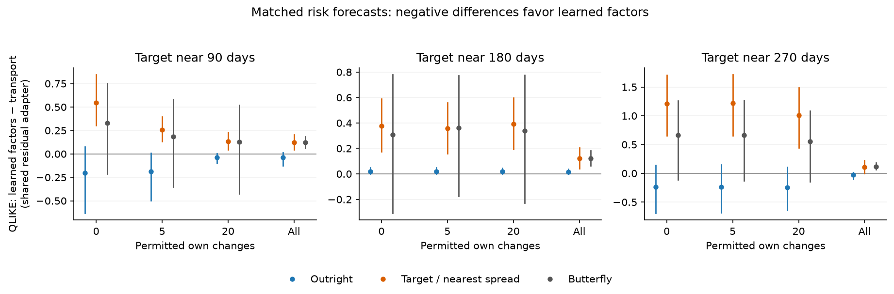
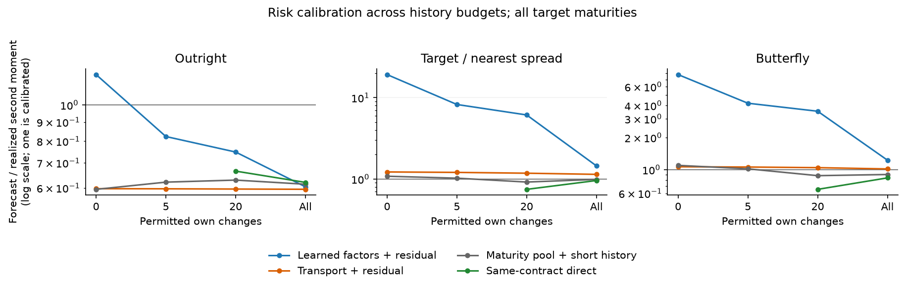
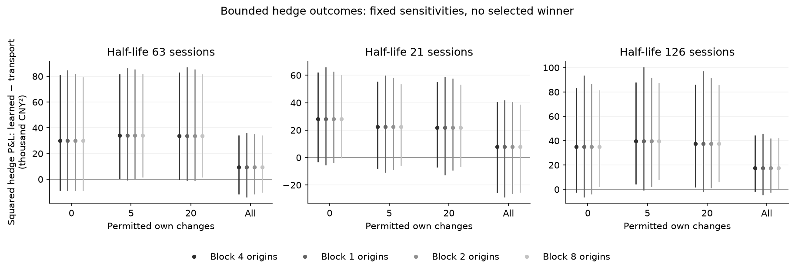

# Copper short-history risk transfer

**Question:** can other copper contracts supply useful next-session risk information when a currently quoted contract has little permitted own history?

This is an exploratory masked-history experiment on inspected daily SHFE settlements. It is not an actual new-listing study, price forecast, pricing model or execution backtest. All reported comparisons concern conditional second moments; a variance interpretation requires negligible conditional means.

Numerical source: `95bd9ba0adac335146fcc54b7e2e36b7ae1b0aa0`; clean at execution: `True`. The run issued 38,544 method forecasts over 438 target episodes, including development validation and fixed half-life sensitivities. Repeated contracts, targets and dates are not independent replications.

Primary settings: 252 historical intervals, 63-session EWMA half-life, history budgets [0, 5, 20, All available], five-tonne contract multiplier. Outcomes are the next observed session of the same actual contracts. The current settlement is always visible. Target comparisons are averaged within origin before pooling.

## What this experiment finds

**The proposed learned-factor policy does not improve short-history spread-risk forecasting in this study.** The transport model is more stable than this DFM implementation, while a simple maturity-pooling baseline remains competitive. These are complete-policy comparisons on inspected data, not a universal result about SPDEs or factor models.

At zero own history, the DFM spread forecast is **19.26 times** realized second moment, reaching **57.10 times** for the near-90-day target. The diagonal leave-one-donor-out correction contributes **CNY² 9.074 million** of the **CNY² 9.254 million** forecast (98.1%). This flags a failure of the present predictive-error transfer policy, not evidence of high true latent noise.

Primary DFM-minus-transport spread QLIKE differences (positive favors transport):

- Own history 0: **+0.712**, block range [0.525, 0.891].
- Own history 5: **+0.612**, block range [0.426, 0.784].
- Own history 20: **+0.510**, block range [0.314, 0.678].
- Own history All available: **+0.118**, block range [0.057, 0.182].

The direction persists across all prespecified half-lives and block lengths. These dependent sensitivity checks do not constitute independent confirmation.

**Removing the diagonal correction is not a complete repair.** At zero own history, the DFM without it forecasts only 0.374 times realized spread second moment and has QLIKE 15.860; factor-only QLIKE is 26.407, versus 14.816 with the full correction. The current factor/residual representation underpredicts without the correction and overpredicts with it.

**The simple pooled baseline must remain central.** At zero own history, transport-minus-pool spread QLIKE is −0.068, block range [−0.204, 0.037], which does not resolve an advantage. At five own changes it is +0.130 [0.006, 0.280], favoring pooling. Pooled hedge RMS is lower at every history budget; this is settlement-risk evidence without execution costs.

The next diagnostic should examine learned-loading stability, leave-one-donor-out leverage and how predictive errors transfer across maturities. Do not retune this inspected sample or add complexity before explaining this failure. A revised rule requires a frozen protocol and an uninspected confirmation period.

## Principal comparison

Learned maturity-dependent return factors and the transport source-C model use the same residual-transfer adapter. Differences therefore compare complete policies, rather than isolating a causal transport effect. Each paired difference uses identical permitted information and future observations. Negative values favor learned factors.

Lines show descriptive 95% circular moving-block percentile ranges with 4 scheduled origins per block (approximately 20 trading sessions). They are dependence sensitivities on an inspected sample, not independent Monte Carlo uncertainty.

| Own-history budget | Risk target | Paired origins | Learned − transport | 95% block range |
| --- | --- | --- | --- | --- |
| 0 | Outright | 97 | -0.1409 | [-0.4165, 0.06223] |
| 5 | Outright | 97 | -0.1349 | [-0.3695, 0.05022] |
| 20 | Outright | 97 | -0.08851 | [-0.2267, 0.03338] |
| All available | Outright | 97 | -0.01642 | [-0.06032, 0.009687] |
| 0 | Target / nearest spread | 97 | 0.7123 | [0.5249, 0.8905] |
| 5 | Target / nearest spread | 97 | 0.6116 | [0.4262, 0.7838] |
| 20 | Target / nearest spread | 97 | 0.5102 | [0.3143, 0.678] |
| All available | Target / nearest spread | 97 | 0.1176 | [0.05661, 0.182] |
| 0 | Butterfly | 97 | 0.436 | [-0.1779, 0.9191] |
| 5 | Butterfly | 97 | 0.4038 | [-0.189, 0.8647] |
| 20 | Butterfly | 97 | 0.3398 | [-0.2425, 0.7889] |
| All available | Butterfly | 97 | 0.1205 | [0.063, 0.1822] |
| 0 | Bounded hedge | 97 | 29.86 | [-8.538, 80.75] |
| 5 | Bounded hedge | 97 | 34.18 | [0.7377, 81.22] |
| 20 | Bounded hedge | 97 | 33.78 | [0.1138, 82.66] |
| All available | Bounded hedge | 97 | 9.426 | [-11.22, 33.6] |

QLIKE differences are dimensionless. Hedge differences above are mean squared P&L in **thousand CNY²**, not differences of RMS. A range spanning zero does not resolve a ranking.

## Calibration and benchmark levels

A forecast/realized second-moment ratio of one is aggregate calibration, not a guarantee of conditional calibration. Below one indicates underprediction. Curves are descriptive policy summaries; availability can differ, so use the paired table for comparisons.

| Own-history budget | Policy | Scored / attempted episodes | Origins | Spread QLIKE | Butterfly QLIKE | Hedge RMS, CNY |
| --- | --- | --- | --- | --- | --- | --- |
| 0 | Learned factors + residual | 291/291 | 97 | 14.82 | 15.78 | 669.9 |
| 0 | Transport + residual | 291/291 | 97 | 14.1 | 15.34 | 647.2 |
| 0 | Maturity pool + short history | 291/291 | 97 | 14.17 | 15.37 | 621.5 |
| 0 | Same-contract direct | 0/291 | 0 | Unavailable | Unavailable | Unavailable |
| 5 | Learned factors + residual | 291/291 | 97 | 14.7 | 15.73 | 675 |
| 5 | Transport + residual | 291/291 | 97 | 14.09 | 15.32 | 649.1 |
| 5 | Maturity pool + short history | 291/291 | 97 | 13.96 | 15.06 | 603.6 |
| 5 | Same-contract direct | 0/291 | 0 | Unavailable | Unavailable | Unavailable |
| 20 | Learned factors + residual | 291/291 | 97 | 14.6 | 15.67 | 674.8 |
| 20 | Transport + residual | 291/291 | 97 | 14.09 | 15.33 | 649.3 |
| 20 | Maturity pool + short history | 291/291 | 97 | 14.01 | 15.13 | 618.4 |
| 20 | Same-contract direct | 291/291 | 97 | 14.12 | 15.6 | 629.6 |
| All available | Learned factors + residual | 291/291 | 97 | 14.21 | 15.45 | 655.7 |
| All available | Transport + residual | 291/291 | 97 | 14.09 | 15.33 | 648.5 |
| All available | Maturity pool + short history | 291/291 | 97 | 14.14 | 15.29 | 638.9 |
| All available | Same-contract direct | 291/291 | 97 | 14.26 | 15.51 | 646.7 |

Direct same-contract covariance is unavailable below the declared complete-change minimum. Maturity pooling remains available at zero own history when donor maturity slots are observed. The pooled estimate blends with the short-history moment using n/(n+20), with n the available complete count.

## Hedge and fixed sensitivity checks

One target contract is hedged with the two selected other contracts, with each hedge position bounded to [−2,2]. Half-life and bootstrap-block sensitivities were fixed, not selected by evaluation performance. Repeated budgets are resampled jointly over calendar origins. No fills, roll mechanics, transaction costs, margin or capacity are modeled.

### All model policies and ablations

These prespecified policies use the primary half-life setting. Uniform policies ignore that half-life by construction. Results are origin-averaged descriptive levels; differences should use paired common outcomes. Joint quadratic scores are in trillion CNY⁴ and may be negative because the score omits a forecast-independent term.

| Own history | Policy | Outright QLIKE | Spread QLIKE | Butterfly QLIKE | Joint quadratic / 10¹² CNY⁴ | Hedge RMS CNY |
| --- | --- | --- | --- | --- | --- | --- |
| 0 | Original uniform source C | 17.96 | 17.69 | 24.67 | -1,001 | 778.3 |
| 0 | EWMA source C | 17.9 | 17.4 | 25.1 | -857.9 | 795 |
| 0 | Transport + residual | 17.84 | 14.1 | 15.34 | -865.3 | 647.2 |
| 0 | Learned factors + residual | 17.7 | 14.82 | 15.78 | 4,888 | 669.9 |
| 0 | Uniform learned factors + residual | 17.8 | 14.62 | 15.7 | -969 | 685.9 |
| 0 | Learned factors only | 17.89 | 26.41 | 39.21 | -860.2 | 925.8 |
| 0 | Transport, no diagonal correction | 17.9 | 15.93 | 24.51 | -858.9 | 829 |
| 0 | Learned factors, no diagonal correction | 17.89 | 15.86 | 21.52 | -858 | 827.6 |
| 5 | Original uniform source C | 17.96 | 17.68 | 24.66 | -1,001 | 778.6 |
| 5 | EWMA source C | 17.9 | 17.39 | 25.09 | -857.9 | 796.4 |
| 5 | Transport + residual | 17.85 | 14.09 | 15.32 | -865.4 | 649.1 |
| 5 | Learned factors + residual | 17.71 | 14.7 | 15.73 | -838.6 | 675 |
| 5 | Uniform learned factors + residual | 17.8 | 14.57 | 15.68 | -1,015 | 691.1 |
| 5 | Learned factors only | 17.9 | 23.48 | 41.59 | -857.9 | 892 |
| 5 | Transport, no diagonal correction | 17.9 | 15.9 | 24.3 | -858.8 | 831.2 |
| 5 | Learned factors, no diagonal correction | 17.89 | 15.83 | 21.55 | -856.2 | 816.3 |
| 20 | Original uniform source C | 17.96 | 17.66 | 24.67 | -1,001 | 779.5 |
| 20 | EWMA source C | 17.9 | 17.35 | 25.12 | -857.1 | 798.3 |
| 20 | Transport + residual | 17.85 | 14.09 | 15.33 | -864.1 | 649.3 |
| 20 | Learned factors + residual | 17.76 | 14.6 | 15.67 | -859.8 | 674.8 |
| 20 | Uniform learned factors + residual | 17.8 | 14.52 | 15.68 | -1,019 | 691.1 |
| 20 | Learned factors only | 17.9 | 23.91 | 41.61 | -857.3 | 886.9 |
| 20 | Transport, no diagonal correction | 17.9 | 15.88 | 24.34 | -857.9 | 833.4 |
| 20 | Learned factors, no diagonal correction | 17.89 | 15.89 | 21.83 | -855.5 | 822.3 |
| All available | Original uniform source C | 17.96 | 17.74 | 25.1 | -1,002 | 781.4 |
| All available | EWMA source C | 17.9 | 17.49 | 25.52 | -858.3 | 796.8 |
| All available | Transport + residual | 17.85 | 14.09 | 15.33 | -864.9 | 648.5 |
| All available | Learned factors + residual | 17.83 | 14.21 | 15.45 | -864.3 | 655.7 |
| All available | Uniform learned factors + residual | 17.89 | 14.21 | 15.41 | -1,013 | 681.4 |
| All available | Learned factors only | 17.89 | 18 | 39.59 | -857.7 | 874.6 |
| All available | Transport, no diagonal correction | 17.9 | 15.97 | 24.74 | -858.9 | 834.1 |
| All available | Learned factors, no diagonal correction | 17.89 | 15.94 | 22.48 | -856 | 807.5 |

### Factor, cross and residual contributions

Components are percentages of each policy's aggregate forecast second moment. The signed cross correction can be negative; the parts are not independent sources of risk. Totals remain in CNY². Diagonal prediction error can include estimation error and is not identified latent noise.

| Own history | Policy | Risk | Factor % | Signed cross % | Correlated residual % | Diagonal % | Forecast CNY² |
| --- | --- | --- | --- | --- | --- | --- | --- |
| 0 | Learned factors + residual | Outright | 48.23 | 0.04599 | 0.117 | 51.61 | 1.671e+07 |
| 0 | Learned factors + residual | Target / nearest spread | 1.476 | 0.02722 | 0.4407 | 98.06 | 9.254e+06 |
| 0 | Learned factors + residual | Butterfly | 2.124 | 0.1562 | 0.9546 | 96.77 | 1.139e+07 |
| 0 | Transport + residual | Outright | 96.83 | 0.07614 | 0.1732 | 2.92 | 8.279e+06 |
| 0 | Transport + residual | Target / nearest spread | 15.29 | 1.099 | 5.326 | 78.28 | 5.865e+05 |
| 0 | Transport + residual | Butterfly | 7.77 | -2.173 | 6.135 | 88.27 | 1.558e+06 |
| 5 | Learned factors + residual | Outright | 70.59 | 0.05547 | 0.1678 | 29.19 | 1.141e+07 |
| 5 | Learned factors + residual | Target / nearest spread | 3.304 | 0.06429 | 1.027 | 95.6 | 3.966e+06 |
| 5 | Learned factors + residual | Butterfly | 3.812 | 0.2837 | 1.765 | 94.14 | 6.14e+06 |
| 5 | Transport + residual | Outright | 96.91 | 0.08768 | 0.1658 | 2.842 | 8.273e+06 |
| 5 | Transport + residual | Target / nearest spread | 15.5 | 1.185 | 5.278 | 78.04 | 5.793e+05 |
| 5 | Transport + residual | Butterfly | 7.819 | -2.147 | 6.119 | 88.21 | 1.549e+06 |
| 20 | Learned factors + residual | Outright | 77.62 | 0.06044 | 0.1742 | 22.15 | 1.037e+07 |
| 20 | Learned factors + residual | Target / nearest spread | 4.239 | 0.09069 | 1.36 | 94.31 | 2.948e+06 |
| 20 | Learned factors + residual | Butterfly | 4.3 | 0.3391 | 2.082 | 93.28 | 5.164e+06 |
| 20 | Transport + residual | Outright | 97.03 | 0.09883 | 0.1579 | 2.714 | 8.261e+06 |
| 20 | Transport + residual | Target / nearest spread | 15.89 | 1.309 | 5.328 | 77.47 | 5.661e+05 |
| 20 | Transport + residual | Butterfly | 7.906 | -2.126 | 6.171 | 88.05 | 1.528e+06 |
| All available | Learned factors + residual | Outright | 96.09 | 0.08926 | 0.1804 | 3.642 | 8.374e+06 |
| All available | Learned factors + residual | Target / nearest spread | 17.54 | 0.2687 | 5.127 | 77.06 | 6.96e+05 |
| All available | Learned factors + residual | Butterfly | 12.26 | 0.7 | 5.721 | 81.32 | 1.795e+06 |
| All available | Transport + residual | Outright | 97.16 | 0.09135 | 0.1613 | 2.591 | 8.249e+06 |
| All available | Transport + residual | Target / nearest spread | 15.99 | 1.42 | 5.523 | 77.07 | 5.48e+05 |
| All available | Transport + residual | Butterfly | 7.929 | -2.102 | 6.215 | 87.96 | 1.487e+06 |

## Availability and numerical scope

| Policy | Attempted | Issued | Scored | Unavailable reason counts |
| --- | --- | --- | --- | --- |
| Learned factors only | 5256 | 5256 | 5256 | None |
| Learned factors + residual | 5256 | 5256 | 5256 | None |
| Learned factors, no diagonal correction | 1752 | 1752 | 1752 | None |
| Uniform learned factors + residual | 1752 | 1752 | 1752 | None |
| Same-contract direct | 5256 | 2628 | 2628 | insufficient_complete_same_contract_changes: 2628 |
| Maturity pool + short history | 5256 | 5256 | 5256 | None |
| EWMA source C | 5256 | 5256 | 5256 | None |
| Transport + residual | 5256 | 5256 | 5256 | None |
| Transport, no diagonal correction | 1752 | 1752 | 1752 | None |
| Original uniform source C | 1752 | 1752 | 1752 | None |

The full numerical diagnostics include source optimizer certificates, factor-boundary gaps, effective counts, Schur support/correction checks and bounded-cache measurements in [diagnostics.json](diagnostics.json). All fixed policies, maturity strata, component contributions and sensitivities remain in [summary.json](summary.json); paired ranges are in [paired.json](paired.json). No unavailable result is replaced by a fallback.

### Solver certificates

These extrema pool validation/evaluation, budgets and fixed sensitivities. Source bounds certify numerical optimization under the fitted objective, not statistical accuracy. Missing entries are not applicable or were unavailable; they are not zeros.

| Policy | Max relative covariance bound | Max certified objective gap | Max iterations |
| --- | --- | --- | --- |
| Learned factors only | Unavailable | Unavailable | Unavailable |
| Learned factors + residual | Unavailable | Unavailable | Unavailable |
| Learned factors, no diagonal correction | Unavailable | Unavailable | Unavailable |
| Uniform learned factors + residual | Unavailable | Unavailable | Unavailable |
| EWMA source C | 9.989e-06 | 1.202e+09 | 7 |
| Transport + residual | 9.989e-06 | 1.202e+09 | 7 |
| Transport, no diagonal correction | 8.175e-06 | 9.505e+08 | 6 |
| Original uniform source C | 7.831e-06 | 1.616e+09 | 6 |

### Conditioning and factor separation

A small third/fourth eigenvalue gap makes individual learned loading directions sensitive. Rotations within the retained subspace do not change its covariance forecast. Condition numbers and effective counts describe the permitted information rather than additional observations.

| Policy | Median effective intervals | Max curve condition | Max residual-feature condition | Min relative third/fourth gap |
| --- | --- | --- | --- | --- |
| Learned factors only | 160.4 | Unavailable | 45.4 | 7.5e-05 |
| Learned factors + residual | 160.4 | Unavailable | 45.4 | 7.5e-05 |
| Learned factors, no diagonal correction | 160.4 | Unavailable | 45.4 | 0.0001806 |
| Uniform learned factors + residual | 252 | Unavailable | 45.4 | 0.000264 |
| EWMA source C | 160.4 | 102.7 | Unavailable | Unavailable |
| Transport + residual | 160.4 | Unavailable | 45.4 | Unavailable |
| Transport, no diagonal correction | 160.4 | Unavailable | 45.4 | Unavailable |
| Original uniform source C | N/A | 102.7 | Unavailable | Unavailable |

Uniform source-C ESS is marked N/A: the aggregate common-context field contains EWMA effective counts, while the actual source fit uses uniform weights. The authoritative local solver diagnostic is source_fit.effective_n. No covariance fit or numerical evidence has been changed for this display correction.

### Support, roundoff and component checks

Support residuals are relative. PSD corrections are absolute matrix-norm changes made only within the declared roundoff tolerance. Remaining signed residual pair products are a descriptive dependence diagnostic; cancellation can conceal dependence and a small ratio does not prove independence.

| Policy | Max relative support residual | Max Schur correction | Max forecast PSD correction | Max relative component residual | Remaining signed pair ratio: min / median / max |
| --- | --- | --- | --- | --- | --- |
| Learned factors only | Unavailable | Unavailable | Unavailable | Unavailable | [-0.112, -0.1051, -0.1] |
| Learned factors + residual | 1.863e-17 | 0 | 0 | 1.968e-16 | [-0.112, -0.1051, -0.1] |
| Learned factors, no diagonal correction | 9.189e-18 | 0 | 0 | 1.71e-16 | [-0.1111, -0.105, -0.1001] |
| Uniform learned factors + residual | 1.412e-17 | 0 | 0 | 1.703e-16 | [-0.1105, -0.1025, -0.1001] |
| EWMA source C | Unavailable | Unavailable | Unavailable | Unavailable | Unavailable |
| Transport + residual | 4.489e-16 | 0 | 0 | 1.773e-16 | [-0.1125, -0.1052, -0.1] |
| Transport, no diagonal correction | 1.997e-16 | 0 | 0 | 1.791e-16 | [-0.1111, -0.105, -0.1001] |
| Original uniform source C | Unavailable | Unavailable | Unavailable | Unavailable | Unavailable |

Run time: 752.0 seconds, including masked preparation and model fitting, excluding archive acquisition. This is a single environment measurement. Environment and archive provenance: [manifest.json](manifest.json); frozen settings: [protocol.json](protocol.json).

## Interpretation and reproduction

The central test is risk transfer, not reconstruction of an already observed price. Success at a masked-history budget would support pooling across contract lifecycles under the tested conditions; it would not establish SPDE superiority, genuine new-listing performance or continuum identification. Four residual maturity features plus a diagonal prediction-error correction remain a restriction. The diagonal term can contain estimation error and is not identified latent noise.

Read the [executed notebook](../../../notebooks/07_short_history_risk_transfer.ipynb) and [protocol](../../../docs/short_history.md). Raw exchange panels, contract-level forecasts and individual P&Ls remain local. This renderer verifies aggregate checksums and does not refit models or change numerical evidence.
