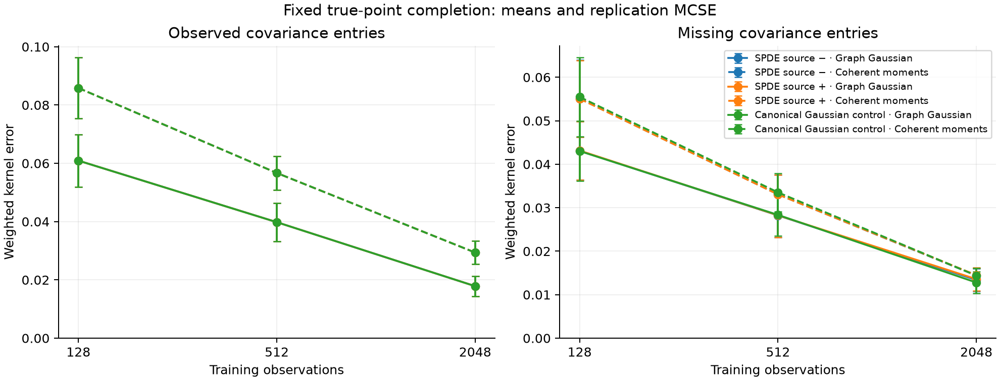
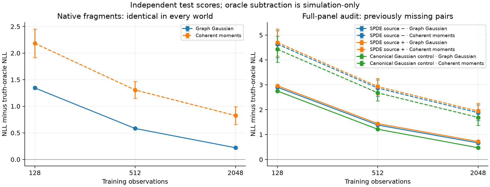
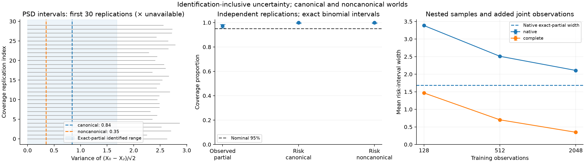

# Statistical completion at fixed true points

This study separates observed covariance estimation, a canonical completion convention, and uncertainty over all PSD completions. It makes no empirical-market or hedge-performance claim.

Acceptance: **PASS**. There is no superiority or nominal-coverage pass/fail gate. Failed candidates: 0; unavailable selected world/method rows: 0.

## Observation model and chronology

Seven fixed true point maturities [np.float64(0.0), np.float64(0.5), np.float64(1.0), np.float64(1.5), np.float64(2.0), np.float64(2.5), np.float64(3.0)]; two native cliques [0,1,2,3] and [3,4,5,6]. The target is a normalized innovation point kernel at Δ=0.019230769 years. Source −/+ use a PSD perturbation of a fixed trace-one power-law source, with a common tail integrated through 512 modes. Point evaluation occurs before estimator projection. The canonical Gaussian control completes their shared observed partial kernel; no SPDE-source membership is asserted for this control.

Each of 20 independent point-study replications uses nested training counts (128, 512, 2048). Validation uses [2048, 2176); the untouched full-panel test uses the following 512 observations. Native fragment rows alternate by date. No test or latent truth enters fitting, the training diagonal reference, or penalty selection. Complete test observations are a separately disclosed measurement augmentation, not native risk availability.

The known fresh Gaussian observation-noise variance is 0.001. Conditional Gaussian parent coupling makes native data exactly equal across all three worlds: **True**. Population native-block discrepancy: 1.5543e-15. Fits, selections and issued kernels are consequently shared, not independently retuned using each world's hidden entries.

The Gaussian model has zeros in the precision entries outside the fixed two-clique graph. It is fitted by multistart graph-constrained EM and has a local stationarity criterion, not a global optimization certificate. The coherent-moment comparator uses the existing shared PSD-clique objective followed by full-support canonical completion. Both use the same training-only positive diagonal reference and candidate pseudo-counts; their KL and Frobenius penalties remain different objectives. A selected failed fit is unavailable, and failed candidates remain in the archive.

Pseudo-count candidates (0.5, 2.0, 8.0) produce Gaussian λ=pseudo-count/N. The coherent λ also multiplies maximum normalized pair coverage. The positive training variance floor is 1e-06 times the largest absolute corrected training variance; the applied floor is recorded. Coherent weighted eigenvalue floor: 1e-09; observed-partial optimizer-distance budget: 1e-05. Those numerical bounds do not bound completed-kernel or sampling error.

Selection minimizes native validation mean marginal Gaussian negative log likelihood, including each measurement dimension's normalizing constant. Ties choose the larger pseudo-count. The native graph stays fixed for full-panel scoring. Native scores cannot test the unobserved conditional-independence convention. Full-panel audit data can reveal its consequences; oracle subtraction below is a simulation-only diagnostic that removes different world entropies.

## Population identification and structural misspecification

| World | Canonical weighted kernel error | Canonical full-panel Gaussian KL |
|---|---:|---:|
| SPDE source − | 0.0027066 | 0.24499 |
| SPDE source + | 0.003221 | 0.2905 |
| Canonical Gaussian control | 0 | 3.5527e-15 |

These are deterministic population diagnostics, not fitted sampling performance. Native population covariances are equal while missing-block truths differ.

| Fixed exposure | Exact-partial PSD lower | Upper | Source − / + / canonical truth |
|---|---:|---:|---|
| within_left | 0.049158 | 0.049158 | 0.049158 / 0.049158 / 0.049158 |
| across_fragments | 0.040799 | 0.10912 | 0.093908 / 0.10153 / 0.074962 |
| spread_difference | 0.036303 | 0.054882 | 0.0451 / 0.039622 / 0.045592 |

Exposure coefficients are normalized using the full weighted-Sobolev evaluation-representer Gram. These algebraic two-block ranges concern all PSD grid completions of exact observed entries. They are neither confidence intervals nor ranges restricted to transport sources.

## Point estimation and independent scores

Errors use the same normalized physical trapezoidal grid weights in every world/method. These grid-kernel norms are distinct from H-coordinate operator norms. Means ± MCSE use independent replication clusters, not dates, nodes or method/world rows.

| World | N | Method | Available | Observed error | Missing error | Full kernel error |
|---|---:|---|---:|---:|---:|---:|
| Canonical Gaussian control | 128 | Coherent moments | 20/20 | 0.085842 ± 0.01042 | 0.055469 ± 0.0090767 | 0.10354 ± 0.013287 |
| Canonical Gaussian control | 128 | Graph Gaussian | 20/20 | 0.060917 ± 0.009031 | 0.04303 ± 0.0068945 | 0.074843 ± 0.011271 |
| Canonical Gaussian control | 512 | Coherent moments | 20/20 | 0.056685 ± 0.0057826 | 0.033522 ± 0.0043874 | 0.066693 ± 0.0068441 |
| Canonical Gaussian control | 512 | Graph Gaussian | 20/20 | 0.0398 ± 0.006614 | 0.028347 ± 0.004771 | 0.048926 ± 0.0081353 |
| Canonical Gaussian control | 2048 | Coherent moments | 20/20 | 0.029374 ± 0.0040154 | 0.014393 ± 0.0016756 | 0.033255 ± 0.004128 |
| Canonical Gaussian control | 2048 | Graph Gaussian | 20/20 | 0.017845 ± 0.0034387 | 0.012788 ± 0.002459 | 0.021974 ± 0.0042219 |
| SPDE source − | 128 | Coherent moments | 20/20 | 0.085842 ± 0.01042 | 0.055083 ± 0.0088408 | 0.10319 ± 0.013183 |
| SPDE source − | 128 | Graph Gaussian | 20/20 | 0.060917 ± 0.009031 | 0.043083 ± 0.006739 | 0.074737 ± 0.011225 |
| SPDE source − | 512 | Coherent moments | 20/20 | 0.056685 ± 0.0057826 | 0.033068 ± 0.0044626 | 0.066337 ± 0.0069579 |
| SPDE source − | 512 | Graph Gaussian | 20/20 | 0.0398 ± 0.006614 | 0.028217 ± 0.0050042 | 0.048808 ± 0.0082874 |
| SPDE source − | 2048 | Coherent moments | 20/20 | 0.029374 ± 0.0040154 | 0.014404 ± 0.0016625 | 0.03324 ± 0.0041311 |
| SPDE source − | 2048 | Graph Gaussian | 20/20 | 0.017845 ± 0.0034387 | 0.013371 ± 0.0026257 | 0.02237 ± 0.0043071 |
| SPDE source + | 128 | Coherent moments | 20/20 | 0.085842 ± 0.01042 | 0.055068 ± 0.0088052 | 0.10316 ± 0.013168 |
| SPDE source + | 128 | Graph Gaussian | 20/20 | 0.060917 ± 0.009031 | 0.04314 ± 0.0067131 | 0.074754 ± 0.011215 |
| SPDE source + | 512 | Coherent moments | 20/20 | 0.056685 ± 0.0057826 | 0.033052 ± 0.00447 | 0.066311 ± 0.0069715 |
| SPDE source + | 512 | Graph Gaussian | 20/20 | 0.0398 ± 0.006614 | 0.028252 ± 0.0050314 | 0.04883 ± 0.0083034 |
| SPDE source + | 2048 | Coherent moments | 20/20 | 0.029374 ± 0.0040154 | 0.014485 ± 0.0016627 | 0.033281 ± 0.0041287 |
| SPDE source + | 2048 | Graph Gaussian | 20/20 | 0.017845 ± 0.0034387 | 0.01357 ± 0.0026365 | 0.022509 ± 0.0043082 |

| World | N | Method | Native NLL | Full-panel NLL | Full-panel excess over truth oracle |
|---|---:|---|---:|---:|---:|
| Canonical Gaussian control | 128 | Coherent moments | -0.46713 ± 0.27102 | -2.3073 ± 0.52992 | 4.4292 ± 0.52876 |
| Canonical Gaussian control | 128 | Graph Gaussian | -1.3063 ± 0.016924 | -3.986 ± 0.035418 | 2.7505 ± 0.035288 |
| Canonical Gaussian control | 512 | Coherent moments | -1.3454 ± 0.16437 | -4.058 ± 0.32917 | 2.6784 ± 0.32402 |
| Canonical Gaussian control | 512 | Graph Gaussian | -2.069 ± 0.012292 | -5.5217 ± 0.019982 | 1.2148 ± 0.013249 |
| Canonical Gaussian control | 2048 | Coherent moments | -1.826 ± 0.17217 | -5.0459 ± 0.32335 | 1.6905 ± 0.3202 |
| Canonical Gaussian control | 2048 | Graph Gaussian | -2.4311 ± 0.011803 | -6.2646 ± 0.017275 | 0.47185 ± 0.0063891 |
| SPDE source − | 128 | Coherent moments | -0.46713 ± 0.27102 | -2.2468 ± 0.54388 | 4.6351 ± 0.54255 |
| SPDE source − | 128 | Graph Gaussian | -1.3063 ± 0.016924 | -3.9781 ± 0.03421 | 2.9038 ± 0.033875 |
| SPDE source − | 512 | Coherent moments | -1.3454 ± 0.16437 | -4.013 ± 0.33551 | 2.869 ± 0.32989 |
| SPDE source − | 512 | Graph Gaussian | -2.069 ± 0.012292 | -5.4984 ± 0.020139 | 1.3836 ± 0.012179 |
| SPDE source − | 2048 | Coherent moments | -1.826 ± 0.17217 | -5.0025 ± 0.31679 | 1.8794 ± 0.31327 |
| SPDE source − | 2048 | Graph Gaussian | -2.4311 ± 0.011803 | -6.2165 ± 0.018948 | 0.66538 ± 0.0074071 |
| SPDE source + | 128 | Coherent moments | -0.46713 ± 0.27102 | -2.2383 ± 0.54599 | 4.7012 ± 0.54467 |
| SPDE source + | 128 | Graph Gaussian | -1.3063 ± 0.016924 | -3.9761 ± 0.033502 | 2.9635 ± 0.033418 |
| SPDE source + | 512 | Coherent moments | -1.3454 ± 0.16437 | -4.0091 ± 0.33736 | 2.9305 ± 0.33173 |
| SPDE source + | 512 | Graph Gaussian | -2.069 ± 0.012292 | -5.4978 ± 0.019776 | 1.4417 ± 0.012517 |
| SPDE source + | 2048 | Coherent moments | -1.826 ± 0.17217 | -4.9963 ± 0.31994 | 1.9432 ± 0.31654 |
| SPDE source + | 2048 | Graph Gaussian | -2.4311 ± 0.011803 | -6.22 ± 0.018545 | 0.71952 ± 0.0087246 |

Raw likelihoods for different measurement dimensions or different truth distributions are not directly interchangeable. Within-world paired method differences cancel the same measurement-only/oracle terms. Quadratic scores omit the measurement-only squared-product constant; all are archived.

| World | N | Paired metric: Gaussian minus moments | Mean difference ± MCSE | Paired replications |
|---|---:|---|---:|---:|
| Canonical Gaussian control | 128 | native_nll | -0.83912 ± 0.27419 | 20 |
| Canonical Gaussian control | 128 | bridge_nll | -1.6787 ± 0.5391 | 20 |
| Canonical Gaussian control | 128 | weighted_kernel_error | -0.028693 ± 0.010371 | 20 |
| Canonical Gaussian control | 128 | missing_error | -0.012439 ± 0.0062836 | 20 |
| Canonical Gaussian control | 512 | native_nll | -0.72361 ± 0.16337 | 20 |
| Canonical Gaussian control | 512 | bridge_nll | -1.4637 ± 0.32899 | 20 |
| Canonical Gaussian control | 512 | weighted_kernel_error | -0.017766 ± 0.0047697 | 20 |
| Canonical Gaussian control | 512 | missing_error | -0.0051743 ± 0.0031412 | 20 |
| Canonical Gaussian control | 2048 | native_nll | -0.60509 ± 0.17002 | 20 |
| Canonical Gaussian control | 2048 | bridge_nll | -1.2187 ± 0.32274 | 20 |
| Canonical Gaussian control | 2048 | weighted_kernel_error | -0.011281 ± 0.003281 | 20 |
| Canonical Gaussian control | 2048 | missing_error | -0.0016048 ± 0.0020326 | 20 |
| SPDE source − | 128 | native_nll | -0.83912 ± 0.27419 | 20 |
| SPDE source − | 128 | bridge_nll | -1.7313 ± 0.5517 | 20 |
| SPDE source − | 128 | weighted_kernel_error | -0.028456 ± 0.010301 | 20 |
| SPDE source − | 128 | missing_error | -0.012 ± 0.0061674 | 20 |
| SPDE source − | 512 | native_nll | -0.72361 ± 0.16337 | 20 |
| SPDE source − | 512 | bridge_nll | -1.4854 ± 0.33527 | 20 |
| SPDE source − | 512 | weighted_kernel_error | -0.017528 ± 0.0047827 | 20 |
| SPDE source − | 512 | missing_error | -0.0048519 ± 0.0031446 | 20 |
| SPDE source − | 2048 | native_nll | -0.60509 ± 0.17002 | 20 |
| SPDE source − | 2048 | bridge_nll | -1.214 ± 0.31629 | 20 |
| SPDE source − | 2048 | weighted_kernel_error | -0.01087 ± 0.0031714 | 20 |
| SPDE source − | 2048 | missing_error | -0.0010324 ± 0.0018835 | 20 |
| SPDE source + | 128 | native_nll | -0.83912 ± 0.27419 | 20 |
| SPDE source + | 128 | bridge_nll | -1.7378 ± 0.55344 | 20 |
| SPDE source + | 128 | weighted_kernel_error | -0.02841 ± 0.010287 | 20 |
| SPDE source + | 128 | missing_error | -0.011928 ± 0.0061436 | 20 |
| SPDE source + | 512 | native_nll | -0.72361 ± 0.16337 | 20 |
| SPDE source + | 512 | bridge_nll | -1.4887 ± 0.33747 | 20 |
| SPDE source + | 512 | weighted_kernel_error | -0.017481 ± 0.0047813 | 20 |
| SPDE source + | 512 | missing_error | -0.0048002 ± 0.0031385 | 20 |
| SPDE source + | 2048 | native_nll | -0.60509 ± 0.17002 | 20 |
| SPDE source + | 2048 | bridge_nll | -1.2237 ± 0.31906 | 20 |
| SPDE source + | 2048 | weighted_kernel_error | -0.010772 ± 0.003149 | 20 |
| SPDE source + | 2048 | missing_error | -0.00091573 ± 0.0018542 | 20 |

## Fixed exposures and scoring availability

| World | N | Method | Exposure | Risk MSE ± MCSE | Native test rows per replication |
|---|---:|---|---|---:|---:|
| SPDE source − | 128 | Graph Gaussian | within_left | 0.0012768 ± 0.00014937 | [256] |
| SPDE source − | 128 | Graph Gaussian | across_fragments | 0.00012608 ± 6.3688e-05 | [0] |
| SPDE source − | 128 | Graph Gaussian | spread_difference | 0.0054068 ± 0.00030337 | [0] |
| SPDE source − | 128 | Coherent moments | within_left | 0.011872 ± 0.010928 | [256] |
| SPDE source − | 128 | Coherent moments | across_fragments | 0.013011 ± 0.0067094 | [0] |
| SPDE source − | 128 | Coherent moments | spread_difference | 0.036472 ± 0.032723 | [0] |
| SPDE source − | 512 | Graph Gaussian | within_left | 0.0001658 ± 3.0595e-05 | [256] |
| SPDE source − | 512 | Graph Gaussian | across_fragments | 0.00016034 ± 2.7816e-05 | [0] |
| SPDE source − | 512 | Graph Gaussian | spread_difference | 0.00071402 ± 6.2511e-05 | [0] |
| SPDE source − | 512 | Coherent moments | within_left | 0.00011273 ± 2.6113e-05 | [256] |
| SPDE source − | 512 | Coherent moments | across_fragments | 0.0020736 ± 0.00086356 | [0] |
| SPDE source − | 512 | Coherent moments | spread_difference | 0.00033559 ± 4.4242e-05 | [0] |
| SPDE source − | 2048 | Graph Gaussian | within_left | 1.8346e-05 ± 4.1272e-06 | [256] |
| SPDE source − | 2048 | Graph Gaussian | across_fragments | 0.00029948 ± 2.3362e-05 | [0] |
| SPDE source − | 2048 | Graph Gaussian | spread_difference | 0.00010775 ± 9.1342e-06 | [0] |
| SPDE source − | 2048 | Coherent moments | within_left | 1.7324e-05 ± 5.28e-06 | [256] |
| SPDE source − | 2048 | Coherent moments | across_fragments | 0.00038756 ± 9.656e-05 | [0] |
| SPDE source − | 2048 | Coherent moments | spread_difference | 3.6037e-05 ± 7.4034e-06 | [0] |
| SPDE source + | 128 | Graph Gaussian | within_left | 0.0012768 ± 0.00014937 | [256] |
| SPDE source + | 128 | Graph Gaussian | across_fragments | 0.00013529 ± 4.7296e-05 | [0] |
| SPDE source + | 128 | Graph Gaussian | spread_difference | 0.0062368 ± 0.00032499 | [0] |
| SPDE source + | 128 | Coherent moments | within_left | 0.011872 ± 0.010928 | [256] |
| SPDE source + | 128 | Coherent moments | across_fragments | 0.012068 ± 0.0064007 | [0] |
| SPDE source + | 128 | Coherent moments | spread_difference | 0.037578 ± 0.033134 | [0] |
| SPDE source + | 512 | Graph Gaussian | within_left | 0.0001658 ± 3.0595e-05 | [256] |
| SPDE source + | 512 | Graph Gaussian | across_fragments | 0.00038551 ± 4.8778e-05 | [0] |
| SPDE source + | 512 | Graph Gaussian | spread_difference | 0.001032 ± 7.4485e-05 | [0] |
| SPDE source + | 512 | Coherent moments | within_left | 0.00011273 ± 2.6113e-05 | [256] |
| SPDE source + | 512 | Coherent moments | across_fragments | 0.0017318 ± 0.00074542 | [0] |
| SPDE source + | 512 | Coherent moments | spread_difference | 0.00055869 ± 5.6735e-05 | [0] |
| SPDE source + | 2048 | Graph Gaussian | within_left | 1.8346e-05 ± 4.1272e-06 | [256] |
| SPDE source + | 2048 | Graph Gaussian | across_fragments | 0.00061712 ± 3.3981e-05 | [0] |
| SPDE source + | 2048 | Graph Gaussian | spread_difference | 0.00024971 ± 1.3702e-05 | [0] |
| SPDE source + | 2048 | Coherent moments | within_left | 1.7324e-05 ± 5.28e-06 | [256] |
| SPDE source + | 2048 | Coherent moments | across_fragments | 0.00041547 ± 7.0651e-05 | [0] |
| SPDE source + | 2048 | Coherent moments | spread_difference | 0.00012522 ± 1.3891e-05 | [0] |
| Canonical Gaussian control | 128 | Graph Gaussian | within_left | 0.0012768 ± 0.00014937 | [256] |
| Canonical Gaussian control | 128 | Graph Gaussian | across_fragments | 0.0006065 ± 0.0001444 | [0] |
| Canonical Gaussian control | 128 | Graph Gaussian | spread_difference | 0.0053351 ± 0.00030143 | [0] |
| Canonical Gaussian control | 128 | Coherent moments | within_left | 0.011872 ± 0.010928 | [256] |
| Canonical Gaussian control | 128 | Coherent moments | across_fragments | 0.015861 ± 0.0074832 | [0] |
| Canonical Gaussian control | 128 | Coherent moments | spread_difference | 0.036376 ± 0.032686 | [0] |
| Canonical Gaussian control | 512 | Graph Gaussian | within_left | 0.0001658 ± 3.0595e-05 | [256] |
| Canonical Gaussian control | 512 | Graph Gaussian | across_fragments | 0.00010376 ± 3.2068e-05 | [0] |
| Canonical Gaussian control | 512 | Graph Gaussian | spread_difference | 0.00068836 ± 6.1435e-05 | [0] |
| Canonical Gaussian control | 512 | Coherent moments | within_left | 0.00011273 ± 2.6113e-05 | [256] |
| Canonical Gaussian control | 512 | Coherent moments | across_fragments | 0.0034267 ± 0.0011684 | [0] |
| Canonical Gaussian control | 512 | Coherent moments | spread_difference | 0.00031847 ± 4.312e-05 | [0] |
| Canonical Gaussian control | 2048 | Graph Gaussian | within_left | 1.8346e-05 ± 4.1272e-06 | [256] |
| Canonical Gaussian control | 2048 | Graph Gaussian | across_fragments | 1.296e-05 ± 4.1915e-06 | [0] |
| Canonical Gaussian control | 2048 | Graph Gaussian | spread_difference | 9.7928e-05 ± 8.7241e-06 | [0] |
| Canonical Gaussian control | 2048 | Coherent moments | within_left | 1.7324e-05 ± 5.28e-06 | [256] |
| Canonical Gaussian control | 2048 | Coherent moments | across_fragments | 0.00082147 ± 0.00024647 | [0] |
| Canonical Gaussian control | 2048 | Coherent moments | spread_difference | 3.0957e-05 ± 6.8287e-06 | [0] |

No same-date native proxy exists for cross-fragment exposures even when a completion predicts them. Full-panel noise-corrected risk scores are separate audit measurements, archived in every point row.

## Independent uncertainty experiment

The separate three-node Gaussian control observes cliques [0,1] and [1,2]. Canonical and noncanonical covariances share both observed blocks; their missing covariance is 0.16 versus 0.65. The variance of (X₀−X₂)/√2 is 0.84 versus 0.35. The graph Gaussian convention does not identify which world generated native data.

Each of 500 independent replications uses 512 observations and known fresh Gaussian noise variance 0.001. The exact Gaussian scalar variance intervals for node/sum/difference statistics share a single Bonferroni error budget, yielding a simultaneous observed-moment region at nominal level 95%. Its PSD risk interval includes identification ambiguity; it is not a confidence interval for the canonical point completion alone.

Nominal coverage-proportion MCSE is 0.0097468; target 0.01, met: **True**. Smoke settings may intentionally miss that precision target. No observed coverage percentage is a pass/fail gate. Exact binomial 95% intervals describe Monte Carlo uncertainty.

| Coverage quantity | Success / denominator | Rate | MCSE | Exact binomial interval |
|---|---:|---:|---:|---|
| Simultaneous observed partial | 487/500 | 0.974 | 0.0071167 | 0.95595 / 0.98609 |
| Risk canonical; unavailable counted as misses | 500/500 | 1 | 0 | 0.99265 / 1 |
| Risk noncanonical; unavailable counted as misses | 500/500 | 1 | 0 | 0.99265 / 1 |
| Risk canonical; available intervals only | 500/500 | 1 | 0 | 0.99265 / 1 |
| Risk noncanonical; available intervals only | 500/500 | 1 | 0 | 0.99265 / 1 |

Nested sample-size and observation-design controls use the same parent observations per replication. Each stratum has its own Monte Carlo summary; counts/designs are paired, not independent extra replications. Complete views are generated under the canonical covariance and therefore assess coverage for that world only. Their law distinguishes the noncanonical alternative.

| Design | N | Available / replications | Partial coverage | Canonical-risk coverage | Noncanonical-risk coverage | Mean width ± MCSE |
|---|---:|---:|---:|---:|---:|---:|
| native | 128 | 500/500 | 0.98 | 1 | 1 | 3.384 ± 0.017733 |
| complete | 128 | 500/500 | 0.986 | 1 | not applicable | 1.4659 ± 0.0054598 |
| native | 512 | 500/500 | 0.974 | 1 | 1 | 2.5093 ± 0.0068039 |
| complete | 512 | 500/500 | 0.978 | 1 | not applicable | 0.70124 ± 0.0013546 |
| native | 2048 | 500/500 | 0.974 | 1 | 1 | 2.1071 ± 0.0028966 |
| complete | 2048 | 500/500 | 0.976 | 1 | not applicable | 0.3475 ± 0.00034952 |

Available numerical intervals: 500; unavailable: 0; mean width 2.5093. The exact-partial population risk range is [0, 1.68]. It persists with infinite data. Numerical SDP endpoints have solver/residual checks, not exact arithmetic certificates; coverage rows retain endpoint status and tolerance.

## Numerical audit, selection and artifacts

| Method | Selected pseudo-count | Number of issued fits |
|---|---:|---:|
| Coherent moments | 0.5 | 59 |
| Coherent moments | 8 | 1 |
| Graph Gaussian | 0.5 | 60 |

Maximum candidate iterations: Gaussian 34, coherent 40. Maximum coherent observed-partial error bound: 9.9161e-06. Total descriptive runtime: 179.8 seconds on the recorded environment; this is not a hardware-independent speed claim.

Convergence, local stationarity, coherent objective gaps, actual regularization, reference floors, multistart attempts, PSD/conditioning diagnostics, all candidate failures and selected kernels remain in the raw artifacts. Gaussian local convergence does not prove a global optimum. Source-tail/integration checks are separate fixed-source numerical diagnostics, not calibrated confidence statements or uniform infinite-class exclusion.

- [Configuration](config.json), [source/environment manifest](manifest.json), [status](status.json).
- [Population controls and exact-partial ranges](population.json.gz).
- [All point rows](point_rows.json.gz), [candidate fits](candidates.json.gz), [issued kernels and chronology](issued_kernels.json.gz).
- [All independent coverage rows](coverage.json.gz), [complete results](results.json.gz).

The experiment requires independent centered Gaussian innovations and independent known Gaussian measurement noise. Neither these controls nor observed validation establish robustness to unknown noise, informative missingness, serial dependence, non-Gaussian observations or nonstationarity. Future curve calibration and hedging require additional observation and decision models.

## Compressed evidence

This evidence bundle retains the complete accepted run. CSV files and measurement/audit JSON files are compressed with gzip; artifact links point to those archives. Use `gzip -dc FILE.gz > FILE` to read an uncompressed copy. [Bundle checksums](artifact_sha256.json) record original and published bytes. The unchanged [manifest](manifest.json) retains the originating clean revision and source hashes.
